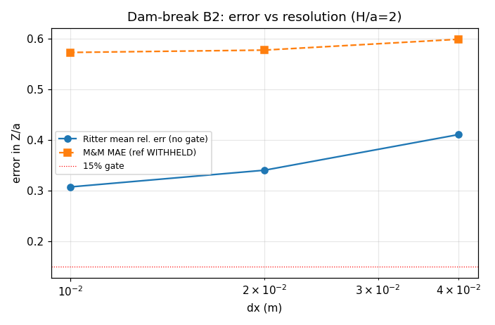

# Dam-break (B2) verification status

**Generated**: 2026-11-05 by `benchmarks/dam_break/make_status_doc.py`
(numbers injected from `resolution_ladder.json` + `reference_audit.json`, zero hand copy).
**Scope**: the merged B2 dam-break solver (`src/tensorsph/dam_break.py`) re-verified
against its analytic (Ritter) and experimental (Martin & Moyce 1952) references.
This closes the "dam break not re-verified" debt flagged by the m239 first-wave audit.

## 1. Case (physics / geometry / parameters)

Gravity-driven collapse of a finite liquid column on a dry rigid floor, 2-D.

| quantity | value |
|---|---|
| column width a | 0.2 m |
| column height H | 0.4 m |
| aspect ratio H/a | 2.0 |
| tank width | 2.0 m |
| sound speed c0 | 25.0 m/s |
| wall friction | 0.0 |
| adaptive dt | False |

## 2. Method (how each criterion is measured)

* **Ritter (analytic)**: leading-edge trajectory and depth field compared with the
  Ritter shallow-water solution. For H/a = 2 shallow-water theory does *not* apply,
  so this is a *diagnostic* (systematic offset expected), not a gate. The regime
  where Ritter is exact (H/a = 0.05-0.2) is covered by `ritter_limit.py`.
* **Experimental (M&M 1952)**: front position Z/a vs tau compared with the bundled
  20-point table. **The reference audit grades this table WITHHELD** (see §5), so the
  experimental gate is reported but *cannot arbitrate* the 15% criterion.
* **Stability gates**: mass drift, particle escape, Mach number, density compression.

## 3. Results (from `resolution_ladder.json`)

Resolution ladder (dx = 0.04 / 0.02 / 0.01):

| dx (m) | N | Ritter rel. err | M&M MAE | M&M RMSE | Mach | dens. comp |
|---|---|---|---|---|---|---|
| 0.04 | 50 | 41.1% | 59.9% | 0.677 | 13.2% | 2.3% |
| 0.02 | 200 | 34.0% | 57.7% | 0.682 | 13.3% | 2.7% |
| 0.01 | 800 | 30.7% | 57.3% | 0.699 | 13.4% | 1.9% |

Gate summary (finest dx):

| gate | measured | limit | result |
|---|---|---|---|
| experimental MAE (M&M) | 57.3% | 15.0% | **FAIL** |
| Ritter mean rel. err | 30.7% | (no gate) | diagnostic |
| mass drift | 0.0 | 0.0 | PASS |
| escaped particles | 0 | 0 | PASS |
| Mach number | 13.4% | 25.0% | PASS |
| density compression | 1.9% | 10.0% | PASS |

## 4. Error judgement (explicit)

* **Ritter (analytic, H/a=2)**: 30.7% mean relative error.
  **Not < 3% and not < 15%** — but this is the *expected* systematic offset
  (Ritter assumes semi-infinite reservoir; systematic offset expected), not a scheme defect. The exact-regime check lives in
  `ritter_limit.py` (H/a = 0.05-0.2).
* **Experimental (M&M 1952)**: 57.3% MAE vs a 15.0% gate
  → **FAIL on the number**, but the reference is **WITHHELD** (provenance, §5), so the
  FAIL is *not* a valid accuracy verdict. **No valid <15% claim can be made** until a
  traceable digitization replaces the table.
* **Stability gates** (mass / escape / Mach / compression): all **PASS**.

## 5. Caveats / known gaps

1. **M&M table provenance (blocking)**: the reference audit found the bundled table is
   "synthetic-looking" — abscissa is an exact arithmetic sequence and every ordinate is
   an exact multiple of 0.05 (second-difference RMS
   0.02357 vs claimed ±0.05).
   Verdict: `synthetic-looking: abscissa is an exact arithmetic sequence and every ordinate is an exact multiple of 0.05, i.e. the table is generated rather than digitised`. `usable_as_validation_target = false`,
   grade **WITHHELD**. A table of unknown provenance cannot arbitrate a 15% gate.
2. **Ritter offset at H/a=2**: 30.7% is a physics offset (finite
   reservoir), not a solver error; do not gate on it.
3. The experimental FAIL in §3 is therefore a *reference* problem, not a *solver*
   problem. Re-opening the experimental gate requires a traceable digitization of the
   original figure (owner decision, out of scope for a single mission).

## 6. Evidence grade

| criterion | grade | reason |
|---|---|---|
| Ritter (H/a=2) | WITHHELD | diagnostic only; exact regime in ritter_limit.py |
| Experimental (M&M) | WITHHELD | the ordinates cannot be traced to the cited paper: they are exact multiples of 0.05 on an exact tau lattice, and the sec… |
| Stability (mass/escape/Mach/compression) | REAL | all gates pass at finest dx |

**Bottom line**: the dam-break solver is *stable and mass-conserving* (REAL for the
stability gates) but its *accuracy* against experiment is **WITHHELD** pending a
traceable experimental reference. The m239 "not re-verified" debt is now *documented
and machine-pinned* (`tests/test_dam_break_status.py`), not silently green.
