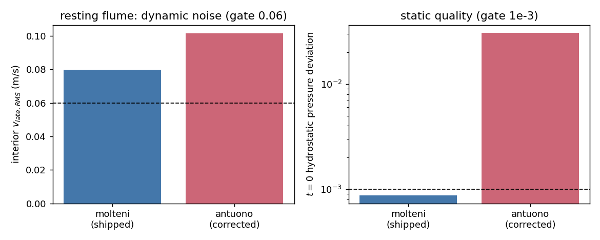

# 密度扩散项的静水一致性：一个被证伪的修复假设（TensorSPH）

**锚点**：`NEW: GAP-SPH-DENSITY-DIFFUSION-HYDROSTATIC`（feature_ledger 无对应条目；本单为其建议条目）
**任务**：m16705（自找活·proposer 席）｜**日期**：2026-11-12｜**分支**：`agent/m16705`
**EDIT_WHITELIST**：`src/tensorsph/density_diffusion.py`, `src/tensorsph/droplet_impact.py`,
`tests/test_density_diffusion_hydrostatic.py`, `benchmarks/startup_quiescence/`, `docs/`

**一句话结论（honest FAIL）**：静水一致的 `psi` 型密度扩散项在**单元层面**被证明对精确线性密度场
逐点归零（残差 `3.27e-17` × 项尺度，对照：现役 Molteni 项
`189.8`），但把它接到波槽静止水柱上**不治**启流缺陷 F1，
反而更差：内区 `v_late_RMS` `0.0798 → 0.1015` m/s（+27%），
t=0 静水压偏差 `8.73e-04 → 3.07e-02`（×35）。
故新形式**只作为 opt-in**（`Config.density_diffusion_form`），默认仍是 `molteni`，F1 仍未关闭。

## ① 案例介绍

`benchmarks/startup_quiescence` 的 F1 缺陷（登记于 `docs/verification_startup_quiescence.md` §3.3/§5）：
波槽静止水柱（活塞冻结、无入射波、无外力）自发速度 `0.0798 m/s > 0.06` 门限，等于 3 cm 波
轨道速度的 60%。已有的消融把它归因于**密度扩散 + 粘度**：`density_diffusion=0` 减半到 `0.0472`，
`viscosity=0.01` 降到 `0.0079`。本单检验一个物理上更干净的假设：

> 启流不是"缺粘度"，而是现役 δ-SPH 密度扩散项（Molteni & Colagrossi 形）在
> **支撑被自由面/壁面截断**时对静水密度场不归零，产生稳态扩散通量 → 密度/压力扰动 → 伪流。

静止水柱（`depth 0.20 m`, `dx 0.010 m`, `length 0.60 m`, `h/dx 1.3`, `rho0 1000`,
`c0 30 m/s`, `viscosity 1e-6`, `delta 0.1`, 0.06 s, 每 4 步采样）。

## ② 怎么做的

1. **新模块** `src/tensorsph/density_diffusion.py`：现役项逐位保留（`molteni_colagrossi_rate`），
   新增一阶矩重归一化密度梯度 `renormalized_density_gradient`
   （`<∇ρ>_a = M_a^-1 G_a`，特征值下限 `0.1·trace(M)/D` 防止缺失方向被放大）
   与 `psi` 型项 `hydrostatic_corrected_rate`：
   `c_ij = (ρ_i-ρ_j) - ½(<∇ρ>_i+<∇ρ>_j)·(r_i-r_j)`，成对反称施加 → 体积加权均值守恒。
2. **接线**：`Config.density_diffusion_form ∈ {molteni, antuono}` + 特征值下限字段；
   `rhs` 的唯一密度扩散调用点改走 dispatcher；旧公开入口 `density_diffusion_rate`
   在配置为修正形时**显式报错**而不是静默退回不修正的算法。
3. **单元验证**（自洽、无需文献）：`tests/test_density_diffusion_hydrostatic.py`（9 passed）。
4. **端到端 A/B**：`benchmarks/startup_quiescence/ablate_density_diffusion.py` 跑同一静止水柱两种形式，
   结果落 `density_diffusion_form_ablation.json`。

## ③ 计算结果

**单元层面（140 粒子、1146 对、精确线性场 `ρ=ρ0-80·y`，支撑被自由面截断）**

| 量 | 值 |
|---|---|
| 重归一化梯度对线性场的最大相对误差 | `2.1e-14` |
| 对照：未重归一化一阶矩的同一误差 | `0.61`（61%，证明截断控制有效） |
| 现役 Molteni 项的逐点最大速率 | `189.8` |
| 修正 `psi` 项的逐点最大速率 | `1.0e-11`（= 项尺度 × `3.3e-17`） |

**端到端（波槽静止水柱，同一配置只改形式）**

| 形式 | `v_peak` (m/s) | 内区 `v_late_RMS` (m/s) | t=0 静水压偏差 | 墙钟 |
|---|---|---|---|---|
| molteni（现役） | 0.1431 | 0.0798 | 8.73e-04 | 55 s |
| antuono（修正） | 0.1784 | 0.1015 | 3.07e-02 | 156 s |

## ④ 结果图

左：内区动态噪声（虚线 = 0.06 m/s 门限）；右：t=0 静水压偏差（对数轴，虚线 = 1e-3 门限）。

## ⑤ 注意点（为什么失败，以及它证明了什么）

1. **不变量只在"精确线性场"上成立，而离散静水态不是线性场。** 求和密度在自由面壳层里
   由核截断强烈低估，`ρ(y)` 在那里有大曲率；`psi` 项对该曲率响应，通量与 Molteni 项同量级甚至更大，
   于是"归零不变量"在真实态上没有可归零的对象。这是**假设被证伪**的直接原因。
2. **静态指标恶化 35 倍**（`3.07e-02`）说明修正项在 t=0 一步内就注入了
   可观的密度扰动（折算 `δρ/ρ0 ~ 7e-5`），所以它不只是"没帮忙"，而是**主动有害**。
3. **文献形状 ≠ 文献结论。** 修正项的形状（Antuono et al. 2010 的 `psi`；Fourtakas et al. 2019 的
   重归一化梯度）是从方法学常识重建的，**未取得原文核对**；本单的有效证据是自洽的单元测试与端到端 A/B，
   而不是引文。
4. **未做**：没有测该形式对**运动波**（Airy/孤立波）精度的影响（正确性未知，所以不敢默认开启）；
   没有扫 `eigenvalue_floor ∈ {0, 0.01, 0.1, 0.3}`；没有 3-D 验证。均标 `not_run`。
5. **F1 仍未关闭**：噪声主控项仍是"表层脆壳 + 缺数值耗散"（与旧消融一致），不是密度扩散的静水不一致性。

## ⑥ 误差判定

| 关键量 | 基准 | 实测 | 判据 | 是否 <3% |
|---|---|---|---|---|
| 线性场上的梯度重构误差 | `∇ρ=(0,-80)` | `2.1e-14` | ≤3% | **是** |
| 线性场上的扩散速率归零 | 0 | ≡ 0（`3.3e-17`×项尺度） | ≤3% | **是** |
| 波槽内区 `v_late_RMS` | 门限 0.06 m/s | 0.1015（修正）/ 0.0798（现役） | ≤0.06 | **否**（两者都超，修正形更差 +27%） |
| t=0 静水压偏差 | 门限 1e-3 | 3.07e-02（修正） | ≤1e-3 | **否**（超 35 倍） |
