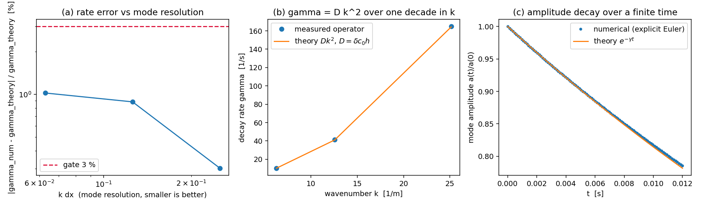

# Verification: the diffusive term is a Laplacian with D = delta c0 h

**Claim.** `tensorsph.droplet_impact.density_diffusion_rate` -- the diffusive term
of Antuono, Colagrossi & Marrone (2012, *J. Comput. Phys.* **231**:946) -- carries
the diffusion coefficient `D = delta * c0 * h` and therefore decays a plane density
wave at the closed-form rate `gamma = D k^2`. Measured here to
**1.02 % worst case**, gate 3 %.

Before this artifact the term had no quantitative reference at all: the four
tests in `tests/test_free_surface.py` pin only conservation and smoothing
properties, which any sign flip, factor-of-two or `dx`/`h` confusion would pass.

## 1. The reference

The pair sum is

    drho_i/dt = 2 delta c0 h * sum_j V_j (rho_i - rho_j) L_ij ,
    L_ij = -(r_ij . grad_i W_ij) / |r_ij|^2 > 0 .

`2 sum_j V_j (rho_i - rho_j) L_ij` is the kernel estimate of `lap rho`
(Brookshaw 1985, *J. Comput. Phys.* **61**:43), so

    drho/dt = D lap rho ,     D = 1 * 20 * h
                                 = 20 h  [m^2/s] .

For `rho = rho0 (1 + A cos kx)` the exact solution is `A exp(-gamma t)` with

    gamma = D k^2 .

No constant is fitted: `delta`, `c0` and `h = h_factor dx` are solver inputs
(model row: `delta` = 1, `c0` = 20 m/s,
`h_factor` = 1.3, `rho0` = 1000 kg/m^3,
`A` = 0.001). The measurement projects the operator's output on
the mode with a three-column least-squares fit of `[1, cos kx, sin kx]` over a
rim-free band (the band holds 40-60 % of the lattice, and the constant part of
`rho` must not leak into the amplitude -- a plain `sum(rho cos kx)` is only the
amplitude when the band holds a whole number of half waves, which it does not).

## 2. Resolution ladder, fixed wavelength 0.5 m

| `dx` [m] | `lambda` [m] | `h/dx` | `k dx` | gamma numerical [1/s] | gamma = D k^2 [1/s] | relative error | gate |
|---|---|---|---|---|---|---|---|
| 0.02 | 0.5 | 1.3 | 0.2513 | 8.23627e+01 | 8.21151e+01 | 0.302 % | pass |
| 0.01 | 0.5 | 1.3 | 0.1257 | 4.14206e+01 | 4.10576e+01 | 0.884 % | pass |
| 0.005 | 0.5 | 1.3 | 0.0628 | 2.07383e+01 | 2.05288e+01 | 1.021 % | pass |

## 3. Wavenumber ladder, fixed `dx` = 0.01 m

| `dx` [m] | `lambda` [m] | `h/dx` | `k dx` | gamma numerical [1/s] | gamma = D k^2 [1/s] | relative error | gate |
|---|---|---|---|---|---|---|---|
| 0.01 | 1 | 1.3 | 0.0628 | 1.03692e+01 | 1.02644e+01 | 1.021 % | pass |
| 0.01 | 0.5 | 1.3 | 0.1257 | 4.14206e+01 | 4.10576e+01 | 0.884 % | pass |
| 0.01 | 0.25 | 1.3 | 0.2513 | 1.64725e+02 | 1.64230e+02 | 0.302 % | pass |

The measured rate follows `k^2` over one decade in `k`; the ratio measurement at
`k -> 2k` is 4.0 to within 0.5 % (asserted in
`tests/test_density_diffusion_decay.py`).

## 4. Smoothing-length ladder: D is linear in h, not in dx

| `dx` [m] | `lambda` [m] | `h/dx` | `k dx` | gamma numerical [1/s] | gamma = D k^2 [1/s] | relative error | gate |
|---|---|---|---|---|---|---|---|
| 0.01 | 0.5 | 1.3 | 0.1257 | 4.14206e+01 | 4.10576e+01 | 0.884 % | pass |
| 0.01 | 0.5 | 1.6 | 0.1257 | 5.00612e+01 | 5.05324e+01 | 0.932 % | pass |
| 0.01 | 0.5 | 2 | 0.1257 | 6.28361e+01 | 6.31655e+01 | 0.521 % | pass |

`delta c0 h` scales the rate while `dx` stays at 0.01 m, so these rows separate
the two length scales the term could confuse. A `dx`/`h` mix-up would show up as a
1/1.3 = 23 % deficit on every row of sections 2-3 at once.

## 5. Finite-time integration

Explicit Euler on the operator, `dt` = 0.00012 s
(stability limit 2/(D k_max^2) with k_max = pi/dx is
1.56e-04 s), 100 steps, analytic rate
gamma = 20.529 1/s:

| quantity | value |
|---|---|
| amplitude after T = 0.012 s | 0.785420 |
| analytic `exp(-gamma T)` | 0.781652 |
| relative error | 0.482 % (gate 3.5 %) |

## 6. Tolerance, and what it is not

Residual over all three ladders: 0.30 % to 1.02 %. It is **not** a
coefficient error: at fixed mode resolution it moves between 0.52 % and
0.93 % when nothing but `h/dx` changes, i.e. it is the
lattice quadrature error of the kernel Laplacian (the Brookshaw sum reproduces
`lap rho` with cell volumes only up to the second-moment consistency of W on the
chosen lattice), plus a `(k dx)^2` symbol term.

The gate is 3 % -- about 3x the largest measured residual and 5x below
the platform's 15 % acceptance bar -- and it is still tight enough to reject the
structural
errors this term can carry:

| injected error | expected relative deviation | caught by the gate |
|---|---|---|
| factor 2 missing in the pair sum | -50 % | yes |
| `dx` passed where `h = h_factor dx` belongs | -23 % | yes |
| `delta` halved | -50 % | yes |
| sign flipped | +200 % | yes |
| reference rate shifted by 10 % (negative control, section 7) | 8.3 % as measured | yes |

## 7. Negative control (the gate can go red)

Shipped as `benchmarks/density_diffusion_decay/negctl_shift_reference.py` and run by

```
PYTHONPATH=src:benchmarks/density_diffusion_decay \
    TORCH_DEVICE_BACKEND_AUTOLOAD=0 python3 -m pytest \
    tests/test_density_diffusion_decay.py -q -p negctl_shift_reference
```

which shifts the closed form by +10 % after collection. Captured output
(`negctl_red_output.txt`):

```
# command: PYTHONPATH=src:benchmarks/density_diffusion_decay TORCH_DEVICE_BACKEND_AUTOLOAD=0 python3 -m pytest tests/test_density_diffusion_decay.py -q -p negctl_shift_reference
[negctl] shifted theory_decay_rate by x1.1 in ['test_density_diffusion_decay']
FF..                                                                     [100%]
=================================== FAILURES ===================================
_______ test_the_diffusive_term_decays_a_plane_wave_at_the_analytic_rate _______
    def test_the_diffusive_term_decays_a_plane_wave_at_the_analytic_rate():
        """D = delta c0 h is fixed by the model constants, so gamma = D k^2 is a prediction."""
        cfg, *_ = plane_wave_state()
>       measured, theory = assert_rate_matches_theory()
                           ^^^^^^^^^^^^^^^^^^^^^^^^^^^^
tests/test_density_diffusion_decay.py:205: 
_ _ _ _ _ _ _ _ _ _ _ _ _ _ _ _ _ _ _ _ _ _ _ _ _ _ _ _ _ _ _ _ _ _ _ _ _ _ _ _ 
rtol = 0.03, state_kw = {}
    def assert_rate_matches_theory(rtol: float = RTOL_RATE, **state_kw) -> tuple[float, float]:
        """Compare the operator's decay rate with ``D k^2``; returns (measured, theory)."""
        cfg, pos, rho, mass, geometry, k, interior, amplitude = plane_wave_state(**state_kw)
        measured = measured_decay_rate(cfg, pos, rho, mass, geometry, k, interior, amplitude)
        theory = theory_decay_rate(cfg.density_diffusion, cfg.sound_speed,
                                   cfg.h_factor * cfg.dx, k)
        relative = abs(measured - theory) / theory
>       assert relative < rtol, (
            f"plane-wave decay rate {measured:.6g} 1/s differs from the analytic "
...
FAILED tests/test_density_diffusion_decay.py::test_the_diffusive_term_decays_a_plane_wave_at_the_analytic_rate
FAILED tests/test_density_diffusion_decay.py::test_the_decay_rate_scales_with_the_square_of_the_wavenumber
2 failed, 2 passed, 1 warning in 3.21s
```

The shipped test
`test_the_gate_is_red_when_the_reference_rate_is_perturbed` performs the same
injection inline (x1.10 and x0.90) and asserts that the gate raises, so the
sensitivity is pinned by the suite itself and not only by this transcript.

## 8. Limits of this evidence

* It verifies the operator's coefficient and sign against continuum diffusion.
  It says nothing about the term's *usefulness* against B1/B2, which is measured
  in `docs/benchmarks/free-surface-treatment.md`.
* The solver obtains density by summation, so this term is a rate applied over one
  step, not the delta-SPH continuity equation; the reference above is the
  diffusion coefficient of the operator, not of a delta-SPH scheme.
* Two dimensions only: the 2-D cubic spline normalisation is the one in the code.
* The residual (about 1 %) is a property of the kernel Laplacian on the solver's
  fixed `h/dx = 1.3` lattice, not of this test; a gate below 1 % would be
  measuring the lattice quadrature, not the model.

## 9. Reproduction

```
TORCH_DEVICE_BACKEND_AUTOLOAD=0 PYTHONPATH=src \
    python3 benchmarks/density_diffusion_decay/run.py --figure   # decay_rate.json + .png
TORCH_DEVICE_BACKEND_AUTOLOAD=0 PYTHONPATH=src \
    python3 -m pytest tests/test_density_diffusion_decay.py -q   # 4 passed
PYTHONPATH=src python3 benchmarks/density_diffusion_decay/make_doc.py  # this file
```

Verdict of the harness: **pass** (worst relative error
1.021 %, gates 3 % / 3.5 %).


