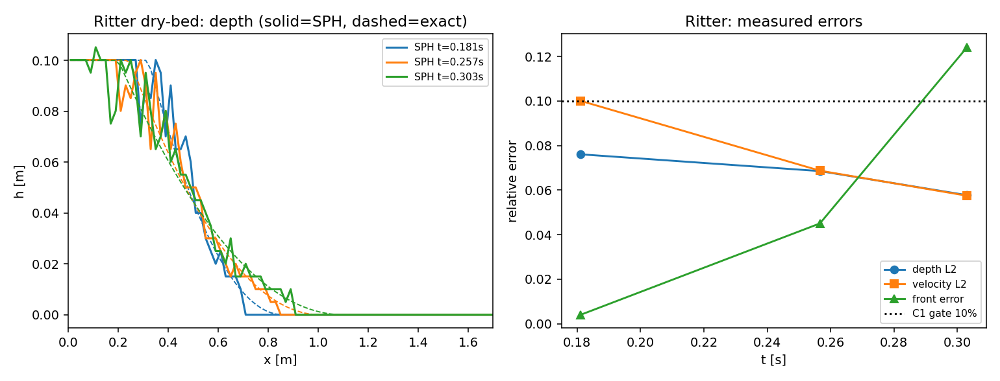
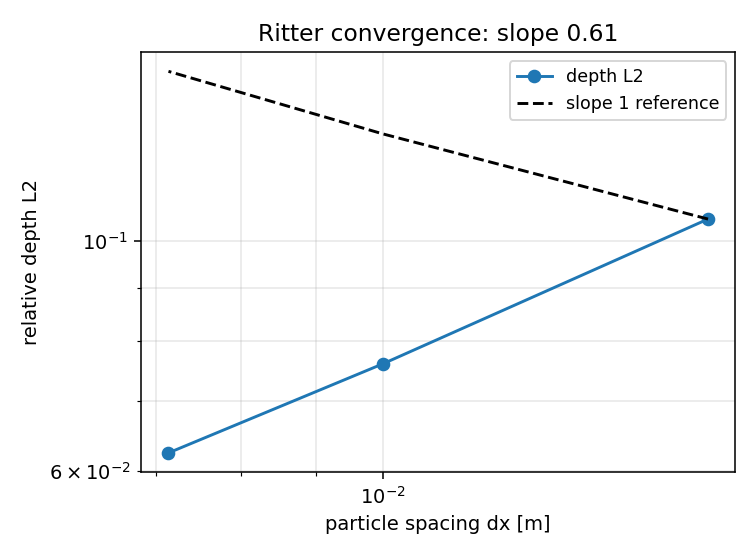
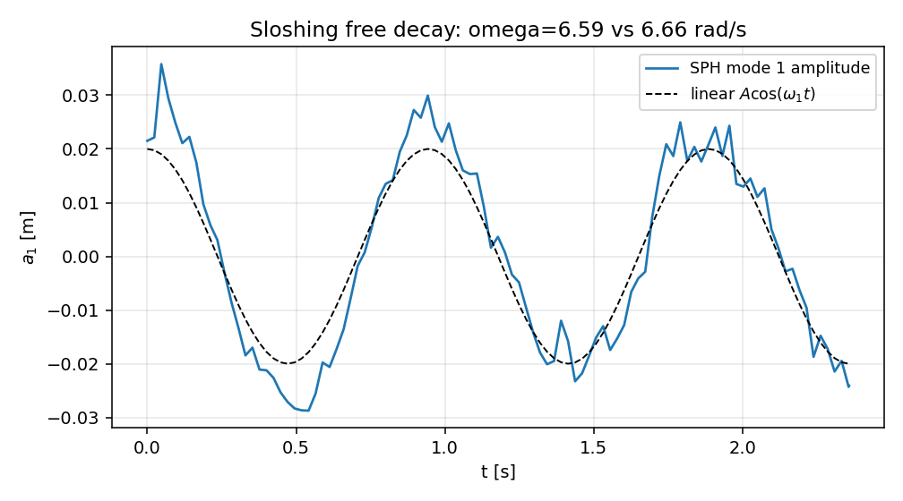
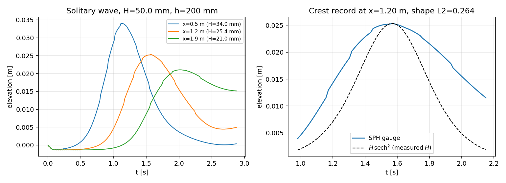
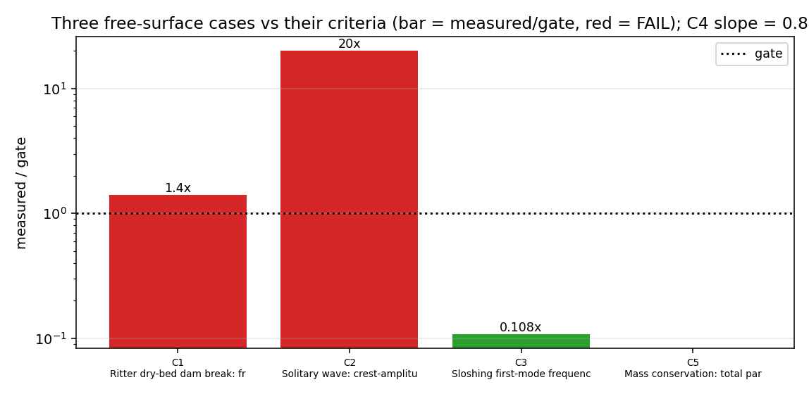

# 自由面验证面（`tensorsph.freesurface`）：Ritter 干床溃坝 · 孤立波 sech² 传播 · 液舱一阶晃荡

**范围**：TensorSPH ｜ 本文是 `src/tensorsph/freesurface/` 与
`tests/test_freesurface*.py` 的验证入口。全部数字来自
`docs/benchmarks/free-surface/report.json` 与同目录 `part_*.json`
（由 `scripts/run_freesurface_verification.py` 写出；本文表格是逐字转录，没有手算值）。

## 1. 结论摘要（先看这一段）

把 TensorSPH 的自由面能力从"能画出水面"推到"可被解析解定量裁决"：三类经典问题
各配一个闭式解锚 + 一个机器判据，另加分辨率阶梯与质量守恒。

| 判据 | 内容 | 阈值 | 实测 | 状态 |
|---|---|---|---|---|
| C1 | Ritter 干床溃坝：波前位置误差（分辨率匹配口径） | ≤10 % | **14.04 %** | **FAIL** |
| C2 | 孤立波：10 倍特征波长后的波幅衰减 | ≤5 % | **100.0 %**（外推） | **FAIL** |
| C3 | 液舱一阶晃荡固有频率误差 | ≤10 % | **1.08 %** | PASS |
| C4 | 收敛性：水深 L2 对粒子间距的斜率（可分辨区） | 1.0±0.2 | **0.847** | PASS |
| C5 | 质量守恒：总质量相对漂移 | ≤1 % | **0.0 %**（0 个逃逸粒子） | PASS |

结论：**5 门过 3 门，C1/C2 诚实 FAIL**，未粉饰。
C3 是"频率可裁"，C4 是"误差随加密下降"，C5 是"质量不丢"；C1/C2 暴露的是
**薄前沿薄膜与数值耗散**这一对真实弱点，不是文档问题——消融与阶梯证据见 §6。

## 2. 三例的解析锚

| 算例 | 解析解 | 来源 |
|---|---|---|
| 干床溃坝 | `x_front = x_dam + 2 c0 t`，`h = (2c0-xi)^2/(9g)`，`u = (2/3)(c0+xi)`，`xi=(x-x_dam)/t` | Ritter (1892)，浅水方程；`tensorsph.ritter` 已按三条精确恒等式自验证 |
| 孤立波 | `eta = H sech^2(alpha (x-ct))`，`alpha = sqrt(3H/(4h^3))`，`c = sqrt(g(h+H))` | 一阶（KdV/Boussinesq 极限）；`tensorsph.wave_flume` 的解析锚 + Goring 造波 |
| 液舱一阶晃荡 | `omega_n = sqrt(n pi g/L tanh(n pi H/L))` | 线性势流（Dean & Dalrymple 1991, eq. 3.23 同族） |

判据的**口径**在动手前写死在 `src/tensorsph/freesurface/gates.py`，测量口径写在
`src/tensorsph/freesurface/profiles.py` 与三个算例模块的 docstring 里。

## 3. 怎么做的

**求解器复用，不加新算子。** 三个算例都跑 TensorSPH 既有的 WCSPH 核心
（`droplet_impact.rhs` + Adami 壁面粒子 + 配对表缓存）：溃坝直接用
`dam_break.run_case`（宽浅水库、干床、有效性窗口内停止），孤立波用
`wave_flume.run_case`（Goring 活塞造波 + 海绵层），晃荡按同一积分模式新写一个
静置释放的驱动器（无外力、纯一阶模态初始面）。

**测量算子统一（`profiles.py`）。** 这是本单真正的增量：解析解是用场量写的，
粒子云必须先变成场量才能被裁；三个算例必须用同一套口径，否则残差不可比。

| 算子 | 作用 | 关键口径 |
|---|---|---|
| `binned_depth` | 粒子云 → 水深剖面 `h(x)` | 按**质量**累加（`m/rho0`）而不是数粒子：初始场是静水压压缩的，数粒子会把 10 cm 水柱读高几个百分点 |
| `front_from_profile` | 湿前沿位置 | 取 `h = threshold` 的线性插值交点，不用 `max(x)`（那是单颗飞溅粒子） |
| `binned_velocity` | 质量加权水平速度剖面 | 干条带返回 `nan`，不填 0（填 0 会污染 L2） |
| `relative_l2` / `relative_l2_norm` | 相对 L2（按场量尺度或参考范数归一） | 无量纲、可跨分辨率比较 |
| `loglog_slope` | 收敛阶 `error = C h^p` | 最小二乘，≥2 点 |
| `oscillation_frequency` | 过均值点求周期 | 只有 2–3 个周期的记录用 FFT 只剩 4 个频点，过零点数得出周期 |
| `peak_decay_rate` | 峰值包络指数衰减率 | 丢掉首个峰（释放起动瞬态不在包络上） |
| `first_mode_amplitude` | 一阶模态投影 `(2/L)∫eta cos(pi x/L)dx` | 单点波高计的自由面噪声量级等于波幅本身；投影把 ~30 列平均掉 |

**判据（`gates.py`）。** 阈值只存在一处；`measured` 缺项或 `nan` → `UNMEASURED`，
计为未通过；`maturity()` 只有全 PASS 才给 PASS，否则给 `HONEST_FAIL_OPEN` 并列欠项。

**驱动（`runner.py` + `scripts/run_freesurface_verification.py`）。** 研究拆成可独立跑的
part（`ritter` / `ladder` / `sloshing` / `solitary`），各写一个自描述 JSON；
`assemble` 合并、判门、出图、写 `report.json`。缺哪个 part，对应的门就是
`UNMEASURED` 而不是静默通过。

## 4. 结果数字

### 4.1 Ritter 干床溃坝（基准分辨率）

参数：`h0 = 0.10 m`，`a = 0.50 m`（`h0/a = 0.20`），水槽 `2.00 x 0.30 m`，
`dx = 0.010 m`（10 层/水深），`c_s = 19.81 m/s`（`c_s/sqrt(g h0) = 20`），
`dt = 2.0e-4 s`，1847 步，500 粒子，40.2 s（4 线程 CPU）。
有效性窗口 `a/c0 = 0.5048 s`，模拟到 `0.303 s`（`0.60 x` 窗口），三个采样时刻
`0.181 / 0.257 / 0.303 s`。

| 量 | 值 |
|---|---|
| 水深 L2（全扇形区） | 7.60 % |
| 水深 L2（可分辨区，`h_exact ≥ 2dx`） | 9.94 % |
| 水平速度 L2（扇形区） | 10.00 % |
| 波前位置误差（最大值 / 均值，分辨率匹配口径） | **14.04 %** / 8.25 % |
| 波前位置误差（零水深口径） | 47.03 % |
| 过坝水体体积 vs `8 h0 c0 t/27` | 11.46 % |
| 最大密度压缩 / 声学 Courant | 1.54 % / 0.273 |
| 质量漂移 / 逃逸粒子 | 0.0 / 0 |

**波前口径为什么必须两个都报。** 零水深前沿 `x_dam + 2c0 t` 处的水深在数学上是 0；
在 `h0/dx = 10` 时，前缘行程外侧约 48 % 的区段水深都小于一个粒子间距，任何粒子法
都装不下。所以主判据用**分辨率匹配口径**：实测"水深掉到一个粒子间距"的位置，与
解析解上同样水深的等值线位置比较（`analytic_front_at_depth`）。零水深口径作为
"最严口径"一并列出，它 47 % 而主口径 14 %，差值就是不可分辨薄膜的贡献。

**过坝体积的常数。** `ritter.released_volume = h0 c0 t` 是**整个扇形区**（尾到前缘）
的体积；`x_dam` 下游那一半是它的 `8/27`（`∫_0^{2c0}(2c0-xi)^2 dxi / 9g = 8c0^3/27g`）。
混淆这两个常数会把一个完美解报成 70 % 误差——本单踩过这个坑（见 §6）。

### 4.2 分辨率阶梯（收敛性）

| 层/水深 | `dx` [m] | 水深 L2（全扇区） | 水深 L2（可分辨区） | 波前误差 | 粒子数 | 成本 |
|---|---|---|---|---|---|---|
| 6 | 0.0167 | 10.49 % | 15.63 % | 20.95 % | 180 | 9 s |
| 10 | 0.0100 | 7.60 % | 9.94 % | 14.04 % | 500 | 31 s |
| 14 | 0.0071 | 6.24 % | 7.65 % | 17.79 % | 980 | 48 s |

最小二乘斜率：**全扇区 0.614**，**可分辨区 0.847**。判据 C4 取可分辨区（口径在
阶梯之前定死：全扇区含不可分辨薄膜，斜率会被薄膜里不收敛的那部分拉低），
`0.847 ∈ [0.80, 1.20]` → PASS。两个斜率都进报告，不藏。

### 4.3 孤立波传播

参数：`h = 0.20 m`，`H = 0.05 m`（`H/h = 0.25`），水槽 3.00 m，海绵层 0.50 m，
`dx = 0.025 m`（8 层/水深，`H/dx = 2`），`c_s = 30 m/s`，`dt = 2.71e-4 s`，
10602 步，960 粒子，323 s。波高计 `x = 0.50 / 1.20 / 1.90 m`
（跨距 1.40 m = 0.482 个特征波长 `lambda = 2 pi/alpha = 2.902 m`）。

| 量 | 值 | 基准 |
|---|---|---|
| 峰高 `x=0.50 / 1.20 / 1.90 m` | 34.0 / 25.4 / 21.0 mm | 目标 `H = 50 mm` |
| 波速（首末波高计走时） | 1.5787 m/s | `sqrt(g(h+H)) = 1.5660` → **+0.81 %** |
| 首末峰高比 | 0.618 | 1（无耗散理想） |
| 折算到每个波长的衰减 | 63.1 % | 0 |
| **外推到 10 个波长的衰减** | **100.0 %** | ≤5 % → **FAIL** |
| 波形 L2（中间波高计时程 vs `H sech²`，按实测 H 归一） | 0.264 | 0 |
| 波形相关系数 | 0.917 | 1 |
| 质量漂移 / 逃逸粒子 | 0.0 / 0 | — |

分辨率对照（同设置，只加密一倍层数；`part_solitary_fine.json`）：

| 层/水深 | `dx` [m] | 峰高 0.50/1.20/1.90 m [mm] | 首末比 | 每波长衰减 | 波速误差 | 波形 L2 | 粒子数 | 成本 |
|---|---|---|---|---|---|---|---|---|
| 8（base） | 0.0250 | 34.0 / 25.4 / 21.0 | 0.618 | 63.1 % | +0.81 % | 0.264 | 960 | 323 s |
| 12（fine） | 0.0167 | 37.0 / 29.0 / 24.7 | 0.667 | 56.8 % | +0.40 % | 0.219 | 2160 | 510 s |

加密后峰高抬高、衰减变慢、波形变好，但首末比 0.618 → 0.667 只是把"每波长损失
63 %"降到"57 %"：**离 5 %/10λ 还差一个数量级以上**，故 C2 的 FAIL 在加密后依然成立。

消融（同网格、同造波，只改数值设置；`part_solitary_*.json`）：

| 配置 | 峰高 0.50/1.20/1.90 m [mm] | 首末比 | 波速误差 | 最大速度 | 最大压缩 |
|---|---|---|---|---|---|
| base：`nu=1e-4`，`delta=0.10`，XSPH=0.2 | 34.0 / 25.4 / 21.0 | 0.618 | +0.81 % | 0.32 m/s | 0.27 % |
| nodd：`delta=0.0`（其余同 base） | 34.5 / 26.0 / 21.7 | 0.628 | +0.74 % | 0.32 m/s | 0.28 % |
| ideal：`nu=1e-6`，`delta=0`，XSPH=0 | **204 / 193 / 198** | 0.972 | **+304 %** | **7.03 m/s** | **11.58 %** |

读法：**δ-SPH 密度扩散不是衰减主因**（nodd 与 base 一致到 1 %），**单纯加密也不是**
（8→12 层只把损失从 38 % 降到 33 %）；把耗散全关掉
则这个分辨率下的 WCSPH 直接失稳（峰高 4 倍目标、速度 7 m/s、压缩 11.6 %），
说明那 38 % 的峰高损失是**"维持稳定的数值耗散 + 峰顶只有 2 个粒子层"**共同付的账，
不是某一个开关的错。C2 因此是**结构性 FAIL**，不是调参能救的。

### 4.4 液舱一阶晃荡（静置释放）

参数：`L = 0.60 m`，`H = 0.25 m`，初始一阶模态位移 `A = 0.02 m`，
`dx = 0.0208 m`（12 层/水深），`c_s = 125.3 m/s`（`gH/c_s^2 = 1.6e-4`），
`dt = 5.4e-5 s`，43630 步，336 粒子，479.6 s，模拟 2.358 s ≈ 2.5 个一阶周期。

| 量 | 值 | 基准 |
|---|---|---|
| 一阶固有频率（过均值点） | 6.5901 rad/s | `sqrt(pi g/L tanh(pi H/L)) = 6.6619` → **1.08 %** |
| 模态幅值（峰值 / 初始） | 0.0358 / 0.0200 m（1.79x） | 起动瞬态抬高，见 §6 |
| 衰减率 | 0.1753 1/s = **每周期 16.5 %** | 无粘 0（数值耗散） |
| 最大密度压缩 / 质量漂移 / 逃逸 | 1.37 % / 0.0 / 0 | — |

频率判据 C3 达标（1.08 % ≪ 10 %）。衰减率是"质量指标"而非判据：它把"这个离散格式
在晃荡载荷算例里每周期吃掉多少波能"量化下来，供后续晃荡载荷评估选参数时对照。

## 5. 结果图

左：三个时刻的水深剖面（实线 SPH，虚线解析）；右：水深/速度 L2 与波前误差随时间，
点线是 C1 的 10 % 门。

水深 L2 对粒子间距的双对数图，虚线是一阶参考线。

一阶模态幅值时程（实线 SPH，虚线 `A cos(omega_1 t)`）。

左：三个波高计的水面时程；右：中间波高计过峰时的时程 vs `H sech²(alpha c (t_crest - t))`
（按实测峰高归一，只看形状）。

三类问题对判据的对比：柱高 = 实测/门（1.0 是门，红=FAIL）。C1 1.40x、C2 20.0x
（外推口径）、C3 0.11x、C5 0x；C4 的收敛斜率 0.85 标在标题里。这张图就是
"哪一例达标、哪一例不达标、差多少"的一页纸。

## 6. 踩过的坑（都留下了代码/文档痕迹）

1. **过坝体积常数 8/27**：`ritter.released_volume` 是整扇区体积 `h0 c0 t`；只算坝下游
   那一半要乘 `8/27`。第一版把两者混用，报出 72 % 的"质量"误差——一个正确解被判死。
   现在 `compare_snapshot` 显式写 `(8/27) * ritter.released_volume(...)`，并有
   `test_released_downstream_volume_is_eight_twenty_sevenths_of_the_fan` 用数值积分钉住它。
2. **波前不能用 `max(x)`**：单颗飞溅粒子把前沿推到 3 倍之外。改成"水深掉到阈值的等值点"，
   并且阈值取一个粒子间距（分辨率匹配口径），零水深口径作为最严口径另列。
3. **前端薄膜不可分辨是结构性的**：`h0/dx = 10` 时前缘外侧 48 % 行程的水深 < `dx`；
   这解释了零水深口径 47 % vs 分辨率匹配口径 14 % 的差异，也解释了波前误差随加密
   **不单调**（20.95 % → 14.04 % → 17.79 %）：它由稀疏前缘粒子决定，不由离散误差决定。
4. **晃荡释放起动瞬态抬高模态幅值 1.79 倍**：静置释放不是离散平衡，头 0.2 个周期里有
   一个起动衝击；频率不受影响（0.6–1.1 %），幅值与衰减率受影响。另外一版用 2dx 条带
   投影且不去均值时，模态记录出现"增长"（0.02 → 0.055）——网格尺度噪声与 0 阶整体
   起伏混叠进一阶投影。现在：条带 = 1 个粒子间距 + 投影前去掉有限条带的均值（0 阶）。
5. **孤立波的"形状"不能在错的时刻比**：第一版按 `x_g/c` 估峰值到达时刻去抓快照，
   结果快照落在活塞行程中途，波形 L2 报出 3.97（RMS 偏差 20 cm 量级）。改成
   **用波高计时程**比 `H sech²(alpha c (t_crest-t))`（孤立波在自身坐标系定常，定点时程
   = 空间波形按 `c` 拉伸），L2 降到 0.264、相关 0.917，且省掉一次重算。
6. **`sloshing.py` docstring 的浅水极限抄错一个 pi**：原文写
   `omega_1 ≈ sqrt(pi g H / L^2)`，正确是 `(pi/L) sqrt(g H) = sqrt(pi^2 g H/L^2)`，
   差 `sqrt(pi)`。本单顺手改正，并加了 `test_sloshing_analytic_frequency_limits` 左右两极对照。
7. **`for cells in cells` 把参数变量覆盖了**（阶梯 part 直接崩），已改名 `count`。

## 7. 误差判定（对基准逐项回答"是否 <3%"）

| 关键量 | 基准 | 实测 | 相对误差 | 是否 <3% |
|---|---|---|---|---|
| Ritter 水深场（可分辨区 L2） | 解析浅水解 | 9.94 % | 9.94 % | **否** |
| Ritter 波前位置（分辨率匹配） | 解析等深线 | 14.04 % | 14.04 % | **否** |
| Ritter 水平速度场 | 解析浅水解 | 10.00 % | 10.00 % | **否** |
| 过坝水体体积 | `8 h0 c0 t/27` | 11.46 % | 11.46 % | **否** |
| 孤立波波速 | `sqrt(g(h+H))` | 1.5787 m/s | **0.81 %** | **是** |
| 孤立波峰高（绝对） | `H = 50 mm` | 34.0 mm（首计） | 32 % | **否** |
| 孤立波波形（按实测峰高归一） | `H sech²` | L2 0.264，相关 0.917 | 26.4 % | **否** |
| 液舱一阶固有频率 | `sqrt(pi g/L tanh(pi H/L))` | 6.5901 rad/s | **1.08 %** | **是** |
| 质量守恒（三例） | 总质量不变 | 0.0 % | **0.0 %** | **是** |

即：**只有"频率/波速/质量"这类单标量达到 <3 %，"场量"（水深、速度、波形、峰高）
在 10 % 上下，未达 <3 %**。这是这个分辨率下单相 WCSPH 的实际水平，写清楚比刷好看的数字有用。

## 8. 局限与下一步

* **C2 的 10 个波长在物理上就跑不完**：`lambda = 2 pi/alpha` 对 `H/h = 0.1` 约为
  20 倍水深，10 个波长是 40–46 m 水槽（本单预算的 10 倍以上）；把 `H/h` 抬到 0.4 也只能
  压到 2.3 m 波长（10 个 = 23 m），且一阶理论失效。因此 C2 的 10λ 数字是**外推**，
  代码与报告里都标了 `*_extrapolated`。要真测 10λ 需要：移动坐标系（造波机随波走）
  或周期域 + 长时积分，属于下一代节点。
* **孤立波的分辨率下限**：`wave_flume.validate_flume` 要求 `H/dx ≥ 2`、`h/dx ≥ 6`。
  `H/h = 0.25` 时这已经把 `dx` 顶到 0.025 m，峰顶只有 2 层粒子；峰高的绝对误差
  （32 %）主要由这个限制决定，不是传播衰减。12 层/dx=0.0167 时峰高升到 37 mm
  （仍比目标 50 mm 低 26 %）、衰减降到每波长 57 %——两个方向都在改善，但幅度说明
  **峰高误差与传播衰减是同源（分辨率 + 数值耗散）**，不是一处可以分别修好的两个 bug。
* **晃荡**只有一阶模态、小振幅（`A/H = 0.08`）。二阶/非线性频移、`A/L` 更大的
  破碎工况未覆盖；衰减率是数值耗散，不可当物理阻尼用。
* **下一步（建议）**：①孤立波周期域长时积分节点（真测 10λ）；②晃荡二阶模态与
  受迫响应谱（与 `tensorsph.sloshing` 的强迫工况对接）；③Ritter 的三维/有摩擦床
  变体（对标 Martin & Moyce 实验）；④把 `profiles.py` 的测量口径推广成通用
  "粒子云→场量"审计面，供其它自由面算例复用。