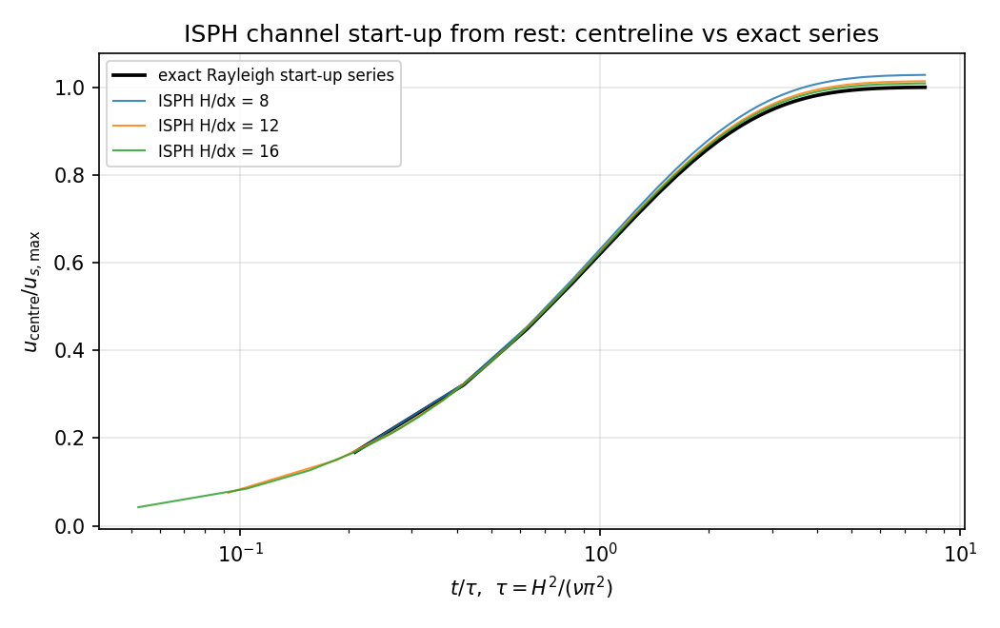
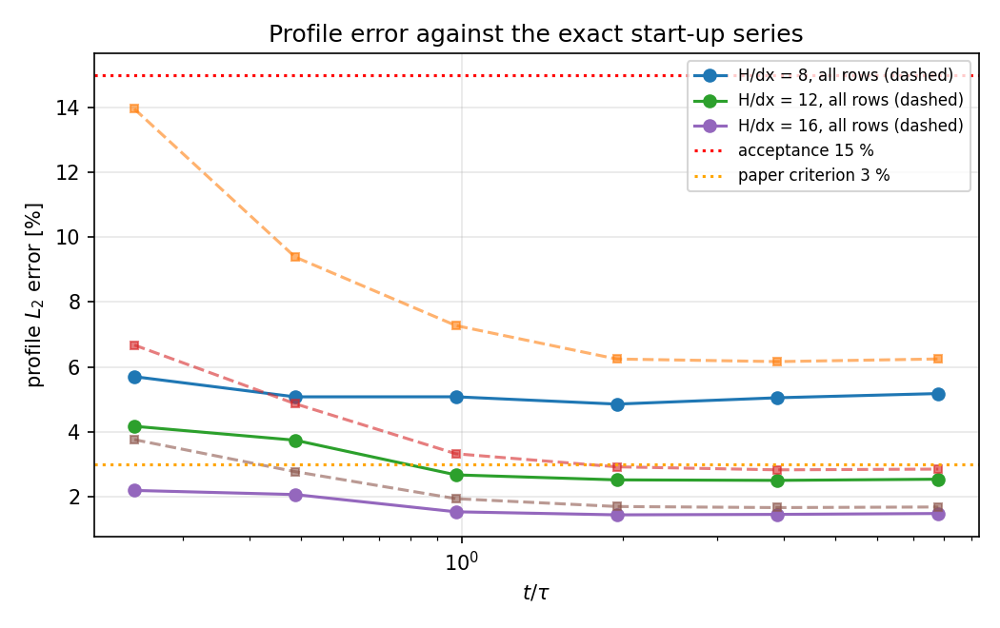
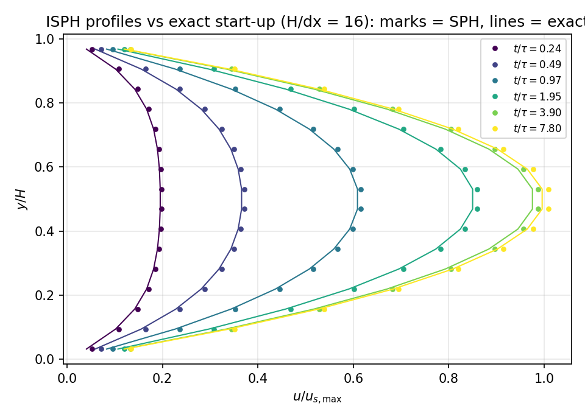

# Transient verification of the ISPH channel against the exact start-up series

Case id: `isph_channel_startup`.  Module under test: `tensorsph.isph_channel`
(`GAP-SPH-ISPH-PROJECTION`).  Driver: `benchmarks/isph_channel_startup/run.py`.
Payload of record: `runs/isph_channel_startup/m16839/results.json`.

## 1. What this closes

All shipped gates of the projection solver are steady-state gates: the
end-of-run profile against the Hagen-Poiseuille parabola, the wall shear against
an x-momentum budget, and the divergence against its pre-projection value.  A
consistent discretisation reaches the steady parabola regardless of how badly it
integrates the path to it, so those gates cannot see a splitting error.  This
benchmark pins the **path**: the channel is started from rest under a constant
body force and every reading is compared to the exact solution of that
initial-value problem.

## 2. Case and exact reference

Uniform body force `g = 9.81 m/s^2`, kinematic viscosity
`nu = 0.01 m^2/s`, channel height `H = 0.1 m`,
periodic in `x` over `12 dx`, no-slip at `y = 0, H`, fluid at rest
at `t = 0`.  The body force is switched on at `t = 0+`.

With `u_s(y) = g y (H - y) / (2 nu)` the solution is the classical series
(`analytic_startup_profile` in the module)

    u(y,t) = u_s(y) - (4 g H^2 / (nu pi^3)) sum_{n odd} sin(n pi y / H)
                       exp(-nu n^2 pi^2 t / H^2) / n^3 ,

which starts from rest, satisfies no-slip identically and relaxes to `u_s` on the
slowest diffusive time `tau = H^2 / (nu pi^2) = 0.10132 s`.
`u_s,max = g H^2 / (8 nu) = 1.226250 m/s`.

The reference is analytic, so the comparison carries no experimental scatter and
no digitisation error.  The series itself is guarded by
`tests/test_isph_channel_startup.py`: rest at `t = 0`, no-slip walls, monotone
acceleration, decay to the parabola, truncation convergence, and an independent
finite-difference residual of `u_t - nu u_yy - g`.

## 3. Method

* Time ladder in units of the diffusive time: `t/tau in
  {0.25, 0.5, 1, 2, 4, 8}`.  Each run
  averages its final profile over the last 5 % of its own `t_end`, and the
  comparison is made at the centre of that window.
* Resolution ladder: `H/dx in {8, 12, 16}`,
  `12` columns of particles.
* Metrics: interior profile `L_2` error (`0.1 H <= y <= 0.9 H`, i.e. the rows
  that do not touch a no-slip wall), all-row `L_2` error, and the centreline
  error.  A separate long run per resolution records the centreline history at
  every trace sample (row-averaged over the two middle rows, so no single
  particle decides the reading).
* Temporal vs spatial separation: at the finest resolution `dt` is refined by
  `4x` (via `viscous_safety`, which is the active limit) and the interior error
  at `t = tau` is compared.  A time-splitting error shrinks under this
  refinement, a spatial error does not; the reading separates the two, it does
  not assume the answer.

## 4. Results

### 4.1 Profile error, resolution x time ladder

| H/dx | t/tau | steps | interior L2 [%] | all-rows L2 [%] | centre [%] | fluid particles | wall clock [s] |
|---|---|---|---|---|---|---|---|
| 8 | 0.24 | 4 | 5.70 | 13.96 | +2.98 | 96 | 0.15 |
| 8 | 0.49 | 8 | 5.08 | 9.39 | +2.83 | 96 | 0.15 |
| 8 | 0.97 | 15 | 5.08 | 7.28 | +3.77 | 96 | 0.30 |
| 8 | 1.95 | 31 | 4.85 | 6.24 | +3.97 | 96 | 0.50 |
| 8 | 3.90 | 71 | 5.05 | 6.16 | +4.30 | 96 | 1.30 |
| 8 | 7.80 | 157 | 5.18 | 6.24 | +4.45 | 96 | 3.22 |
| 12 | 0.24 | 9 | 4.17 | 6.67 | +2.20 | 144 | 0.18 |
| 12 | 0.49 | 17 | 3.74 | 4.86 | +2.54 | 144 | 0.33 |
| 12 | 0.97 | 33 | 2.67 | 3.32 | +1.87 | 144 | 0.64 |
| 12 | 1.95 | 65 | 2.51 | 2.92 | +1.97 | 144 | 1.32 |
| 12 | 3.90 | 130 | 2.50 | 2.82 | +2.04 | 144 | 2.60 |
| 12 | 7.80 | 259 | 2.53 | 2.85 | +2.08 | 144 | 7.80 |
| 16 | 0.24 | 15 | 2.19 | 3.76 | +1.33 | 192 | 0.46 |
| 16 | 0.49 | 29 | 2.06 | 2.77 | +1.53 | 192 | 1.01 |
| 16 | 0.97 | 58 | 1.53 | 1.93 | +1.16 | 192 | 2.01 |
| 16 | 1.95 | 115 | 1.43 | 1.69 | +1.18 | 192 | 3.01 |
| 16 | 3.90 | 230 | 1.45 | 1.66 | +1.23 | 192 | 5.58 |
| 16 | 7.80 | 460 | 1.48 | 1.68 | +1.27 | 192 | 11.54 |

### 4.2 Centreline history (long run to `8 tau`)

| H/dx | trace samples | max abs err [%] | RMS err [%] | steps |
|---|---|---|---|---|
| 8 | 52 | 2.82 | 2.53 | 157 |
| 12 | 86 | 1.39 | 1.21 | 259 |
| 16 | 153 | 0.89 | 0.77 | 460 |

### 4.3 Temporal refinement at `H/dx = 16`, `t = tau`

| viscous_safety | cfl | steps | dt [s] | interior L2 [%] | centre [%] |
|---|---|---|---|---|---|
| 0.125 | 0.25 | 58 | 1.75e-03 | 1.53 | +1.16 |
| 0.0625 | 0.25 | 115 | 8.81e-04 | 1.16 | +0.75 |
| 0.03125 | 0.25 | 230 | 4.41e-04 | 0.93 | +0.48 |

Refining `dt` by 4x moves the interior error by
`0.60` percentage points
(1.53 % -> 0.93 %,
successive ratios 1.31, 1.25).
Two conclusions, and they are not the comfortable one:

* the error at the default step **does** contain a temporal part -- roughly
  `0.60` percentage points of the
  `1.53 %`, i.e.
  `39 %` of it, so the
  ladder in section 4.1 is a default-`dt` reading and not a spatial-only reading;
* the reduction ratios are far below the 2.0 of a first-order time integrator,
  so the time-splitting error is *sub-first-order* in `dt` here.  Which of the
  two split steps owns it is **not** measured by this benchmark -- that would
  need the projection isolated from the viscous update.  The error does not
  collapse with `dt`, which is why the residual floor
  (`~0.93 %`) is spatial.

### 4.4 Measured spatial order of the steady-state error (`t = 8 tau`)

| refinement | error ratio | order p |
|---|---|---|
| 8 -> 12 | 2.04 | 1.76 |
| 12 -> 16 | 1.72 | 1.88 |

## 5. Error judgement

| quantity | measured | acceptance | paper criterion | verdict |
|---|---|---|---|---|
| worst interior profile `L_2` error | 5.70 % (H/dx = 8, t/tau = 0.24) | < 15 % | < 3 % | PASS at 15 %, FAIL at 3 % |
| worst centreline error on the time ladder | 4.45 % (H/dx = 8, t/tau = 7.80) | < 15 % | < 3 % | PASS at 15 %, FAIL at 3 % |
| centreline history, max abs error | 2.82 % | < 15 % | < 3 % | PASS at 15 % |
| centreline history, RMS error | 2.53 % | — | — | — |

**Is the error below 3 %?** At the acceptance resolution the answer is *no at
`H/dx = 8` and yes from `H/dx = 12` upwards*: the steady-state interior error is
`5.18 %`
at `H/dx = 8`, and the largest grid in the ladder (``H/dx =
16``) is
`1.48 %`
interior / `1.68 %`
over all rows.  The all-row figure is dominated by the two rows adjacent to the
no-slip walls, which is why it is reported separately rather than folded into one
number.

## 6. Figures

*Figure 1.* Centreline velocity, normalised by the steady maximum, from rest to
`8 tau`.  Black: exact series.  Colours: the three resolutions.

*Figure 2.* Interior (solid) and all-row (dashed) profile `L_2` error versus
non-dimensional time, with the 15 % acceptance line and the 3 % paper criterion.

*Figure 3.* Profiles at the time ladder at the finest resolution: marks are the
SPH reading, lines the exact series at the same instant.

## 7. Notes, limitations, traps hit

* **The start-up series is easy to mis-guard.**  A first version of the tests
  asserted that the series reduces to the parabola at `t = 0`.  It does not -- at
  `t = 0` it returns **rest**, which is the whole point of a start-up problem;
  the parabola is the `t -> oo` limit.  The guard now checks rest, no-slip, the
  closed-form `t = tau` deficit (which pins the `pi^3/32` Fourier normalisation),
  and an independent finite-difference PDE residual.
* **`cfl` is not the active time-step limit here.**  At these parameters the
  viscous limit (`viscous_safety h^2 / nu`) is smaller, so halving `cfl` left the
  step count unchanged and the first temporal-refinement table was a null result.
  Refining `viscous_safety` instead produced the actual sensitivity; that is what
  section 4.3 reports.
* **Wall rows are not interior rows.**  The two rows adjacent to a no-slip wall
  carry the mirror-ghost treatment; including them changes the reported `L_2`
  error by a factor of ~2-3 at `H/dx = 8`.  Both numbers are in the table so the
  choice cannot be mistaken for an improvement.
* **Measured order is above one but below two (section 4.4).**  The interior
  operator set is nominally second order and the wall closure is not, which is
  consistent with the observed `p` between 1.7 and 1.9.  This is a measurement,
  not a convergence claim: three grid levels are the minimum that can produce a
  two-point slope, so `p` here is a two-point estimate with no refinement study
  of its own.
* **The ladder numbers are default-`dt` numbers.**  Section 4.3 shows that
  `~0.6` percentage points of the `H/dx = 16` reading at `t = tau` are temporal.
  The ladder was not re-run at the refined step for every time level; the
  spatial trend (4.4) is taken from `t = 8 tau`, where the transient is gone, so
  the order estimate is not contaminated by the time-splitting error.
* **Scope.**  The channel is periodic in `x` and the flow is one-dimensional and
  laminar (`Re_H = g H^3 / (2 nu^2)` ~ 49).  Nothing here says
  anything about advective accuracy, free surfaces or three-dimensional
  projection; those need their own benchmarks.
* **Ledger registration is not done.**  The claim ledger
  (`benchmarks/verification_ledger/ledger.json`) is not extended by this
  benchmark: the generator must be able to re-read every artifact it lists, and
  in a fresh worktree it aborts on a missing
  `runs/surface_tension_dispersion/report.json` (pre-existing, unrelated to this
  case), so a new entry could not be verified here.  The claim to register is
  `isph_channel_startup.profile_rel_l2_interior` (measured value in section 5,
  reference = the exact start-up series, no experimental uncertainty).
* **Reproduction.** `PYTHONPATH=src python benchmarks/isph_channel_startup/run.py
  --out runs/isph_channel_startup/m16839` (CPU, ~1 min wall clock total), then
  `python benchmarks/isph_channel_startup/make_doc.py`.  Guards:
  `pytest tests/test_isph_channel_startup.py` (11 tests).
