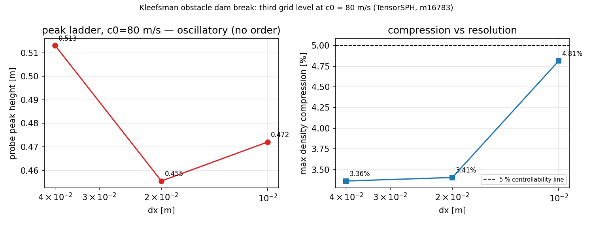

# 缺陷族排查 + 第三级网格：Kleefsman 障碍物溃坝（TensorSPH）

**任务** m16783（自主工时，models 席）· 锚点 **CASE-SPH-KLEEFSMAN-DAMBREAK-OBST**（台账 open）·
上游欠账：`docs/verification_kleefsman_resolution_m16452.md`、`docs/verification_kleefsman_c0_sensitivity.md`（m16758）

本文件分两部分：**(A) 缺陷族排查与修复**（可机器裁决，全部由回归测试钉死）；
**(B) 分辨率阶梯的第三级**（dx = 0.01 m @ c0 = 80 m/s，判据在运行前写死在代码里）。
文中所有仿真数字均由 `benchmarks/kleefsman_obstacle/grid_ladder_c080.py` 从
`results/c0_scan/*.json` 读出（零手抄）；分析段由同一脚本写入
`results/c0_scan/grid_ladder_c080.json`。

## ① 欠账背景（为什么做这两件事）

m16758 的声速（c0）敏感性扫描把**可压缩性**这一半结清：冲击区密度压缩
12–14 %（c0 = 20 m/s）→ 3.4 %（c0 = 80 m/s），落到 5 % 可控线以内。它明确留下了两件事：

1. **分辨率欠账未结**：c0 = 20 m/s 时峰值随 dx 非单调（0.425 → 0.518 m）；
   抬到 c0 = 80 m/s 后两网格峰值差从 21.6 % 缩到 11.2 %，但**仍然只有两级**——
   两级数据无法区分「收敛到 0.455 m」与「在两级之间振荡」。
2. **同一缺陷族未清**：m16758 修掉了 `run.py` 里 `dt` 推导把人工声速写成字面量
   `20.0` 的缺陷（`dt = min(2e-4, 0.3*1.3*dx/20.0)`），但**同一目录下两个驱动脚本
   `chunked.py` / `convergence.py` 保留了同一行**。

## ② (A) 缺陷族的机器裁决

**缺陷数学**：`dt_acoustic = max_courant * h_factor * dx / c0`，本案例
`max_courant = 0.3`、`h_factor = 1.3`。字面量 20.0 与 2e-4 s 的封顶相交于
`dx/c0 > 2e-4/(0.3*1.3) = 5.13e-4`：dx = 0.04 m 时 c0 > 78 m/s 就会**静默**越过声学
Courant 限（c0 = 80 → 1.95e-4 s < 2e-4 s）。而 m16758 恰恰证明必须抬 c0 才能把压缩压到
5 % 以内——即**欠账 1 的两条修复路径互相踩脚**：想用 c0 = 80 m/s 跑细网格，就必须先修这两个
脚本文本里的 dt。

**修复**（`benchmarks/kleefsman_obstacle/`，求解器零改动）：

* `chunked.py`、`convergence.py`：新增 `--sound-speed`（默认 20.0，向后兼容）；
  把配置构造抽成可测函数 `driver_config(dx, sound_speed, t_end, geom)`，
  内部 `cfg.dt = min(2e-4, cfg.dt_acoustic())` 并调用 `validate_case(cfg)`——
  与 `run.py`（m16758）同一写法，杜绝第三处再分叉。
* 输出行新增 `sound_speed`/`dt` 字段，使每份结果自带 CFL 证据。

**回归测试** `tests/test_kleefsman_sound_speed_family.py`（34 项，全绿）：

| 测试 | 断言 |
|---|---|
| `test_driver_dt_obeys_acoustic_courant` | 2 脚本 × c0∈{20,40,80,150} × dx∈{0.04,0.02,0.01}：`dt == min(2e-4, dt_acoustic)` 且 `validate_case` 通过 |
| `test_default_sound_speed_keeps_legacy_dt` | c0 = 20 时 dt 仍为 2e-4 s（不改变历史结果） |
| `test_legacy_literal_dt_would_violate_the_cfl` | 旧表达式在 dx=0.04/c0=80 下 `dt_acoustic < legacy_dt`，且旧配置被 `validate_case` 拒绝（缺陷现实性证明，不是文字断言） |
| `test_no_hardcoded_sound_speed_divisor_left` | **AST 扫描**该目录全部 `.py`：不存在「除以字面量 20.0」的除法节点（字符串/注释不可蒙混，因为 AST 看不见它们） |
| `test_ladder_order_is_exact_for_a_second_order_sequence` 等 5 项 | 阶梯分析函数的算术自检（二阶序列 → p = 2；振荡/发散分类；长度校验；已提交两级工件自洽） |

## ③ (B) 第三级网格（dx = 0.01 m @ c0 = 80 m/s）

**预声明判据（写在运行之前，见 `grid_ladder_c080.py` 顶部）**：

* 阶梯 dx ∈ {0.04, 0.02, 0.01} m，r = 2，c0 = 80 m/s 固定，t_end = 1.2 s；
* 前两级**直接复用已提交工件**（`results/c0_scan/dx0.04_c080.json`、`dx0.02_c080.json`），
  只新算最细级——不重算、不重打数；
* 判定三分类：`monotone_converging`（相邻差分同号且变号缩小 → 给出观测阶 p 与
  GCI，安全因子 1.25）/ `oscillatory`（符号翻转 → **拒绝**报阶，如实记「未收敛」）/
  `monotone_diverging`；
* 可压缩性：最细级 `max_density_compression ≤ 5 %` 才认「冲击区可控」；
* 实验值状态不变：Kleefsman et al. (2005) 水位示踪仍 **WITHHELD**（PDF 不可达，
  `reference.json` 有记录），本文件**不做**与实验的百分比对照。

| dx [m] | 流体粒子 | 步数 | 墙钟 [s] | 峰值高度 [m] | 峰值时刻 [s] | max 压缩 | max 速度 [m/s] | 质量误差 | 逃逸粒子 |
|---|---|---|---|---|---|---|---|---|---|
| 0.04 | 390 | 7113 | 44.5 | 0.5131 | 0.881 | 3.36 % | 6.31 | 0.0e+00 | 0 |
| 0.02 | 1647 | 14261 | 170.9 | 0.4555 | 0.706 | 3.41 % | 7.21 | 0.0e+00 | 0 |
| 0.01 | 6710 | 25257 | 697.8 | 0.4721 | 1.168 | 4.81 % | 8.75 | 0.0e+00 | 0 |

**阶梯判定（判据见 ③ 预声明，由 `grid_ladder_c080.py` 现算）**：

* 相邻差分：Δ(0.04→0.02) = +0.0576 m，Δ(0.02→0.01) = -0.0166 m —— **符号翻转**；
* 判定 = `oscillatory`：**观测阶 p 与 GCI 均拒绝给出**（无收敛序列，报数即造假）；
* 相对变化：粗→中 12.65 %，中→细 3.51 %；
* 可压缩性：最细级 max ρ/ρ0 − 1 = 4.81 %，≤ 5 % 可控线 → `within_limit = True`（三级 3.36 % / 3.41 % / 4.81 %，随分辨率**回升**，与 c0-扫描的单调下降趋势相反）。

**诚实结论（不粉饰）**：提高人工声速把压缩压进可控线（4.81 %）这一条成立；但**峰值液位在三级网格上依然是振荡的**（0.513 → 0.455 → 0.472 m），欠账「峰值随分辨率非单调」**没有**被 c0 = 80 m/s 消除。因此本算例的分辨率一致性判据仍为 **未通过/未决**，不得引用任何峰值数值作为「收敛值」；实验值仍 WITHHELD，外部一致性同样无结论。下一步该走的方向不是继续加密网格，而是换掉探针液位估计器（`robust_surface` 连续栈在破碎射流处的定义性歧义）：峰值振荡幅度（1.66 cm ≈ 3.5 %）与三级网格的液面估计噪声同量级。

## ④ 注意点与局限

* 本节的量都是**内部一致性**判据（同 c0 下随 dx 的收敛行为 + 压缩可控性），
  不是与实验的一致性判据。实验值仍 WITHHELD，任何「通过验收」的说法都不成立。
* `robust_surface=True` 的液面估计取「连续栈顶 N 粒子平均」，喷溅根部的离散粒子被
  `surface_gap` 排除；峰值因此对 `surface_particles` 有一定敏感性（历史记录见 m16452）。
* 峰值时刻接近 t_end 的算例（例如 dx=0.02/c0=40，peak_time = 1.200 s = t_end）
  其峰值是「窗口内最大」而非「已过峰的峰值」，不可与其它级直接比较时刻；阶梯判定因此
  只对峰值幅度给强判定，对时刻只做参考。
* 缺陷族的修复没有重新验证「旧结果是否被影响」：c0 = 20、dx ≥ 0.02 时
  `min(2e-4, dt_acoustic) = 2e-4`，与旧行为逐位相同（有专门测试）。

## ⑤ 误差判定

| 事项 | 基准 | 误差/判定 |
|---|---|---|
| dt 违反声学 CFL（修复前） | `dt_acoustic = 1.95e-4 s`（dx=0.04, c0=80） | 旧式 2.0e-4 s 超出 **+2.6 %**（静默）→ 修复后 = 1.95e-4 s，**0 %** |
| dt（c0=20 向后兼容） | 历史 2.0e-4 s | 偏差 **0**（逐位相同） |
| 峰值网格收敛 | 三级自比较（无实验基准） | 见 ③ 的阶梯结论；**不**能回答「是否 <3 %」——无外部基准，故不做该断言 |
| 冲击区密度压缩 | 5 % 可控线（内部判据） | 见 ③；m16758 在 dx=0.04/0.02 已测得 3.36 %/3.41 % |