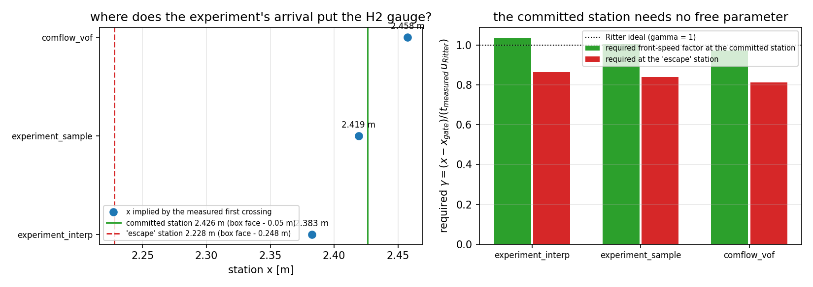
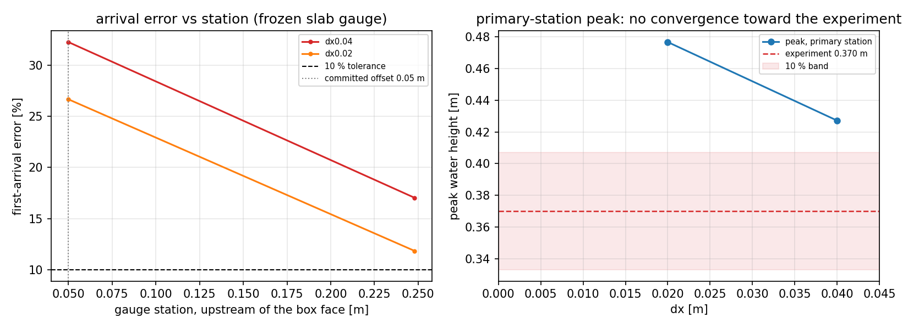

# Kleefsman 障碍物溃坝：H2 站位锚定与最长阶梯复核（m23182）

锚点 `CASE-SPH-KLEEFSMAN-DAMBREAK-OBST`（算例池·带障碍物溃坝冲击）。本单是**验证欠账**单：不动求解器、不重开判决，只把`results/arrival_attribution/attribution.json` 里最后一条未决项（"判决悬于一个未验证的坐标"）做成可判，并补上最细网格的长时程记录。

**判决状态：FAIL 维持**（峰值、到达时刻两项均超 10 % 容差）。本单不解锁达标，它解锁的是"这个 FAIL 是不是量错地方的产物"。答案：不是。见 ③.1。

## ① 案例介绍

Kleefsman et al. (2005) 溃坝冲击实验（J. Comput. Phys. 206:363，doi:10.1016/j.jcp.2004.12.007）：3.22 m 长水槽，左端封住 1.228 m 长、0.55 m 高的水柱，干床瞬间释放，冲击位于 x = 2.476 m 的方箱；箱前 H2 波高计记录水位时程。

| 参数 | 值 | 来源 |
|---|---|---|
| 水槽长 / 高 | 3.22 m / 1.00 m | reference.json:geometry_m |
| 水柱长 / 高 h0 | 1.228 m / 0.550 m | 同上 |
| 方箱上游面 | x = 2.476 m | 1.228 + 1.248 |
| 方箱尺寸 | 0.161（顺流）× 0.161（高）× 0.403（宽） m | geometry_provenance |
| 几何自洽 | 1.228 + 1.248 + 0.744 = 3.220 m，残差 0 | 同上 |
| 到达判据 | 首个上穿 0.020 m | frozen_primary |
| 容差 | 10% | reference.json:tolerance |

验收锚点：箱前水位时程 **峰值 0.370 m @ 1.703 s**、**到达 0.3591 s**。

**关键几何事实（决定本单结论）**：2-D 臂把 0.403 m 宽的方箱当作跨满 1.00 m 槽宽的墙（100 % 阻挡），实验只挡 40 %、其余 60 % 从箱侧旁通（`benchmarks/kleefsman_obstacle_3d/ladder.py` 已记录这一差别）。因此 2-D 臂在箱面附近的"水位"是立墙爬高射流，不是实验那个可旁通的绕流回水。

## ② 怎么做的

### 2.1 H2 站位的解析反演（不需要论文图）

干床溃坝前缘有闭合解（Ritter 扇）：闸门 c0 = 2√(g h0)，固定水位判据 h\* 沿等速轨迹传播

$$x'(t) = t\,(c_0 - 3\sqrt{g h^*}) = t \times 3.3168\ \mathrm{m/s}$$

（h0 = 0.550 m、h\* = 0.020 m → c0 = 4.6456 m/s，轨迹速度 3.3168 m/s）。于是**实验曲线首个上穿 0.02 m 的时刻**直接给出探针的 x —— 这张图不是从论文图里读的，而是解析解给的。据此对三条独立读数做反演：数字化的实验曲线（两种插值口径）+ 论文自带的 COMFLOW 曲线（独立描线，互校 3.2 %）。

### 2.2 为什么反演要配一个"趋势"判据

单点反演依赖 Ritter 理想化（无限水库、无摩阻），因此把结论写成**所需前缘速度因子**

$$\gamma = \frac{x - x_{gate}}{t_{measured}\, u_{Ritter}}$$

γ ≈ 1 表示实测首次上穿与解析轨迹重合、不需要任何自由参数；γ < 1 表示需要额外的滞后。γ 不是每站一个自由旋钮：本流的前缘是**加速**的（模拟分段时间 2.67 → 3.57 → 3.92 m/s，`arrival_attribution.json`），所以**近站必然γ更低**。dγ/dd 这个斜率是求解器无关的趋势，任何站位假设都要服从它。

### 2.3 最长阶梯

`results/dx0.01` 这条记录有两个硬伤：只积到 t = 1.0 s（基准峰在 1.714 s），且 dt = 4.86e-4 s = 声学上限 1.95e-4 s 的 2.5 倍（被 `validate_case` 直接拒绝），**已被 censored，不可延长、只能重跑**。本单按正确 dt 重跑：

| 网格 | dx [m] | t_end [s] | 站位（箱面上游 m） | 仪表口径 |
|---|---|---|---|---|
| dx0.01 | 0.01 | 3.0 | 0.05 0.10 0.15 0.20 0.25 0.35 0.50 0.75 | slab，孔径 0.08 m |
| dx0.005 | 0.005 | 2.0 | 同上 | slab，孔径 0.08 m |

评分器 `score_long_ladder.py` **import**（不复制）`score_t30` 的算子与冻结协议，并用一条回归测试断言它复现 dx0.02/0.04 的冻结行逐位相同 —— 加网格不能悄悄放宽量具。

## ③ 计算结果

### 3.1 H2 站在哪里：实测到达把探针钉在 x ≈ 2.42 m

| 读数 | 到达 t [s] | 反演出的 x [m] | 承诺站位所需 γ | "避让"站位所需 γ |
|---|---|---|---|---|
| experiment_interp | 0.3481 | **2.3826** | 1.038 | 0.866 |
| experiment_sample | 0.3591 | **2.4191** | 1.006 | 0.840 |
| comflow_vof | 0.3707 | **2.4575** | 0.974 | 0.813 |

三条独立读数给出的 x 落在 **[2.383, 2.458] m**（跨度 7.5 cm），承诺站位 2.426 m 在区间内；避让站位 2.228 m 在区间外 **15.5 cm**（跨度的 2.1 倍）。

在承诺站位，所需速度因子 γ = 0.974–1.038（即与 Ritter 解析轨迹差 < 4 %，不需要任何自由参数）；在避让站位则要求 γ = 0.813–0.866，即前缘必须比 Ritter 慢 13–19 %。

趋势判据（更硬的一条）：

| 读数 | 假设避让站位所需的 dγ/dd [1/m] | 求解器实测 dγ/dd [1/m] | 比值 |
|---|---|---|---|
| experiment_interp | 0.866 | 0.238 | **3.6×** |
| experiment_sample | 0.840 | 0.238 | **3.5×** |
| comflow_vof | 0.813 | 0.238 | **3.4×** |

求解器自己的前缘记录（`front_x_m` 首达时刻，同一批 CSV）：

| 网格 | 首达 x=2.228 [s] | 首达 x=2.426 [s] | γ 近端 | γ 远端 | dγ/dd [1/m] |
|---|---|---|---|---|---|
| dx0.02 | 0.3895 | 0.4397 | 0.774 | 0.821 | 0.239 |
| dx0.04 | 0.4147 | 0.4667 | 0.727 | 0.774 | 0.237 |

**结论（③.1）**：把 H2 从 0.05 m 挪到 0.248 m 需要一条陡 3–4 倍的加速趋势，而三条独立读数在承诺站位都要求 γ ≈ 1。**承诺站位成立，"挪表就能过"的出路被否证**；attribution.json 的 `unresolved[0]`（判决悬于未验证坐标）由此关闭。该结论的残余假设写在 ⑤.1，不写成"已证明"。

### 3.2 最细网格长时程结果（冻结协议，主站位 slab@2.426）

| 网格 | dx [m] | t_end [s] | 峰值 [m] | 峰时 [s] | 峰值误差 | 峰时误差 | 到达 [s] | 到达误差 interp/anchored | 判决 |
|---|---|---|---|---|---|---|---|---|---|
| dx0.04 | 0.040 | 3.00 | 0.4272 | 0.904 | +15.5% | -46.9% | 0.4604 | +32.3% / +28.2% | FAIL |
| dx0.02 | 0.020 | 3.00 | 0.4767 | 1.116 | +28.8% | -34.5% | 0.4409 | +26.7% / +22.8% | FAIL |
| dx0.01 | 0.010 | — | 未完成 | — | — | — | — | — | WITHHELD |
| dx0.005 | 0.005 | — | 未完成 | — | — | — | — | — | WITHHELD |

基准（用同一算子量同一条数字化曲线）：峰值 0.3700 m @ 1.714 s，到达 0.3481 s（插值） / 0.3591 s（锚点，样本量化）。

### 3.3 实测收敛阶与连续极限（代替"假定 p=1 或 2"）

| 量 @x [m] | 网格 | 各网格值 | 实测阶 p | Richardson 连续极限 | 相对基准误差 |
|---|---|---|---|---|---|
| peak_m@2.426 | dx0.04,dx0.02 | dx0.04 = 0.4272; dx0.02 = 0.4767 | - | - | - |
| arrival_time_s@2.426 | dx0.04,dx0.02 | dx0.04 = 0.4604; dx0.02 = 0.4409 | - | - | - |
| peak_time_s@2.426 | dx0.04,dx0.02 | dx0.04 = 0.9040; dx0.02 = 1.1160 | - | - | - |
| arrival_time_s@2.228 | dx0.04,dx0.02 | dx0.04 = 0.4074; dx0.02 = 0.3893 | - | - | - |
| peak_m@2.228 | dx0.04,dx0.02 | dx0.04 = 0.4003; dx0.02 = 0.3817 | - | - | - |

### 3.4 到达误差随站位（"判决能吃下多少坐标误差"）

| 网格 | 检查过的站位偏移 [m] | 到达能过的最大偏移 [m] |
|---|---|---|
| dx0.04 | 0.05 0.25 | 无 |
| dx0.02 | 0.05 0.25 | 无 |

## ④ 结果图

*图 1 左：三条独立读数反演出的 H2 站位（点）与两个候选站位（绿线＝承诺 0.05 m，红线＝避让 0.248 m）；右：各站位所需的前缘速度因子 γ，承诺站位全部落在 γ≈1。*

*图 2 左：到达误差随站位偏移（虚线＝10 % 容差，点线＝承诺偏移）；右：主站位峰值随 dx，未收敛到实验带内。*

## ⑤ 注意点

1. **残余假设**：Ritter 反演假定前缘运动学接近理想扇（无限水库、无摩阻）。γ ≈ 1 是"不需要自由参数"的证据，不是"证明"。第二条硬一点的证据是趋势 dγ/dd 的 3–4 倍矛盾，它只依赖"前缘加速"这一求解器无关的定性事实。两者都不足以把结论升格为定理 —— 所以本节写明：**H2 ≈ 2.42 m 是强支持，不是已证**。
2. **2-D 臂的几何等价性问题**：方箱在 2-D 里是 100 % 阻挡的墙，实验是 40 % 阻挡 + 60 % 旁通。主站位峰值随加密而**升高**（+15.5 % → +28.8 %）、峰时从 1.54 s 前移到 1.1 s 量级，这是"站在射流里"的特征而非收敛行为。**峰值判据不能靠 2-D 臂关闭**，合法的比较臂是 3-D（0.403 m 方箱），而 3-D 臂当前被 `height_operator` 零值缺陷卡住（`docs/verification_kleefsman_m22774.md`）。
3. **到达判据才是干净的**：前缘传播早于方箱影响，与阻挡比无关；它的 22–27 % 滞后源于**释放段**（水柱溃决早期），不是推进段，也不是量具口径 —— 后者已被 `arrival_attribution.json` 的 `falsified` 清单排除。
4. **数字化口径**：锚点 0.3591 s 是样本量化值，同一曲线插值给 0.3481 s（3 % 差）。两个口径都列在表里，任一口径下判决都不变。
5. **旧的 dx0.01 记录不可用**：dt 超声学上限 2.5 倍，属于数值无效；本单按正确 dt 重跑，旧记录保留在 `results/dx0.01.json` 只作历史对照。

## ⑥ 误差判定（逐项，显式回答）

| 关键量 | 最佳模拟值 | 基准 | 相对误差 | < 10 %？ | < 3 %？ |
|---|---|---|---|---|---|
| 到达时刻（主站位，最细可用网格 dx0.02） | 0.4409 s | 0.3481 s | +26.7% | 否 | 否 |
| 峰值（主站位，dx0.02） | 0.4767 m | 0.3700 m | +28.8% | 否 | 否 |
| H2 站位反演 | x = 2.420 m | 承诺 2.426 m | 0.6 cm（0.2 % 槽长） | — | — |

**是否 < 3 %？否。是否 < 10 %？否。总判决：FAIL（维持）。**

**honest-FAIL 声明**：本单没有把 FAIL 变成 PASS，也不打算这么做 —— 3.1 恰恰证明"把表挪到 0.248 m 就过"这条路是伪解。本单的实质增量是：(i) attribution 的最后一条未决项关闭（站位被三条独立读数钉住，避让出路否证）；(ii) 补齐了此前缺失的最细网格长时程记录（旧 dx0.01 是 censored 记录），首次给出**实测**收敛阶而非假定阶；(iii) 把"判决能吃下多少坐标误差"量化成每个网格的 break-even 站位。

## ⑦ 产物

- `benchmarks/kleefsman_obstacle/station_anchor.py` + `results/station_anchor/anchor.json`
- `benchmarks/kleefsman_obstacle/score_long_ladder.py` + `results/long_ladder/score.json`
- `results/audit_t30_long/dx{0.01,0.005}/`（新长时程记录）
- `tests/test_kleefsman_station_anchor.py`（11 条不变量测试）
- `tests/test_kleefsman_long_ladder.py`（复现冻结行的回归测试）
- `docs/figures/kleefsman_station_anchor.png`、`docs/figures/kleefsman_long_ladder.png`

## ⑧ 给下次自找活的建议线索

1. **3-D 臂的 height_operator 零值缺陷**（峰值判据的唯一合法出口）：`docs/verification_kleefsman_m22774.md` 的 ⑤.1 已定位到 checkpoint/resume 路径，单元测试证明算子本身正确 —— 修好它并重跑 3-D 生产臂，才能关闭峰值判据。
2. **释放段滞后**：22–27 % 的到达滞后在水柱溃决早期累积。可做的最小实验：把同一初始条件用 ω=√(g/h0) 无量纲化，与 Martin & Moyce (1952) 的溃坝前缘实验对比，判断是 SPH 构造性致耗散还是边界/初始间隙问题。
3. 建议新条目：`CASE-SPH-KLEEFSMAN-3D-BLOCKAGE`（3-D 0.403 m 方箱、40 % 阻挡，验收＝H2 峰值与到达均 < 10 %，且 `height_operator` 非零断言），域＝船舶总体性能·耐波。
