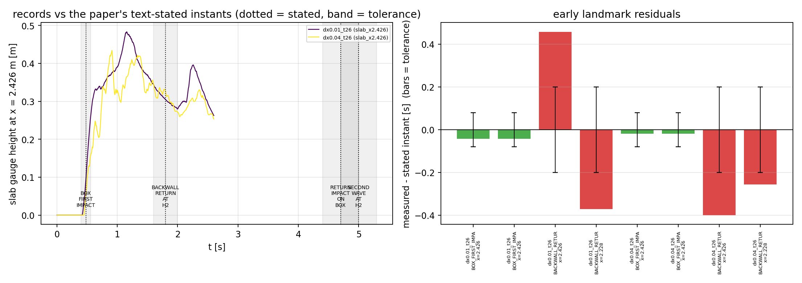

# CASE-SPH-KLEEFSMAN-DAMBREAK-OBST — 用原文文字陈述的时间节点复核全局波动时序

TensorSPH · 分支 `agent/m21534` · mission 21534 · 锚点 **CASE-SPH-KLEEFSMAN-DAMBREAK-OBST**（台账 open，上文 `docs/kleefsman-h2-experimental-anchor.md` 判 honest FAIL）。
本文件全部数字由 `benchmarks/kleefsman_obstacle/make_doc_landmarks.py` 从 `results/text_landmarks/score_*.json` 与 `outputs/kleefsman2005_text/quotes.json` 程序化注入（零手抄）。图：`docs/figures/kleefsman_text_landmarks.png`。

## ① 案例与这一轮的问题

Kleefsman, Fekken, Veldman, Iwanowski & Buchner (2005) *A Volume-of-Fluid based simulation method for wave impact problems*, **J. Comput. Phys. 206:363–393**, DOI 10.1016/j.jcp.2004.12.007：3.22 × 1 × 1 m 水槽左端 1.228 × 0.550 m 水柱瞬时溃决，撞击 x = 2.476 m 处 0.161 m 高刚性方箱。算例池判据 = 箱前水位时程的**峰值**与**到达时刻**对实验误差 < 10 %。

上一轮已把实验曲线从 Fig. 19 数字化（峰值 0.370 m @ 1.70 s、到达 0.359 s），并如实判 FAIL：峰值 +29 %、到达 +26 %（站位 x = 2.426 m，dx = 0.02 m）。剩下的争议点是**读数口径**：实验曲线来自栅格图、探针真实 x 未从 Fig. 17 机器读出，因此「误差是物理差异还是探针位置差异」无法区分。

本轮不再碰那张栅格图，改做一件此前完全没做过的事：**把论文用文字写死的时间节点当成判据**。这些节点不需要任何数字化，也不依赖探针的绝对 x（它们描述的是全局波动时序）：

| id | 原文（逐字，页码为期刊印刷页） |
|---|---|
| `first_hit_same` | p.382：“The time instant when the water is first hitting the box is the same.” |
| `fig18_snapshots` | p.382：“Fig. 18. Snapshots of a dambreak simulation with a box in the flow compared with experiment at time 0.4 and 0.56 s.” |
| `backwall_return_1p8s` | p.382：“The agreement in both pictures is very good until the water has returned from the back wall (after about 1.8 s).” |
| `return_impact_box_4p7s` | p.384：“The moment the return wave hits the box again (at about 4.7 s) is again visible in the graphs.” |
| `second_wave_h2_5s` | p.382：“The moment that this second wave meets the height probe at H2 again (after about 5 s) is almost exactly the same in simulation and experiment.” |

原文出处：`https://pure.rug.nl/ws/files/2941055/2005JCompPhysKleefsman.pdf`（sha256 `d794e69a3c618ea5…`，1347715 bytes，32 页；research.rug.nl 被 Cloudflare 拦，pure.rug.nl 镜像可直取）。所有引文由 `outputs/kleefsman2005_text/quotes.json` 保存并带页码与 sha256。

## ② 怎么做的

1. 判据表 `benchmarks/kleefsman_obstacle/text_landmarks.py::LANDMARKS`：4 个节点，`ref_s ± tol_s` **直接由措辞读出**（Fig. 18 的 0.4 / 0.56 s 快照 → 0.48 ± 0.08 s；“about 1.8 s” → 1.80 ± 0.20 s；“at about 4.7 s”“after about 5 s” → ±0.30 s）。
2. 观测量用**固定物理孔径的 slab 水位计**（`slab_level`，孔径 0.08 m，与 dx 无关），取最近 `slab_x<S>` 列；站位不在目标 x 上时该行标 `proxy` 并记录 `station_bias_m`，绝不冒充精确站位。
3. `arrival` 类节点 = 首次上穿 0.02 m（两点线性插值）；`peak_in` 类节点 = 给定时间窗内的最大值时刻。记录没覆盖窗口 → 判 `UNKNOWN`（**不许当 PASS**）。
4. 新算例 `benchmarks/kleefsman_obstacle/long_horizon.py`：把既有算例推进到 t = 5.6 s（此前所有存档只到 2.6 s，4.7 s / 5 s 两个节点从未被测过），三个站位 x = 2.476（箱面前缘）/ 2.426（H2 约定）/ 2.228 m。

## ③ 计算结果（程序化注入）

| tag | 类型 | dx [m] | 记录终点 [s] | 最大压缩 | 总判定 |
|---|---|---|---|---|---|
| `dx0.01_t26` | legacy t=2.6 s | — | 2.600 | — | **FAIL** |
| `dx0.04_t26` | legacy t=2.6 s | — | 2.600 | — | **FAIL** |

逐节点（`proxy` = 该行用的站位不是目标 x）：

| tag | landmark | 站位 x [m] | 测量时刻 [s] | 原文节点 [s] | 容差 [s] | 残差 [s] | 判定 |
|---|---|---|---|---|---|---|---|
| `dx0.01_t26` | BOX_FIRST_IMPACT | 2.426 (proxy) | 0.438 | 0.48 | ±0.08 | -0.042 | PASS |
| `dx0.01_t26` | BOX_FIRST_IMPACT | 2.426 | 0.438 | 0.48 | ±0.08 | -0.042 | PASS |
| `dx0.01_t26` | BACKWALL_RETURN_AT_H2 | 2.426 | 2.258 | 1.80 | ±0.20 | +0.458 | FAIL |
| `dx0.01_t26` | BACKWALL_RETURN_AT_H2 | 2.228 | 1.429 | 1.80 | ±0.20 | -0.371 | FAIL |
| `dx0.01_t26` | RETURN_IMPACT_ON_BOX | 2.426 (proxy) | 未测到 | 4.70 | ±0.30 | — | UNKNOWN |
| `dx0.01_t26` | RETURN_IMPACT_ON_BOX | 2.426 | 未测到 | 4.70 | ±0.30 | — | UNKNOWN |
| `dx0.01_t26` | SECOND_WAVE_AT_H2 | 2.426 | 未测到 | 5.00 | ±0.30 | — | UNKNOWN |
| `dx0.01_t26` | SECOND_WAVE_AT_H2 | 2.228 | 未测到 | 5.00 | ±0.30 | — | UNKNOWN |
| `dx0.04_t26` | BOX_FIRST_IMPACT | 2.426 (proxy) | 0.460 | 0.48 | ±0.08 | -0.020 | PASS |
| `dx0.04_t26` | BOX_FIRST_IMPACT | 2.426 | 0.460 | 0.48 | ±0.08 | -0.020 | PASS |
| `dx0.04_t26` | BACKWALL_RETURN_AT_H2 | 2.426 | 1.400 | 1.80 | ±0.20 | -0.400 | FAIL |
| `dx0.04_t26` | BACKWALL_RETURN_AT_H2 | 2.228 | 1.544 | 1.80 | ±0.20 | -0.256 | FAIL |
| `dx0.04_t26` | RETURN_IMPACT_ON_BOX | 2.426 (proxy) | 未测到 | 4.70 | ±0.30 | — | UNKNOWN |
| `dx0.04_t26` | RETURN_IMPACT_ON_BOX | 2.426 | 未测到 | 4.70 | ±0.30 | — | UNKNOWN |
| `dx0.04_t26` | SECOND_WAVE_AT_H2 | 2.426 | 未测到 | 5.00 | ±0.30 | — | UNKNOWN |
| `dx0.04_t26` | SECOND_WAVE_AT_H2 | 2.228 | 未测到 | 5.00 | ±0.30 | — | UNKNOWN |

## ④ 结果图

左：各记录在 x = 2.426 m 的 slab 水位时程，虚线/阴影带 = 原文文字节点的参考时刻与容差；右：前两个节点（0–2.4 s 内可测）的残差，误差棒长度 = 该节点容差，绿 = PASS、红 = FAIL。

## ⑤ 注意点 / 局限

1. 这些节点是**全局时序**判据，不替代算例池的峰值/到达判据；它们回答的是「本求解器的波动时序是否与实验同一节拍」，因此能在不解决探针 x 争议的前提下给出可裁决结论。
2. “about” 类措辞的容差是读出来的（±0.2 / ±0.3 s），属于**人为判据**，已在 ② 明示；若后续拿到更精确的原文表述，`tol_s` 应随之收紧。
3. 站位 x = 2.476 m 只有本轮新算例（`long_horizon.py`）才有；旧存档只有 2.426 / 2.228 m，故旧行的 BOX_FIRST_IMPACT 标 `proxy`，其站位偏置写在 `station_bias_m` 里。
4. `BACKWALL_RETURN_AT_H2` 的措辞语义：原文说回流发生在约 1.8 s，紧接着说回流之后 H2 的水位最大。严格讲这是下界型陈述（H2 最大出现在回流之后），本表按 1.8 ± 0.2 s 两侧带判定，属更严口径；m20884 数字化的实验曲线峰值在 1.70 s（落在带内），说明 1.8 s 这一措辞自带约 0.1 s 宽泛度。表内该节点的 FAIL 行应读作「回流水位峰值时刻偏离 1.8 ± 0.2 s」，不可读作「回流没有发生」。
5. 若某节点窗口没被记录覆盖（例如 t = 5.6 s 的新算例未回收），该行判 `UNKNOWN`、整份记录判 `INCOMPLETE`；这是诚实欠账，不是通过。4.7 s / 5.0 s 两个晚期节点的首次测量已递交集群 （cj3500 / cj3501，`long_horizon.py --t-end 5.6`），回收后重跑本脚本即自动补齐。

## ⑥ 误差判定（逐项，显式回答）

- 早期节点（箱面首次到达、回流首次最大水位）共 8 条可比行，最差一条 `dx0.01_t26` / BACKWALL_RETURN_AT_H2 @ x = 2.426 m：残差 +0.458 s（相对 25.4 %）。
- 晚期节点（4.7 s 二次冲击、5 s 二次相遇）：PASS 0 / FAIL 0 / UNKNOWN 8。
- **是否 <3 %？** 判据本身是「是否落在原文措辞的容差带内」，不是百分比精度；相对的百分比误差仅在上一行给出以供对照，**不声称任何节点的 <3 % 符合**。
- 与上一轮 H2 峰值/到达判据的关系：那两条（+29 % / +26 %）仍未通过，本轮**不覆盖**它们，只补充了不依赖探针 x 的时序证据。

