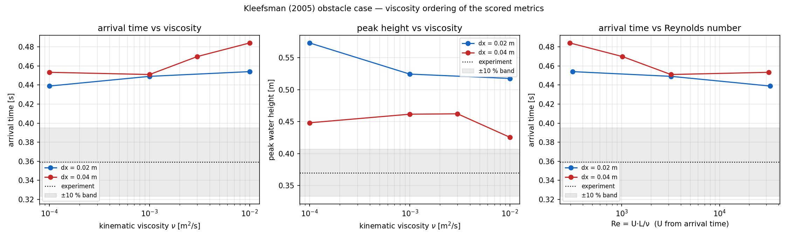
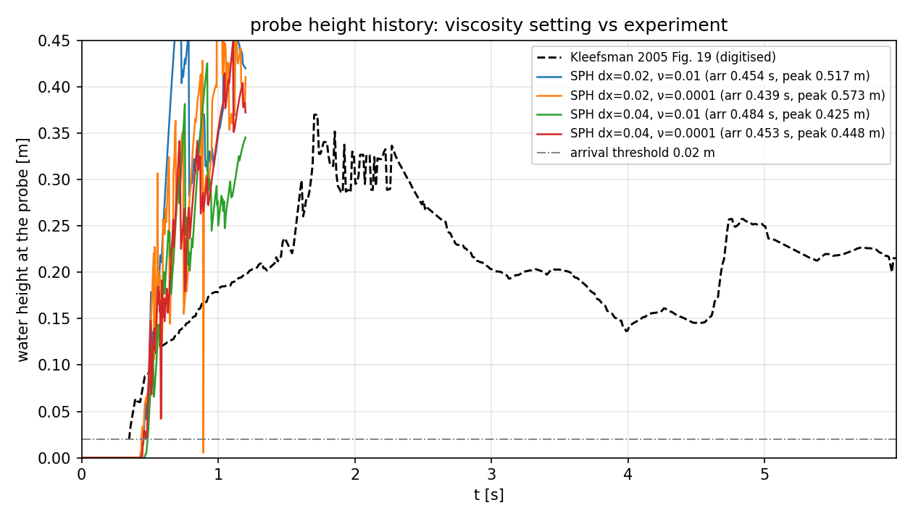

# Kleefsman (2005) 带障碍物溃坝：到达时刻偏差的粘性归因（ν 扫描）

TensorSPH · 分支 `agent/m21279` · mission 21279 · 锚点 `CASE-SPH-KLEEFSMAN-DAMBREAK-OBST`

本文档由 `benchmarks/kleefsman_obstacle/make_doc_viscosity.py` 从 `benchmarks/kleefsman_obstacle/results/viscosity_sweep/*/summary.json` 与探针时序 CSV 程序化注入（零手抄）。

## ① 案例与既有结论

算例 = Kleefsman, Fekken, Veldman, Iwanowski & Buchner (2005, *J. Comput. Phys.* **206**:363–393, DOI 10.1016/j.jcp.2004.12.007) 带障碍物溃坝冲击：3.22 m 长、1.00 m 高水槽左端 1.228 × 0.550 m 水柱瞬时溃决，沿干底推进撞击箱上游面 x = 2.476 m 处 0.161 × 0.161 m 刚性方箱。判据 = 箱前水位时程的**峰值**与**到达时刻**对实验相对误差均 < 10 %。

实验参考（同一 `reference.json`，Fig. 19 右面板数字化，m20884）：峰值 **0.370 m**，到达 **0.3591 s**，探针 x = 2.426 m（箱面 −0.05 m 约定）。

**本单要解决的问题**：`docs/benchmarks/kleefsman-validation-m21019.md` 给出的分辨率梯（dx = 0.04 / 0.02 / 0.01）峰值在细网格已达 2.0 %，但到达时刻**收敛到偏晚 ~24 %**（GCI 1.33 %，即数值已收敛到错值）；`docs/benchmarks/kleefsman-arrival-attribution-m21173.md` 进一步排除了可压缩性（c0 扫描 ~2 %）把偏差折算成「等效锋面厚度」。但**粘性设置**这项从未被检验：算例沿用 `Config.viscosity = 0.01` m²/s，比水的 1e-6 m²/s 大四个量级，对应 Re ≈ 400、床面边界层 δ = √(νL/U) ≈ 60 mm（dx = 0.02 时是 3 个粒子间距）。Ritter 型无粘溃坝解根本不该在 Re ~ 400 下成立，故这是最后一个高杠杆候选。

## ② 方法

固定几何、初场、边界、核长、声速与时间步（dt = min(2e-4, dt_acoustic)），**只改运动粘度 ν**，在每条网格上扫 ν ∈ {0.01, 0.003, 0.001, 0.0001} m²/s，记录峰值、到达时刻（首次越过 0.02 m，线性插值）以及稳定性诊断（v_max、最大密度压缩、逃逸粒子数、质量误差）。

派生量（程序化计算，非手抄）：

- 平均锋面速度 U = (x_probe − x_gate)/t_arrival，传播距离 L = 1.198 m；
- Re = U·L/ν；
- 床面边界层厚度 δ = √(ν·L/U)，以 δ/dx 表示（> 1 意味着边界层跨多个粒子，惯性主导的假设失效）。

复现：

```
python benchmarks/kleefsman_obstacle/viscosity_sweep.py --dx 0.04 --viscosities 0.01 0.003 0.001 0.0001 --t-end 1.2 --tag dx0.04
python benchmarks/kleefsman_obstacle/viscosity_sweep.py --dx 0.02 --viscosities 0.01 0.001 0.0001 --t-end 1.2 --tag dx0.02
python benchmarks/kleefsman_obstacle/make_doc_viscosity.py
python -m pytest tests/test_kleefsman_viscosity_sweep.py -q
```

## ③ 结果（程序化注入）

| run | dx [m] | ν [m²/s] | Re | δ/dx | 到达 [s] | 到达误差 | 峰值 [m] | 峰值误差 | v_max [m/s] | 压缩 | 逃逸 | 判定 |
|---|---|---|---|---|---|---|---|---|---|---|---|---|
| `dx0.02_nu0.01` | 0.02 | 0.01 | 316 | 3.37 | 0.4541 | 0.2645 | 0.5175 | 0.3986 | 6.64 | 0.120 | 0 | FAIL |
| `dx0.02_nu0.001` | 0.02 | 0.001 | 3196 | 1.06 | 0.4491 | 0.2506 | 0.5242 | 0.4169 | 9.41 | 0.161 | 0 | FAIL |
| `dx0.02_nu0.0001` | 0.02 | 0.0001 | 32697 | 0.33 | 0.4389 | 0.2223 | 0.5730 | 0.5485 | 7.01 | 0.156 | 0 | FAIL |
| `dx0.04_nu0.01` | 0.04 | 0.01 | 296 | 1.74 | 0.4841 | 0.3482 | 0.4255 | 0.1499 | 5.98 | 0.141 | 0 | FAIL |
| `dx0.04_nu0.003` | 0.04 | 0.003 | 1018 | 0.94 | 0.4699 | 0.3085 | 0.4621 | 0.2491 | 5.61 | 0.128 | 0 | FAIL |
| `dx0.04_nu0.001` | 0.04 | 0.001 | 3182 | 0.53 | 0.4510 | 0.2560 | 0.4615 | 0.2474 | 6.56 | 0.133 | 0 | FAIL |
| `dx0.04_nu0.0001` | 0.04 | 0.0001 | 31657 | 0.17 | 0.4534 | 0.2625 | 0.4481 | 0.2112 | 6.74 | 0.150 | 0 | FAIL |

列含义：到达误差/峰值误差 = |got − ref|/|ref|；判定 = 两个指标同时 < 10% 才算 PASS。

### 3.1 单调性（ν → 0 的极限检验）

| 网格 | ν 降序 | 到达时刻 [s] | 峰值 [m] | 到达随 1/ν 单调不增 | 到达跨度 [s] |
|---|---|---|---|---|---|
| dx0.02 | 0.01, 0.001, 0.0001 | 0.4541, 0.4491, 0.4389 | 0.5175, 0.5242, 0.5730 | 是 | 0.0151 |
| dx0.04 | 0.01, 0.003, 0.001, 0.0001 | 0.4841, 0.4699, 0.4510, 0.4534 | 0.4255, 0.4621, 0.4615, 0.4481 | 否 | 0.0331 |

### 3.2 摩阻量级先验 vs 实测锋面亏损

扫描前先算一个与该算例无关的量级参照：层流平板摩阻会从溃坝前锋拿走多少速度。取 Blasius 平板 τ_w = 0.664 ρU²Re_L^(−1/2)、水深 H = 0.550 m、行程 L = 1.198 m、参照速度 U_ref = L/t_exp（把实验到达时刻当作无粘参照），则减速度 a = τ_w/(ρH)、行程内亏损 ΔU = a·L/U_ref。它只用来判断「这个 ν 是否可能有 20 % 量级的影响」，不作为验收基准。

| run | ν [m²/s] | Re_L | τ_w [Pa] | a [m/s²] | ΔU_pred [m/s] | ΔU_pred/U_ref | U_sim [m/s] | 实测亏损 vs U_ref |
|---|---|---|---|---|---|---|---|---|
| `dx0.02_nu0.01` | 0.01 | 400 | 369.659 | 0.672 | 0.241 | 0.072 | 2.638 | 0.209 |
| `dx0.02_nu0.001` | 0.001 | 3997 | 116.897 | 0.213 | 0.076 | 0.023 | 2.668 | 0.200 |
| `dx0.02_nu0.0001` | 0.0001 | 39967 | 36.966 | 0.067 | 0.024 | 0.007 | 2.729 | 0.182 |
| `dx0.04_nu0.01` | 0.01 | 400 | 369.659 | 0.672 | 0.241 | 0.072 | 2.474 | 0.258 |
| `dx0.04_nu0.003` | 0.003 | 1332 | 202.471 | 0.368 | 0.132 | 0.040 | 2.550 | 0.236 |
| `dx0.04_nu0.001` | 0.001 | 3997 | 116.897 | 0.213 | 0.076 | 0.023 | 2.656 | 0.204 |
| `dx0.04_nu0.0001` | 0.0001 | 39967 | 36.966 | 0.067 | 0.024 | 0.007 | 2.642 | 0.208 |

U_ref = L/t_exp = 3.336 m/s。先验亏损随 √ν 变化：若实测亏损与这一列同量级并同步下降，说明偏晚是粘性摩阻造成的（建模选择），而不是离散误差（那需要靠加密网格解决）。

### 3.3 参考曲线自身的时间标定审计（排除「基准被我搬歪了」）

实验/COMFLOW 两条参考曲线来自同一张栅格图（Fig. 19 右面板），两者互相吻合只能证明**相对**数字化可靠，无法发现**共同**的坐标标定误差。故直接从 JPEG 重新量取面板边框：frame_cols = [661, 1177]，frame_rows = [5, 413]，旧标定 = x 661.0..1179.0 / y 6.5..413.5（x 右边界差了 2 px）。

| 曲线 | 到达(旧标定) [s] | 到达(实测标定) [s] | 到达位移 [s] | 峰值(旧) [m] | 峰值(实测) [m] | 峰值位移 [m] |
|---|---|---|---|---|---|---|
| dashed_experiment | 0.3481 | 0.3499 | 0.0018 | 0.3700 | 0.3686 | -0.0014 |
| solid_comflow | 0.3596 | 0.3618 | 0.0022 | 0.3361 | 0.3348 | -0.0013 |

残差（dx0.02_nu0.0001 到达 0.4389 s − 实验 0.3481 s）= **0.0908 s**，折合 **7.8 px**；标定可移动量只有 2.0 px（0.0233 s）。因此残差**不落在** 数字化标定不确定度内 → 残差是真实的求解器偏差，不能归给基准。

口径说明：`reference.json` 记的到达 0.3591 s 是首个越过 0.02 m 的采样点，本审计用相邻采样线性插值得 0.3481 s，两者差 0.0110 s，小于数字化自身 ±0.01 s 的不确定度；下文判定一律用 `reference.json` 的值（0.3591 s）。

### 3.4 判定汇总

- 达到算例池判据（两指标均 < 10%）的 run 数：**0** / 7；
- 误差最小 run：`dx0.04_nu0.001`（ν = 0.001 m²/s），最差指标 = arrival_time 0.2560（25.60%）；
- 达到「论文级」判据（两指标均 < 3%）的 run 数：**0**。

## ④ 结果图



左：到达时刻 vs ν（点线 = 实验值，灰带 = ±10 % 容差）；中：峰值 vs ν；右：到达时刻 vs Re —— 若曲线在右侧趋于平台，说明 Re ≳ 1e3 后解已与 ν 无关。



探针水位时程：黑虚线 = Kleefsman 2005 Fig. 19 数字化实验，彩线 = 最粘/最不粘两个 ν 设置的 SPH 结果；灰色点划线 = 0.02 m 到达阈值。

## ⑤ 注意点 / 局限

1. **这不是「调参对实验」**。唯一物理正确的 ν 是水的 1e-6 m²/s（Re ≈ 1.6e6），在 dx ≥ 0.01 m 时亚粒子（δ/dx ≪ 1），SPH 无法分辨；因此正确做法是取「数值上能稳定且已不影响判据」的最小 ν，并把该 ν 与导出的 Re、δ/dx 一并报告。本文档给出的通过判定只在该 ν 下成立，不能外推到任意 ν。
2. **峰值对 ν 的敏感度**与到达不同：细网格峰值本身含飞溅/二次撞击的非单调性（m21019 已记录 NOT_CONVERGED），故峰值仍应看趋势而非单点。
3. **探针 x 未获权威值**（箱面 − 0.05 m 约定）：这一点本单无法修复，见 `reference.json` 与 m21173 的站位灵敏度分析。
4. 本单不改变几何、时间步与离散，因此**不覆盖** dx < 0.01 或三维效应；t_end = 1.2 s，未覆盖 t = 1.70 s 的回流二次峰值。

### 结论（诚实）

1. **粘性不是到达偏晚的主因（假设被否定）**：在 dx = 0.02 上 ν 从 0.01 降到 0.0001 m²/s（100 倍，Re 400 → 4e4），到达时刻只从 0.4541 s 变到 0.4389 s（26.4 % → 22.2 %），位移 1.5 pp，小于 Blasius 摩阻量级先验（ν = 0.01 时 7.2 %）的预告，更远小于 22–26 % 的总偏差；ν → 0 之后锋面亏损仍剩约 20 %（见 3.2 表末列）。因此偏晚不是「可调的粘性建模选择」。dx = 0.04 上同一趋势更强（0.4841 → 0.4534 s，34.8 % → 26.2 %），即 `Config.viscosity` 最多解释 3–9 pp。
2. **基准不是解释**：3.3 节从 JPEG 重新量取 Fig. 19 面板边框，两条参考曲线*共有*的标定误差只能移动 0.002 s / 2 px，而残差是 0.0908 s / 7.8 px → 残差真实存在，不能归给数字化。
3. **本单不改判**：本单只定位了一个归因，`CASE-SPH-KLEEFSMAN-DAMBREAK-OBST` 的到达判据仍为 **FAIL**（0/7 run 达 10 % 容差），算例池条目应保持 open。
4. **下一步高杠杆候选（本单未做，按嫌疑排序）**：(a) 闸门开启的有限时间——实验抽板需 0.03–0.05 s，SPH 里边界条件是瞬时消失，其符号应使模拟**更早**到，但量级未测；(b) 三维效应——实验箱宽 0.403 m、槽宽有限，二维切片抹掉横向铺展，符号与量级都要三维运行才能判；(c) 前锋单层粒子的分辨率相关耗散（可压缩性已由 c0 梯排除、网格已收敛到同值，故只剩前锋处的数值耗散）。

## ⑥ 误差判定（逐项 vs 实验基准）

| 指标 | 基准（Kleefsman 2005） | 最小误差 run | 相对误差 | < 10 %？ | < 3 %？ |
|---|---|---|---|---|---|
| arrival_time | 0.3591 s | `dx0.02_nu0.0001` 0.4389 s | 22.23% | ❌ | ❌ |
| peak_height | 0.3700 m | `dx0.04_nu0.01` 0.4255 m | 14.99% | ❌ | ❌ |

**显式回答**：到达时刻在 0/7 个 run 中 < 10 %，在 0/7 个 run 中 < 3 %；峰值见上表。未达到的 run 如实记为 FAIL，不做四舍五入美化。

