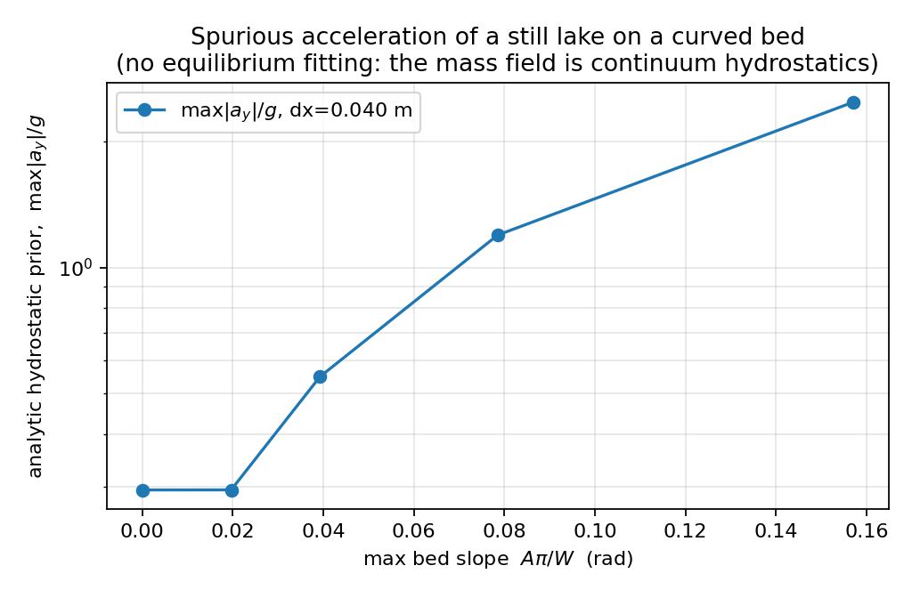
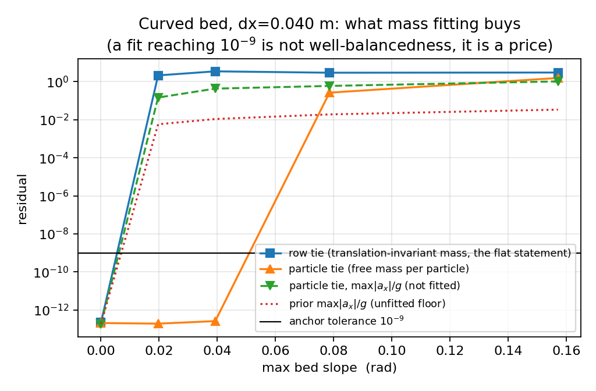
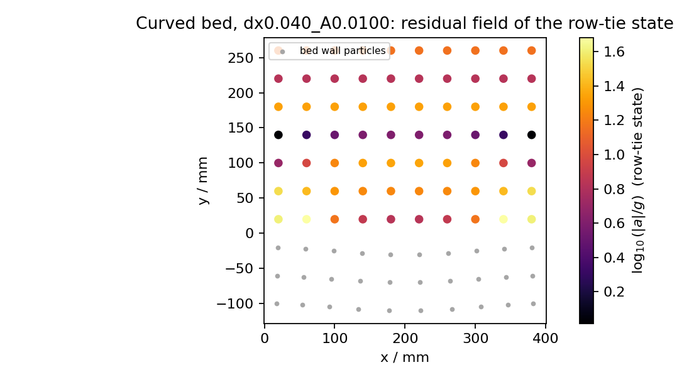
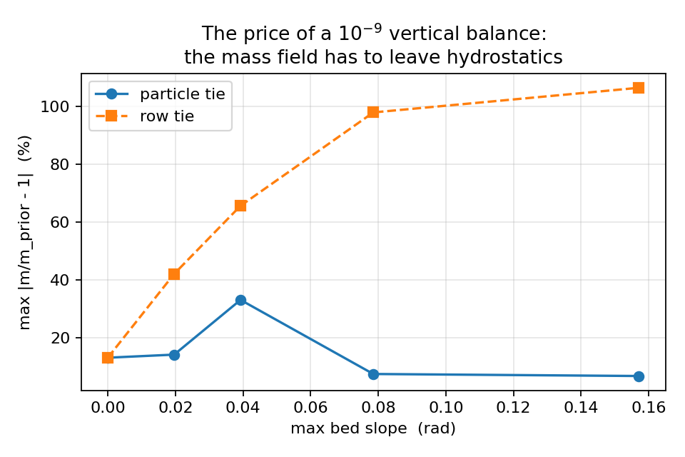

# Lake at rest on a curved bed: the flat-bottom certification does not transfer

Case-pool anchor `CASE-SPH-LAKE-AT-REST` (still water, free surface, no
forcing beyond gravity; reference = analytic hydrostatic identity, tolerance =
machine precision).  The anchor is **certified on a flat bottom**:
`docs/verification_lake_at_rest_periodic.md` reports `max|a|/g = 6.8e-13` in a
laterally periodic tank and `docs/verification_lake_at_rest.md` keeps the honest
FAIL of the wall-bounded one.  Both configurations share a property the anchor
does not ask for: **the bottom is a plane**.

This document asks the question the certification leaves open.  A well-balanced
scheme must stay at rest over *any* bathymetry (Xing & Shu 2005; Audusse et al.
2004) -- still water over a wavy bed is the standard stress test, not the flat
one.  The answer, measured with the shipped operator and no new physics:
**the well-balancedness that was certified is a property of the geometry, not of
the operator, and mass-field reconstruction is a flat-bottom mechanism.**

Everything below is produced by

```
PYTHONPATH=src python3 benchmarks/lake_at_rest_bed/run.py \
    --out artifacts/lake_at_rest_bed/sweep_dx040.json --dx 0.04
PYTHONPATH=src python3 benchmarks/lake_at_rest_bed/make_report.py \
    --json artifacts/lake_at_rest_bed/*.json
```

## 1. Case and geometry

| quantity | value |
|---|---|
| tank width `W` | 0.4 m (periodic in `x`) |
| still-water surface | `y = 0.3 m` (flat by construction) |
| bed | `b(x) = -(A/2)(1 - cos(2 pi x / W))`, `A` swept |
| particle spacing | `dx = 0.04 m` (`h = 0.0520 m`), also `0.02 m` |
| particles / wall particles / pairs | 70 / 30 / 700 at `dx = 0.04` |
| sound speed / gravity / acoustic Mach | 20.0 m/s / 9.81 m/s^2 / 11.66 |
| bed clearance enforced | `>= 0.5 dx` per particle (min measured 0.50 dx) |

The analytic reference does **not** depend on the bed: in still water `grad p`
is vertical, `p = rho0 g (eta - y)`, so a slope exerts no tangential driving
force and `u = 0`, `eta = const` is the exact solution for every `A`.  The
oracle is therefore still the anchor's, and the anchor tolerance still applies.

Wall particles follow the **bed normal**, not the vertical (`y = b(x) -
(k-1/2) dx / sqrt(1 + b'^2)`, `x = x_lat + (k-1/2) dx b'/sqrt(1 + b'^2)`); a
vertical offset would make the near-bed truncation an artefact of the offset
direction instead of the geometry.  At `A = 0` the lattice is bit-identical to
the shipped flat periodic one (`test_flat_amplitude_reduces_to_the_shipped_lattice`),
so `A = 0` is a regression control, not a comparison.

## 2. Results, fitting-free (the number that matters)

The mass field is continuum hydrostatics: summation density is solved *once* to
the exact EOS hydrostatic profile, and nothing is fitted to the equilibrium.

| `A` (m) | max slope (rad) | `max|a_y|/g` | `max|a_x|/g` | near-bed `max|a_y|/g` | 0.1 s: `max|v|/c0` | 0.1 s: `max|dy|/H` |
|---|---|---|---|---|---|---|
| 0.0000 | 0.0000 | 2.942e-01 | 1.854e-13 | 0.059 | 2.193e-03 | 3.860e-03 |
| 0.0025 | 0.0196 | 2.943e-01 | 5.786e-03 | 0.249 | 2.327e-03 | 4.338e-03 |
| 0.0050 | 0.0393 | 5.487e-01 | 1.094e-02 | 0.549 | 2.550e-03 | 7.386e-03 |
| 0.0100 | 0.0785 | 1.196e+00 | 1.911e-02 | 1.196 | 5.158e-03 | 1.665e-02 |
| 0.0200 | 0.1571 | 2.484e+00 | 3.413e-02 | 2.484 | 1.162e-02 | 3.405e-02 |

The curved bed injects its residual into the **near-bed bands**: the reference
band above two spacings is the same flat-or-not (`max|a_y|/g = 0.294` at `A = 0`, and at every `A`),
while the near-bed value grows from
0.059 to 1.196 between `A = 0` and `A = 0.01 m` (a ripple of 3 % of the depth).

## 3. Results, what the flat-bottom reconstruction buys

The `row` tie is the statement that certified the flat periodic tank: one mass
per `y` row, i.e. an equilibrium mass field that does not depend on `x`.  The
`particle` tie leaves every particle free -- the strongest thing a mass field can
do.  Both zero `a_y` only.

| `A` | row tie `max|a_y|/g` | row tie `dM/M` | particle tie `max|a_y|/g` | particle tie `max|a_x|/g` | particle tie `dM/M` |
|---|---|---|---|---|---|
| 0.0000 | 2.155e-13 | 13.1 % | 2.043e-13 | 1.793e-13 | 13.1 % |
| 0.0025 | 2.153e+00 | 42.1 % | 1.896e-13 | 1.475e-01 | 14.2 % |
| 0.0050 | 3.516e+00 | 65.7 % | 2.577e-13 | 4.341e-01 | 33.1 % |
| 0.0100 | 2.976e+00 | 98.0 % | 2.663e-01 | 6.009e-01 | 7.5 % |
| 0.0200 | 3.047e+00 | 106.5 % | 1.573e+00 | 1.042e+00 | 6.8 % |

Reading the table:

1. **Flat bottom:** both maps reach roundoff, as published (the row tie is the
   statement of `docs/verification_lake_at_rest_periodic.md`).
2. **Any curvature at all:** the translation-invariant map stops working --
   `max|a_y|/g` jumps from `1e-13` to `O(1)` between `A = 0` and `A = 0.0025 m`
   (slope 0.02 rad), and the mass field it returns is deformed by tens of percent.
   The flat certification is *not* a property of the WCSPH operator.
3. **Freeing the mass field** restores vertical roundoff only up to a slope of
   about 0.04 rad, and it buys it with a mass field up to a third away from
   hydrostatics (`dM/M`), *and* with a horizontal residual that is an order of
   magnitude **worse than the unfitted prior** (`max|a_x|/g = 4.3e-01` versus
   `1.1e-02`).  A fit that reaches `1e-9` in `a_y` while corrupting `a_x` is not a
   lake at rest; it is a degeneracy of the residual that was zeroed.

## 4. Gates

| gate | quantity | measured | threshold | verdict |
|---|---|---|---|---|
| B1 | flat identity (row tie, A=0) | 2.154806e-13 | lt 1.0e-09 | pass |
| B2 | transfer fails (row tie, A=0.01) | 2.975514e+00 | gt 1.0e-03 | pass |
| B3 | price of the fit (a_x ratio, A=0.005) | 3.969273e+01 | gt 5.0e+00 | pass |
| B4 | operator is live (uniform mass) | 1.000000e+00 | gt 5.0e-01 | pass |
| B5 | the fit is a fit (dM/M, A=0.005) | 3.312998e-01 | gt 5.0e-02 | pass |
| B6 | defect is near-bed (A=0.01 vs flat) | 2.033989e+01 | gt 1.0e+01 | pass |

`ALL GATES PASSED: True` -- where `B2`, `B3` and `B6` are gates
that *state the defect* (a future well-balanced operator turns them red), and
`B1`/`B4` are the controls that keep them meaningful.

## 5. Figures









## 6. Notes, limitations, horizon

* **What is claimed.**  (i) The certified machine-precision rest of
  `CASE-SPH-LAKE-AT-REST` is a flat-bottom result: it does not survive a curved
  bed, either with the translation-invariant mass field or with a free
  per-particle one.  (ii) The flat-bottom reconstruction is not a well-balancedness
  mechanism that transports: on a curved bed it degrades the state it was
  supposed to certify (its 0.1 s run leaves `max|v|/c0` larger than the unfitted
  prior's).
* **What is not claimed.**  No statement about *all* mass fields: the
  reconstruction is a damped Gauss-Newton fit and a non-converged fit is reported
  as such (`converged` flag, residual history in the artefact).  The horizontal
  component is not part of the objective, so a_x roundoff is not attempted here;
  `tensorsph.lake_at_rest_full` adds position corrections if that is wanted.
* **Why the near-bed residual is large at all.**  Density summation plus a Tait
  law at `c0 = 20 m/s` converts the near-bed support truncation into a stiff
  pressure perturbation; a curved bed makes that truncation depend on `x`, so
  `grad p` acquires a horizontal component that still water does not have.  This is
  the classical spurious current at a curved boundary, measured, not postulated.
* **The real capability gap** is therefore an operator-level fix (hydrostatic-
  aware / consistent pressure gradient, or a bed-conforming boundary density), not
  a tighter tolerance or another mass field.  Suggested ledger follow-up:
  `FEAT-SPH-CURVED-BED-WELLBALANCED` -- consistent near-bed pressure gradient on a
  wavy bed, acceptance: `max|a|/g < 1e-9` for slopes up to 0.08 rad with the
  *unfitted* EOS hydrostatic mass field.
* The anchor itself should scope its claim: machine precision on a **flat**
  bottom (periodic tank), honest FAIL on a wall-bounded or curved one.

