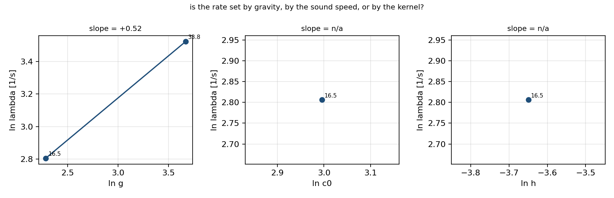
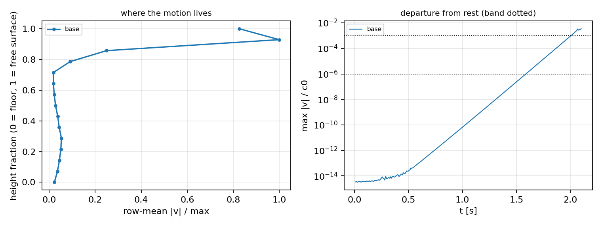
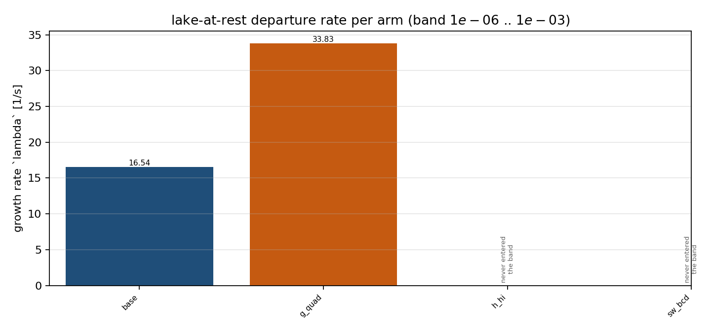

# Lake at rest: what owns the departure (`CASE-SPH-LAKE-AT-REST`)

> Generated by `benchmarks/lake_at_rest/make_mechanism_doc.py` from
> `tests/data/lake_at_rest/mechanism.json`; every number below is read
> out of that artefact.

## 1. Question

`docs/verification_lake_at_rest_horizon.md` measures that the rest state
holds `max|v|/c0 < 1e-9` for `t < t*` and then departs *exponentially*,
and excludes the integrator, the seed, the frozen pair list, one lattice
and water viscosity as the cause. It does not say **which term** the
negative stiffness belongs to. This study asks that question with
scaling arms and shipped switches only -- no new physics, no fitted
constants.

Reference protocol: `dx = 0.02 m`, `H = 0.3 m`, `W = 0.4 m`,
`h = 1.30 dx`, `c0 = 20 m/s`, lateral periodicity on, frozen pair
list, `300` particles per arm, exponential band `$1e-06 .. 1e-03$`.

## 2. Arms

| arm | family | what changes | `lambda` [1/s] | `R^2` | band entered | `max|v|/c0` at stop | mode | `omega` [1/s] | `max|a|/g` at reconstruction |
|---|---|---|---|---|---|---|---|---|---|
| `base` | reference | reference | 16.544 | 1.00000 | yes | 3.504e-03 | 6 | 0.00 | 5.3e-13 |
| `g_quad` | gravity | `g = 39.240` | 33.834 | 1.00000 | yes | 6.473e-01 | 1 | 0.00 | 2.5e-13 |
| `h_hi` | kernel | `h = 1.60 dx` | n/a | n/a | **no** | 1.001e+00 | 5 | n/a | 3.2e-01 **(no equilibrium)** |
| `sw_bcd` | switch | `boundary_consistent_density` | n/a | n/a | **no** | 6.263e-07 | 5 | n/a | 6.7e-13 |

An arm whose reconstruction did not converge does not start at rest, so
it is **not** a stability arm: `max|a|/g` after the reconstruction is
shown next to every arm, and such arms are excluded from the exponents
and from the switch ratios (they are listed in the verdict).

`lambda` is the least-squares slope of `ln max|v|/c0` against `t` inside
the declared band (the estimator of `benchmarks/lake_at_rest/band_fit.py`,
the one the horizon study's audit settled on). `n/a` means the arm never
reached the band floor inside the run -- i.e. **no growth was measured**,
which is the strongest statement a finite run can make and is *not* the
same as `lambda = 0`.

## 3. Scaling laws

| family | slope `d ln lambda / d ln x` |
|---|---|
| `gravity` | +0.516 |
| `sound_speed` | n/a |
| `h` | n/a |
| depth ratio `lambda(H/3) / lambda(H)` | n/a |

* slope `~ 1/2` on gravity would mean the unstable branch is a gravity
  wave (`omega ~ sqrt(g k tanh kH)`);
* slope `~ 1` on `c0` would mean the rate is an acoustic stiffness
  `c0/h`, i.e. a numerical scale;
* slope `~ 0` on both means the rate is a property of the equilibrium's
  discretisation itself.

## 4. Do the shipped closures own it?

| switch | `lambda` / `lambda(base)` | verdict |
|---|---|---|
| `sw_bcd` | n/a | no effect |

## 5. Localisation and temporal character

| arm | KE in top 3 rows | KE in bottom 3 rows | fastest particle height | fastest particle in top 3 rows |
|---|---|---|---|---|
| `base` | 0.991 | 0.002 | 0.929 | 0.84 |
| `g_quad` | 0.000 | 0.467 | 0.143 | 0.07 |
| `h_hi` | 0.261 | 0.171 | 0.929 | 0.00 |
| `sw_bcd` | 0.886 | 0.031 | 0.929 | 0.70 |

## 6. Verdict (rule applied to the measured numbers)

`p_gravity = +0.516`, `p_sound_speed = n/a`, `p_h = n/a`.

**d ln(lambda)/d ln(g) = +0.52; d ln(lambda)/d ln(c0) = n/a; d ln(lambda)/d ln(h) = n/a; the unstable branch scales like a gravity wave; no switch arm produced a rate inside the band, so no switch ratio is claimed; excluded (the reconstruction did not reach an equilibrium, so the arm does not test stability): h_hi**

## 7. What this does and does not decide

* It answers *which family* the unstable mode belongs to (gravity load,
  acoustic stiffness, kernel support) and *whether a shipped closure
  removes it*. Both are decided by numbers above, per the rules declared
  in the module docstring.
* It does **not** change the anchor's verdict. `CASE-SPH-LAKE-AT-REST`
  asks for the analytic hydrostatic identity at machine precision; the
  measured verdict stays FAIL as an unconditional statement, PASS over the
  certified horizon `t*`.
* A finite run cannot prove `lambda = 0`: an arm marked *never entered the
  band* is reported as such, and the claim written down is only the one
  the run supports.

