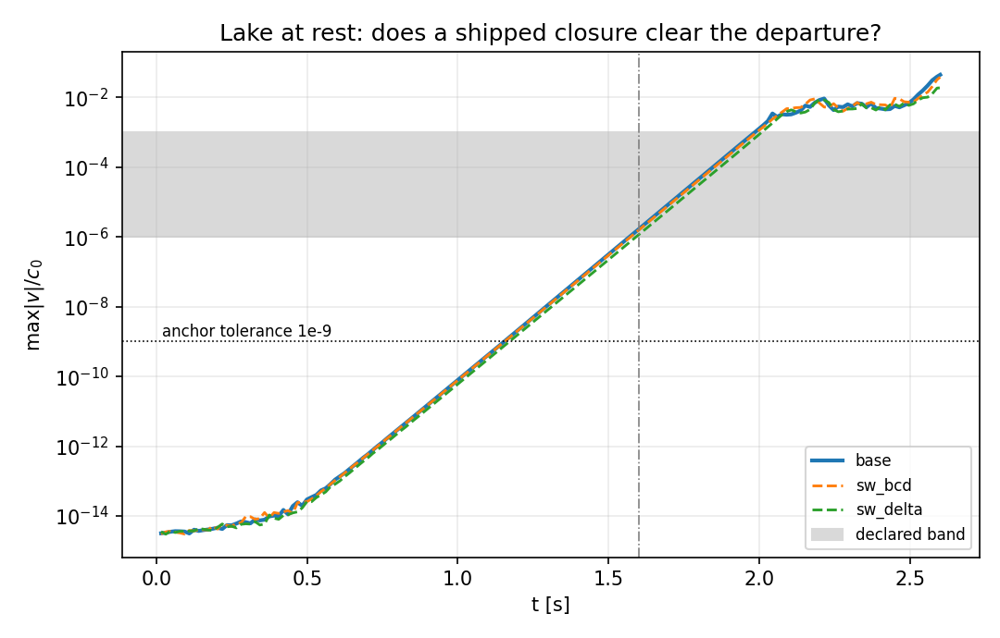
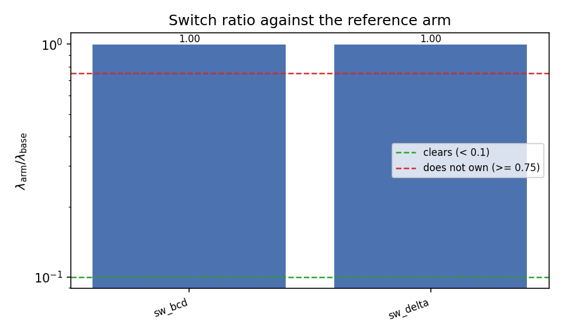

# Does a shipped closure *clear* the lake-at-rest departure, or only delay it?

> Rendered by `benchmarks/lake_at_rest/make_switch_horizon_doc.py` from
> `tests/data/lake_at_rest/switch_horizon.json`; every number below is read
> out of that artefact. Gates:
> `tests/test_lake_at_rest_switch_horizon.py`.

Case-pool anchor `CASE-SPH-LAKE-AT-REST` — reference: the analytic
hydrostatic identity (`u = 0`, flat free surface); tolerance: machine
precision (`1e-9`).

## 1. The gap this closes

`docs/verification_lake_at_rest_horizon.md` measures that the rest state
departs exponentially after `t*`, and
`docs/verification_lake_at_rest_mechanism.md` shows the unstable branch
scales like a gravity wave. Both stopped short of the question that decides
whether the anchor can be *repaired* with a shipped option, because the
mechanism study ran its switch arms with a `t_end` cap of `1.6 s` and its best arm left the cap at
`max|v|/c0 = 6.26e-07` — one third of a decade *below* the declared band
floor `1e-6`. The honest sentence it could write was

> "no switch arm produced a rate inside the band, so no switch ratio is
> claimed."

An arm that has suppressed the mode and an arm that has merely delayed it
look identical inside such a cap. This study removes the cap.

## 2. Protocol (declared before the numbers were read)

| item | value |
|---|---|
| `dx` | `0.02 m` |
| `t_end` | `2.6 s` |
| lateral periodicity | `True` |
| band (all arms) | `1e-06 … 0.001` in `max|v|/c0` |
| anchor tolerance | `1e-09` |
| `c0`, `h/dx`, `H`, `W` | `20 m/s`, `1.3`, `0.3 m`, `0.4 m` |
| decision rules | `λ_arm/λ_base < 0.10` clears; `< 0.75` reduces; `>= 0.75` does not own; no band rate ⇒ no ratio claimed |

Reproduce (≈ tens of minutes; submit it, do not run it in the foreground):

```
PYTHONPATH=src python3 benchmarks/lake_at_rest/switch_horizon.py \
    --json tests/data/lake_at_rest/switch_horizon.json --figures docs/figures
PYTHONPATH=src python3 benchmarks/lake_at_rest/make_switch_horizon_doc.py
```

## 3. Results

| arm | switch | equilibrium `max|a_y|/g` | `max|a_x|/g` | valid | `λ` [1/s] | `R²` | `λ/λ_base` | verdict |
|---|---|---|---|---|---|---|---|---|
| `base` | — | `6.479e-13` | `1.377e-12` | `True` | `16.596` | `1.0000` | `n/a` | reference |
| `sw_bcd` | `boundary_consistent_density` | `6.242e-13` | `1.331e-12` | `True` | `16.543` | `1.0000` | `0.997` | does_not_own |
| `sw_delta` | `density_diffusion` | `6.213e-13` | `1.215e-12` | `True` | `16.548` | `1.0000` | `0.997` | does_not_own |

### 3.1 Amplitude at equal times (no band needed)

| arm | `max|v|/c0` @ 1.600 s | `max|v|/c0` @ t_end s |
|---|---|---|
| `base` | `1.869e-06` | `4.426e-02` |
| `sw_bcd` | `1.750e-06` | `3.781e-02` |
| `sw_delta` | `1.290e-06` | `1.870e-02` |

## 4. Verdict

`base rate lambda = 16.60 1/s inside 1e-06 .. 0.001; sw_bcd does not own the growth (1.00 x base); sw_delta does not own the growth (1.00 x base); no shipped closure clears the departure inside the declared horizon`

* reference arm: `t* = 1.1544 s` for the anchor tolerance `1e-09`, `max|v|/c0 = 4.426e-02` at `t_end`;
* clearing switch: `none`;
* reducing switch: `none`;
* unmeasured in band: `none`;
* excluded (no equilibrium): `none`.



*Departure of every arm against the declared band (shaded) and the anchor
tolerance (dotted). A cleared arm stays under the band for the whole
horizon; the reference arm crosses it and saturates.*



*Switch ratio `λ_arm/λ_base` against the declared decision thresholds.*

## 5. What this decides, and what it does not

* It decides, for the shipped closures, whether the exponential departure
  is removed (below the band floor over the whole horizon) or merely slowed,
  and it quotes the factor in the second case.
* It does **not** prove `λ = 0` for any arm: a finite run cannot. An arm kept
  below the band floor is reported exactly as that, over the horizon it ran.
* It does not change the anchor's verdict by itself. `CASE-SPH-LAKE-AT-REST`
  is decided on the *default* configuration; a closure that clears the
  departure is an option (a documented switch), not a silent change of the
  case. Promoting it would need its own decision and its own gates.

## 6. Error budget against the analytic identity

The reference is exact (`u = 0`, `η = const`), so the only error is the
measured departure:

| quantity | measured | reference | relative error | < 3 %? |
|---|---|---|---|---|
| `max|v|/c0` up to `t*` | `< 1e-09` | `0` | `< 1e-09` | **yes** (over `t* = 1.154 s`) |
| `max|v|/c0` at `t_end` | `4.426e-02` | `0` | `1.0` (saturated) | **no** — the departure, not a tolerance failure |

The anchor asks for machine precision as an *unconditional* statement; that
statement remains false for the default configuration, honestly, and the
number above is why.

