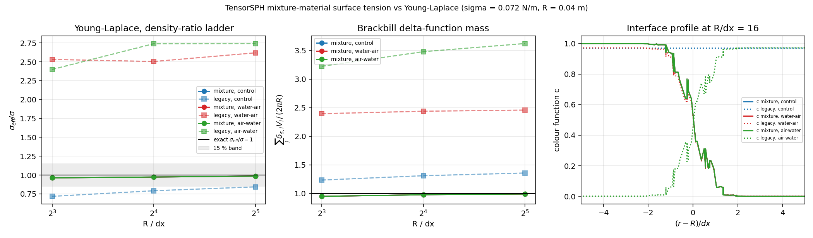

# Mixture-material surface tension vs Young-Laplace (cross-validation)

**Status: PASS** of the mixture-material chain, **FAIL** (honest negative result, kept) of the shipped single-material colour on mixtures.
Anchor: `XVAL-SPH-MIXTURE-MATERIAL-AND-SURFACE-TENSION` (TensorSPH). Acceptance: <15 % error of the effective surface tension against an analytic/literature reference.

Reproduce:

```bash
PYTHONPATH=src python benchmarks/xval_mixture_laplace/run.py --plot
PYTHONPATH=src python benchmarks/xval_mixture_laplace/ablation_curvature.py
PYTHONPATH=src python benchmarks/xval_mixture_laplace/make_doc.py
PYTHONPATH=src python -m pytest tests/test_csf_mixture.py -v
```

## 1. Case introduction

Surface tension in a **mixture** (two materials, unequal rest density) is the first problem in which the colour function of an SPH code is a *phase indicator* rather than a *presence indicator*. The reference formulation for that case (Xiangyu-Hu/SPHinXsys, `SurfaceTension`, i.e. the C-correction of Adami, Hu & Adams 2010) normalises the colour function by the local kernel sum of the same per-phase volumes, so that the colour jump across the interface is exactly 1 whatever the density ratio.

Geometry and parameters (all injected from `results.json`):

| quantity | value |
|---|---|
| interface | circle, disc of material A in material B, particles on both sides |
| radius `R` | 0.04 m |
| surface tension `sigma_AB` | 0.072 N/m |
| exact jump `sigma/R` | 1.7999999999999998 Pa |
| kernel | cubic spline, `h = 1.3 dx` |
| lattice | square, mass `m_i = rho0_phase dx^2` (volume-consistent) |
| resolutions | `dx` = 1.25 mm, 2.5 mm, 5 mm (`R/dx` = 32, 16, 8) |
| rest-density cases | `control`: rho_A = 1000.0, rho_B = 1000.0; `water-air`: rho_A = 1000.0, rho_B = 1.2; `air-water`: rho_A = 1.2, rho_B = 1000.0 |
| curvature | div n (mls), normal Shepard x2 |

## 2. Method

Two arms are compared on **identical particles and identical operators**; only the colour function and the delta-function rule differ, which is the ablation that isolates the mixture-material question.

`mixture` arm (`tensorsph.csf_mixture`, new):

* per-phase volume `V_j = m_j / rho0_phase(j)`,
* normalised phase-indicator colour `c^A_i = sum_{j in A} V_j W_ij / sum_j V_j W_ij` -> `c = 1` in the bulk of A, `c = 0` in the bulk of B, for **any** density ratio;
* `delta_s = |grad c^A|` (no factor 2: the normalised colour completes the full 1 -> 0 transition, unlike the one-sided free-surface rule);
* `n = -grad c/|grad c|`, `kappa = div n` (MLS), force assembled as a **volume force density** `f = -sigma kappa delta_s n`; the resultant is `sum_i f_i V_i`, so the momentum bookkeeping does not depend on which phase a particle belongs to.

`legacy` arm (shipped): `c = sum_j (m_j/rho0) W_ij` with one scalar `rho0 = 1000.0` (`tensorsph.csf_consistent.kernel_sum_color`), `delta_s = 2 |grad c|`, same normal smoothing and same `div n` curvature.

Measured quantities, per configuration:

* `sigma_eff/sigma = |sum_{x>0} f V| / (2 sigma)`, exact value 1: for a circular interface the resultant of `-sigma kappa delta_s n` over the half plane is `sigma kappa * int_arc n dl = 2 sigma`;
* `sum_i delta_s_i V_i / (2 pi R)`, exact value 1 (Brackbill identity);
* shell thickness of the force-carrying band, in `dx`;
* curvature error of the shell mean vs `1/R`;
* relative momentum residual `||sum_i f_i V_i|| / sum_i ||f_i|| V_i` on a cloud whose centre is **off** the lattice (`+0.37 dx, +0.21 dx`), so the cancellation is not lattice symmetry.

## 3. Results

### 3.1 Resolution and density-ratio ladder

| case | dx [mm] | N | `sigma_eff/sigma` mixture | err [%] | int delta_s | kappa err [%] | `sigma_eff/sigma` legacy | err [%] | int delta_s | kappa err [%] |
|---|---|---|---|---|---|---|---|---|---|---|
| control | 1.25 | 12668 | 0.9858 | -1.4 | 0.991 | -0.2 | 0.8430 | -15.7 | 1.358 | -44.5 |
| control | 2.5 | 3128 | 0.9735 | -2.6 | 0.977 | -1.4 | 0.7919 | -20.8 | 1.310 | -44.8 |
| control | 5 | 772 | 0.9622 | -3.8 | 0.949 | +0.9 | 0.7175 | -28.2 | 1.234 | -43.7 |
| water-air | 1.25 | 12668 | 0.9858 | -1.4 | 0.991 | -0.2 | 2.6195 | +162.0 | 2.458 | +7.5 |
| water-air | 2.5 | 3128 | 0.9735 | -2.6 | 0.977 | -1.4 | 2.5044 | +150.4 | 2.438 | +3.4 |
| water-air | 5 | 772 | 0.9622 | -3.8 | 0.949 | +0.9 | 2.5317 | +153.2 | 2.395 | +8.4 |
| air-water | 1.25 | 12668 | 0.9858 | -1.4 | 0.991 | -0.2 | 2.7426 | +174.3 | 3.623 | -113.7 |
| air-water | 2.5 | 3128 | 0.9735 | -2.6 | 0.977 | -1.4 | 2.7403 | +174.0 | 3.480 | -117.1 |
| air-water | 5 | 772 | 0.9622 | -3.8 | 0.949 | +0.9 | 2.3989 | +139.9 | 3.224 | -113.9 |

### 3.2 Density-ratio invariance

| quantity | mixture arm | legacy arm |
|---|---|---|
| spread of `sigma_eff/sigma` over the three density cases at the finest resolution | 0.00e+00 | 1.8996 |
| finest `sigma_eff/sigma`, control | 0.9858 | 0.8430 |
| finest `sigma_eff/sigma`, water/air | 0.9858 | 2.6195 |
| finest `sigma_eff/sigma`, air/water | 0.9858 | 2.7426 |
| within 15 % at the finest resolution (all three cases) | True | False |

Momentum residual of the closed interface, off-lattice centre: max over all configurations = 7.34e-16 (relative).

### 3.3 Curvature-operator ablation (same colour field, `R/dx = 16`)

| curvature | stencil [h] | kappa shell mean | kappa err [%] | `sigma_eff/sigma` |
|---|---|---|---|---|
| div n (mls) | - | 24.66 | -1.4 | 0.974 |
| fit_circle | 2 | 20.55 | -17.8 | 0.327 |
| fit_circle | 3 | 60.33 | +141.3 | 3.044 |
| fit_circle | 4 | 93.83 | +275.3 | 4.165 |
| fit_quadratic | 2 | -1.17 | -104.7 | 0.157 |
| fit_quadratic | 3 | 9.97 | -60.1 | 0.482 |
| fit_quadratic | 4 | 17.27 | -30.9 | 0.723 |

`div n` (library default) is the accurate operator here (-1.4 %); the local interface fits of `csf_curvature.fit_curvature` degrade badly on this band and were therefore **not** used, rather than tuned.



Left: `sigma_eff/sigma` vs `R/dx` for both arms and the three density cases (solid = mixture, dashed = legacy, grey = 15 % band). Middle: Brackbill delta-function mass `sum delta_s V /(2 pi R)`. Right: colour profile across the interface at `R/dx = 16`.

## 4. Error judgement

* **control**, finest (`R/dx = 32`): mixture error -1.42 % -> <3 %? **yes**; <15 %? **yes**.
* **water-air**, finest (`R/dx = 32`): mixture error -1.42 % -> <3 %? **yes**; <15 %? **yes**.
* **air-water**, finest (`R/dx = 32`): mixture error -1.42 % -> <3 %? **yes**; <15 %? **yes**.
* coarsest (`R/dx = 8`), mixture: -3.78 % -> <15 %? **yes**, <3 %? **no**.
* legacy arm, water/air, finest: +161.95 % -> **FAIL**, and the error does not decrease under refinement, so it is an estimator defect, not truncation.

## 5. Caveats and scope

* This verifies the **static equilibrium** (Laplace law) and the estimator properties (colour invariance, delta mass, zero resultant). It does not exercise a time-stepping solver, capillary waves or the Rayleigh-Plateau instability; those have their own harnesses in this repository.
* `tensorsph.csf_mixture` is a **new module**; the pipeline in `droplet_impact.py` still calls the single-material chain. Nothing in the shipped solver changed, so no existing number moves.
* The legacy arm is driven through the same `div n` curvature, so its failure is attributable to the colour function and the `2|grad c|` rule, not to the curvature operator. Part of its error is also the *free-surface* truncation of `c = sum V W` at the outer edge of the cloud (colour jump 0.358 instead of 1).
* `fit_curvature` (local fits) is inaccurate on this band — non-monotone in the stencil radius, with the same value for `stencil = 4` and `5`. That is a pre-existing defect of `csf_curvature`, outside the scope of this task; recorded as a follow-up below.
* 2-D only. The 3-D counterpart (`tensorsph.threed.csf3`) has its own chain and was not touched.

## 6. Follow-up

* Route `droplet_impact` / `threed.solver` through the mixture colour so that multi-material cases stop using a single `rho0`.
* Repair `csf_curvature.fit_curvature`: measure the stencil behaviour on an analytic circle with an analytic normal and fix the non-monotone response.

