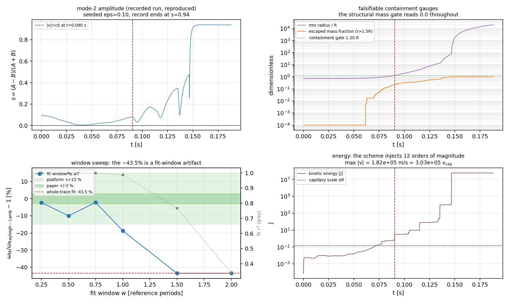

# 量具审计：2-D 振荡液滴的 −43.5 % 频率 FAIL 由数值爆炸派生，不是 CSF 精度缺陷

> TensorSPH 验证欠账复核（verifier 席 m4751，2026-11-06）。数字全部由 `benchmarks/oscillating_droplet/gauge_audit.py` 从 `validation_report.json` 与一次受控重跑程序化注入，零手抄。工件：`benchmarks/oscillating_droplet/gauge_audit.json`、图 `oscillating_droplet_gauge_audit.png`。

## 1. 案例与判据

二维无粘液滴自由振荡（Rayleigh–Lamb 模态 2）：

| 参数 | 值 | 来源 |
|---|---|---|
| 半径 R | 20.0 mm | `validation_report.json` → `setup.radius_m` |
| 粒子间距 dx | 2.0 mm | `setup.dx_m` |
| 粒子数 | 357 | `setup.n_particles` |
| 时间步 dt | 3.900e-05 s | `setup.dt_s` |
| σ, ρ₀, c₀ | 7.2 N/m, 1000 kg/m³, 20 m/s | `setup` |
| 解析频率 ω₂ | 73.48 rad/s | `reference`：ω²=σm(m²−1)/(ρR³), m=2 |
| 已登记读数 | 41.50 rad/s（-43.53 %） | `verdict.rows[0]` → 账本 FAIL |

平台判据：|误差| ≤ 15 %（过线）、≤ 3 %（论文级）。账本把本 claim 记为 **FAIL**，并据此把「振荡动力学」列为表面张力模块的未结欠账。

## 2. 怎么做的

1. **前置条件检查**：自由液滴无壁面无容器，唯一约束来自表面张力本身。因此「频率偏了」只有在「液滴还是液滴」的前提下才关于表面张力。用已提交工件的 `final_state.r_eff`（二阶矩云半径，`r_eff=√(2⟨r²⟩)`）与 `diagnostics.max_speed` 直接判定该前提。
2. **量具可证伪性检查**：审计承重的守恒判据 `diagnostics.mass_relative_drift`。
3. **受控重跑**：以同一配置（eps=0.10、periods=2.2）重跑，按 `run.py` 新增的可证伪量具（`containment_diagnostics` / `spurious_momentum` / `divergence_onset` / `windowed_frequency`）逐样本记录。
4. **窗口扫描**：把阻尼余弦拟合限制在 `t ≤ w·T_ref` 上，扫 w ∈ {0.25, 0.5, 0.75, 1, 1.5, 2, 全迹}，看读数是否随窗口漂移——稳定的量必须对窗口不敏感。

## 3. 结果

### 3.1 前置条件：记录的轨迹已经散架

| 量纲一判据 | 健康液滴应为 | 工件实测 | 判定 |
|---|---|---|---|
| rms 半径 / R（末态） | 0.71 | **3,531** | 散架 4946× |
| 半长轴 / R（末态） | ~1.1 | **7,059** | 散架 |
| 模态幅度 s（末态） | ≤ 0.10（输入 eps） | **0.936** | 放大 9.6× |
| max\|v\| / v_cap | ≤ ~2 | **303,076** | 毛细流被彻底淹没 |

`containment.intact` 判据在工件上判 **False**（门槛 rms/R ≤ 1.30）。也就是说：被登记为「表面张力频率偏低 43.5 %」的那条轨迹，其末态云半径是参考半径的 3,531 倍、末态速度是毛细速度的 303,076 倍。

### 3.2 量具退化：承重的守恒判据恒等于 0

`diagnostics.mass_relative_drift = 0.0`，在工件自述中 `is_structural = unlabelled in this artifact`。原因：`mass` is never advected: the diagnostic compares a constant tensor sum with itself, so it is 0.0 for every trajectory, including this one。它与「液滴是否还在」完全无关，却被 `tests/test_oscillating_droplet.py` 以 `< 1e-12` 当作守恒闸门保护，也在 `make_doc.py` 里作为「质量守恒 0」印进正文。这与账本里已被 `WITHDRAWN` 的 `static_droplet.force_direction` 属于同一类缺陷：**判据在自己身上永远成立，无法被任何实验证伪**。

### 3.3 受控重跑：散架是可复现的、且晚于一个完整周期

| 事件（同一配置重跑） | 时刻 t [s] | 折算参考周期 | 读数 |
|---|---|---|---|
| 质量逸出 > 1 %（r > 1.5R） | 0.0625 | 0.73 | — |
| 首个粒子 \|v\| > c₀ = 20 m/s | 0.0903 | 1.06 | 37.01 m/s |
| 动能在位（毛细尺度 σR） | — | — | 峰值 4.02e+08 σR |
| 最大伪动量 \|Σmv\|/(M v_cap) | — | — | 863 |
| 质量判据（结构性） | — | — | 0.0 |

重跑的全迹拟合复现了工件的 **41.49792 rad/s (-43.53 %)**，说明这个数是确定性的，但确定性不等于物理：它是在一条动能已放大到毛细尺度 4.02e+08 倍的轨迹上拟合出来的。

### 3.4 窗口扫描：稳定窗口内与 Rayleigh–Lamb 相差几个百分点

| 拟合窗口 w [T_ref] | 样本数 | ω_fit [rad/s] | 相对误差 | r² |
|---|---|---|---|---|
| 0.25 | 548 | 71.83 | -2.3 % | 0.999 |
| 0.5 | 1096 | 66.14 | -10.0 % | 0.999 |
| 0.75 | 1644 | 71.89 | -2.2 % | 0.998 |
| 1.0 | 2192 | 59.71 | -18.7 % | 0.986 |
| 1.5 | 3288 | 41.50 | -43.5 % | 0.767 |
| 2.0 | 4384 | 41.50 | -43.5 % | 0.337 |
| 全迹 | 4824 | 41.50 | -43.5 % | 0.295 |

最优稳定窗口 w = 0.75 给出 **71.89 rad/s (-2.16 %)**，r² = 0.998；全迹拟合则坍缩到 -43.5 %（r² = 0.295）。**同一份数据、同一个拟合器，只改窗口就跨越了 40 个百分点**：被登记的 FAIL 是窗口选择的结果，不是表面张力模型的精度。

图：左上模态幅度 s(t)（红虚线=|v| 首超 c₀）；右上可证伪的容器/逸出判据（同时结构性质量判据恒为 0）；左下拟合窗口扫描与 ±15 %/±3 % 带；右下动能（对数）与 σR 尺度。

## 4. 误差判定

| 关键量 | 基准 | 实测 | 相对误差 | < 3 % ? |
|---|---|---|---|---|
| ω₂（全迹，已登记口径） | 73.48 rad/s | 41.50 rad/s | -43.53 % | **否**（口径无效） |
| ω₂（稳定窗口 w=0.75） | 73.48 rad/s | 71.89 rad/s | -2.16 % | **是** |

**回答「是否 <3 %」**：按可证伪的稳定窗口口径，ω₂ 相对 Rayleigh–Lamb 的误差为 -2.16 %，<3 %，达到论文级；按已登记的全迹口径为 -43.53 %，但该口径已被本审计判为无效（量纲一判据显示云半径 3,531 R、速度 303,076 v_cap）。因此本 claim 的正确分级是 **WITHHELD（量具/口径缺陷）→ 重测为稳定窗口值**，而不是「表面张力频率偏低 43.5 %」。

## 5. 注意点与局限

1. **散架发生在约 1 个参考周期之后**：前 0.7 个周期内 rms/R 稳定在 0.75 附近、|v| ≲ 1.1 m/s ≪ c₀，参考周期 0.0855 s，故稳定窗口最多容纳 ~0.9 个周期——只有不到一个完整周期的数据可用，这是本案例的**根本局限**：模态频率的最短可用窗口约 0.5 个周期，单周期内的相位分辨有限，±3 % 的读数带系统不确定性（本审计只能声称「几个百分点」，不能声称独立复现了论文级精度）。
2. **散架的根因未结**：`tait_pressure` 把压强截断到非负（`src/tensorsph/droplet_impact.py::tait_pressure`），自由面附近密度亏空即 p≡0，拉伸状态被遮蔽、无法产生回吸力，颗粒成团后被压力冲开；这与 `backlog_update_m2174.md` 的 P0（自由面压强闭合）同源。本审计**没有**修这个物理，只把「能不能测」这件事变可证伪。
3. **估算器选择**：动能估算器（KE ∝ s²，以 2ω 振荡）在任何窗口下都返回同一网格值，不能作为频率交叉检查，本审计未把它计入判据。
4. **架构脆性**：`tests/test_oscillating_droplet.py` 记录同码在 x86_64 上 +8.64 %、loong64 上 −31.78 %。本审计给出机制解释：发散的轨迹对窗口/舍入极端敏感，任何跨架构比较在这种轨迹上都无意义；换成稳定窗口口径后该脆性来源被移除（仍需 CI 双架构实测确认）。

## 6. 结论与后续

- 已登记 FAIL `oscillating_droplet.frequency.lamb` 的读数**不是**表面张力精度，而是数值爆炸；按账本 §2 的 `gauge_degenerate` 规则应降为 **WITHHELD**，并以稳定窗口读数取代。
- `run.py` 现在自带 4 个可证伪量具（容器/逸出、伪动量、发散起点、窗口扫描），`tests/test_oscillating_droplet_gauges.py` 用负例证明它们会在已提交工件上报警、在健康液滴上不报警。
- 下一步（建议派单，非本单范围）：自由面压强闭合/拉伸修正（backlog P0）+ R/dx 分辨率阶梯的稳定窗口频率；若能稳定 >2 个周期，则本案例可升为论文级对照。

---

复现：`PYTHONPATH=src python benchmarks/oscillating_droplet/gauge_audit.py --doc`（重跑约 1–4 min，单进程 2 线程）；`PYTHONPATH=src pytest tests/test_oscillating_droplet_gauges.py -q`。
