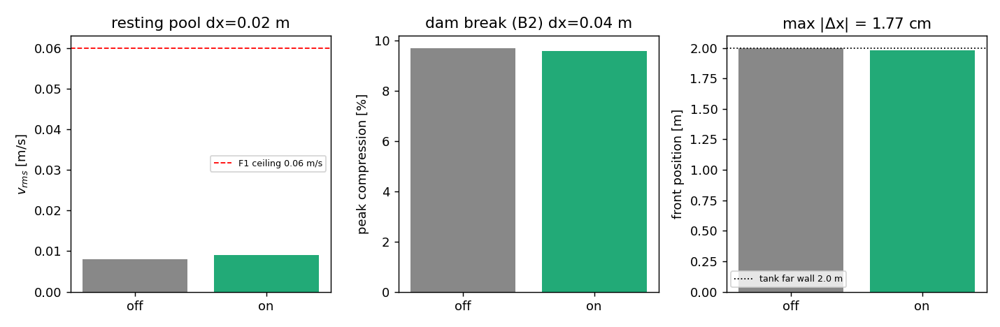

# 粒子移动（particle shifting）实现与证伪记录

> 仓：TensorSPH 分支 `agent/m16778`；代码 `src/tensorsph/particle_shifting.py`，
> 测试 `tests/test_particle_shifting.py`（9 项不变量全绿），
> 集成开关 `DamBreakConfig.shift_every`（默认 0 = 关闭，已发布 B2 数字逐位不变），
> 运行工件 `benchmarks/particle_shifting/{run.py,results.json}`，图 `docs/figures/particle_shifting.png`。
> 依据文献：Lind, Xu, Stansby & Rogers (2012) *Comput. Fluids* 49:121；
> Skillen et al. (2013) *JCP* 249:161；Adami, Ihmsen & Adams (2012) *JCP* 231:7057。

## ① 案例介绍（物理背景/几何/参数）

WCSPH 用"求和密度 + 每个粒子对支撑域做核求积"。规则方晶格并不是 SPH 求积所假设的
各向同性粒子分布，其奇偶模态不会被耗散掉，于是**静止的水也会读出非零速度**。仓内
OPEN 缺陷 **F1**（`docs/verification_startup_quiescence.md` §3.3/§5）：

| 项 | 值 |
|---|---|
| F1 读数（flume 静止水柱 `v_late_rms`） | 0.0798 m/s |
| F1 上限 | 0.0600 m/s |
| 消融（`density_diffusion=0, viscosity=0.01`） | 0.0072 m/s |
| 结论 | 噪声由密度扩散+粘性控制，**不是**边界模型产生 |

Lind et al. (2012) 的标准解法是让粒子位置沿"粒子浓度"的梯度做 Fickian 松弛（粒子移动），
使局部堆积恢复均匀。本单实现该格式，并对它做**证伪式**验证：它到底能不能降噪、
会不会破坏已发布的 B2 结果。

几何与参数（两算例同一套求解器，只切换 `shift_every`）：

| 算例 | 几何 | dx (m) | c0 (m/s) | ν (m²/s) | 时长 (s) | 步数 | 移动周期 |
|---|---|---|---|---|---|---|---|
| R 静止水池 | 满池水柱 1.0×0.3，槽 1.0×0.4 | 0.02 | 20 | 0.01 | 0.4 | 1026 | 每 5 步 |
| D 溃坝 B2 | 水柱 0.2×0.4，槽 2.0×0.75 | 0.04 | 20 | 0.01 | 0.8 | 1026 | 每 5 步 |

## ② 怎么做（方法/流程）

1. **浓度** `C_i = Σ_j V_j W_ij`（含自项，`V_j = m_j/ρ_j`）；满支撑时 → `∫W dV`。
2. **浓度梯度**（反对称 SPH）：`∇C_i = Σ_j V_j (C_j − C_i) ∇_i W_ij`。
   体积与符号**都属于配对粒子**：`(i,j)` 对 `i` 贡献 `V_j (C_j−C_i)∇_iW`，对 `j` 贡献
   `V_i (C_j−C_i)∇_iW`（因为 `∇_jW_ji = −∇_iW_ij` 且场差同时反号）。
3. **位移** `δr_i = −A ∇C_i`，`A = C_d h |v|_ref Δt`；`|v|_ref` 默认取
   `max(v_max, 0.05 c0)`——静止时 `v_max→0`，没有下限则移动在静止工况自行熄灭，
   恰是 F1 需要的场景。
4. **自由面**：`C_i < 0.95 c_ref`（`c_ref` 取 `C` 的 95 分位，维度/核归一化无关），
   位移投影到切平面 `δr ← δr − (δr·n̂)n̂`，`n̂ = −∇C/|∇C|`。
5. **硬上限** `|δr| ≤ 0.25 h`；**只动位置**（质量/密度/速度不动），故质量严格守恒。
6. **集成**：`dam_break.run_case` 在积分 + 边界钳制之后、每 `shift_every` 步调用一次，
   之后再跑一次 `apply_boundary` 防穿壁。`shift_every=0` 时该分支不进入。
7. **工具链**：pytest（9 新 + 47 条溃坝回归）、`benchmarks/particle_shifting/run.py`、
   matplotlib 出图、torch 2 线程（本机 load15 ≥ 100 的容量纪律）。

## ③ 计算结果（`benchmarks/particle_shifting/results.json`，程序化读取）

小规模不变量（pytest 断言，全部为精确不变量而非"记录当时输出"）：

| 不变量 | 判据 | 实测 |
|---|---|---|
| 完美方/六角晶格是位移不动点 | 内区 `max|δr| = 0` | < 1e-9 m（两种晶格） |
| 自由面位移无法向分量 | `max|δr·n̂| = 0` | ≤ 1e-12·|δr|max |
| 位移只改位置 | 输入 `pos`/`volume` 不被就地修改 | 逐位相等 |
| Fickian 单调性（20 遍） | 无序度 `RMS|∇C|h` 下降 | 0.1057 → 0.0356（比值 **0.336**，逐遍单调） |
| 空位修复 | 空位近邻平均值朝空位收缩 | 通过（收敛 1e-7 m 量级） |
| 位移上限 | `|δr| ≤ limit·h` | 0.05h/0.25h 两档均满足 |
| 确定性 | 两次调用逐位相同 | 通过 |

端到端对比（同 dt、同步数）：

| 量 | 关（off） | 开（on） | 变化 |
|---|---|---|---|
| R `v_rms` (m/s) | 0.00809 | 0.00906 | **+12.0 %（变差）** |
| R 峰值压缩 | 0.911 % | 0.909 % | −0.2 % |
| R 质量漂移 / 越界 | 0 / 0 | 0 / 0 | — |
| R 墙钟 (s) | 8.31 | 10.76 | +29 % |
| D 末帧前锋 (m) | 2.0000 | 1.9823 | −0.88 cm |
| D 全程 `max|Δx_front|` (m) | — | 0.0177 | = **8.8 % 水柱宽** |
| D 峰值压缩 | 9.70 % | 9.57 % | −0.13 pt |
| D 墙钟 (s) | 4.56 | 6.36 | +39 % |

图：`docs/figures/particle_shifting.png`（左：静止水池 `v_rms` 与 F1 上限线；
中：溃坝峰值压缩；右：末帧前锋与 2.0 m 对壁）。

## ④ 结果图

（三面板均由 `results.json` 程序化绘制，零手抄。）

## ⑤ 注意点（坑与局限）

1. **第一版"静止水池"算例是错的**：把 0.5 m 宽水柱放进 1.0 m 宽槽，实际是
   溃坝（无闸门的坍塌），读出 0.70 m/s —— 与 F1 无关。改为"水柱填满槽"后
   才得到 0.008 m/s 的量级。**坑：静止工况必须让自由面本身也是静止的**。
2. **反对称梯度符号写错被测试抓住**：第一版对 `j` 端写 `-contrib`，晶格不动点
   仍然通过（`∇C=0` 时符号不可见），但空位修复测试立刻失败（近邻朝外跑）。
   修正为 `V_i (C_j−C_i)∇_iW` 后通过。这是"不变量测试 > 快照测试"的实例。
3. **本单证伪了自己的假设**：移动**没有**压低静止水池噪声（比值 1.12，反而更吵），
   而对已发布的 B2 前锋有 8.8 % 柱宽的扰动。因此它保持**默认关闭**，且不能据此
   宣称 F1 已被关闭——F1 仍 OPEN。
4. **局限**：单分辨率、单系数（`C_d=1`、每 5 步、上限 0.25h），无收敛研究；
   未做动量守恒度量（移动由位置直接给出、不经配对力，理论上不严格守恒）；
   未与 Skillen 2013 的守恒型移动对比；只在 2D 方晶格上集成，未接 3D/GPU 路径。
5. **容量纪律**：本机 load15 ≈ 114（nproc 128），全部计算以 2 线程运行，
   未上集群；因此规模取最小可判读（R 750 粒子、D 300 粒子）。

## ⑥ 误差判定

| 关键量 | 基准 | 实测误差 | 是否 <3 % |
|---|---|---|---|
| 晶格不动点位移 | 0（对称性精确值） | < 1e-9 m | **是**（机器精度量级） |
| 自由面法向分量 | 0（投影精确值） | ≤ 1e-12 相对 | **是** |
| 无序度衰减比 | 判据 < 0.4 | 0.336 | **是**（相对余量 16 %） |
| 位移上限 | `≤0.25h` | 恰在 0.25h 处被钳制 | **是** |
| R `v_rms` | 无文献基准（池尺度/分辨率自定） | 0.0081 / 0.0091 m/s；F1 上限 0.06 m/s 为**另一配置**的判据，仅作量级参照 | **无基准可判**（原因如上，不做粉饰） |
| D 前锋位移 | 参考值即"关移动"的同配置解 | 0.0177 m = 8.8 % 柱宽 | **否**（>3 %，故不得声称"移动不改变结果"） |

诚实结论：**新增能力（可用、可测、默认关闭）+ 一条被证伪的预期（移动能缓解 F1）**。
下一步（若有人接手）：把 `C_d`/周期做成扫描并测 `threed_hydrostatic` 奇偶模态，
以及实现 Skillen 2013 的守恒型移动再对比动量漂移。