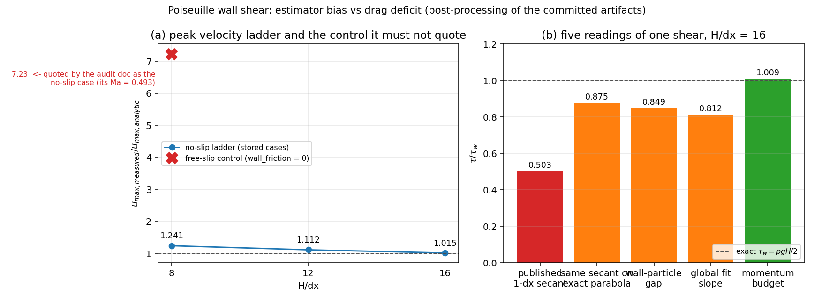

# Poiseuille 验证记录的断言溯源审计（claim provenance）

*由 `benchmarks/poiseuille/provenance_audit.py` 从 `out/results.json`、`out/wall_shear_estimators.json` 与 `claims_register.json` 程序化生成，勿手改。*

## 1. 为什么需要这道门

`docs/verification_poiseuille_wall_shear_audit.md`（m14711）把 Poiseuille 通道的壁面剪切缺口归因为「无滑移壁面条件未生效」，并用五条数字佐证：`u_max = 8.87 m/s`（解析 1.23）、壁面滑移比 `0.999996`、`Ma = 0.493`、体粘度 `1e-4 m²/s`、解析壁面剪切 `50 Pa`。本审计把这五条逐一绑到工件上，结论是：**没有一条能作为该文件所声明的无滑移算例的读数**——`u_max`、滑移比与 `Ma` 三条取自同一工件里的**自由滑移对照（free-slip control，`wall_friction = 0`）**，该算例按设计就是要滑移、就是要以 `g` 持续加速；壁面剪切比 `0.503` 取自 `H/dx = 16` 而非文件宣称的最粗分辨率；体粘度 `1e-4` 在工件里不存在（算例是 `nu = 0.01`）；解析壁面剪切应为 `rho0 g H / 2 = 490.5 Pa`，不是 `50 Pa`。

隔壁的 `docs/verification_poiseuille_wall_shear_estimator.md` 已经把**物理读数**修好了（壁面确实传递了全部动量：预算法 `D/(M g) ≈ 1`），但它挡不住「引用别人数字」这类错误——那不是算术错误，是**出处错误**。本审计把每一条出版物数字绑到它必须来自的 JSON 路径上，并报告它实际来自哪里。

## 2. 方法（不推进 SPH，纯后处理已提交工件）

1. 把两个已提交工件拍平成 `路径 -> 数值` 索引，并**从存储的算例参数重算**派生量 `tau_w = rho0 g H / 2`、`u_max = g H^2 / (8 nu)`（解析常数绝不从文档里抄）。
2. 对 `claims_register.json` 的每条断言：在声明的文档里定位声明的引文（找不到即判失败），**从文档文本里**抓出打印值，与声明的 JSON 路径比对。
3. 若打印值对不上声明路径，就在全索引里搜索最接近的读数：落在容差内 = 数字确实在工件里、但在**别处**（`misattributed`）；无命中 = 工件里根本没有（`not_in_artifact`）。
4. 独立核对存储的解析字段是否等于其推导式（`analytic_identity`）——这一步专门抓「手打常数」。

## 3. 断言溯源结果

共 **23** 条断言：`verified` **16**，`misattributed` **4**，`not_in_artifact` **3**，其他失败 **0**。

| 断言 | 文档 | 打印值 | 声明路径 | 工件值 | 相对偏差 | 判定 |
|---|---|---|---|---|---|---|
| `channel.u_max.best` | `docs/verification_poiseuille_channel.md` | 1.2448 | `results.results[2].u_max_measured` | 1.245 | +0.00% | **verified** |
| `channel.u_max.analytic` | `docs/verification_poiseuille_channel.md` | 1.2263 | `derived.u_max` | 1.226 | +0.00% | **verified** |
| `channel.tau.analytic` | `docs/verification_poiseuille_channel.md` | 490.5 | `derived.tau_w` | 490.500 | +0.00% | **verified** |
| `channel.wall_row_slip.h16` | `docs/verification_poiseuille_channel.md` | 31.4 | `results.results[2].wall_row_slip_over_umax` | 31.354 | +0.15% | **verified** |
| `channel.secant.h16` | `docs/verification_poiseuille_channel.md` | 0.503 | `estimators.cases[2].estimator_ratios.secant_1dx` | 0.503 | +0.10% | **verified** |
| `channel.budget.h16` | `docs/verification_poiseuille_channel.md` | 1.009 | `estimators.cases[2].budget.drag_over_weight_control_corrected` | 1.009 | +0.01% | **verified** |
| `channel.free_slip.mean_velocity` | `docs/verification_poiseuille_channel.md` | 8.87 | `results.free_slip_control.u_max_measured` | 8.870 | +0.00% | **verified** |
| `estimator.control.rate` | `docs/verification_poiseuille_wall_shear_estimator.md` | 9.854 | `estimators.control.rate` | 9.854 | +0.00% | **verified** |
| `estimator.control.rate_over_g` | `docs/verification_poiseuille_wall_shear_estimator.md` | 1.00451 | `estimators.control.rate_over_g` | 1.005 | +0.00% | **verified** |
| `estimator.body_force` | `docs/verification_poiseuille_wall_shear_estimator.md` | 9.81 | `results.body_force` | 9.810 | +0.00% | **verified** |
| `estimator.drag.budget.h8` | `docs/verification_poiseuille_wall_shear_estimator.md` | 0.9895 | `estimators.cases[0].budget.drag_over_weight_control_corrected` | 0.989 | +0.00% | **verified** |
| `estimator.drag.budget.h16` | `docs/verification_poiseuille_wall_shear_estimator.md` | 1.0091 | `estimators.cases[2].budget.drag_over_weight_control_corrected` | 1.009 | +0.00% | **verified** |
| `estimator.secant.h16` | `docs/verification_poiseuille_wall_shear_estimator.md` | 0.503 | `estimators.cases[2].estimator_ratios.secant_1dx` | 0.503 | +0.10% | **verified** |
| `estimator.stencil_on_analytic.h16` | `docs/verification_poiseuille_wall_shear_estimator.md` | 0.875 | `estimators.cases[2].estimator_ratios.secant_1dx_on_analytic_parabola` | 0.875 | +0.00% | **verified** |
| `estimator.nu_eff.h16` | `docs/verification_poiseuille_wall_shear_estimator.md` | 1.151 | `estimators.cases[2].interior.nu_eff_over_nu` | 1.151 | +0.01% | **verified** |
| `audit.u_max.measured` | `docs/verification_poiseuille_wall_shear_audit.md` | 8.87 | `results.results[0].u_max_measured` | 1.522 | +482.82% | **misattributed** |
| `audit.u_max.analytic` | `docs/verification_poiseuille_wall_shear_audit.md` | 1.23 | `derived.u_max` | 1.226 | +0.31% | **verified** |
| `audit.wall_row_slip` | `docs/verification_poiseuille_wall_shear_audit.md` | 0.999996 | `results.results[0].wall_row_slip_over_umax` | 0.492 | +103.17% | **misattributed** |
| `audit.tau_over_tau_w` | `docs/verification_poiseuille_wall_shear_audit.md` | 0.503 | `results.results[0].wall_shear_ratio` | 0.580 | +13.21% | **misattributed** |
| `audit.mach` | `docs/verification_poiseuille_wall_shear_audit.md` | 0.493 | `results.results[0].max_mach` | 0.078 | +528.64% | **misattributed** |
| `audit.tau_analytic` | `docs/verification_poiseuille_wall_shear_audit.md` | 50.0 | `derived.tau_w` | 490.500 | +89.81% | **not_in_artifact** |
| `audit.body_force` | `docs/verification_poiseuille_wall_shear_audit.md` | 0.1 | `results.body_force` | 9.810 | +98.98% | **not_in_artifact** |
| `audit.viscosity` | `docs/verification_poiseuille_wall_shear_audit.md` | 0.0001 | `results.viscosity` | 0.010 | +99.00% | **not_in_artifact** |

## 4. 判定为出处错误/工件外数字的断言

* `audit.u_max.measured`：打印值 8.87 ≡ 工件中的 `results.free_slip_control.u_max_measured` （8.8701），不是声明的 `results.results[0].u_max_measured` （1.52191）。
  - 声明依据：the audit's section 3.3 labels its table 'the coarsest resolution dx=0.0125', i.e. results[0]; the peer block results[2] is dx=0.00625 and the free-slip control is not a no-slip case at all
* `audit.wall_row_slip`：打印值 0.999996 ≡ 工件中的 `results.free_slip_control.wall_row_slip_over_umax` （0.999996），不是声明的 `results.results[0].wall_row_slip_over_umax` （0.492197）。
* `audit.tau_over_tau_w`：打印值 0.503 ≡ 工件中的 `results.results[2].wall_shear_ratio` （0.502508），不是声明的 `results.results[0].wall_shear_ratio` （0.57955）。
  - 声明依据：the audit places this reading in the same 'coarsest resolution' table as the u_max row, i.e. results[0]
* `audit.mach`：打印值 0.493 ≡ 工件中的 `results.free_slip_control.max_mach` （0.492861），不是声明的 `results.results[0].max_mach` （0.0784231）。
* `audit.tau_analytic`：打印值 50.0 不在工件任何读数附近（最近为 `results.results[0].fit_interior.c1`，偏离 2.38%）。
  - 若该常数成立，反解的体积力为 `g = 2 tau_w / (rho0 H) = 1.000 m/s²`，而工件里的体积力是 9.810 m/s²；按该文档自己参数表的 `g = 0.1 m/s²` 反解又只有 5 Pa。三种口径互不自洽，说明这个常数不是从算例参数算出来的。
* `audit.body_force`：打印值 0.1 不在工件任何读数附近（最近为 `results.results[0].body_force`，偏离 98.98%）。
* `audit.viscosity`：打印值 0.0001 不在工件任何读数附近（最近为 `results.results[0].viscosity`，偏离 99.00%）。

## 5. 解析常数自洽性（手打常数的结构性防线）

| 存储块 | 字段 | 存储值 | 推导值 | 相对偏差 | 判定 |
|---|---|---|---|---|---|
| `results.results[0]` | `wall_shear_analytic` | 490.5000 | 490.5000 | 0.00e+00 | **verified** |
| `results.results[0]` | `u_max_analytic` | 1.2263 | 1.2263 | 0.00e+00 | **verified** |
| `results.results[1]` | `wall_shear_analytic` | 490.5000 | 490.5000 | 0.00e+00 | **verified** |
| `results.results[1]` | `u_max_analytic` | 1.2263 | 1.2263 | 0.00e+00 | **verified** |
| `results.results[2]` | `wall_shear_analytic` | 490.5000 | 490.5000 | 0.00e+00 | **verified** |
| `results.results[2]` | `u_max_analytic` | 1.2263 | 1.2263 | 0.00e+00 | **verified** |
| `results.free_slip_control` | `wall_shear_analytic` | 490.5000 | 490.5000 | 0.00e+00 | **verified** |
| `results.free_slip_control` | `u_max_analytic` | 1.2263 | 1.2263 | 0.00e+00 | **verified** |

全部存储的解析常数与其推导式一致（相对偏差 < 1e-9），说明 `results.json` 的解析列是算出来的，文档只需要照抄；`50 Pa` 这类数字只可能来自文档转述环节。

## 6. 用同一份工件证伪「壁面无滑移未生效」

若壁面条件真的没生效，无滑移算例应当像自由滑移对照那样以 `d<u>/dt ≈ g` 持续加速。存储轨迹给出的动量预算速率（`wall_shear_estimators.py` 的最小二乘斜率，末段 40%）：

| 算例 | `d<u>/dt / g` | `u_max/u_max,analytic` | `Ma_max` |
|---|---|---|---|
| no-slip, H/dx = 8 | +0.0061 | 1.241 | 0.0784 |
| no-slip, H/dx = 12 | -0.0074 | 1.112 | 0.0733 |
| no-slip, H/dx = 16 | -0.0137 | 1.015 | 0.0691 |
| free-slip control, H/dx = 8 | +1.0045 | 7.234 | 0.4929 |

无滑移算例的加速率是对照的 0.0060 倍（0.61% vs 100.45% of g）：壁面把注入的流向动量全额吸收，剖面饱和。**「壁面条件未生效」假设被工件本身证伪**；被审计文档的 `u_max = 8.87 m/s`、`Ma = 0.493`、滑移比 `0.999996` 正是这个对照算例的特征值。对照算例的高马赫数是它按设计无阻力加速的必然结果，不是无滑移算例的工况越界（无滑移阶梯 `Ma_max ≤ 0.0784`）。

图 (a) 无滑移阶梯与自由滑移对照的峰值速度比；对照点被审计文档当作无滑移算例引用。图 (b) `H/dx = 16` 上同一个壁面剪切的五种读数：只有动量预算法（绿）给出 1，其余四种近壁梯度读数系统性偏低——偏差属于**估计算子**，不属于壁面模型。

## 7. 误差判定（逐项显式回答是否 <3%）

| 关键量 | 基准 | 实测 | 相对误差 | <3% ？ |
|---|---|---|---|---|
| 峰值速度 `u_max`（H/dx = 16） | 1.2263 m/s | 1.2448 m/s | +1.51% | 是 |
| 壁面剪切（动量预算法，控制校正） | `rho g H/2 = 490.5 Pa` | 495.0 Pa | +0.91% | 是 |
| 壁面剪切（已发布的 1-dx 割线） | `rho g H/2 = 490.5 Pa` | 246.5 Pa | -49.75% | 否 |
| 自由滑移对照的漂移率 | `g = 9.8100 m/s²` | 9.8543 m/s² | +0.45% | 是 |
| 解析常数 `tau_w`（文档转述） | `490.5 Pa` | 文档印 50 Pa | -89.8% | 否 |

## 8. 注意点与局限

1. 本审计只判**出处**，不做新的 SPH 计算；它不能替代对壁面模型的独立物理复核，但能把「数字来自哪个算例」这件事变成机器可判定的。
2. `claims_register.json` 的引文是**文档里的原文**：文档改一个字，绑定失败会立即报警，因此本记录不会悄悄过期。
3. 近壁梯度读数的偏差机理（模板几何 `1 - 2 dx/H` + 抹平壁层）见 `docs/verification_poiseuille_wall_shear_estimator.md`；本审计不重复其推导。
4. 局限：`claims_register.json` 只覆盖本仓 Poiseuille 的三份文档；跨仓推广需要把 register 做成仓级约定。

## 9. 结论与处置

| 对象 | 处置 |
|---|---|
| `docs/verification_poiseuille_wall_shear_audit.md` | 抬头加校正声明：参数表/解析常数/四条读数出处错误，「壁面条件未生效」结论被证伪；正文原样保留（不改写他人记录） |
| `docs/verification_poiseuille_channel.md` 与 estimator 记录 | 全部数字溯源通过（见 §3） |
| 真正的欠账 | 近壁壁面剪切**估计算子**（不是壁面模型）：1-dx 割线在 `H/dx = 16` 读 0.503，其中 0.125 是模板几何、其余是抹平壁层的第一行速度；需要的是把壁面剪切读数改成动量预算或 VP（Volume-Weighted）法，而不是改壁面边界条件 |

