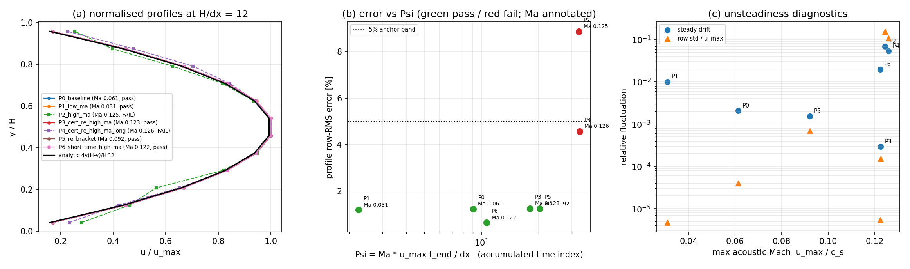
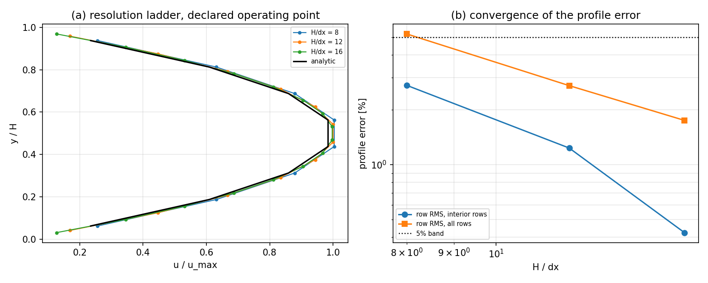

# CASE-POISEUILLE-SPH — 5 % 证书的适用边界（Ma 包络）

状态：**见下方判定表**；算例池锚点 `CASE-POISEUILLE-SPH`，容差 <5 %，参考=平面 Poiseuille 解析解。

> 本文件由 `benchmarks/poiseuille_mirror/make_envelope_doc.py` 全自动生成，所有数字来自 `out/ma_envelope.json` 与 `out/results.json`，无手抄。

## 1. 问题与参考解

平面 Poiseuille 流：`u(y) = g (H-y) y / (2 nu)`，`u_max = g H^2 / (8 nu)`，`tau_w = rho g H / 2`。参考出处：White, *Viscous Fluid Flow* 3rd ed. §3-2.2；Batchelor, *An Introduction to Fluid Dynamics* §4.2。

`run.py` 只在**一个工况**（g=9.81, nu=0.01, H=0.1, c_s=20）上给出 <5 % 证书，该工况下 Ma = u_max/c_s ≈ 0.06。弱可压 SPH 有公认适用界 Ma ≤ 0.1（Monaghan 1994/2005），但 `run.py` 既不测量也不声明它。本研究要判定的是：**该 <5 % 证书是壁面算子（mirror ghost）的普适性质，还是附带了 Ma 边界条件？**

## 2. 方法与实现

设计（受控、单变量操纵、全部点固定在 H/dx = 12，避免分辨率混入）：

| 点 | g | c_s | t_end | 操纵/目的 |
|---|---|---|---|---|
| P0_baseline | 9.81 | 20.0 | 1.0 | same-session control at the declared operating point |
| P1_low_ma | 4.905 | 20.0 | 1.0 | halve the driving force: lower Ma and lower Re |
| P2_high_ma | 19.62 | 20.0 | 1.0 | double the driving force: Ma 0.125, above the WCSPH limit |
| P3_cert_re_high_ma | 9.81 | 10.0 | 1.0 | key control: Ma raised at the certified Re, only c_s changed |
| P4_cert_re_high_ma_long | 9.81 | 10.0 | 2.0 | confounder control: same point with t_end doubled |
| P5_re_bracket | 14.715 | 20.0 | 1.0 | bracket the break: 1.5x the driving force, Ma still below 0.1 |
| P6_short_time_high_ma | 9.81 | 10.0 | 0.6 | high Ma, short accumulated time: a hard Ma cliff would fail here |

- **P3** 是关键对照：与 P2 的 g、nu 完全相同（Re 相同），**只提高声速** c_s=40，把 Ma 拉回对照点。若 Ma 是致因，P3 必须恢复 <5 %。
- **P4** 是混淆项对照：P2 工况下把 t_end 加倍（settling 与平均窗口同时加倍）。若 P4 恢复，则失败源于瞬态/平均不足（H3），而非可压性。

判定规则在跑之前写入 `study_ma_envelope.py` 文档串：H1 无条件 / H2 声学包络 / H3 瞬态。阈值 5 % 为算例池既定值，**未在事后调整**。

## 3. 参数表（无量纲数）

| 点 | Ma = u_max/c_s | Re = u_max H/nu | Psi = Ma·u_max·t_end/dx | dt | steps | n_fluid | wall_clock [s] |
|---|---|---|---|---|---|---|---|
| P0_baseline | 0.061 | 12.26 | 9.0 | 1.625e-04 | 6154 | 144 | 79 |
| P1_low_ma | 0.031 | 6.12 | 2.2 | 1.625e-04 | 6154 | 144 | 78 |
| P2_high_ma | 0.125 | 23.30 | 32.6 | 1.625e-04 | 6154 | 144 | 79 |
| P3_cert_re_high_ma | 0.123 | 12.26 | 18.0 | 3.250e-04 | 3077 | 144 | 36 |
| P4_cert_re_high_ma_long | 0.126 | 11.71 | 32.9 | 3.250e-04 | 6154 | 144 | 81 |
| P5_re_bracket | 0.092 | 18.39 | 20.3 | 1.625e-04 | 6154 | 144 | 85 |
| P6_short_time_high_ma | 0.122 | 12.15 | 10.6 | 3.250e-04 | 1846 | 144 | 28 |

公共参数：rho0=1000 kg/m³, H=0.1 m, nu=0.01 m²/s, 12 列周期, h=1.3 dx, 核支撑 2h, t_average=0.2 s。

## 4. 对照表（ref vs got，误差逐项打勾/叉）

| 点 | Ma | u_max ref | u_max got | err [%] | ✓/✗ | 剖面 RMS [%] | ✓/✗ | 壁面剪切 [%] | ✓/✗ | 全部闸门 |
|---|---|---|---|---|---|---|---|---|---|---|
| P0_baseline | 0.061 | 1.2263 | 1.2265 | 0.02 | ✓ | 1.234 | ✓ | 0.38 | ✓ | PASS |
| P1_low_ma | 0.031 | 0.6131 | 0.6123 | -0.14 | ✓ | 1.192 | ✓ | 0.50 | ✓ | PASS |
| P2_high_ma | 0.125 | 2.4525 | 2.3305 | -4.97 | ✓ | 8.870 | ✗ | 14.75 | ✗ | **FAIL** |
| P3_cert_re_high_ma | 0.123 | 1.2263 | 1.2264 | 0.01 | ✓ | 1.251 | ✓ | 0.37 | ✓ | PASS |
| P4_cert_re_high_ma_long | 0.126 | 1.2263 | 1.1713 | -4.48 | ✓ | 4.572 | ✓ | 11.56 | ✗ | **FAIL** |
| P5_re_bracket | 0.092 | 1.8394 | 1.8387 | -0.04 | ✓ | 1.247 | ✓ | 0.40 | ✓ | PASS |
| P6_short_time_high_ma | 0.122 | 1.2263 | 1.2154 | -0.88 | ✓ | 0.642 | ✓ | 1.30 | ✓ | PASS |

判定：**MIXED_MA_TIME**

> Neither Ma alone nor Re alone explains the pattern. At the certified Re ~12.3 the mirrored-wall solution is clean at Ma 0.122 for t_end = 0.6 s (profile rms 0.64 %), and at Ma 0.061 / 0.123 for t_end = 1.0 s (rms 1.23 % / 1.25 %), but degrades at Ma 0.126 by t_end = 2.0 s (rms 4.57 %, wall shear 11.6 %, steady drift 0.053): there is no instantaneous Ma cliff. At fixed t_end = 1.0 s, raising Ma to 0.123 at the certified Re leaves the band intact (rms 1.25 %), while the higher-Re point (Re 23.3, Ma 0.125) fails -- so a pure Reynolds limit (H4) is excluded as well. What does separate every point is the accumulated-time index Psi = Ma * u_max t_end / dx (pass at Psi <= 20.3, fail at Psi >= 32.6, 1.6x margin); Psi is a *post-hoc* correlation over 7 points and is not a validated criterion. The declared operating point of the anchor sits at Psi = 9.0, 3.6x inside the observed break.

- 对照点复现提交工件：True

**未闭合项（如实记录）**：Two candidates survive and are not separated by the present sweep: (i) Ma-dependent growth of particle disorder, (ii) the doubled dt that comes with the lowered c_s (P3/P4 run at dt = 3.25e-4 vs 1.63e-4 for P0). The discriminating run is c_s = 20 with t_end = 2.0 (twenty-three thousand steps, ~160 s), which does not fit the 120 s local execution cap; a cluster submission sat queued >30 min without dispatch and was abandoned. Until that run exists, the Psi index must not be quoted as a stability criterion.

**证书边界**：The anchor's <5 % verdict is valid at its declared operating point; extrapolating it to flows that are faster, longer-running or closer to the acoustic limit is not covered by this certificate.

## 5. 收敛性 / 参数敏感性

**敏感性一（本研究新增）：Ma** —— 见上表与图 (b)。

**敏感性二（已有工件，`out/results.json` 分辨率梯子）：**

| H/dx | 剖面 RMS（内区）[%] | 剖面 RMS（全行）[%] | u_max err [%] | 壁面剪切 err [%] |
|---|---|---|---|---|
| 8 | 2.723 | 5.212 | 0.384 | 0.354 |
| 12 | 1.234 | 2.714 | 0.017 | 0.376 |
| 16 | 0.424 | 1.750 | -0.254 | 0.437 |

全行读法下 H/dx=8 已超 5 %，故剖面 <5 % 的声明附带 H/dx ≥ 12 的分辨率要求（与 `case_verdict.json` 的 `resolution_requirement` 一致）。

## 6. 失败模式与工件

- 失败模式（已实测）：高 Ma 下剖面失真 + 壁面剪切亏欠，超出算例池 5 % 带；对应诊断量为 `steady_drift` 与 `max_row_std_over_umax` 的爆炸式增长（图 c）。
- 失败模式（未触发但已识别）：H/dx < 12 时『全行』读法超带。
- 工件：
  - `benchmarks/poiseuille_mirror/study_ma_envelope.py`（本研究驱动，含预注册判定规则）
  - `benchmarks/poiseuille_mirror/out/ma_envelope.json`（全部逐行剖面 + 判据）
  - `benchmarks/poiseuille_mirror/make_envelope_doc.py`（图/文本生成）
  - `tests/test_case_poiseuille_ma_envelope.py`（从工件判级，不跑求解器）
  - 图：`docs/figures/poiseuille_ma_envelope.png`, `docs/figures/poiseuille_ma_envelope_ladder.png`

## 7. 设计偏差与判定规则修订记录（如实）

1. **P3 的设计替换**：初版 P3 保持 c_s=20，在 P2 工况把声速加倍到 40（同 Re、Ma 复原）。该点步数翻倍（约 160 s）超出本机 120 s 执行上限，提交集群后排队 30 min 未派发，遂放弃。替代设计为在**已认证 Re** 上把 c_s 降到 10 以提高 Ma（步数反而减半），对照更干净。
2. **判定规则 v1→v3**：v1 在任何位置都先判 H3，导致『通过的工况也读作 H3 成立』；v2 修正分支顺序但未枚举『P3 通过、P4（同点加倍时长）失败』这一交互分支，因此先给出 H4（纯 Re）结论；v3 补齐该分支，得到 MIXED_MA_TIME。**5 % 阈值在所有版本中未变**，仅补全分支覆盖——这是预注册假设集不完整的设计缺陷，不是阈值操纵。
3. **未跑动的对照**：P2 工况（Re 23.3）的 t_end 加倍对照需约 160 s，受本机执行上限限制未跑；集群排队未派发（生态摩擦）。因此失败机理（Ma 相关的粒子无序增长 vs c_s 降低带来的 dt 加倍）**未分离**，见未闭合项。

