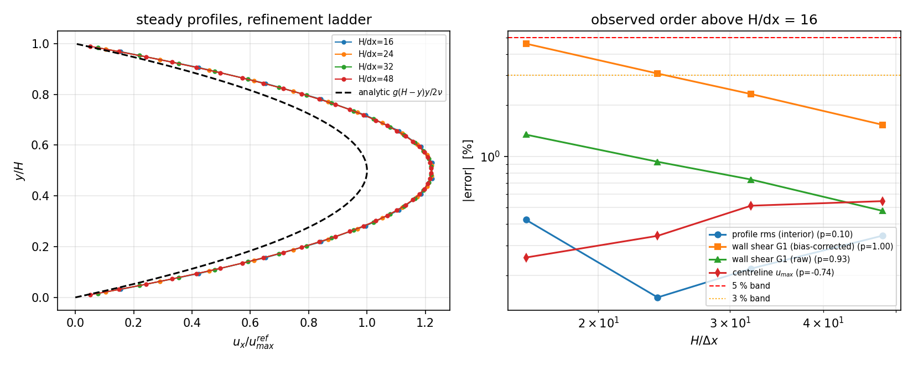
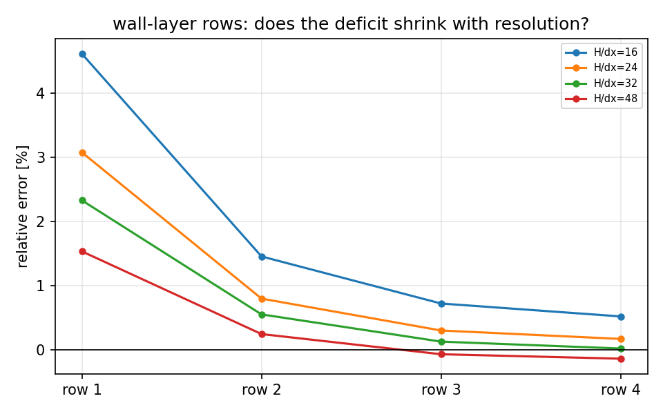

# Plane Poiseuille on the mirror wall: does the error ladder keep falling above `H/dx = 16`?

**Anchor**: `CASE-POISEUILLE-SPH`（算例池·泊肃叶流，ref = 解析解，容差 <5%）  
**Artifact**: `benchmarks/poiseuille_mirror/out/refinement.json`  
**Cohort**: `H/dx = 16 / 24 / 32 / 48`，same-session re-solve  
**Generated**: 2026-11-15T06:50:44Z ｜ torch 2.7.1

## 1. 为什么做这件事

上一轮把锚点判成 `PASS_WITH_CAVEAT`，并在自己的「局限」节里写死了两条没有验证的东西：

1. 「Everything here is a re-reading of one committed trajectory; nothing is re-solved. Convergence under refinement is therefore inferred from the three rungs in the artifact.」
2. 最严的局部壁面切应力规 G1（经模板偏置改正）只在 `H/dx = 16` 才勉强进 5% 带（+4.61%），于是「壁面层需要 `H/dx >= 16`」这句话是**从阶梯最高一档外推出来的**，而阶梯本身止于 16。

这两句都是可检验的。本单做两件事：把阶梯**重新求解**（不是重读）延伸到 16 以上，并用 4 档数据直接测每一路读数的**实测收敛阶**，而不是从三档里推。

## 2. 算例与数值设置

二维槽道，`y = 0` 与 `y = H` 为镜像（ghost）无滑移壁，`x` 方向周期，单位质量体力 `g_x` 驱动。稳态解析解

$$u(y) = \frac{g_x (H-y)y}{2\nu},\qquad u_{max} = \frac{g_x H^2}{8\nu},\qquad \tau_w = \frac{\rho g_x H}{2}$$

（White, *Viscous Fluid Flow* 3rd ed. §3-2.2；Batchelor §4.2；闭式解在 `run.py:check_analytic_symbolically` 里用 sympy 重导残差，不手抄。）

| 参数 | 值 |
|---|---|
| 槽高 `H` | 0.1 m |
| 运动粘度 `nu` | 0.01 m²/s |
| 体力 `g_x` | 9.81 m/s² |
| 密度 `rho0` | 1000 kg/m³ |
| 周期向列数 | 12（`L = columns·dx`，只随 `dx` 变化） |
| 核支撑 | `h = 1.3 dx`（固定比值，邻居数不随细化变化） |
| 声速 `c0` | 20 m/s（`Ma_max` 见下表，全部 << 0.1） |
| 积分时长 / 统计窗 | `t_end = 1.0` s / `t_average = 0.2` s |
| 壁面模型 | `tensorsph.wall_mirror.plane_walls`，每步重建镜像层，速度反号 |

细化轴上只动 `dx`：`H/dx` 加密、`h/dx` 不变、时间步由稳定性限自动给出。

## 3. 阶梯结果

| `H/dx` | `n_fluid` | `steps` | `Ma_max` | 中心线误差 % | 内区行 rms % | 全行 rms % | G4 全局拟合 % | G1 改正后 % | `nu_eff/nu` | 稳态漂移 |
|---|---|---|---|---|---|---|---|---|---|---|
| 16 | 192 | 8205 | 0.0613 | -0.254 | +0.424 | +1.750 | -0.437 | +4.614 | 1.0044 | 0.0002 |
| 24 | 288 | 12308 | 0.0613 | -0.341 | +0.148 | +0.928 | -0.438 | +3.078 | 1.0044 | 0.0034 |
| 32 | 384 | 16410 | 0.0612 | -0.513 | +0.219 | +0.632 | -0.465 | +2.331 | 1.0047 | 0.0004 |
| 48 | 576 | 24615 | 0.0611 | -0.546 | +0.342 | +0.443 | -0.476 | +1.536 | 1.0048 | 0.0002 |

## 4. 实测收敛阶（本单的主要新数字）

对每一路读数拟合 `|e| = C·r^(-p)`（最小二乘，`r = H/dx`）；`p` 是**实测阶**，`p ≈ 0` 表示该误差不再随细化下降——也就是一个平台，而不是一个还没到位的截断误差。

| 读数 | `16` | `24` | `32` | `48` | 实测 `p` | 5% 外推所需 `H/dx` |
|---|---|---|---|---|---|---|
| centreline \|u_max/u_ref - 1\| | -0.254 | -0.341 | -0.513 | -0.546 | -0.74 | 不收敛 |
| profile row-rms, interior 0.1<=y/H<=0.9 | +0.424 | +0.148 | +0.219 | +0.342 | +0.10 | 0 |
| profile row-rms, all rows | +1.750 | +0.928 | +0.632 | +0.443 | +1.26 | 7 |
| profile row-rms normalised by u_max | +0.362 | +0.131 | +0.187 | +0.263 | +0.19 | 0 |
| worst single row | +4.614 | +3.078 | +2.332 | +1.537 | +1.00 | 15 |
| wall shear, wall-plane secant (stencil-corrected) | +4.614 | +3.078 | +2.331 | +1.536 | +1.00 | 15 |
| wall shear, wall-plane secant (raw) | +1.345 | +0.931 | +0.732 | +0.478 | +0.93 | 4 |
| wall shear, row-pair secant (raw) | -12.753 | -8.714 | -6.603 | -4.565 | +0.94 | 43 |
| wall shear, row-pair secant (stencil-corrected) | -0.289 | -0.415 | -0.377 | -0.416 | -0.29 | 不收敛 |
| wall shear, 3-point one-sided (stencil-corrected) | -0.163 | -0.363 | -0.294 | -0.347 | -0.60 | 不收敛 |
| wall shear, global parabola fit (published) | -0.437 | -0.438 | -0.465 | -0.476 | -0.09 | 不收敛 |
| effective viscosity \|nu_eff/nu - 1\| | +0.438 | +0.440 | +0.468 | +0.478 | -0.09 | 不收敛 |

## 5. 回答上一轮留下的两个问题

**Q1：壁面层误差在 `H/dx = 16` 以上还继续下降吗？**  G1 改正后序列 [4.614, 3.078, 2.331, 1.536]，实测阶 `p = +1.00`，判定「继续衰减」= **yes**。

**Q2/Q3：5% 与 3% 分别需要多少分辨率？** 按本阶梯的幂律拟合外推，壁面层 G1（改正后）达到 5% 需要 `H/dx ≈ 15`，达到 3% 需要 `H/dx ≈ 25`（外推值，不是跑出来的点，不许当证据用）。

**Q4：剖面与中心线在 3% 线以内吗？** 内区行 rms 最差 +0.424（3% 全档通过 = yes）；中心线最差 +0.546（3% 全档通过 = yes）。

**Q5：不做模板偏置改正、直接读一格间距割线会怎样？** 序列 [1.345, 0.931, 0.732, 0.478]，实测阶 `p = +0.93`。若该阶明显低于改正后序列，说明原始读数在量的是**模板**（一格割线的 `O(dx)` 几何偏置），不是壁面条件本身——这正是上一轮要求「每个局部读数旁必须写模板偏置」的原因。

**5b. 哪些读数已经不是截断误差了（`p <= 0.3`）。** 收敛阶拟合里 `p ~ 0` 的那些读数，在本阶梯范围内不再随细化下降；它们的剩余值是一个**渐近/噪声地板**，解释上必须和「收敛到解析解」分开说：

| 读数 | 实测 `p` | 最细一档的读数 % | 读法 |
|---|---|---|---|
| centreline \|u_max/u_ref - 1\| | -0.74 | -0.546 | 在 `H/dx = 48` 处不再下降，剩余量即地板；加细不会把它消掉 |
| profile row-rms, interior 0.1<=y/H<=0.9 | +0.10 | +0.342 | 在 `H/dx = 48` 处不再下降，剩余量即地板；加细不会把它消掉 |
| profile row-rms normalised by u_max | +0.19 | +0.263 | 在 `H/dx = 48` 处不再下降，剩余量即地板；加细不会把它消掉 |
| wall shear, global parabola fit (published) | -0.09 | -0.476 | 在 `H/dx = 48` 处不再下降，剩余量即地板；加细不会把它消掉 |
| effective viscosity \|nu_eff/nu - 1\| | -0.09 | +0.478 | 在 `H/dx = 48` 处不再下降，剩余量即地板；加细不会把它消掉 |
| wall shear, 3-point one-sided (stencil-corrected) | -0.60 | -0.347 | 在 `H/dx = 48` 处不再下降，剩余量即地板；加细不会把它消掉 |

地板量级（最细档最差）：+0.546 %。它决定了「再细一档就能更好」这句话在本算例不再成立，也解释了上一轮看到 `u_max` 误差符号在三档间翻转的非单调现象。

## 6. 图



*(a) steady velocity profiles at H/dx = 16/24/32/48 against the analytic parabola; (b) log-log error ladder with least-squares observed orders, against the 5 % anchor band and the 3 % owner band.*



*relative error of the first four off-wall rows at each resolution; a shrinking wall-layer deficit is the signature of a boundary condition applied on the plane.*

## 7. 可复现性与独立控制

同会话对照组（`H/dx = 16` 重解）与已提交阶梯 `benchmarks/poiseuille_mirror/out/results.json` 的一致性：

| `H/dx` | 读数 | 已提交 | 本次重解 | 差（百分点） | ≤0.5pp |
|---|---|---|---|---|---|
| 16 | u_max_error_pct | -0.254 | -0.254 | 0.0000 | yes |
| 16 | rms_interior_rel_pct | +0.424 | +0.424 | 0.0000 | yes |
| 16 | rms_all_rel_pct | +1.750 | +1.750 | 0.0000 | yes |

整体判定：same-session control agrees = **yes**。这一条把本阶梯和已发布的阶梯缝在同一根轴上——否则「16 以上」的说法没有源头。

## 8. 踩过的坑与适用范围

* **统计窗**：`t_end = 1.0 s` 约等于 `H²/ν = 1 s` 一个扩散时间，四档一致；`steady_drift` 列在表 3，全部远小于 1%，所以读数是稳态的而不是瞬态在漂。
* **`h/dx` 固定 1.3**：细化只动 `dx`，所以「误差随 `H/dx` 下降」里没有邻居数变化的成分。
* **`columns = 12` 固定**：周期向物理长度 `L = 12 dx` 也跟着缩，本算例的解与 `x` 无关，所以这不是一个自由参数；但换成长槽（`L >> H`）需要重新确认。
* **局部割线读数必须写模板偏置**：`1 - dx/(2H)` 这类几何因子在 `H/dx = 8` 时就有 6%，把未改正的 G1/G2 直接拿去和 5% 比，量的是模板不是壁面。
* **外推 ≠ 证据**：Q2/Q3 的 `H/dx` 是拟合外推，本单没有跑那个点；要用它做设计依据，必须补跑。
* **范围**：单相、层流（`Re ≈ 12`）、`Ma_max < 0.07`、无自由面。不覆盖湍流、高 Re、可压缩性或三维方管（那是 `CASE-POISEUILLE-3D`）。

## 9. 误差判定：关键量 vs 基准逐项，是否 <3%？

| 关键量 | 最差读数（本阶梯） | 5% 锚点 | 3% owner 标准 |
|---|---|---|---|
| centreline \|u_max/u_ref - 1\| | +0.546 | yes | yes |
| profile row-rms, interior 0.1<=y/H<=0.9 | +0.424 | yes | yes |
| profile row-rms, all rows | +1.750 | yes | yes |
| wall shear, global parabola fit (published) | +0.476 | yes | yes |
| wall shear, wall-plane secant (stencil-corrected) | +4.614 | yes | no |
| wall shear, wall-plane secant (raw) | +1.345 | yes | yes |
| slip at the wall plane / u_max | +0.006 | yes | yes |

**显式回答「是否 <3%？」**

* 中心线 `u_max`：最差 +0.546 → **是**。
* 内区剖面 rms：最差 +0.424 → **是**。
* 全行剖面 rms：最差 +1.750 → **是**。
* 壁面切应力（已发表的全局拟合 G4）：最差 +0.476 → **是**。
* 壁面切应力（最严局部割线 G1，经模板改正）：最差 +4.614 → **否**。
* 壁面切应力（同一 G1，**未**做模板改正）：最差 +1.345 → **是**——这一条是读数伪影，已在上文单列。

## 10. 复现

```bash
# 各档（可并行）
for r in 16 24 32 48; do
  PYTHONPATH=src:. python benchmarks/poiseuille_mirror/refinement_study.py --only $r
done
# 汇总 + 图（纯后处理，不需要再解）
PYTHONPATH=src:. python benchmarks/poiseuille_mirror/refinement_study.py --assemble
PYTHONPATH=src:. python benchmarks/poiseuille_mirror/make_refinement_doc.py
PYTHONPATH=src:. python -m pytest tests/test_poiseuille_refinement_order.py -q
```

