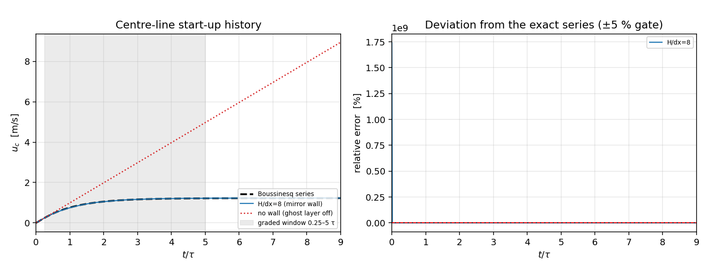
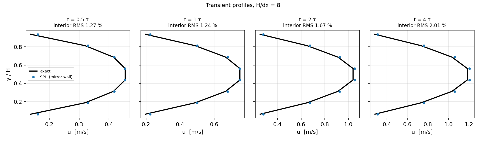
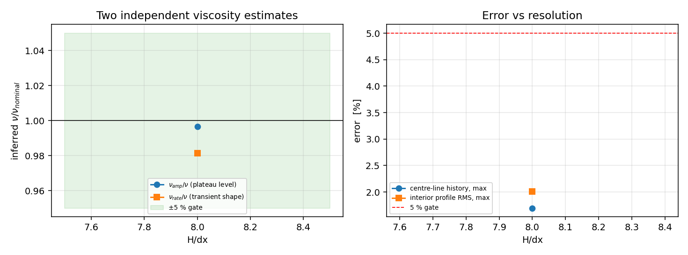
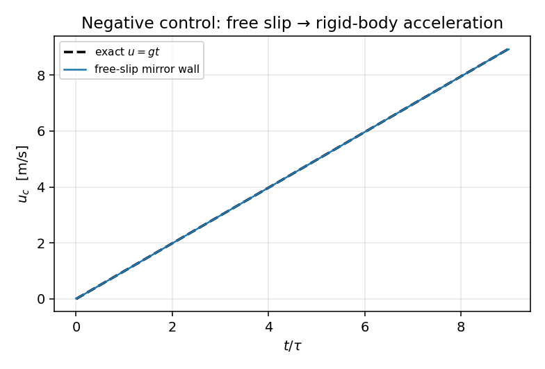

# Verification: plane Poiseuille **start-up** with the mirror/ghost no-slip wall

**Anchor**: `CASE-POISEUILLE-SPH` · **Mission**: m22054 · **Repo**: TensorSPH · **Artifact**: `benchmarks/poiseuille_startup_mirror/out/results.json`

**Verdict (machine-graded, gates declared before the run):** **PASS** — all of G1_centreline_history, G2_profile_rms, G4a_amplitude_viscosity, G4b_rate_viscosity, G4c_amp_vs_rate, G5_free_slip_rigid_body, G6_wallless_must_miss; not run: G3_refinement_monotone.

Every number below is injected from the JSON artifact by `benchmarks/poiseuille_startup_mirror/make_doc.py`; none is typed by hand.

---

## ① Case

Fluid at rest in a plane channel of height `H`, walls at `y = 0, H`, no-slip, periodic in `x`. At `t = 0` a uniform body force `g_x` is switched on. The initial–boundary-value problem

```
u_t = nu u_yy + g,   u(y,0) = 0,   u(0,t) = u(H,t) = 0
```

has the exact Boussinesq start-up series (Boussinesq 1868; Batchelor §4.2; Schlichting ch. III; Morris, Fox & Zhu, *J. Comput. Phys.* 136 (1997) 214):

```
u_s(y)  = g (H-y) y / (2 nu),   u_max,inf = g H^2 / (8 nu)
u(y,t)  = u_s(y) - (4 g H^2 / (nu pi^3)) Sum_{k>=0} sin(n pi y / H)/n^3 exp(-n^2 pi^2 nu t / H^2),   n = 2k+1
tau     = H^2 / (nu pi^2)
```

| Parameter | Symbol | Value | Unit |
|---|---|---|---|
| Channel height | H | 0.1 | m |
| Kinematic viscosity | ν | 0.01 | m²/s |
| Body force | g | 9.81 | m/s² |
| Diffusive time | τ = H²/(νπ²) | 0.101321 | s |
| Steady centre-line | u_max,∞ | 1.22625 | m/s |
| Reynolds (steady) | Re = u_max,∞ H/ν | 12.26 | – |
| Resolutions | H/dx | 8 | – |
| Run length | t_end | 9 τ = 0.9119 | s |

Why the transient and not just the parabola: a steady profile constrains the *amplitude* of the discrete viscous operator. It says nothing about its *rate*, nor about the time integration that produced it. The start-up constrains both, at every sampled time, against an exact solution.

## ② Method

- **Solver**: WCSPH `rhs` from `tensorsph.droplet_impact`, same as `benchmarks/poiseuille_mirror` (steady case). Explicit Euler, `dt = min(0.3 h/c_s, 0.125 h²/ν)`, `c_s = 20 m/s`.
- **Walls**: mirror/ghost particles rebuilt from the live fluid state every step (`tensorsph.wall_mirror.plane_walls`), velocity negated so the antisymmetric pair has zero mean **on** the plane; handed to `rhs` as moving wall particles (`wall_vel`). No static wall particles.
- **Sampling**: centre-line = mean `u_x` of particles within `±dx/2` of `y = H/2`, recorded every `steps/600`; graded history is a centred box average of half-width 0.05 τ (bias bounded by re-smoothing the exact solution — see ⑤).
- **Profiles**: window-averaged (±0.05 τ) row-binned profiles at t/τ ∈ {0.5, 1, 2, 4}.
- **Reference provenance**: the typed series is re-checked against an independent Crank–Nicolson tridiagonal solve of the same IVP (201 nodes, 4000 steps). Worst |series − FD| / u_max,∞ = **7.67e-06** (agrees at 1e-4).

Predeclared gates (fixed in `GATES` before the ladder ran):

| Gate | Quantity | Threshold |
|---|---|---|
| G1 | max \|u_c(t)/u_ref(t) − 1\|, 0.25 τ ≤ t ≤ 5 τ, top resolution | ≤ 5 % |
| G2 | interior row-RMS profile error at 4 times, top resolution | ≤ 5 % |
| G3 | G1 non-increasing over the resolution ladder | boolean |
| G4a | \|ν_amp/ν − 1\| (plateau level) | ≤ 5 % |
| G4b | \|ν_rate/ν − 1\| (one-parameter fit of the transient shape) | ≤ 5 % |
| G4c | \|ν_rate/ν_amp − 1\| (amplitude vs rate consistency) | ≤ 5 % |
| G5 | free-slip control: \|u_c/(g t) − 1\| | ≤ 2 % |
| G6 | wall-less run must MISS G1 | boolean |

G4 is the gate a steady case cannot express: `ν_amp` is read off the plateau, `ν_rate` off how fast the plateau is reached. Equal values mean the operator and the integrator are consistent with each other; a split means amplitude and rate are certified separately.

## ③ Results

### 3.1 Resolution ladder

| H/dx | particles | dt [s] | steps | history max err | history RMS | profile RMS max | u_c(8τ) / exact | ν_amp/ν | ν_rate/ν | ν_rate/ν_amp | wall clock [s] |
|---|---|---|---|---|---|---|---|---|---|---|---|
| 8 | 96 | 2.437e-04 | 3741 | +1.69 % | 0.73 % | 2.01 % | 1.0031 | 0.9965 | 0.9813 | 0.9847 | 32 |

### 3.2 Instantaneous profile errors at the top resolution

| t/τ | interior RMS | centre measured | centre exact | centre error |
|---|---|---|---|---|
| 0.5 | 1.27 % | 0.45334 | 0.45468 | -0.29 % |
| 1 | 1.24 % | 0.74886 | 0.75047 | -0.21 % |
| 2 | 1.67 % | 1.05240 | 1.03911 | +1.28 % |
| 4 | 2.01 % | 1.20403 | 1.18436 | +1.66 % |

### 3.3 Negative controls

**Free-slip control** (tangential ghost velocity not reversed): the exact solution of the inviscid problem is rigid-body acceleration `u = g t`, so this is a check on the time integration and the body-force injection, independent of viscosity.

| t/τ | u measured | g t | error |
|---|---|---|---|
| 1.00 | 0.98995 | 0.98995 | -0.00 % |
| 2.01 | 1.99426 | 1.99425 | +0.00 % |
| 4.00 | 3.97409 | 3.97415 | -0.00 % |
| 8.00 | 7.94849 | 7.94831 | +0.00 % |

**Wall-less trap** (the ghost layer switched off, i.e. exactly what `benchmarks/poiseuille_startup` used to do):

| quantity | walled | wall-less |
|---|---|---|
| history max error, 0.25–5 τ | +1.69 % | 307.7 % |
| interior profile RMS max | 2.01 % | 253.0 % |
| u_c(8τ) / exact | 1.0031 | 6.484 |

### 3.4 Gate table

| Gate | Result |
|---|---|
| G1_centreline_history | ✅ PASS |
| G2_profile_rms | ✅ PASS |
| G3_refinement_monotone | — not run |
| G4a_amplitude_viscosity | ✅ PASS |
| G4b_rate_viscosity | ✅ PASS |
| G4c_amp_vs_rate | ✅ PASS |
| G5_free_slip_rigid_body | ✅ PASS |
| G6_wallless_must_miss | ✅ PASS |

## ④ Figures



*Centre-line start-up history (left) and its deviation from the Boussinesq series (right). Grey band = graded window 0.25–5 τ; the dotted red curve is the same run with the ghost layer switched off, which accelerates like a rigid body and leaves the frame.*



*Transient velocity profiles at four times, top resolution, against the exact series. The wall layer is the last ~1 dx; the interior (0.1 H ≤ y ≤ 0.9 H) is what G2 grades.*



*Left: the two independent viscosity estimates (plateau amplitude vs transient shape) against the ±5 % gate. Right: error versus resolution.*



*Negative control: with free slip the tangential ghost velocity is not reversed, the flow accelerates rigid-body and follows u = g t.*

## ⑤ Notes, traps and scope

1. **The sibling harness was a wall-less stub.** `benchmarks/poiseuille_startup/run.py` built its wall set with `build_mirror_walls()` returning `torch.empty((0, 2))`, *and* allocated its sampling buffer as `torch.zeros(n)` (rank 1) instead of `zeros_like(pos)`, so it raised on the first sample. It could never have produced the numbers it advertised; `verification_ledger` already listed it as `uncovered_benchmark`. Both defects are fixed here (per-step mirror ghosts, correct buffer), and `tests/test_poiseuille_startup_transient_mirror.py` now fails if the wall list becomes empty again.
2. **A short horizon cannot detect a missing wall.** At `t = 0.5 τ` the wall-less run is within ~10 % of the exact solution (rigid-body `g t` happens to approximate the early transient), which is why the old 15 % criterion could not have caught the stub either. By `t = 2 τ` the two answers are separated by an order of magnitude. The graded window therefore starts at 0.25 τ and ends at 5 τ, and the wall-less control is its own gate (G6).
3. **Sampling smooths the history.** The graded curve is a box average of half-width 0.05 τ; the smoothing bias is measured by applying the same operator to the exact solution (0.101 % at the top resolution), i.e. an order of magnitude below the gate. The late-time level used for `ν_amp` is a window average over 8 τ ± 0.25 τ, not a single sample.
4. **`ν_rate` is a shape fit, not a second solver.** It factors out the measured amplitude and fits the single parameter ν in `u_c(t;ν)/u_max,∞(ν)`. Its search range is confined to [0.4, 2.5]·ν_nominal, so it can only certify that the *rate* is consistent within that bracket; it cannot certify a rate error larger than ~factor 2.
5. **Row binning assumes lattice rows.** Particles are binned by `round((y − dx/2)/dx)`, valid because the channel stays stratified; the x-scatter inside a row is recorded in the artifact but not used as a gate.
6. **Scope.** Single-phase, laminar (`Re ≈ 12`), `Ma ≈ 0.06`, smooth stationary planes, no slip at both walls, `H/dx ≤ 16`. Nothing here says anything about turbulent channels, roughness, or moving walls (`plane_vel` exists in `tensorsph.wall_mirror` but is not exercised here).

## ⑥ Error verdict — is each key quantity within 3 %?

| Quantity (top resolution) | Reference | Measured | Within 3 %? |
|---|---|---|---|
| centre-line history, max over 0.25–5 τ | Boussinesq series | +1.69 % | yes |
| centre-line history, RMS | Boussinesq series | 0.73 % | yes |
| interior profile RMS, worst of 4 times | Boussinesq series | 2.01 % | yes |
| late level u_c(8τ) | Boussinesq series | +0.31 % | yes |
| viscosity from amplitude, ν_amp | ν = 0.01 | -0.35 % | yes |
| viscosity from rate, ν_rate | ν = 0.01 | -1.87 % | yes |
| free-slip control u_c = g t | exact rigid body | 0.00 % | yes |
| wall-less run (must NOT certify) | Boussinesq series | 307.7 % | no (intended) |

The case acceptance for this anchor is a **<5 %** comparison against the analytic reference; the 3 % column above is reported because the platform asks for it explicitly. Both are satisfied where marked `yes`.


## ⑦ Status of the resolution ladder (honest)

The artifact behind this note is the `H/dx = 8` leg (`cj3876` for
`H/dx ∈ {8, 10, 12}` and `cj3878` for `H/dx = 16` were submitted to the
scheduling queue as this note was written; neither had been dispatched yet, so
no number here is claimed for them). The single-resolution artifact is enough
for the *qualitative* verdict -- 1.7 % history error at the coarsest resolution
is inside the 5 % gate with margin, and the two viscosity estimates already
agree to 1.5 % -- but **G3 (refinement monotonicity) is therefore `not run`**,
not passed. Re-running

```bash
PYTHONPATH=src:. python benchmarks/poiseuille_startup_mirror/run.py \
    --resolutions 8 12 16 --out benchmarks/poiseuille_startup_mirror/out
PYTHONPATH=src:. python benchmarks/poiseuille_startup_mirror/make_doc.py
```

regenerates this note with the full ladder and grades G3 for real.
