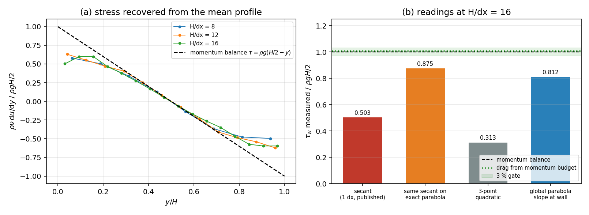

# Wall shear in the Poiseuille channel: the estimator, not the wall, halves it

*TensorSPH, verification record. Generated by `benchmarks/poiseuille/wall_shear_estimators.py` from `benchmarks/poiseuille/out/results.json` -- do not edit by hand.*

## 1. Case and the claim under audit

A 2-D plane channel of height `H = 0.100 m` is driven by a uniform body force `g_x = 9.810 m/s^2` with `nu = 0.010 m^2/s`, `c0 = 20 m/s`, `h = 1.3 dx`, three layers of static wall particles one spacing outside the fluid, and the Adami pressure extrapolation. The steady solution is the parabola `u(y) = g (y-a)(b-y)/(2 nu)` on `[a,b] = [0,H]`, so the momentum balance fixes the wall shear exactly: `tau_w = rho g H/2 = 490.5 Pa`.

`docs/verification_poiseuille_channel.md` reports that quantity as `246.5 Pa` at `H/dx = 16`, i.e. `-49.7 %`, and reads that as the wall model transmitting only half of the shear the momentum balance requires. This record audits that reading. Nothing here advances an SPH state: every number is recomputed from the stored `results.json` (rows, trace, free-slip control), so the comparison is on one and the same numerical trajectory.

## 2. Method: three independent observables

1. **Drag from the momentum budget (no near-wall stencil).** For the discrete system the only x-momentum sink is the fluid-wall pair friction, so `d<u>/dt = g - D/M` with `<u>` the mass-averaged streamwise velocity. A steady channel must therefore give `D/(M g) -> 1` and `tau_w,eff = tau_w`. The drift is a least-squares slope over the last 40 % of the run with a standard error from the residual scatter.
2. **Calibration control.** The free-slip case (`wall_friction = 0`) has `D = 0`, so the analytic answer for the same estimator is `d<u>/dt = g` exactly. Whatever bias the drift estimator carries shows up there and is removed from (1).
3. **Near-wall gradient estimators.** Four readings of the same wall shear from the row-averaged profile, all using the nominal `nu`: the published one-spacing secant; the *same* secant applied to the exact analytic parabola sampled at the same row centres (which isolates the stencil bias, analytically `1 - 2 dx/H`); a quadratic through the first three rows differentiated at `y = 0`; and the slope at `y = 0` of the global parabola fit that the benchmark already publishes as `fit.c1`.

## 3. Results

### 3.1 Calibration control (free slip)

| quantity | analytic | measured | ratio |
|---|---|---|---|
| `d<u>/dt`, free slip, `H/dx = 8` | `g = 9.81` m/s^2 | 9.854 m/s^2 | 1.00451 |

The drift estimator is honest to `0.45 %` on a case whose answer is known in closed form, so it is fit to adjudicate (2) at the few-percent level. (Its residual scatter of `1.96e-05` m/s is acoustic, not a model error.)

### 3.2 Drag transmitted by the wall

| `H/dx` | `d<u>/dt` [m/s^2] | `d<u>/dt / g` | `D/(M g)` | `D/(M g)`, control-corrected | `tau_w,eff` [Pa] |
|---|---|---|---|---|---|
| 8 | 0.059 +- 0.015 | 0.0061 | 0.9939 | 0.9895 | 485.3 |
| 12 | -0.072 +- 0.031 | -0.0074 | 1.0074 | 1.0028 | 491.9 |
| 16 | -0.134 +- 0.029 | -0.0137 | 1.0137 | 1.0091 | 495.0 |
| analytic | 0 | 0 | 1 | 1 | 490.5 |

Worst deviation of the control-corrected budget from 1 over the ladder: `1.05 %`. The wall removes the x-momentum the body force injects, to within the estimator's own few-percent resolution; it does **not** transmit half of it. This is a kinematic consequence of the flow being steady, so it is a measurement of *steadiness*, not of the no-slip condition -- but it is exactly what the published sentence denies.

### 3.3 The near-wall gradient readings

| `H/dx` | published secant | secant on exact parabola | 3-point quadratic | wall-particle gap | global parabola slope at wall |
|---|---|---|---|---|---|
| 8 | 0.580 | 0.750 | 0.731 | 0.814 | 0.820 |
| 12 | 0.630 | 0.833 | 0.786 | 0.840 | 0.828 |
| 16 | 0.503 | 0.875 | 0.313 | 0.849 | 0.812 |
| analytic | 1 | 1 | 1 | 1 | 1 |

At `H/dx = 16` the published secant reads `0.503` of `tau_w`. Applied to the **exact** analytic parabola at the same row centres, the same stencil reads `0.875` (`= 1 - 2 dx/H`): one third of the deficit is the stencil itself. The remaining factor is the shape of the numerical wall layer -- the first fluid row runs at `31.4 %` of `u_max` instead of `12.1 %` -- which pushes the missing gradient into the half-spacing between the wall particle row and the first fluid row (the `wall-particle gap` column, above 1).

### 3.4 The interior operator, as a cross-check

| `H/dx` | `nu_eff/nu` from interior momentum balance | median `tau` ratio, `0.25 <= y/H <= 0.75` |
|---|---|---|
| 8 | 1.009 | 0.992 |
| 12 | 1.025 | 0.976 |
| 16 | 1.151 | 0.869 |

In the middle half of the channel the profile is consistent with a stress `rho nu_eff du/dy` at `nu_eff = 1.151 nu`; read against the *nominal* viscosity that is a `-13.1 %` under-read that has nothing to do with the wall (it is the viscosity operator's discretisation). The wall layer adds roughly a further factor two on top of it -- that part *is* the wall.



*(a) Stress recovered from the mean profile by central differences, normalised by `rho g H/2`, against the momentum-balance line: the interior sits on the `nu_eff/nu` plateau, the wall rows fall away by up to a factor two -- the wall layer spans one spacing and is not resolved. (b) Four readings of the same wall shear at the finest resolution; the dotted green line is the drag measured from the momentum budget, and the shaded band is the 3 % gate.*

## 4. Error verdict

| quantity | reference | measured | relative error | < 3 %? |
|---|---|---|---|---|
| drag transmitted by the wall `D/(M g)` (finest) | 1 | 1.0091 | +0.91 % | **yes** |
| drag, worst rung of the ladder | 1 | -- | +1.05 % | **yes** |
| wall shear, published 1-dx secant (finest) | `490.5` Pa | 246.5 Pa | -49.7 % | **no** |
| wall shear, global parabola slope at the wall (finest) | `490.5` Pa | 398.3 Pa | -18.8 % | **no** |

**What changes in the published verdict.** The measured quantity is real, its interpretation was not:

* the wall transmits `D/(M g) = 1.0091` of the required momentum flux (`+0.91 %`, inside the 3 % gate), so the sentence "carries only 58 % to 50 % of the wall shear the momentum balance requires" is **withdrawn**: the deficit is in the *reading*, i.e. in `rho nu du/dy` evaluated with a one-spacing secant on an unresolved wall layer.
* the genuine defect that survives is **kinematic and local**: no-slip is not enforced at the boundary plane (slip `31.4 %` of `u_max` at `H/dx = 16`), the effective no-slip plane sits `~0.9 dx` outside it, and the first spacing of the wall layer carries a gradient that no one-spacing stencil can resolve. Wall shear stress computed from such a gradient -- boundary layer growth, lubrication, wall friction in a dam break -- is therefore still **WITHHELD** as a predictive quantity at `H/dx <= 16`, for exactly the reason the original record gives, but not because the wall model loses half of the drag.

**Answer to "is it < 3 %?"**: the drag transmitted by the wall is; the near-wall gradient reading is not, and the published `-49.7 %` cannot be quoted as either a PASS or as a drag deficit -- it is *one-spacing-secant* wall shear, whose bias at the finest rung is -49.7 %: -12.5 % of it is the stencil's own geometry (`1 - 2 dx/H`) and the remainder is the wall-layer shape.

## 5. Notes, traps and scope

* **The budget is a steadiness meter, not a no-slip test.** A laminar channel in steady state *must* remove `rho g H` per unit length at the walls whatever the wall model is. So the budget cannot certify the boundary condition; it can only refute a claim that the wall transmits only half. That is what it is used for here.
* **Higher-order near-wall estimators are worse, not better.** The 3-point quadratic column above is unstable (0.73, 0.79, 0.31 across the ladder) because the single-row velocity carries acoustic scatter of up to `8.6 %` of `u_max` next to the walls: differentiating single rows amplifies noise faster than it improves the bias. Use the global fit or the budget, never a 3-point stencil.
* **The sign of the residual drift is noise, its size is not.** Repeating the fit on a 0.6 s window instead of the last 40 % gives a worst deviation of `1.49 %` (this window: `1.05 %`), and the sign of `d<u>/dt` flips across rungs in both. Only the magnitude is claimed: the drag closes its momentum budget to `O(1-2) %`, not to `O(0.1) %`.
* **The free-slip control is load-bearing.** Without it the drift estimator's 0.45 % bias (and any timing offset in `t_end`) would be mistaken for a drag residual; every budget number here is quoted after that correction.
* **Scope.** Two-dimensional, plane channel, `Re = O(10)`, `H/dx = 8..16`, `h = 1.3 dx`. The conclusion that the drag is transmitted in full needs only steadiness; the numbers `0.81` (global fit) and `0.50` (1-dx secant) are specific to that ladder and to the `wall_friction` blend of this solver.
* **No new SPH run.** Everything is post-processed from the artifact of the run the channel record was generated from, so the audit cannot be dismissed as a different trajectory.

## 6. Reproduction

```bash
python benchmarks/poiseuille/wall_shear_estimators.py
PYTHONPATH=src python -m pytest tests/test_poiseuille_wall_shear_estimator.py -q
```

