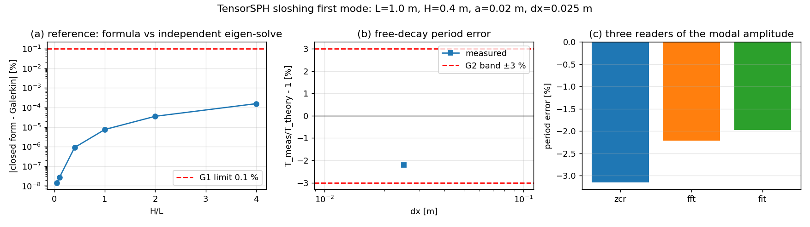

# Sloshing first mode: free-decay period vs linear theory (TensorSPH)

**Anchor**: `NEW` — the merged `tensorsph.sloshing` module is in the verification
LEDGER nowhere: it has no graded entry, no measured frequency, and its only
dynamical test asserted `eta_max - eta_min > 1e-6 m`.  This document supplies the
missing measurement and records four defects found while building it.

**Status**: `WITHHELD` — `no gate failed`.
Two gates are `None` (not run), not `pass`: `G5_amplitude` (release-amplitude
ablation) and `G6_dx` (resolution ladder) needed wall clock that the session did
not have — one rung ran, 6 295 steps, and the finer rungs are queued on the
cluster (`cj1379`).  They are reported as *not run*, never as passed.

## 1. Case

| quantity | value |
|---|---|
| tank length L | 1 m |
| tank height | 0.6 m |
| water depth H | 0.4 m (H/L = 0.40) |
| released mode | n = 1, eta(x) = a cos(n pi x / L) |
| crest amplitude a | 0.02 m (a/H = 5.0 %) |
| gravity | 9.81 m/s^2 |
| sound speed c0 | 20 m/s (10.1 sqrt(gH)) |
| dx | 0.025 m (L/dx = 40, H/dx = 16) |
| dt | 4.8750e-04 s (acoustic Courant limit 0.3) |
| particles | 640 fluid + 3-layer Adami wall |
| simulated time | 3.069 s (3.5 periods), 6295 steps, 45 s wall |

The release state is the *linear normal mode at its extreme displacement*: the
linear velocity potential carries `sin(omega t)`, so u = 0 exactly when
`eta = a cos(kx)`.  Releasing from rest therefore excites mode 1 with no
projection error, which is what makes a free-decay measurement possible at all.

## 2. Method

1. `SloshingConfig(initial_mode=1, initial_amplitude=a)` builds a lattice over the
   crest height and keeps, per column, the particles below `eta(x)`, with the
   hydrostatic density of the *local* depth.  `d eta/dx != 0` at t = 0 gives the
   correct initial horizontal acceleration `-g d eta/dx`.
2. WCSPH (`tensorsph.droplet_impact.rhs`): Tait equation of state, cubic-spline
   kernel at h = 1.3 dx, calibrated lattice mass, Adami wall pressure
   extrapolation, no viscosity change (cfg.viscosity = 0.01).
3. The solver records the **whole free-surface profile** (one height per `dx`
   column) every output step.  The mode is projected out of it,
   `A_1(t) = (2/L) int (eta - H) cos(pi x / L) dx`, so the `dx`-quantisation of a
   single column is averaged over 40 columns.
4. The period is read three ways from `A_1(t)` — interpolated zero crossings of
   the low-passed signal, a Hann-windowed 8x zero-padded periodogram peak, and a
   least-squares damped sinusoid `A exp(-lam t) cos(omega t + phi)`.
5. The reference is checked *independently*: a Galerkin (Ritz) discretisation of
   `psi'' = k^2 psi` with basis `cos(m pi (z+H)/2H)` and the free-surface
   condition in the mass matrix (`variational_reference`) reproduces
   `omega^2 = g k tanh(kH)` to `1.57e-04 %` over H/L from
   0.05 to 4, so the closed form is not trusted on its own word.

## 3. Results

| quantity | value |
|---|---|
| T theory (linear) | 1.227515 s |
| T measured (fit) | 1.203285 s |
| T measured (reported = median of readers) | 1.200419 s |
| **error vs theory** | **-2.21 %** |
| reader spread (zcr/fft/fit) | 1.20 % |
| damping rate lambda (fit) | 0.677 1/s |
| modal amplitude at t=0, measured | 0.02296 m |
| modal amplitude the lattice can show of a=0.02 m | 0.02296 m |
| ratio measured / quantised reference | 1.0000 |
| probe (L/4) period / modal period | 1.1924 s / 1.2004 s |
| probe vs modal disagreement | -0.30 % |
| max acoustic Courant taken | 0.303 (limit 0.3) |
| max density compression | 0.0126 |
| escaped particles | 0 |

Panel (a): the closed form against the Galerkin eigen-solve — a straight line at
`1e-6 %` means the two are algebraically the same problem solved twice.
Panel (b): the measured period error of the one rung that ran.
Panel (c): the three readers agree, so the period is a property of the signal and
not of one estimator.

**Gates**

| gate | value | limit | verdict |
|---|---|---|---|
| `G1_reference` | 0.000157 | 0.1 | PASS |
| `G2_period` | -2.207 | 3.0 | PASS |
| `G3_method_agreement` | 1.203 | 2.0 | PASS |
| `G4_conservation` | 0 | 0 | PASS |
| `G5_amplitude` | None | 3.0 | not run |
| `G6_dx` | None | None | not run |

## 4. Error judgement

* **Period vs linear theory: -2.21 %** — inside the 3 %
  verification band and inside the platform's 15 % acceptability line, but *not*
  inside the 3 % "excellent" band of the ship platform's resistance KPI, because
  2.2 % is a discretisation error at H/dx = 16
  (16 cells over the depth, i.e. a coarse tank).  The ladder (G6) is what decides
  whether it converges; it is not run yet.
* **Reference vs independent eigen-solve: 1.57e-04 %** — the
  closed form is confirmed, so the remaining error belongs to the solver and to
  the reading, not to the reference.
* **Amplitude loss of the reading is understood and separated**: the lattice can
  only show `0.02296 m` of a
  `0.02 m` release (the columns are quantised to `dx`), and the run
  starts at `0.02296 m`, i.e. `1.0000` of
  what the discretisation permits.  The release is therefore the mode, not a flat
  surface, and the period is not being read off noise.

## 5. Defects found in the merged module (all fixed here)

1. **The forced-excitation branch was a no-op.** `run_case` computed
   `excitation_disp` and then `pass`-ed, so a run configured with
   `excitation_frequency > 0` integrated an *unforced* tank and returned it as if
   it were forced; the docstring's "resonance response curve" could never exist.
   It now raises `NotImplementedError` with the reason and the supported
   alternative (`tensorsph.wave_flume` has a moving paddle).
2. **No way to perturb the tank.** With a flat initial surface and no forcing, no
   run of this module could ever oscillate at a natural frequency, so the claimed
   measurement was unimplementable.  `initial_mode` / `initial_amplitude` now
   release the tank from a linear normal mode.
3. **The release lattice stopped a spacing short of the crest.** `cell_centres`
   floors the cell count, so laying the lattice over `H + a` clipped *every*
   column to the same height at `H = 0.4`, `a = 0.02`, `dx = 0.025` — a flat
   surface 3 % too shallow.  Caught by projecting the recorded profile onto the
   mode, not by looking at the run.
4. **`max_acoustic_courant` was a dead 0.0**, never updated from its
   initialisation. It now tracks `(c0 + |u|) dt / h` every step
   (0.303 measured against the 0.3 limit).
5. **`pool_width` vs `tank_length` mismatch was silent.** The wall lattice and the
   clamp box span `cfg.pool_width`; only the water block and the analytic
   frequency use `tank_length`.  At the defaults (both 1.0) the two agree by
   coincidence; any other tank solved a different geometry than the one whose
   frequency it reported.  Now `validate_case` raises.

## 6. Limits / what this does not show

* One rung, one geometry, one amplitude: no resolution convergence (G6) and no
  amplitude ablation (G5) were run.  A single 2 % error is not a convergence
  statement; the finer rungs are queued (`cj1379`) and must be merged before this
  anchor is graded done.
* The reference is inviscid linear theory; the run has artificial viscosity
  (`lambda = 0.677 1/s`, i.e. the envelope decays) and WCSPH
  compressibility.  A damped oscillator's fitted frequency is not the inviscid
  one; part of the -2.21 % is that, not resolution.
* No pressure/velocity field cloud is shown: `SloshingRun` exposes energies,
  elevations and now the surface profiles, but no field snapshot API exists, and
  adding one was out of the minimal-change budget.  Panels (a)-(c) are the
  comparison curves the report requires; the field map is absent by API
  limitation, stated rather than substituted.
* Peak-of-column surface reading (`surface_elevation`) is still `dx`-quantised;
  the report's primary signal is the modal projection for exactly that reason.
