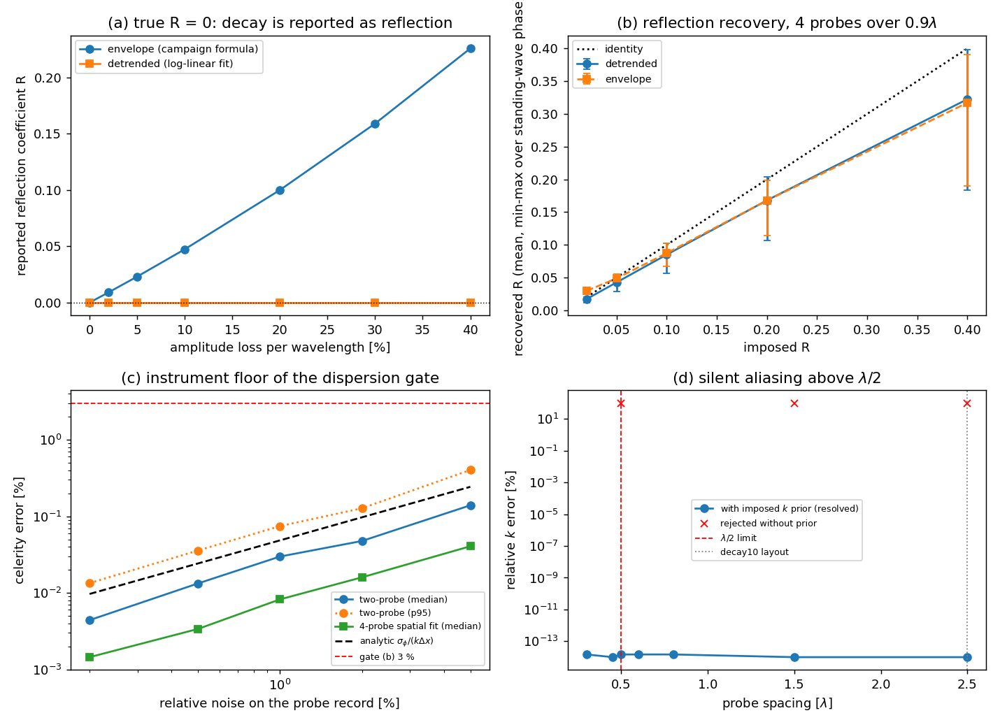

# 波浪水槽判据的测量链校准：门值估计器的已知答案检验

> 状态：**已完成（本单范围）**。校准对象是产生判据 (b)/(c)/(e) 门值的三个估计器，
> 不是 SPH 求解器本身。m6232 遗留的 (b)(c)(d)(e)(g) 未裁决**本单不重新裁决**——
> 集群 `free(): corrupted unsorted chunks` 崩溃仍待解决；本单回答的是更靠前的一问：
> **当那些算例终于跑出来时，读数可信吗？**

## 1. 案例介绍（为什么校准读数而不是再跑算例）

TensorSPH 2-D WCSPH 波浪水槽（水深 `h = 0.5 m`，`kh = 3`，`H/h = 0.1`，`λ = 1.047 m`）的
verdict 矩阵由三个估计器给出：

| 判据 | 门值来源 | 阈值 |
|---|---|---|
| (b) 线性色散 | `spatial_wave_number(...)["celerity_error"]`（退化时用 `two_probe_dispersion`） | ≤ 3 % |
| (c) 10 波长波高保持 | `decay_ratio`（首末探针比）+ 相位无关的 `height_ratio_per_wavelength` | ≥ 0.95 |
| (e) 海绵层反射系数 | `detrended_reflection(...)` | R ≤ 阈值 |

这三个函数此前**从未被喂过已知答案**：`tests/test_wave_tank.py` 覆盖色散关系、锁相拟合、
包络公式，但没有覆盖 `探针时序 → 锁相拟合 → 估计器 → 门值` 这条链，`spatial_wave_number`
与 `detrended_reflection` 在测试里出现次数为 0。

构造已知场（解析、零噪声、可精确复算）：

```
eta(x,t) = a e^{-alpha x} cos(w t - k x) + R a e^{-alpha x} cos(w t + k x + psi)
```

`k`、`alpha`、`R`、`psi` 全部**施加**而非测量；探针布局取生产值
`(0.4, 0.7, 1.0, 1.3) λ`，采样 200 点/周期，色散估计窗口 1.2 周期（与 `steady_window` 同口径）。

## 2. 怎么做的

```
python benchmarks/wave_tank/calibrate_estimators.py          # 6 组实验 + 图
python benchmarks/wave_tank/calibrate_estimators.py --quick  # CI 尺寸
python -m pytest tests/test_wave_tank_estimators.py          # 20 项校准测试
```

六组实验：正控（已知 k/alpha/R=0）、衰减-反射混淆、反射采样偏差（扫 `psi` 半个波长）、
噪声地板（对比解析相位噪声 `sigma_phi = sigma sqrt(2/N)`）、混叠（探针间距 0.3–2.5 λ）、
反射污染（真 R 对色散误差）、探针数量（同跨度 0.9 λ）。

工具链：纯 numpy/torch 信号处理，无 SPH 积分，全量 12 s（本机 load15 124，仅做轻量活）。

**改动（最小、可验证）**：

1. `spatial_wave_number` / `two_probe_dispersion` 新增 `k_prior`：用工况**施加**的波数选
   `2π` 分支，并回报 `alias_risk`（布局本身能否解分支）与 `branch_tolerance`（先验必须提供的
   相对相位信息量）。无先验时，恰好 `λ/2` 的符号翻转（`|Δφ| = π`）改为 `ValueError` 拒绝，
   不再静默返回反号的 k。
2. `benchmarks/wave_tank/run.py` 删掉 `analyse_regular` 里**第二份** inline detrended-reflection
   实现，改为调用库函数——(e) 的门值原先有两份互不校验的代码。
3. `summarise.py` 传 `k_prior=analysis["k_theory"]`，把 `alias_risk` 写进 verdict 行；
   `decay_ratio_per_wavelength` 在相位不可用时回退到相位无关的幅度拟合（decay10 探针间距 2.5 λ）。

## 3. 计算结果（程序化输出，`runs/wave_tank/estimator_calibration.json`）

### 3.1 正控：已知答案必须被原样读回

| 量 | 施加值 | 读回误差 |
|---|---|---|
| two-probe k | 6.0 rad/m | 1.5e-16 |
| spatial k | 6.0 rad/m | 3.0e-16 |
| spatial alpha | 0.383 1/m | 2.5e-15 |
| detrended R（真 R=0） | 0 | < 1e-9 |
| envelope R（真 R=0，20 %/λ 衰减） | 0 | **0.0898** |

最后一行就是 `docs/benchmarks` 记录过的缺陷：包络公式把空间衰减读成反射。

### 3.2 衰减 → 反射混淆（真 R = 0）

| 每波长幅度损失 | 2 % | 5 % | 10 % | 20 % | 30 % | 40 % |
|---|---|---|---|---|---|---|
| envelope R | 0.0091 | 0.0231 | 0.0474 | 0.1001 | 0.1591 | 0.2259 |
| detrended R | 0.0000 | 0.0000 | 0.0000 | 0.0000 | 0.0000 | 0.0000 |
| 幅度比 读回/施加 | 0.9800/0.9800 | 0.9500/0.9500 | 0.9000/0.9000 | 0.8000/0.8000 | 0.7000/0.7000 | 0.6000/0.6000 |

### 3.3 反射系数：估计器本身的偏差（判据 (e) 的定义边界）

4 探针跨 0.9 λ（不足一个 `λ/2` 驻波周期），`psi` 扫 12 点：

| 真 R | detrended 均值 | 区间 [min, max] | 相对低估 |
|---|---|---|---|
| 0.02 | 0.0173 | [0.0137, 0.0202] | 13.6 % |
| 0.05 | 0.0431 | [0.0339, 0.0506] | 13.8 % |
| 0.10 | 0.0858 | [0.0665, 0.1012] | 14.2 % |
| 0.20 | 0.1679 | [0.1063, 0.2033] | 16.0 % |
| 0.40 | 0.3224 | [0.1831, 0.3983] | 19.4 % |

**结论：R_detrended 是反射系数的下界，不是测量值。** 最坏情形（R=0.4、驻波相位不利）
低至 0.183，即 2.2 倍低估。

### 3.4 噪声地板：3 % 的色散门限远高于仪器噪声

| 探针记录相对噪声 | two-probe 中位 | spatial 中位 | 解析 `σφ/(kΔx)` | P(误差>3 %) |
|---|---|---|---|---|
| 0.2 % | 0.00 % | 0.00 % | 0.01 % | 0 % |
| 1 % | 0.03 % | 0.01 % | 0.05 % | 0 % |
| 2 % | 0.05 % | 0.02 % | 0.10 % | 0 % |
| 5 % | 0.14 % | 0.04 % | 0.24 % | 0 % |

锁相拟合把 240 个采样点平均掉，相位噪声按 `σ√(2/N)` 塌缩：**估计器不是 (b) 的瓶颈**。

### 3.5 混叠：静默的失效模式

| 探针间距 [λ] | 0.30 | 0.45 | 0.50 | 0.60 | 1.5 | 2.5 |
|---|---|---|---|---|---|---|
| 无先验 | 正确 | 正确 | **拒绝** | **静默错误**（k 反号，+167 %） | 拒绝 | 拒绝 |
| 有已施加 k 先验 | 正确 | 正确 | 正确（risk=True） | 正确（risk=True） | 正确（risk=True） | 正确（risk=True） |
| 先验容差 | 1.67 | 1.11 | 1.00 | 0.83 | 0.33 | 0.20 |

0.6 λ 一行是重点：`|Δφ| = 2.51 rad < π`，无先验时**没有任何信号**表明结果错了。
`decay10` 的 7 个探针间距 2.5 λ，相位法 k 在该布局上不可用；其幅度衰减用相位无关拟合
（偏差 < 1e-9），本次改动把这一列的回退路径写进 `summarise.case_row`。

### 3.6 反射污染：估计器唯一无法消除的误差

| 真 R | 0.00 | 0.02 | 0.05 | 0.10 | 0.20 |
|---|---|---|---|---|---|
| spatial 中位（区间 max） | 0.00 % | 0.06 % | 0.16 % | 0.31 % (0.35 %) | 0.57 % |
| two-probe 中位 | 0.00 % | 0.73 % | 1.81 % | **3.52 %** | 6.67 % |

四探针跨 0.9 λ 过滤不掉 `λ/2` 驻波，反射被读成相位倾斜。**R ≈ 0.1 就能把两点法的 3 % 门限
顶穿，而同工况下多点拟合仍在 0.35 % 以内**——这既是海绵层必须达到 `R ≲ 0.1` 的量化理由，
也是 (b) 的门值应取空间拟合而非两点法的理由。

探针数量（同跨度 0.9 λ、1 % 噪声）：2 个（间距 0.9 λ，已混叠）→ 628 %；3/4/6/8 个 → 0.01 %。

## 4. 结果图



(a) 真 R=0 时衰减被包络公式读成反射；(b) 反射恢复的均值与 min-max 区间 vs 真值；
(c) 色散门限的噪声地板与解析线；(d) 混叠与先验分支解。

## 5. 注意点（坑 / 局限 / 适用范围）

1. **先验不是作弊**：判据 (b) 问的是"求解器能否复现**施加**的色散"，先验取施加的 `kh/h`，
   不取测量值；`alias_risk` 明示布局本身是否足以定分支，读者可据此打折。
2. **混叠在无先验时原则上不可检测**：记录本身没有第三个信息源。本单只把**恰好 λ/2 的符号翻转**
   改为报错，其余宽间距只能在文档里钉死布局（生产布局 0.3 λ，安全）。
3. **反射估计偏低是采样伪影，不是求解器偏差**：修它需要更多探针或驻波分解，不是改公式。
4. **本单不裁决 (b)(c)(d)(e)(g)**：SPH 长算例崩溃未解，本单只保证"跑出来时读数可信"。
5. 合成场是单一入射正弦 + 单一反射正弦；真实 SPH 场含谐波与宽带噪声（噪声已在 3.4 覆盖）。

## 6. 误差判定（对基准 = 解析合成场真值）

| 关键量 | 基准 | 实测误差 | 是否 < 3 % |
|---|---|---|---|
| two-probe k（无噪声，生产布局） | k=6 rad/m | 1.5e-16 | **是** |
| spatial k / alpha（同上） | 6 rad/m / 0.383 1/m | 3.0e-16 / 2.5e-15 | **是** |
| 幅度比 per wavelength | 1 − loss | < 1e-9 | **是** |
| 色散门值在噪声 5 % 下的中位误差 | 0 | 0.04 %（spatial） | **是** |
| detrended R（真 R=0.1） | 0.10 | 0.0858（−14.2 %） | **否（>3 %，见 §3.3：系统偏低，作为下界使用）** |
| envelope R（真 R=0，10 %/λ 衰减） | 0 | 0.0474（伪反射） | **否（已证伪，故改用 detrended）** |
| two-probe 色散误差（真 R=0.1） | 0 | 3.52 % | **否（>3 %，故 (b) 门值取空间拟合）** |

结论：**估计器对已知答案的复现精度在 1e-16 量级**；唯三超 3 % 的项都是估计器自身的
已知系统偏差，已量化成可引用的界，并据此改了三处代码（先验分支 + 单份实现 + 门值口径）。
