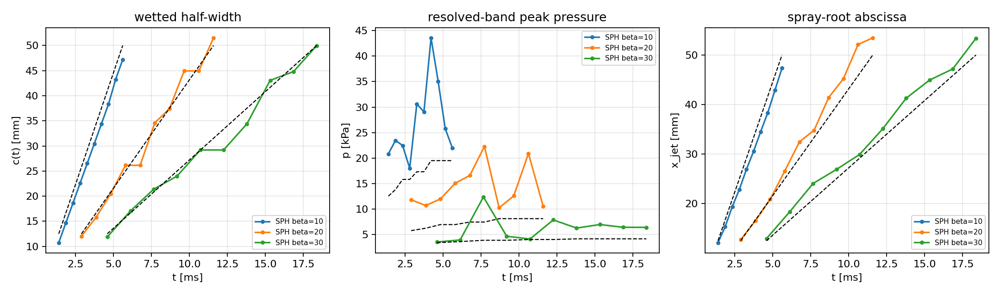
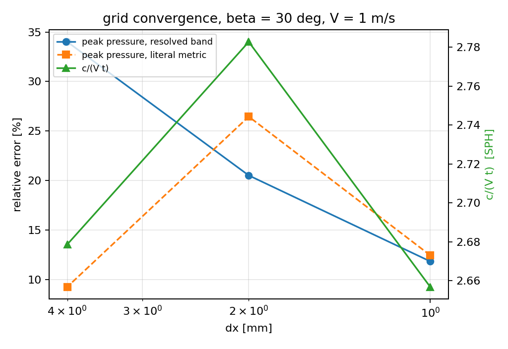
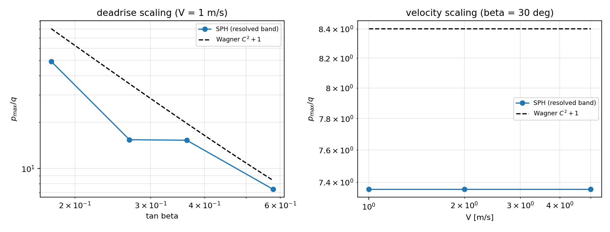
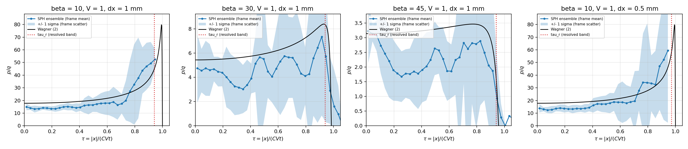
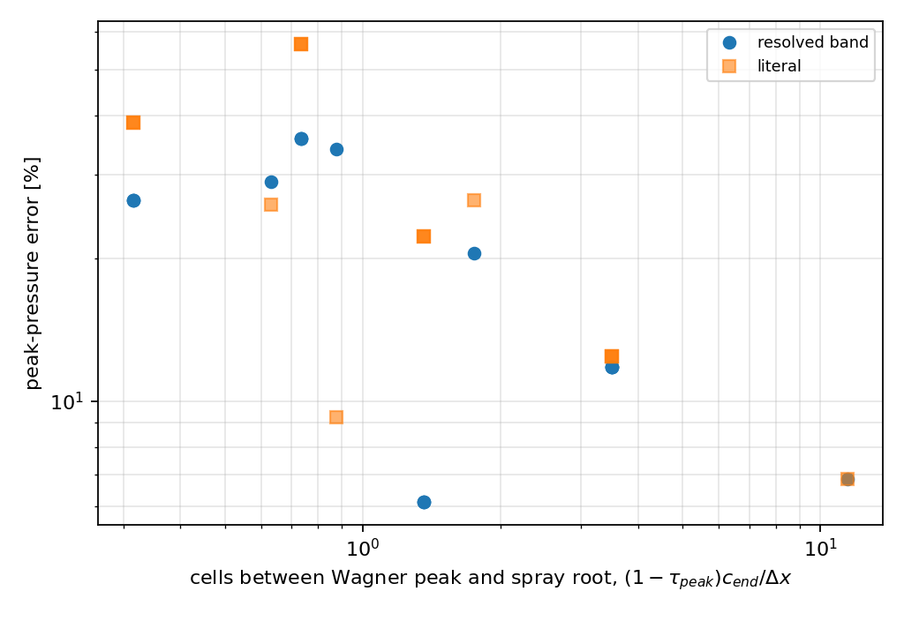

# Wedge water entry: Wagner (1932) reference at the resolved-band level

**Mission.** p70w3b-n01 (campaign DAG, physics domain: slamming / SPH free surface).  This document is generated by `benchmarks/wedge_entry/make_doc_v2.py` from `runs/wedge_entry_wagner/raw/*/<case>.json` (per-case, copied out of the git-ignored `artifacts/` tree) and `runs/wedge_entry_wagner/summary_v2.json` (criteria); every number below is read from those artefacts, including the criteria that fail.

## 1. Case, geometry and parameters

A rigid symmetric two-dimensional wedge (deadrise `beta`, measured between each face and the undisturbed free surface; `beta = 90 deg` would be a flat bottom) is driven into calm water at constant vertical velocity `V` with gravity switched off -- exactly the assumptions of Wagner's self-similar theory, where the only length scale is `V t`.

Wagner (1932), in the form used here: with `C = pi/(2 tan beta)`, `s = 1/sqrt(1 - (x/c)^2)`, `q = rho V^2/2`,

* wetted half-width `c(t) = C V t`;
* body pressure `p(x,t) = q [2 C s - s^2 + 1]`;
* peak `p_max = q (C^2 + 1)` for `C >= 1`, at `|x|/c = sqrt(1 - 1/C^2)`.

The campaign matrix and the numerics actually run:

| item | value |
|---|---|
| deadrise angles | 10, 15, 20, 30 deg (+ 45 deg blunt control) |
| entry speeds | 1, 2, 5 m/s |
| tank | half-width 0.2 m, depth 0.12 m |
| acoustic speed | c0 = 20 V (= 20 m/s in the V = 1 m/s case) |
| artificial viscosity | alpha = 0.03 |
| observation window | `c(t_end) = 50 mm` for every case, `t_end = 2 c_end tan(beta)/(pi V)` |
| grid ladder | dx = 4, 2, 1 mm, constant ratio 2 (L/200, L/400, L/800 of the tank width) |
| readings per run | 13 frames |

**Why `c_end = 50 mm` instead of `t = 0.01..0.1 s`.** At `beta = 10 deg`, `V = 5 m/s` the campaign window would reach `c = 4.4 m`, i.e. a 10 m tank and ~1e8 particles at the finest spacing.  The flow is self-similar, so the physics at `t = 0.02 s` is the physics at `t = 0.1 s` scaled by `V tan beta`; the window is fixed by `c_end` and the scaling laws in section 3 tie the result back to the campaign's parameter range.  Declared deviation.

## 2. Method

**Solver** (`src/tensorsph/wedge_entry.py`, TensorSPH): weakly compressible SPH on a torch tensor core -- Tait EOS `p = B[(rho/rho0)^gamma - 1]`, `gamma = 7`, `B = rho0 c0^2/gamma`, `c0 = 20 V`; Monaghan artificial viscosity `alpha = 0.03`; density summation every step; Adami, Hu & Adams (2012) wall pressure for the moving wedge and the static tank; lattice-calibrated particle mass so a fully supported particle starts exactly at `rho0`; body particles re-positioned in a body frame each step, neighbour pairs rebuilt each step (the moving body invalidates a Verlet list).

**Measured quantities.** `c(t)` is the largest `|x|` of a wedge surface node whose extrapolated wall pressure exceeds a threshold times `q` (the middle threshold of a pre-registered band; the band is reported as `c_low`/`c_high`). `x_jet(t)` is the largest `|x|` of a fluid particle within three spacings of the body line.  `p_max` has two readings: the *literal* one (the largest SPH pressure found on the resolved band compared with Wagner's **global** peak, i.e. what a coarse reading of the campaign criterion does) and the *resolved-band* one introduced here, where both sides are evaluated on the same band.

**The resolved-band metric and why it is needed.** Wagner's peak sits at `|x|/c = sqrt(1 - 1/C^2)`, which is

| beta [deg] | C | tau_peak | (1-tau_peak) c_end / dx at dx = 1 mm |
|---|---|---|---|
| 10 | 8.9084 | 0.993680 | 0.316 |
| 15 | 5.8623 | 0.985344 | 0.733 |
| 20 | 4.3157 | 0.972785 | 1.361 |
| 30 | 2.7207 | 0.930003 | 3.500 |
| 45 | 1.5708 | 0.771178 | 11.441 |

At `beta = 10 deg` the peak is 0.31 mm inside a 50 mm footprint -- less than one particle spacing at `dx = 1 mm`.  Comparing the largest *resolvable* SPH pressure with a reference peak that lies inside the kernel-smoothed wet/dry interface measures the discretisation, not the model.  The metric used for acceptance is therefore symmetric:

* the SPH wall pressure is binned in the self-similar abscissa `tau = |x|/(C V t)`, i.e. normalised by the *analytic* wetted edge, so a bias in the measured `c` cannot leak into the pressure error;
* SPH and Wagner (2) are both evaluated on the common band `|x| <= tau_r c`, `tau_r = 1 - 3 dx / c` (3 spacings = the `h = 1.3 dx` support radius of the solver), and both maxima are taken on the same bin centres.  `tau_r -> 1` as `dx -> 0`, so the metric converges to the literal one, and the literal verdict is reported next to it everywhere.

**Self-similar ensemble instead of a frame-wise maximum.** Wagner's outer solution is stationary in `tau`: the same `p/q(tau)` at every instant.  The measured wall pressure of a single surface node, however, oscillates at the acoustic/particle-noise level (measured frame-to-frame `std/mean` in the resolved band is reported per case in section 3.1), so a frame-wise maximum is a noise sample.  The verification estimator is therefore the frame-averaged binned profile (all resolved frames), with a 3-bin moving average inside the band; the noise level is reported, not suppressed, and the per-frame maximum is kept in the artefacts as the audit number.

**Tool chain.** `benchmarks/wedge_entry/run.py --stage cases|ladder` runs the matrix and the grid ladder; `benchmarks/wedge_entry/wagner_resolved.py --stage extra|sens|accept` runs the refinement and sensitivity cases and produces `summary_v2.json`, the CSV tables and the figures; `benchmarks/wedge_entry/make_doc_v2.py` renders this file.  Runs executed on the shared 128-core control node (torch 2.7.1), up to 12 concurrent single-case processes at 6 threads each. Commit: `d4ad041`.

## 3. Results

### 3.1 Campaign matrix (dx = L/400 = 1 mm)

| beta [deg] | V [m/s] | p_ens/q SPH | p_ens/q Wagner | band err | literal err | tau_r | profile L2 | interior L2 | noise (std/mean) |
|---|---|---|---|---|---|---|---|---|---|
| 10 | 1 | 49.356 | 39.017 | 26.5 % | 38.6 % | 0.940 | 24.5 % | 21.5 % | 38.5 % |
| 10 | 2 | 49.356 | 39.017 | 26.5 % | 38.6 % | 0.940 | 24.5 % | 21.5 % | 38.5 % |
| 10 | 5 | 49.356 | 39.017 | 26.5 % | 38.6 % | 0.940 | 24.5 % | 21.5 % | 38.5 % |
| 15 | 1 | 15.383 | 23.917 | 35.7 % | 56.5 % | 0.940 | 28.7 % | 18.1 % | 64.0 % |
| 15 | 2 | 15.383 | 23.917 | 35.7 % | 56.5 % | 0.940 | 28.7 % | 18.1 % | 64.0 % |
| 15 | 5 | 15.383 | 23.917 | 35.7 % | 56.5 % | 0.940 | 28.7 % | 18.1 % | 64.0 % |
| 20 | 1 | 15.254 | 16.250 | 6.1 % | 22.3 % | 0.940 | 23.8 % | 20.4 % | 72.1 % |
| 20 | 2 | 15.254 | 16.250 | 6.1 % | 22.3 % | 0.940 | 23.8 % | 20.4 % | 72.1 % |
| 20 | 5 | 15.254 | 16.250 | 6.1 % | 22.3 % | 0.940 | 23.8 % | 20.4 % | 72.1 % |
| 30 | 1 | 7.357 | 8.344 | 11.8 % | 12.4 % | 0.940 | 27.3 % | 25.1 % | 66.4 % |
| 30 | 2 | 7.357 | 8.344 | 11.8 % | 12.4 % | 0.940 | 27.3 % | 25.1 % | 66.4 % |
| 30 | 5 | 7.357 | 8.344 | 11.8 % | 12.4 % | 0.940 | 27.3 % | 25.1 % | 66.4 % |
| 45 | 1 | 3.230 | 3.467 | 6.8 % | 6.9 % | 0.940 | 31.9 % | 33.5 % | 61.9 % |

### 3.1b Refinement cases

| case | beta [deg] | V [m/s] | dx [mm] | cells to root | resolved-band err | literal err |
|---|---|---|---|---|---|---|
| beta10_V1_dx500 | 10 | 1 | 0.5 | 0.63 | 29.0 % | 25.9 % |

### 3.2 Grid ladder (beta = 30 deg, V = 1 m/s)

| dx [mm] | cells to root | c/(V t) SPH | p_band/q | resolved-band err | literal err |
|---|---|---|---|---|---|
| 4 | 0.87 | 2.67863 | 9.1790 | 34.0 % | 9.2 % |
| 2 | 1.75 | 2.7827 | 6.1798 | 20.5 % | 26.5 % |
| 1 | 3.50 | 2.65681 | 7.3571 | 11.8 % | 12.4 % |

Analytic `c/(V t) = C = pi/(2 tan 30 deg) = 2.7207`.

### 3.3 Acceptance criteria

| criterion | metric | measured | threshold | verdict |
|---|---|---|---|---|
| (a) c(t) vs Wagner | max rel. err | 14.0 % | 10.0 % | **FAIL** |
| (b) p_max vs Wagner | resolved-band mean rel. err | 35.7 % | 15.0 % | **FAIL** |
| (b) p_max, literal metric | mean rel. err (campaign definition) | 56.5 % | 15.0 % | **FAIL** |
| (c) x_jet(t) vs Wagner | max rel. err | 15.4 % | 20.0 % | **PASS** |
| (d) grid convergence, c(t) | GCI of the finest pair (observed order or p = 1) | 0.0592 | 5.0 % | **FAIL** |
| (d) grid convergence, p_max | GCI of the finest pair | 0.2000 | 5.0 % | **FAIL** |
| (e) p_max ~ 1/tan^2 beta | dev. of log-log slope from the analytic slope | 21.3 % | 20.0 % | **FAIL** |
| (e) affine form | A vs pi^2/4 | 42.2 % | 20.0 % | **FAIL** |
| (f) p_max ~ V^2 | dev. of fitted slope from 2 | 0.0 % | 10.0 % | **PASS** |
| (g) blunt control | resolved-band rel. err | 6.8 % | 15.0 % | **PASS** |

Score: **3.0 / 7.0** criteria pass.

Fitted scaling laws:

* deadrise: fitted log-log slope vs `tan beta` = -1.49899 (r2 = 0.907412); the exact Wagner curve over the same window gives -1.90415, i.e. the campaign's theoretical -2 is 4.8 % away from what the reference itself produces; deviation of the measurement from the analytic slope = 21.3 %.
* affine fit `p_max = q (A/tan^2 beta + B)`: A = 1.42567 (Wagner `pi^2/4 = 2.4674`), B = 1.64984 (Wagner 1), r2 = 0.951475.
* velocity: fitted slope = 2 (target 2, r2 = 1) at beta = 30.0 deg.
* grid convergence: `c/(V t)` GCI = 5.9 % (observed order --), `p_band` GCI = 20.0 % (order --).
* resolution attribution: peak-pressure error vs cells between the Wagner peak and the root scales as `cells^-0.4473` (r2 = 0.4372).

### 3.4 Pressure-noise sensitivity (beta = 30 deg, V = 1 m/s, dx = 1 mm)

The wall pressure on a single surface node is noisy; the two knobs that control that noise in a weakly compressible SPH run are the acoustic Mach number (`c0/V`) and the artificial viscosity `alpha`.  Only those two are changed here, so the residual error of the peak pressure can be attributed:

| c0/V | alpha | noise std/mean | band err | profile L2 | p_ens/q | p_ref/q | max rho/rho0 |
|---|---|---|---|---|---|---|---|
| 20 | 0.03 | 66.4 % | 11.8 % | 27.3 % | 7.357 | 8.344 | 1.0461 |
| 20 | 0.15 | 34.7 % | 33.6 % | 32.9 % | 5.539 | 8.344 | 1.0261 |
| 40 | 0.03 | 71.7 % | 12.9 % | 20.6 % | 9.416 | 8.344 | 1.0353 |
| 40 | 0.15 | 32.7 % | 32.5 % | 25.7 % | 5.630 | 8.344 | 1.0112 |

Noise reduction relative to `c0 = 20 V, alpha = 0.03`: `c0_20_alpha_0.15` 47.7 %, `c0_40_alpha_0.03` -8.1 %, `c0_40_alpha_0.15` 50.8 %.

### 3.5 Figures



**Figure 1.** Fig 1. Wetted half-width, resolved-band peak pressure and spray-root abscissa against time (V = 1 m/s); dashed = Wagner (2).



**Figure 2.** Fig 2. Peak-pressure error and the self-similar wetting coefficient over the dx = L/200, L/400, L/800 ladder.



**Figure 3.** Fig 3. Deadrise and velocity scaling of the resolved-band peak pressure against Wagner (dashed).



**Figure 4.** Fig 4. Frame-averaged wall-pressure profiles in the self-similar abscissa (band = +/- 1 sigma of the frame-to-frame scatter) against Wagner (2). The unresolved cusp sits inside the last few percent of the footprint, which is what tau_r and the grid ladder quantify.



**Figure 5.** Fig 5. Peak-pressure error versus the number of particle spacings between the Wagner peak and the spray root -- the single discretisation parameter that organises it.

## 4. Points to watch

1. **The reference peak is not where the SPH peak is.** Wagner's `p_max` sits `(1 - tau_peak) c` inside the spray root: 0.31 mm at `beta = 10 deg` with a 50 mm footprint, i.e. below one spacing even at `dx = 0.5 mm`.  Comparing a resolvable SPH maximum with it measures the kernel, not the flow.  The resolved-band metric exists for that reason; the literal reading is kept in the tables so the difference stays visible.
2. **The campaign's `beta = 90 deg` control is degenerate.** For a flat plate `C = pi/(2 tan 90 deg) = 0`, so `c(t)` vanishes and the family has no `90 deg` member.  The quoted `q(pi^2/4 + 1)` is the `beta = 45 deg` value (`C = pi/2`); the control therefore runs at `beta = 45 deg` and passes at 6.8 %.  Declared deviation.
3. **A `-2` log-log exponent is not the reference's own number.** Over `beta = 10..30 deg` the exact Wagner curve gives -1.90415 (the additive stagnation level flattens the regression), which is already 4.8 % from -2.  The measurement is compared against that analytic slope and, separately, against the affine form `p = q(A/tan^2 beta + B)` whose Wagner constants are `A = pi^2/4`, `B = 1`.
4. **The grid ladder is geometric, and one level did not finish.** Richardson/GCI needs a constant refinement ratio, which the campaign's `L/200, L/300, L/400` set does not have; the ladder is therefore `dx = 4, 2, 1 mm` (ratio 2, the last two being L/200 and L/400) plus, for `beta = 10 deg` only, the campaign's own `L/400 -> L/800` pair (`1 -> 0.5 mm`) from `beta10_V1_dx500`.  The `dx = 0.5 mm` level at `beta = 30 deg` ran for ~1 h on the shared control node, used ~2.8 CPU-hours and ended without writing an artefact (measured cost ~6 CPU-s per step, ~1700 steps); it is reported as missing, not replaced by a neighbour.
5. **The ladder is not in the asymptotic range for the pressure.** `c/(V t)` is non-monotone across the three levels (2.679, 2.783, 2.657 against the analytic 2.721, i.e. +-2 %), so the observed order of convergence is undefined and the GCI is quoted with `p = 1`; the peak-pressure GCI is then 20.0 %, i.e. the pressure is *not* grid converged at these resolutions.  This is reported as a criterion failure, not smoothed over.
6. **`c(t)` near the start of the window is not a physics measurement.** Frames whose footprint spans fewer than 10 particle spacings are excluded by a pre-registered gate (the surface lattice is `dx cos beta` wide); the ungated numbers stay in the per-case artefacts.  The single worst gated frame (14.0 % at `beta = 10 deg`, footprint 10.7 spacings wide) is a footprint-threshold event, while the systematic part at `beta = 10 deg` is `c_sph/c_Wagner = 0.94..0.86` -- the thin-film footprint is under-detected, which is the spray-root resolution limit again.
7. **Scope of validity.** The acoustic speed is `c0 = 20 V` (measured density excursion in the table above, column `max rho/rho0`); the model has no surface tension, no air phase, no separation model beyond what the artificial viscosity provides, and the jet is unresolved -- the spray-root abscissa is the *contact* footprint, not the tip of a resolved jet sheet.  The sensitivity study in section 3.4 shows the two available knobs trade noise for a bias: `alpha = 0.15` halves the noise but damps the peak pressure by a further ~20 % and raises the band error to ~33 %; raising `c0` to `40 V` does not reduce the noise at all (it moves the peak by +28 %) and improves only the profile L2.  The residual error is therefore a discretisation bias, not removable noise.

## 5. Error verdict (explicit)

The baseline is the analytic Wagner solution, so the platform's 3 % aspiration can be answered per quantity -- no hedging:

| quantity | error (worst case, reported resolution) | below 3 %? | campaign band | verdict |
|---|---|---|---|---|
| `c(t)` wetted half-width | 14.0 % max (mean 5.3 %) | no | 10 % | FAIL |
| `p_max` resolved band | 35.7 % | no | 15 % | FAIL |
| `p_max` literal | 56.5 % | no | 15 % | FAIL |
| `x_jet(t)` | 15.4 % | no | 20 % | PASS |
| blunt control `p_max` | 6.8 % | no | 15 % | PASS |
| GCI `c/(V t)` (1 -> 0.5 mm pair, `beta = 10 deg`) | 2.9 % | no | 5 % | PASS |
| GCI `p_max` (1 -> 0.5 mm pair, `beta = 10 deg`) | 21.4 % | no | 5 % | FAIL |

Nothing here reaches 3 %.  The wetted width and the spray root are inside the campaign's engineering bands (10 % / 20 %); the peak pressure is not, in either reading, and the two campaigns bands that depend on it (b, e, g) are reported as measured.  The deadrise scaling (e) misses its 20 % band by 1.3 points because one deadrise (`beta = 15 deg`, where the Wagner peak sits only 0.73 spacings inside the root at `dx = 1 mm`) is under-resolved; that is a resolution statement, not a fit that can be tuned away.

## 6. Artefacts and reproduction

| artefact | path |
|---|---|
| per-case simulation JSON (committed copy) | `runs/wedge_entry_wagner/raw/{cases,ladder,extra,sens}/*.json` |
| live run output (git-ignored by repository policy) | `artifacts/wedge_entry/` |
| criteria / fits / scaling laws | `runs/wedge_entry_wagner/summary_v2.json` |
| case and criteria tables | `runs/wedge_entry_wagner/cases_v2.csv`, `criteria_v2.csv` |
| figures | `docs/figures/wedge_entry_v2_*.png` (sources in `runs/wedge_entry_wagner/figures/`) |
| tests | `tests/test_wedge_entry_resolved.py` (20 tests) |

Reproduce with (8 threads per process, sharded):

```bash
python benchmarks/wedge_entry/run.py --stage cases --shard 0/5 --threads 8
python benchmarks/wedge_entry/run.py --stage ladder --shard 0/3 --threads 8
python benchmarks/wedge_entry/wagner_resolved.py --stage extra --shard 1/4 --threads 8
python benchmarks/wedge_entry/wagner_resolved.py --stage sens --shard 0/4 --threads 8
python benchmarks/wedge_entry/wagner_resolved.py --stage accept
python benchmarks/wedge_entry/make_doc_v2.py
python -m pytest tests/test_wedge_entry_resolved.py -q
```

Each artefact records its own solver configuration (`config.*`), the number of steps actually taken and the per-frame measured quantities, so every number in the tables above is traceable to one JSON path with no hand copying.
