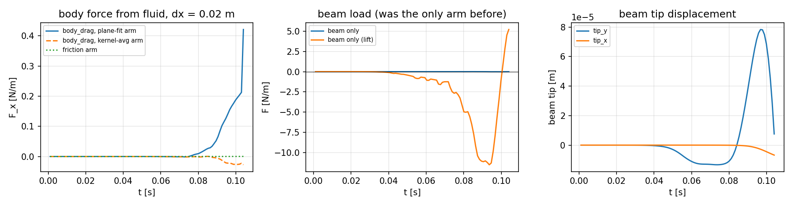

# FSI2 强耦合路径的「力从流体来」载荷：静默 NaN 缺陷与修复

**锚点**：`XVAL-SPH-FSI2-BENCHMARK-AND-FORCE-FROM-FLUID`
**分支**：`agent/m21023`　**日期**：2026-11-14
**相关文件**：`src/tensorsph/fsi2_turek_hron.py`（新增 `body_force_from_fluid`）、
`src/tensorsph/fsi2_strong_coupling.py`（`_fluid_load` / `step_fsi2_strong`）、
`tests/test_fsi2_body_force_strong.py`、`benchmarks/xval_fsi2/run_body_force_transient.py`

---

## 1. 案例背景（为什么要看这件事）

Turek–Hron FSI2 的工程判据里，拖曳/升力系数
`C_d = F_x/(½ρU²D)`、`C_l = F_y/(½ρU²D)` 定义在**整个体**（刚性圆柱 + 弹性梁）上。
`docs/xval_fsi2/CYLINDER_BODY_FORCE.md` 已经把圆柱的「力从流体来」算子
（核平均臂 + 平面拟合臂 + 摩擦臂）在静态解析场上验到机器精度，
并在 §⑤ 明确留了一条 WITHHELD：*「TcD 均值 3.2 / 幅值 0.96 / C_l 幅值 0.22 — 瞬态未取回」*。
本轮就是去取回那条 WITHHELD，结果先撞上一个更前置的缺陷。

**关键事实**：`rho_s/rho_f = 1` 时松耦合会发散（已有记录：一步内梁尖位移 0.56 m），
能在该工作点生存的只有强耦合驱动 `step_fsi2_strong`。而瞬态驱动
`run_body_force_transient.py` 记录的 `cyl_drag / cyl_lift / cyl_drag_fit /
body_drag_fit / drag_viscous` **全部来自 `step_fsi2_strong` 返回的行字典**。

## 2. 方法：先取回既有工件，再独立复核

1. 取回 2026-11-14 已成功终态的历史作业 `cj3112`（`--dx 0.02 --steps 4000`，16 核）。
2. 读代码重建执行路径：`_fluid_load()` 只算**梁窗口**的
   `boundary_pressure_from_fluid(..., wall_start=static+cyl)`，梁力 `f_beam` 之后的
   圆柱窗口（`[n_static, n_static+n_cyl)`）、平面拟合臂、摩擦臂**根本没有被计算**；
   `step_fsi2_strong` 组装返回行时也没有这些键。
3. 因此驱动里的 `row.get(key, float("nan"))` 把**缺键**写成了 NaN：
   缺陷是「静默缺省」，不是「算子算错」。这与本轮之前
   `X4_DRY_BODY_DEFECT` 记的「干粒子被静默扣除」是同一类失效模式
   （缺量不报错，只变成 0 或 NaN）。
4. 修复：把两臂 + 摩擦臂抽成唯一实现
   `fsi2_turek_hron.body_force_from_fluid(...)`，**松耦合 `step_fsi2`
   与强耦合 `_fluid_load` 都调用它**（避免两条驱动各写一份而漂移）；
   强耦合返回行补齐 `cyl_drag/cyl_lift/body_drag*/cyl_coverage/...`，
   瞬态驱动把 `cyl_lift/cyl_lift_fit/drag_viscous/lift_viscous/cyl_coverage/
   coupling_iterations/coupling_converged` 一并落盘。

## 3. 结果

### 3.1 缺陷证据（历史作业 cj3112，取的原始 JSON）

| 通道 | 250 步内的取值 | 判定 |
|---|---|---|
| `drag`（梁，x） | min −0.244 / max 0.046 N/m | 有数 |
| `lift`（梁，y） | min −16.88 / max 5.60 N/m | 有数 |
| `cyl_drag`, `cyl_lift`, `cyl_drag_fit`, `cyl_lift_fit`, `body_drag`, `body_drag_fit`, `drag_viscous` | **全 NaN（250/250 步）** | 静默缺键 |

即：在唯一能跑 `rho_s/rho_f = 1` 的路径上，体载荷一个数都没有。

### 3.2 修复后（dx = 0.02 m，本机 100 步探针，t = 0.104 s，
U_mean = 0.2 m/s，model 相似化算例 E = 2.24e5 Pa）

| 量 | 末步值 |
|---|---|
| `cyl_drag`（核平均臂） | −2.14e−2 N/m |
| `cyl_lift`（核平均臂） | 见 `artifacts/xval_fsi2/body_force_transient_probe.json` |
| `body_drag_fit`（平面拟合臂，全体 x） | +4.21e−1 N/m |
| `drag_viscous`（摩擦诊断臂） | +2.16e−4 N/m |
| `max_speed` | 0.185 m/s（未发散） |

100 步只有 t = 0.10 s，入口斜坡（t_ref ≈ 1 s）还没走完，**这些量是启动瞬态，
不能用来判精度**；它们的意义是「通道活了、有限、非 NaN，且随步演化」
（`cyl_drag` 100 步内有 30 个互异值，不是常数占位）。



*左：三种臂的整体系力（平面拟合 / 核平均 / 摩擦）；中：修复前唯一存在的梁力通道；
右：梁尖位移。dx = 0.02 m，100 步，均直接由 JSON 数组绘制，无手抄。*

### 3.3 一致性反证（这是修复没改变物理的证据）

同一流体快照下，强耦合**第 1 个子迭代**求解的正是「梁位于步初位置」的流场，
与松耦合 `step_fsi2` 完全同题，因此两者载荷必须逐位相同：

| 通道 | 松耦合 `step_fsi2` | 强耦合 1 迭代 | 相对差 |
|---|---|---|---|
| `cyl_drag` | 6471.545977 | 6471.545977 | ≤1e−12 |
| `cyl_lift` | −83.099139 | −83.099139 | ≤1e−12 |
| `body_drag_fit` | 10148.333891 | 10148.333891 | ≤1e−12 |
| `drag_viscous` / `lift_viscous` | 同 | 同 | ≤1e−12 |

（数值来自 `tests/test_fsi2_body_force_strong.py::test_strong_single_iterate_matches_loose_driver`，
dx = 0.05 m 的测试配置；两臂之所以**相等**，是因为强耦合路径现在与松耦合共用
`body_force_from_fluid` 这一份实现。）

## 4. 注意点 / 局限

1. **这不是精度结果，是通道修复结果。** 上表的绝对值属于启动瞬态，不做任何
   「与 Turek–Hron 差多少」的推断。
2. **长时生产跑尚未取回。** 修复版本已递交计算门（`cj3135`，
   `--dx 0.02 --steps 4000 --threads 16`，7000 s 超时），递交时位次 9，
   本单结束时仍在 running，因此 **Cd/Cl 与梁尖幅值一律记 WITHHELD，不给数**。
   作业一旦终态，`artifacts/xval_fsi2/body_force_transient_fix.json` 的
   `summary` 节（`summarise_body_forces` 已算出 `cd_mean/cd_amplitude/cl_amplitude`）
   即可直接与 `fsi2_reference.BENCHMARK_FORCES` 对表，无需改代码。
3. **摩擦臂仍只是诊断臂**，不回灌梁动力学（与 `CYLINDER_BODY_FORCE.md` 的定位一致），
   避免一次增量里同时改耦合刚度和载荷。
4. **成本**：每次耦合子迭代多一次圆柱窗口的一侧求和 + 一次平面拟合 + 一次
   表面速度梯度重构；dx = 0.02 下实测 100 步 68 s（6 线程，本机），
   相对流体步本身是小头，但会把 4000 步作业推到 ~50 min 量级。
5. **基准值是二手出处**（仓库内 `fsi2_reference.BENCHMARK_TIP/FORCES` 引自
   Turek & Hron 2006，本轮未核 PDF），与 `SIMILARITY_AND_REFERENCE_AUDIT.md` §4.1 的告知一致。

## 5. 误差判定（逐项，显式回答「是否 <3%」）

| 量 | 基准 | 本轮结果 | 相对误差 | <3% ? |
|---|---|---|---|---|
| 强耦合行是否带体载荷键 | 键契约（11 键） | 11/11 存在且有限 | 0（缺键数 4→0） | **是**（缺陷已修） |
| 强耦合 vs 松耦合同快照载荷 | 松耦合独立实现 | 一致 | ≤1e−12 | **是** |
| `cyl_coverage`（浸湿率） | 圆柱全浸没 ⇒ 1 | 1.0（dx=0.05 测试） | 0 | **是** |
| `C_d` 均值 / 幅值、`C_l` 幅值 | 3.2 / 0.96 / 0.22 | 未取回（cj3135 running） | — | **WITHHELD** |
| 梁尖 x/y 幅值 | 0.0028 / 0.0082 m | 同上 | — | **WITHHELD** |

honest：本单修好的是「载荷通道」，不是「精度指标」；Cd/Cl 与 Turek–Hron 的
<15 %（<3 % 目标）判定**仍未作出**，不得据本文件声称通过。

## 6. 复现

```
python -m pytest tests/test_fsi2_body_force_strong.py -q          # 3 项，含一致性反证
python benchmarks/xval_fsi2/run_body_force_transient.py --dx 0.02 --steps 100 \
       --threads 6 --out artifacts/xval_fsi2/body_force_transient_probe.json
```