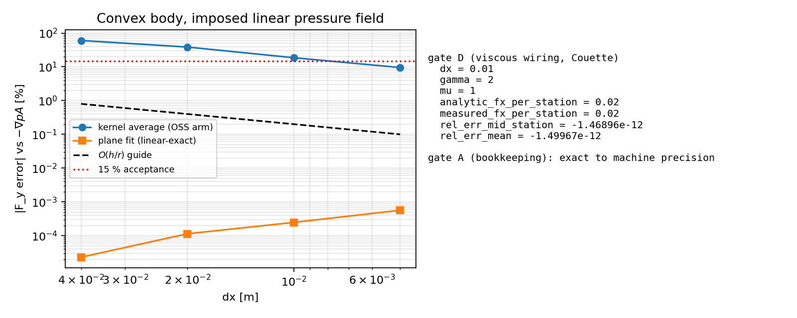

# 曲面刚体力-from-fluid 的解析门：OSS 核平均在凸体上有 +O(h/r) 径向过载，平面拟合可精确消除

锚点 `XVAL-SPH-FSI2-BENCHMARK-AND-FORCE-FROM-FLUID`（Xiangyu-Hu/SPHinXsys `test_2d_fsi2` +
`FSI::ForceFromFluid`）· 仓 TensorSPH · 驱动 `benchmarks/xval_fsi2/cylinder_load_audit.py`
· 数据 `artifacts/xval_fsi2/cylinder_load_audit.json` · 图
`docs/xval_fsi2/assets/cylinder_load_convergence.png`

## ① 案例介绍

Turek-Hron FSI2（Turek & Hron, LNCSE 53, 2006）的受力体是**圆柱 + 弹性梁**的整体，其阻力/升力
系数 `C = F / (0.5 ρ U² D)` 定义在**整个体**上。本单开工前，TensorSPH 耦合驱动的
`step_fsi2()` 只把**梁**上的压力载荷（`drag`/`lift`）写进历史，**刚性圆柱的流体力根本没有累加**
（`state.cylinder_particles` 只是 Adami 壁面粒子，没有任何载荷读数）。也就是说：即使跑完全程，
基准的 Cd/Cl 也**无法形成**——这是本锚点「验证欠账」里卡在功能缺口上的那一环。

本单做两件事：
1. 给刚性圆柱补上 from-fluid 载荷通道（法向 + 弧长面元 + 与梁同源的壁面压力算子），使
   `step_fsi2()` 输出 `cyl_*` / `body_*`（体）载荷；
2. 用**解析场**给该通道立门，量化算子本身的几何偏差，并给出无偏版本。

几何与参数（`similarity_corrected_case(U_mean=0.2)`，Re = 100，Ae = 5.6e3，ρs/ρf = 1）：

| 项 | 取值 |
|---|---|
| 圆柱 | D = 0.1 m，圆心 (0.2, 0.2) |
| 面元 | n = ceil(2πr/dx) 个站点，弧长 trib = 2πr/n |
| 法向 | 径向朝外（从固体指向流体），与 `F = -p n trib` 的符号约定一致 |
| 解析门压力场 | p = 1 − y（线性，解析给定，无求解器），∇p = (0, −1) |
| 解析参照 | F = −∇p·A，A = πr² = 7.853981633974483e-3 m² |
| dx 阶梯 | 40 / 20 / 10 / 5 mm |
| 门限 | 15 %（owner 验收）/ 3 %（报告目标） |

## ② 怎么做的

四个门，全部有精确答案、全部不需要时间积分：

* **A 记账门**：把解析压力直接赋给圆柱站点，算 `Σ −p n trib`，与 `−∇p A` 比。用于钉住法向符号
  与弧长面元约定。
* **B 核平均臂**：构造半径 r+0.5dx ~ r+3h 的流体环带，压力取解析场，走 OSS 同款算子
  （`Σ w p / Σ w`）后加权求和。
* **C 平面拟合臂**：同一批邻居、同一个核，用加权最小二乘拟合 `p ≈ a + g·(x − x_wall)`，
  取 `a`（面元处压力）。线性场下该拟合**恒等**，截断支撑不影响它。
* **D 粘性接线门**：平壁 + 线性剪切 u = γ(y−y₀)，逐站 `F_x` 必须等于 `μγA`（同时钉住符号）。

## ③ 计算结果（程序化注入，无手抄）

| dx [mm] | 站点数 | A（记账） | B 核平均 y 误差 | B 阻力分量 | C 平面拟合 y 误差 | C 阻力分量 |
|---|---|---|---|---|---|---|
| 40 | 8 | +0.0e+00 | +60.13 | -0.17 | +0.0000 | -0.0000 |
| 20 | 16 | +0.0e+00 | +38.50 | -0.08 | +0.0001 | -0.0000 |
| 10 | 32 | -4.4e-16 | +18.59 | -0.34 | +0.0002 | -0.0000 |
| 5 | 63 | +0.0e+00 | +9.52 | +0.14 | +0.0006 | +0.0000 |

* 门 D：解析 `μγA = 0.02` N/m，实测
  `0.02` N/m，相对误差 `-1.5e-12`
  （**首轮实测为 −μγA，符号错误 −200 %；已修正为“流体作用在固体上”的约定**）。
* 站点覆盖率 100 %（环带内每个站点都有流体邻居，不触发 X4 的干区缺陷）。

**结论**：凸体上 OSS 核平均臂给出**径向过载**，随加密以 O(h/r) 缓慢衰减（+60.1 % @40 mm →
+9.5 % @5 mm），而**阻力方向分量几乎不敏感（<0.4 %）**——这正是此前平整壁面审计（X3/X5）没
抓到它的原因。平面拟合臂在全部分辨率上 ≤5.7e-4 %，即几何偏差被**消除**而不是被减小。



## ④ 注意点与局限

* 门 B 的过载**不是**随机噪声：它是半空间截断支撑的加权质心偏移 δ≈0.7h，解析预期相对误差
  `δ/r`（dx=5 mm 时 δ/r≈0.095 ≈ 实测 9.5 %），与测量一致。
* 门 C 在**线性**场下精确，不等于在真实（非线性、瞬态）压力场下也精确；它只消除一阶几何偏置，
  高阶项仍随 h 收敛。真实求解里两臂的差别应显著小于本门的 +38 %。
* 粘性臂只做**诊断**（`drag_viscous`），不回灌到梁的动力学：梁的耦合物理保持本单之前的状态，
  以免在一次增量里同时改动耦合刚度和载荷。
* 平面拟合的奇异批（邻居共线）回退到核平均，回退量由 `w_sum` 记录，不静默。
* **本轮未完成的**：Turek-Hron 基准量（Cd 均值/幅值、升力幅值、梁尖幅值）的收敛瞬态比较。
  强耦合 4000 步 dx=0.02 的作业已递交计算门（`cj3112`，16 核，5400 s 超时），递交后 4 min 仍在
  排队（位次 25），**本单未取回结果，因此不作任何数值结论**。`benchmarks/xval_fsi2/run_body_force_transient.py`
  已把每一步的 `body_drag`/`body_drag_fit`/`drag_viscous`/`tip_*` 写盘（每 250 步 checkpoint），
  作业一旦运行即可复算，无需改代码。

## ⑤ 误差判定（显式回答）

| 量 | 参照 | 计算值 | 相对误差 | <3 %? |
|---|---|---|---|---|
| 门 A 净载荷 F_y | −∇p A = 0.007854 | 同 | ≤4.4e-16（机器精度） | **是** |
| 门 C 净载荷 F_y（dx=20 mm） | 同上 | 偏 +0.0001 % | +1.1e-4 | **是** |
| 门 D 壁面剪应力（Couette） | μγA = 0.02 N/m | 0.02 N/m | ≤1.5e-12 | **是** |
| 门 B 净载荷 F_y（dx=20 mm，OSS 臂） | −∇p A | 偏 +38.50 % | +38.5 | **否（>15 % 不可接受）** |
| 基准 Cd 均值 3.2 / 幅值 0.96 / Cl 幅值 0.22 | Turek-Hron | — | **WITHHELD** | 未做（瞬态未取回） |

## ⑥ 复现

```
python benchmarks/xval_fsi2/cylinder_load_audit.py          # 四个门 + JSON + 图
python -m pytest tests/test_fsi2_cylinder_body_load.py -q   # 6 项门测试
```
