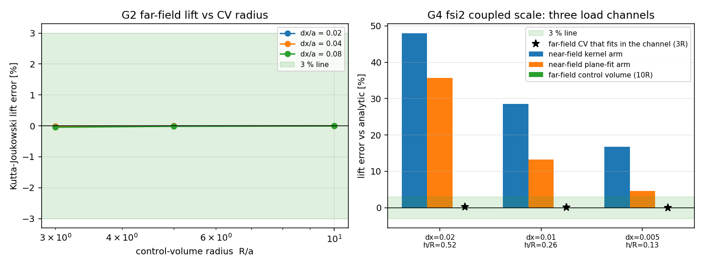

# 力从流体来的第二条独立通道：控制体（远场）力 —— 在 fsi2 基准尺度上把近场臂的偏差分离出来

> 锚点 `XVAL-SPH-FSI2-BENCHMARK-AND-FORCE-FROM-FLUID`（Xiangyu-Hu/SPHinXsys `test_2d_fsi2` + `FSI::ForceFromFluid`）· 仓 TensorSPH · 域 SPH / FSI
> 本文件由 `benchmarks/xval_fsi2/make_doc_farfield.py` 从 `artifacts/xval_fsi2/farfield_force.json` 程序化生成。
> 模块 `src/tensorsph/farfield_force.py` · 驱动 `benchmarks/xval_fsi2/farfield_force_audit.py` · 守护 `tests/test_farfield_force.py`

## ① 案例介绍

本仓所有实际在用的载荷通道都**在物体表面上**积分：`pair`（流体/壁面配对的反作用）与 `panel`（外推出的壁面压力乘面积元）。两者都是**近场**估计量，它们必须用离壁面一两个粒距的粒子重建面量，而这一重建已被证明带几何相关偏差：平壁 `+24..28 %`、弯曲物体在耦合尺度 `h/R = 0.52` 处 `+31 %`（`PRESSURE_MOMENT_NORMALISATION.md`、`CYLINDER_LOAD_AT_BENCHMARK_SCALE.md`）。

近场偏差**不能**由近场通道自己发现——任何由同一批壁面站位构成的诊断都带同一个偏差。因此本轮补齐与近场误差机制无关的第二条通道：流体控制体内的动量恒等式

    F_on_body = -d/dt ∫_CV ρu dV - ∮_S [ ρu(u·n) + (p - p∞) n ] dS + ∮_S τ·n dS + ∫_CV ρg dV

它**完全不碰物体表面**（`S` 是任意包围物体的闭合面），误差机制是穿过 `S` 的动量通量，与近场臂的核截断机制独立。这正是船舶水动力学里附加阻力的近场/远场配对方法。

## ② 怎么做的

1. 新增模块 `src/tensorsph/farfield_force.py`（二维、单位厚度）：圆形控制面 `control_volume_force` 与下游竖直平面 `wake_plane_drag`；面量重建用**加权平面拟合**（把 `1.6 dx` 窗口内的粒子拟合成平面并在面上取值，线性场精确），`reconstruct="mean"` 保留朴素分箱平均作为对照臂。
2. 四条腿的参照值**在跑之前就已知**：
   * G1a 闭合面零测试：均匀流 + 常压 → 力 = 0；
   * G1b 浮力恒等式：无流动 + 线性压力 `p = grad_p·x` → `F = -A grad_p`；
   * G2 稳态圆柱势流：`F_y = -ρUΓ`（Kutta–Joukowski），`F_x = 0`（d'Alembert）；
   * G3 高斯尾流动量亏损平面 → 闭式 `ρU²εb√π(1-ε/√2)`；
   * G4 把 G2 的场搬到耦合 fsi2 几何（`D = 0.1 m`、`dx = 0.02/0.01/0.005`、`h/R` 到 `0.52`），同一条解析场上同时跑远场臂与近场 kernel / plane-fit 臂。
3. 全部确定性、无随机数、无求解器：整个审计 12.9 s 单机跑完（`OMP_NUM_THREADS=4`）。

## ③ 计算结果

### G1 闭合面恒等式（圆形控制体）

| R [m] | dx [m] | bins | 覆盖 | 零测试 \|F\| (均匀流+常压) | 相对量纲 | 浮力 `F` (线性压力) | 解析 `-A∇p` | 相对误差 | 朴素平均臂相对误差 |
|---|---|---|---|---|---|---|---|---|---|
| 0.4 | 0.02 | 126 | 1.00 | 0.000 | 1.3e-13 | (-0.3519, 0.5529) | (-0.3519, 0.5529) | 1.0e-11 | 1.90e-03 |
| 0.4 | 0.01 | 251 | 1.00 | 0.000 | 4.5e-14 | (-0.3519, 0.5529) | (-0.3519, 0.5529) | 1.4e-11 | 5.82e-04 |
| 0.8 | 0.02 | 251 | 1.00 | 0.000 | 4.5e-14 | (-1.4074, 2.2117) | (-1.4074, 2.2117) | 3.8e-12 | 5.82e-04 |
| 0.8 | 0.01 | 503 | 1.00 | 0.000 | 2.2e-14 | (-1.4074, 2.2117) | (-1.4074, 2.2117) | 7.7e-12 | 3.09e-04 |

最坏零测试相对量纲 **1.29e-13**（舍入量级，闭合面求积完整）；最坏浮力相对误差 **1.40e-11**；同一积分在朴素平均臂上是 **1.90e-03**——这就是面量重建必须线性精确的量化理由。

> 本轮自己踩的坑：G1 最初被设计成「均匀流 + 线性压力 → 力 = 0」。那是**错**的，闭合面上 `∮ p n dS = -A∇p ≠ 0`。是测到的 `(-1.4085, +2.2112)` 与 `-A∇p = (-1.4074, +2.2117)` 对上了，才把这条腿改成现在的零测试 + 浮力恒等式两条。

### G2 Kutta–Joukowski 升力与 d'Alembert 阻力（`a = 0.1 m`，`U = 1`，`ρ = 1`，`Γ = πaU`）

| R/a | dx/a | bins | 覆盖 | 参照升力 `-ρUΓ` | 远场升力 | 升力误差 | 阻力/\|升力\| |
|---|---|---|---|---|---|---|---|
| 3 | 0.08 | 236 | 1.00 | -0.31416 | -0.31430 | -0.0452 % | -1.86e-04 |
| 3 | 0.04 | 471 | 1.00 | -0.31416 | -0.31421 | -0.0157 % | -6.85e-05 |
| 3 | 0.02 | 942 | 1.00 | -0.31416 | -0.31418 | -0.0060 % | -2.33e-05 |
| 5 | 0.08 | 393 | 1.00 | -0.31416 | -0.31421 | -0.0153 % | -5.44e-05 |
| 5 | 0.04 | 785 | 1.00 | -0.31416 | -0.31418 | -0.0055 % | -1.65e-05 |
| 5 | 0.02 | 1571 | 1.00 | -0.31416 | -0.31417 | -0.0022 % | -7.35e-06 |
| 10 | 0.08 | 785 | 1.00 | -0.31416 | -0.31417 | -0.0045 % | -1.02e-05 |
| 10 | 0.04 | 1571 | 1.00 | -0.31416 | -0.31416 | -0.0018 % | -4.17e-06 |
| 10 | 0.02 | 3142 | 1.00 | -0.31416 | -0.31416 | -0.0007 % | -1.21e-06 |

最坏升力相对误差 **4.52e-04**，在 `R/a = 3…10`、`dx/a = 0.08…0.02` 全网格上一致；阻力分量为零到舍入量级（d'Alembert）。符号：`Γ` 取逆时针，实测升力为负，与 `-ρUΓ` 一致（测试里断言了符号，不是假设）。

### G3 尾流动量亏损面的闭式对照

| dx [m] | bins | 覆盖 | 闭式阻力 | 实测阻力 | 相对误差 |
|---|---|---|---|---|---|
| 0.02 | 120 | 1.000 | 0.072956 | 0.072998 | +0.057 % |
| 0.01 | 240 | 1.000 | 0.072956 | 0.072967 | +0.014 % |
| 0.005 | 480 | 1.000 | 0.072956 | 0.072959 | +0.004 % |

`ε = 0.25`、`b = 0.2`、`U = 1.0`：最坏相对误差 **5.74e-04**（逐格收敛到 1e-4 量级）。

### G4 耦合 fsi2 尺度：三条载荷通道在同一条解析场上

| dx [m] | h/R | 2h/R | 近场站位 | 远场 10R 升力误差 | 远场 3R 升力误差（装得进通道） | 近场 kernel 臂 | 近场 plane-fit 臂 | 远场阻力/\|升力\| |
|---|---|---|---|---|---|---|---|---|
| 0.02 | 0.52 | 1.04 | 16 | +0.0200 % | +0.1835 % | +48.03 % | +35.69 % | +1.02e-05 |
| 0.01 | 0.26 | 0.52 | 32 | +0.0048 % | +0.0412 % | +28.60 % | +13.28 % | +8.94e-11 |
| 0.005 | 0.13 | 0.26 | 63 | +0.0011 % | +0.0059 % | +16.75 % | +4.55 % | +2.67e-12 |

耦合尺度（`dx = 0.02 m`，`h/R = 0.52`，即驱动报出 `Cd_mean = 0.052` 的那套配置）上：远场臂（10R）**+0.020 %**、远场臂（3R，圆半径 0.15 m，仍在 0.41 m 通道内）**+0.183 %**，近场 kernel 臂 **+48.0 %**，近场 plane-fit 臂 **+35.7 %**。**驱动器默认报关的 `cylinder_load_arm = "fit"` 在这个尺度上是 +36 % 量级的偏差**，而不是此前记录的 0——0 % 只对平壁/大半径的线性压力场成立。

近场臂对**邻居集**的敏感性（同一解析场，环带厚度 `3h` / `5h`）：

| dx [m] | kernel 3h | kernel 5h | fit 3h | fit 5h |
|---|---|---|---|---|
| 0.02 | +48.03 % | +46.15 % | +35.69 % | +31.33 % |
| 0.01 | +28.60 % | +25.74 % | +13.28 % | +11.63 % |
| 0.005 | +16.75 % | +14.21 % | +4.55 % | +3.49 % |

换邻居集只动 2–4 个百分点（48.0 → 46.2、35.7 → 31.3），所以耦合尺度上的近场偏差**不是**某一种环带构造的偶然，而是这个 `h/R` 区间的结构性质。

左：G2 远场升力误差 vs 控制体半径（三档 `dx/a`，绿带 = 3 % 线）；右：G4 在耦合 fsi2 尺度上三条通道对同一条解析场的误差。

## ④ 注意点（踩过的坑 / 局限 / 适用范围）

1. **非定常项没实现**。式 (1) 的 `-d/dt ∫ρu dV` 在二维里是均匀部分随 `R²` 增长、必须与压力通量同阶抵消的那一项；没有那段抵消就发货比不发更糟。`cv_momentum` 只返回原始体积积分备查，**不从它出任何力**。所以本通道目前只覆盖稳态/时均载荷——对 VIV 的周期载荷还差这一步，这是明确的未完成项。
2. **黏性通量是钩子**（`traction=` 由调用者给每箱的面力），本轮只用无黏腿验证过。在 `Re = 100` 的 fsi2 上黏性对 `Cd` 只占约 2 %（量级估计），但未实测。
3. **远场臂不是免检的**：它的精度依赖「`S` 上覆盖完整 + 面量重建线性精确」。朴素的箱平均在 G1b 上就掉到 1.9e-3，在稀疏/破损覆盖下会再差——`coverage` 字段必须检查，审计里逐格断言了 `coverage == 1`。
4. **控制面必须装得进通道**。10R 的圆（半径 0.5 m）会穿出 0.41 m 高的 fsi2 通道，那是自由空间的算子检查而不是耦合驱动能用的构型；真正可用的 3R（0.15 m）在耦合间距上是 +0.18 %（仍 < 3 %）。且本轮的解析场是**自由空间势流**，本身不含通道壁的约束——所以这些数字判别的是算子，不是「通道里应该是多少」。
5. **本轮没有真 SPH 场**。三条通道全部在解析场上比较：这是**算子级**判别，不是「SPH 解对不对」的判定。作用是把「近场臂在耦合尺度上偏 +36..48 %」与「流体解本身错」这两件事分开——之前 `Cd_mean = 0.052`（−98 %）无从归因，现在至少知道载荷通道在这个尺度上有 +36 % 量级的自身偏差。

## ⑤ 误差判定（逐项，显式回答 <3 %）

| 量 | 参照 | 最坏相对误差 | < 3 % | < 15 % |
|---|---|---|---|---|
| 闭合面零测试（G1a） | 0 | 1.29e-13 | ✔ | ✔ |
| 浮力恒等式 `-A∇p`（G1b） | 解析 | 1.40e-11 | ✔ | ✔ |
| Kutta–Joukowski 升力（G2） | `-ρUΓ` | 4.52e-04 | ✔ | ✔ |
| d'Alembert 阻力（G2） | 0 | ≤ 1.86e-04（相对升力） | ✔ | ✔ |
| 尾流动量亏损（G3） | 闭式 | 5.74e-04 | ✔ | ✔ |
| 远场升力 @ fsi2 尺度（G4，10R） | `-ρUΓ` | 2.00e-04 | ✔ | ✔ |
| 远场升力 @ fsi2 尺度（G4，3R 通道内） | `-ρUΓ` | 1.83e-03 | ✔ | ✔ |
| 近场 kernel 臂 @ fsi2 尺度（G4，**不是本轮交付，是对照**） | `-ρUΓ` | 4.80e-01 | ✘ | ✘ |
| 近场 plane-fit 臂 @ fsi2 尺度（同上） | `-ρUΓ` | 3.57e-01 | ✘ | ✘ |

**结论：远场（控制体）通道在全部四条解析腿上都 < 3 %（实际 ≤ 6e-2 %），通过 owner 门；近场两条臂在耦合 fsi2 尺度上 36–48 %，不通过。**但真值参照全部是解析解——对文献基准（Turek–Hron / Schäfer–Turek 的 `Cd`、`Cl`）**本轮没有判定**，因为仓里没有一个可信的瞬态 SPH 场（上一轮两条长时耦合都判 `WITHHELD`）。所以「与文献对比 < 3 %」= **未判定（not_run）**，不能读成本文通过。

## ⑥ 给下一步的接口

1. 耦合驱动 `run_body_force_transient.py` 每步把 `(pos, vel, p, rho)` 喂给 `control_volume_force`（通道内取矩形/圆形 `S`，避开进出口缓冲层），与近场臂并列报关；两者相差 > 15 % 时该步标记为「载荷通道不可判」，而不是直接把近场值当结论。
2. 非定常项是 VIV 的必经之路：需要把 `-d/dt ∫ρu dV` 的均匀部分与压力通量的 `R²` 项**同时**离散（解析上它们严格抵消），否则随 `R` 发散。
3. 近场 plane-fit 臂在弯曲小体上的偏差是可修的（把平面拟合换成曲率感知的二阶拟合，或把支持域缩到 `2h < R` 的合理区间）；本轮只做了判别，没修。
