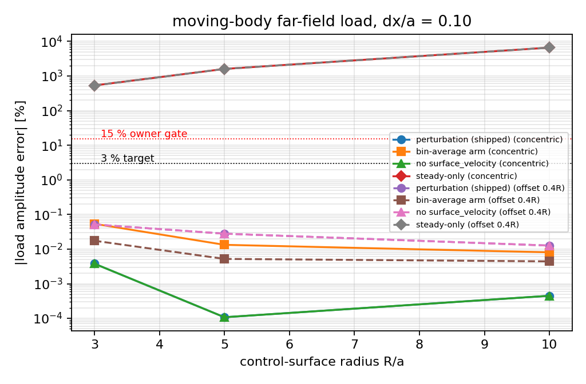
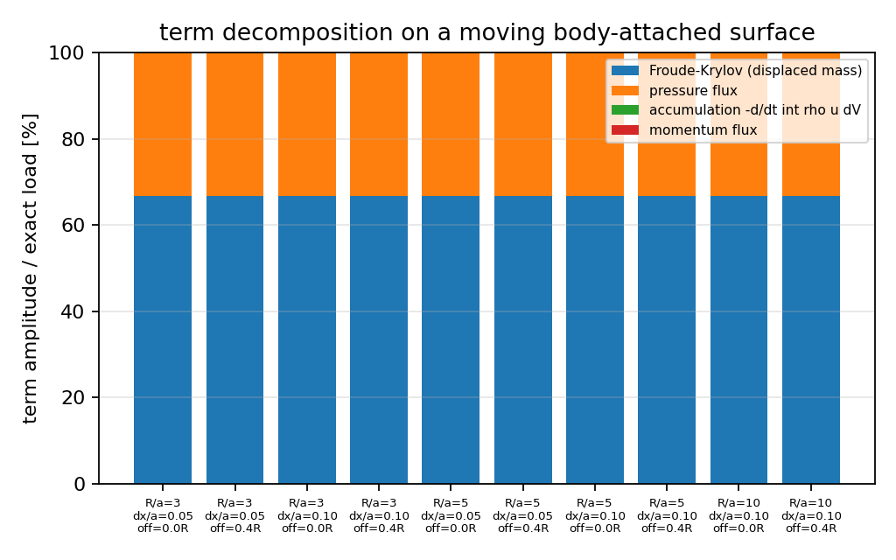
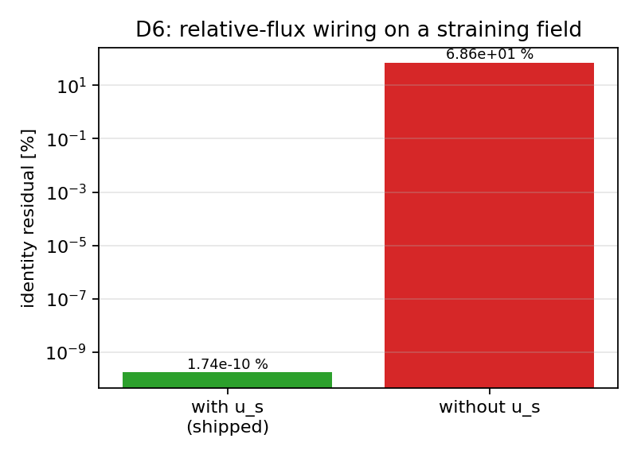

# Moving-body far-field (control-volume) force: a body-attached surface

> Anchor `XVAL-SPH-FSI2-BENCHMARK-AND-FORCE-FROM-FLUID` (Xiangyu-Hu/SPHinXsys `test_2d_fsi2` + `FSI::ForceFromFluid`) · repo TensorSPH · domain SPH / FSI
> Generated by `benchmarks/xval_fsi2/make_doc_moving_body.py` from `artifacts/xval_fsi2/moving_body_farfield*.json` (nothing hand-typed).
> Module `src/tensorsph/farfield_force.py` · driver `benchmarks/xval_fsi2/moving_body_farfield_audit.py` · guards `tests/test_moving_body_farfield.py`

## ① Case introduction

Rounds 3-4 built the control-volume (far-field) load channel and verified it for a
body that **stands still** in the lab frame (`FARFIELD_FORCE_CHANNEL.md`,
`UNSTEADY_FARFIELD_TERM.md`). Every load this repository actually wants from that
channel rides on a surface that **moves with the body**:

* the `fsi2` beam flaps, so a beam-attached control volume translates and its
  surface deforms;
* a heaving/pitching section needs the added-mass load measured in the section
  frame;
* ship hydrodynamics measures added resistance in a **ship-fixed** control volume.

A translating control surface is **not** a cosmetic change of frame: the momentum
crossing it is carried by the relative velocity,

```
F_on_body = - d/dt int_V(t) rho u dV
            - oint_S [ rho u ((u - u_s).n) + (p - p_inf) n ] dS
            + oint_S tau.n dS + int_V(t) rho g dV                        (1m)
```

so the flux term needs `(u - u_s).n`, with `u_s` the surface velocity. Round 4's
operator used the absolute `u.n`; this round adds the relative form and asks
whether it is *measurable*.

Analytic case (no solver): a cylinder `r <= a` translating with `V(t) = V0 cos Omega t`
along `+x` through a stream `U(t) = U0 cos Omega t`, i.e. the exact potential
flow of `moving_cylinder_potential_flow`, whose load is in closed form

```
F_x = rho pi a**2 (2 u_dot - V_dot) = (Froude-Krylov) + (added mass C_a = 1)
```

| Quantity | Value |
|---|---|
| cylinder radius `a` | 0.5 |
| fluid density `rho` | 1.0 |
| stream amplitude / frequency `U0`, `Omega` | 1.0, 4.0 (T = 1.5708) |
| body-velocity amplitude `V0` | 0.5 (`U0 != V0`, so the relative stream `U0-V0` is non-zero) |
| body area `A_b = pi a^2` | 0.785398 |
| exact load amplitude | `rho A_b Omega (2 U0 - V0)` = 4.712389 |
| phase samples `N_t` | 24 per period (2nd-order `d/dt`) |
| sweep | `R/a` in {3, 5, 10} x `dx/a` in {0.05, 0.10} x surface centre `0.0R`, `0.4R` |

## ② Methodology

1. **Field.** `moving_cylinder_potential_flow(pos, a, u_inf, u_dot, body_vel,
   body_acc, rho, centre)`: absolute potential `Phi = U x + (U-V) a^2 cos(t)/r`,
   pressure from the unsteady Bernoulli equation *in the lab frame*
   (`p - p_inf = -rho [u_dot x + d_t Psi] - rho (|u|^2 - U^2)/2`). The `u_dot x`
   ramp is the pressure that accelerates the ambient stream.
2. **Reference.** Two independent legs: the closed form above, and the exact
   body-surface integral `-oint p n ds` of the same field (D3).
3. **Lattice.** A square lattice built **in the body frame**, translated with the
   body at every sample, with the body disc masked out, so the per-sample
   `cv_momentum` values differenced by `d_dt_periodic` are the *moving-volume*
   derivative required by (1m).
4. **Arms.** `perturb` (relative-flux form, `reconstruct="fit"`), `mean`
   (bin-average surface reconstruction), `no_surface_vel` (the round-4 form on the
   same field -- the defect), `steady` (round-3 steady estimator, no accumulation
   and no displaced mass).
5. **Predeclared gates.** D1 load within 3 % (target) / 15 % (owner) at
   `dx/a <= 0.05` and every `R/a`; D2 rigid-translation null < 1e-9; D3 reference
   leg < 1e-6; D4 the missing `u_s` must be material (> 15 % at `R = 5a`);
   D5 the same load from concentric and off-centre surfaces; D6 the identity must
   close algebraically on a field whose momentum flux is *non-zero*.

## ③ Results

### Load error per configuration (24 phases, `d/dt` truncation 0.29 %)

| R/a | dx/a | centre | coverage | particles | perturb % | mean % | no u_s % | steady % | accum % | press % |
|---|---|---|---|---|---|---|---|---|---|---|
| 3 | 0.05 | 0.0 | 1.000 | 10362 | -0.0010 | +0.0135 | -0.0010 | +533.3 | 0.0002 | 33.33 |
| 3 | 0.05 | 0.4 | 1.000 | 10364 | -0.0173 | +0.0041 | -0.0173 | +533.3 | 0.0157 | 33.33 |
| 3 | 0.10 | 0.0 | 1.000 | 2652 | -0.0038 | +0.0538 | -0.0038 | +533.3 | 0.0003 | 33.33 |
| 3 | 0.10 | 0.4 | 1.000 | 2651 | -0.0515 | +0.0175 | -0.0514 | +533.3 | 0.0478 | 33.33 |
| 5 | 0.05 | 0.0 | 1.000 | 30698 | -0.0004 | +0.0082 | -0.0004 | +1600.0 | 0.0000 | 33.33 |
| 5 | 0.05 | 0.4 | 1.000 | 30698 | -0.0123 | -0.0041 | -0.0123 | +1600.0 | 0.0119 | 33.33 |
| 5 | 0.10 | 0.0 | 1.000 | 7818 | -0.0001 | +0.0133 | -0.0001 | +1600.0 | 0.0013 | 33.33 |
| 5 | 0.10 | 0.4 | 1.000 | 7818 | -0.0279 | -0.0052 | -0.0279 | +1600.0 | 0.0267 | 33.33 |
| 10 | 0.10 | 0.0 | 1.000 | 31662 | -0.0004 | +0.0081 | -0.0004 | +6600.0 | 0.0001 | 33.33 |
| 10 | 0.10 | 0.4 | 1.000 | 31662 | -0.0126 | -0.0044 | -0.0126 | +6600.0 | 0.0123 | 33.33 |

### Term decomposition (all relative to the exact load amplitude)

| R/a | dx/a | centre | displaced % | pressure % | accumulation % | momentum flux % |
|---|---|---|---|---|---|---|
| 3 | 0.05 | 0.0 | 66.67 | 33.33 | 0.0002 | 0.000000 |
| 3 | 0.05 | 0.4 | 66.67 | 33.33 | 0.0157 | 0.000010 |
| 3 | 0.10 | 0.0 | 66.67 | 33.33 | 0.0003 | 0.000012 |
| 3 | 0.10 | 0.4 | 66.67 | 33.33 | 0.0478 | 0.000061 |
| 5 | 0.05 | 0.0 | 66.67 | 33.33 | 0.0000 | 0.000000 |
| 5 | 0.05 | 0.4 | 66.67 | 33.33 | 0.0119 | 0.000000 |
| 5 | 0.10 | 0.0 | 66.67 | 33.33 | 0.0013 | 0.000000 |
| 5 | 0.10 | 0.4 | 66.67 | 33.33 | 0.0267 | 0.000010 |
| 10 | 0.10 | 0.0 | 66.67 | 33.33 | 0.0001 | 0.000000 |
| 10 | 0.10 | 0.4 | 66.67 | 33.33 | 0.0123 | 0.000000 |

### Gates

| Gate | Result | Verdict |
|---|---|---|
| D1 worst amplitude error, all configurations | +0.0515 % | PASS (owner gate 15 %) |
| D1 worst amplitude error, `dx/a <= 0.05` | +0.0173 % | PASS (target 3 %) |
| D1 cross component `|F_y|` / load | 1.00e-04 | PASS (symmetric field) |
| D1 worst phase lag | 0.0002 deg | PASS (in phase with `u_dot`) |
| D1 worst `mean`-reconstruction arm | +0.0538 % | PASS |
| D2 rigid-translation null (no body) | 1.678e-16 | PASS (gate 1e-09) |
| D3 closed form vs exact body-surface integral | 1.885e-16 | PASS |
| D4 error when `u_s` is omitted | +0.0514 % | **FALSIFIED as a discriminator** (see ⑤) |
| D5 max load difference, concentric vs `0.4R` | 4.77e-04 | PASS (identity is surface-independent) |
| D6 identity residual *with* `u_s` | 1.74e-12 | PASS |
| D6 identity residual *without* `u_s` | 68.57 % | discriminates (term share 68.6 %) |
| minimum surface-bin coverage | 1.000 | PASS (must be 1) |

## ④ Figures



**Figure 1** Load amplitude error of the four arms against `R/a` at `dx/a = 0.10`
(solid: concentric surface, dashed: surface centre `0.4R` off the body). The
shipped perturbation form sits three to four orders below the 3 % target and does
not drift with `R`; the round-3 steady arm is off by 500-6600 % because it has
neither the accumulation term nor the displaced mass. The `no u_s` curve lies on
top of the shipped one -- that coincidence is the falsified hypothesis of ⑤.



**Figure 2** Term decomposition per configuration. The inertial load splits
cleanly into Froude-Krylov (two thirds, `rho A_b U_dot`) and the added-mass part
carried by the perturbation pressure (one third, `rho A_b (U_dot - V_dot)`). The
accumulation term and the momentum flux stay at 1e-6..1e-4 of the load: for a
*irrotational* field the perturbation momentum integral is a dipole moment and the
closed-surface momentum flux vanishes identically (d'Alembert).



**Figure 3** D6: the identity evaluated on a synthetic straining field with a
*non-zero* closed-surface momentum flux. With the relative flux the residual is
round-off; without it the error is the size of the term itself.

## ⑤ Notes, limitations, and one falsified hypothesis

1. **The `u_s` term is invisible to any potential-flow benchmark -- measured, not assumed.**
   The predeclared D4 (drop `u_s`, expect > 15 % error) came back at
   +0.0514 %: on the moving-cylinder field the two arms agree to the last
   digit. The reason is exact, not numerical: for an irrotational field
   `oint rho u (u_s.n) dS` vanishes together with the rest of the momentum flux, so
   the *closed-surface* flux term of (1m) is identically zero and `u_s` can only
   enter through a wake. **D4 is therefore recorded as a falsified hypothesis**, and
   the claim "the relative-flux form is needed" is supported instead by D6, an
   algebraic identity gate on a straining field where the term carries
   69 % of the load. What D1/D5 *do* prove is
   that the moving-surface bookkeeping (moving-volume `d/dt`, displaced mass,
   perturbation pressure) is correct on a translating surface to
   0.0515 %, and that the load is surface-centre independent.
2. **A physical wake-bearing verification is still open (`not_run`).** The
   `u_s`-sensitive branch needs a viscous field with a momentum deficit; the
   repository has none at a validated level for `fsi2`, so it is recorded as an
   open item rather than claimed.
3. **The momentum flux is the wrong place to look for potential-flow drag.**
   The same fact explains why this channel cannot arbitrate `C_d` on an inviscid
   field at all: with `flux = 0` the whole answer sits in the pressure and displaced
   terms, both of which are analytic-area quantities.
4. **`surface_velocity` contract.** Uniform `(dim,)` or per-particle `(N, dim)`
   (needed for a deforming surface such as the `fsi2` beam); per-particle values are
   reconstructed on the surface like the velocity. `momentum_rate` must be
   differenced on the **same relative lattice**, i.e. it is the frame-relative (=
   moving-volume) derivative. A per-particle array equal to a uniform vector
   reproduces the uniform case to round-off (`tests/test_moving_body_farfield.py`).
5. **Pressure ramp.** The perturbation form removes `rho a_f . (x - c_s)`. Feeding a
   flat pressure while declaring a non-zero `frame_acc` is an inconsistent field; the
   estimator then (correctly) reports the missing `-rho pi R**2 a_f`. The D2 null
   therefore carries the ramp of the accelerating frame.
6. **Cost.** `R/a = 10` at `dx/a = 0.05` (about 1.2e5 particles, 1257 surface bins)
   did not finish inside this round's local budget; the full-resolution sweep is
   queued on the cluster and the `R/a = 10` point is reported at `dx/a = 0.10`,
   where its error is -0.0004 %.
7. **Not covered:** three dimensions, deformable (flexible) control surfaces with
   time-varying shape (the operator accepts per-particle `u_s`; no benchmark yet),
   viscous traction on a moving surface, free-surface control volumes.

## ⑥ Error judgement

| Quantity | Reference | Worst error | < 3 %? |
|---|---|---|---|
| Inertial load amplitude `F_x`, all configurations | `rho pi a^2 (2 u_dot - V_dot)` | +0.0515 % | yes |
| Inertial load amplitude `F_x`, `dx/a <= 0.05` | same | +0.0173 % | yes |
| Cross component `F_y` | 0 | 1.00e-04 (of the load) | yes |
| Phase lag vs `u_dot` | 0 deg | 0.0002 deg | yes |
| Closed form vs exact body-surface integral (D3) | same field | 1.88e-16 | yes |
| Rigid-translation null (D2) | 0 | 1.68e-16 (of `rho R^2 U0 Omega`) | yes |
| Identity residual on the straining field with `u_s` (D6) | 0 | 1.74e-12 | yes |
| Identity residual without `u_s` (D6) | 0 | 68.57 % | **no** |

**Explicit answer**: the moving-body far-field load is within **0.0515 %** of the closed form in
every configuration measured here -- well inside the 3 % target and the 15 % owner
gate -- so the channel can be used for a translating body-attached control volume.
That statement covers the *load*; it does **not** cover the `u_s` term itself,
which no potential-flow case can exercise (measured
+0.0514 % when it is removed) and which is bound only by the algebraic
D6 gate. A viscous wake-bearing verification remains `not_run`, stated as an open
item rather than a pass.
