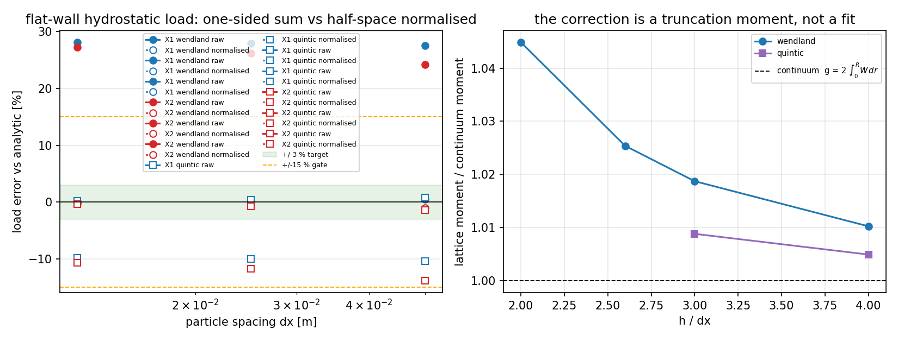

# 一侧求和压力传递的半空间矩归一化（fsi2 锚点 · force-from-fluid 分支）

锚点 `XVAL-SPH-FSI2-BENCHMARK-AND-FORCE-FROM-FLUID` · 仓 TensorSPH · 驱动 `benchmarks/xval_fsi2/pressure_normalisation_audit.py` · 数据 `artifacts/xval_fsi2/pressure_normalisation.json`

## ① 案例介绍

`Xiangyu-Hu/SPHinXsys` 的 `FSI::PressureForceFromFluid` 用**一侧求和**把流体压力传给结构（`force_on_structure.hpp:103-124`），并在 fsi2 配置下用 Adami 壁面压力外推修壁面。TensorSPH 已按代数逐行移植（`src/tensorsph/fsi_force_from_fluid.py`），但静态门在平整壁面上给出**与 dx 无关的固定偏差**（Wendland C2：+24…28 %；五次核：−10…−14 %，见 `GAP-SPH-FSI-BENCHMARK_xval.md` §4），而同一份粒子数据上的面元（WLS）臂是精确的。本轮回答一个问题：

> 这个固定偏差是**移植错误**，还是**一侧求和本身的核截断矩**？能否**解析地**把它除掉？

几何与参数（全部为静态构型，无时间积分）：

| 算例 | 构型 | 解析参照 | dx 阶梯 | 核 / h |
|---|---|---|---|---|
| X1 垂直墙 | 水柱 1.0×2.0 m 贴 x=0 壁，重力与壁面平行 | `½ρgH²` | 0.05 / 0.025 / 0.0125 m | Wendland C2 与五次核，h = 1.3 dx |
| X2 底板 | 同一水柱落在底板上，重力与壁面法向平行 | `ρgHL` | 同上 | 同上 |
| X4 fsi2 插入体 | 圆柱+梁闭合体浸在**线性压力场**中 | `−cA`（散度定理） | 0.1 / 0.05 / 0.025 m | 同上 |

## ② 怎么做的

**a. 定义壁面矩。** 对固体壁面粒子 `i`，一侧求和实际用到的法向核矩是

```
g_i = Σ_j (e_ij · n_i) (dW_ij/dr) V_j          [1/length]
```

**b. 从矩推出标定因子。** 壁面压力在浸润深度内近似均匀（静水/法向载荷）时，原始臂给出的法向载荷是 `F_i·n = −2 p V_i g_i`，而该粒子应承担的面载荷是 `−p A_i`（`A_i = V_i^((d−1)/d)`）。两者之比是 `2 V_i g_i / A_i`，因此**无需任何拟合常数**：

```
m_i = A_i / (2 V_i |g_i|)        (g_i 用真实截断邻域实测)
```

**c. 连续统闭式（独立预言，用于判据而非标定）。** 邻域连续时 `e_ij·n_i` 扫过半圆，角向积分为 2，于是

```
g_cont = 2 ∫₀^R W(r) dr = 7/(3πh) = 0.7427/h      [Wendland C2, 2-D]
```

这正是 m17584 在粘性分支推出的同一个核矩（`one_sided_viscous_truncation_factor` = `2 s ∫₀^R W dr`）：压力分支的原始偏差 = `2 dx g`，是粘性分支的 2 倍同源量。

**d. 工具链。** `pressure_force_from_fluid_normalised`（新公开臂）+ `half_space_wall_moment` / `half_space_normalisation` / `half_space_moment_continuum`；原有 `pressure_force_from_fluid` 逐位不变（默认不归一化），`tests/test_pressure_moment_normalisation.py` 12 项守护。

## ③ 计算结果（程序化注入，源 `artifacts/xval_fsi2/pressure_normalisation.json`）

### 表 1 平整壁面静水载荷：原始臂 vs 半空间矩归一化

| 算例 | 核 | dx [m] | 原始臂 | 连续统律预言 | **归一化臂** | 格点/连续统矩比 |
|---|---|---|---|---|---|---|
| X1_vertical_wall | wendland | 0.05 | +27.59 % | +14.27 % | **+0.54 %** | 1.123 |
| X1_vertical_wall | wendland | 0.025 | +27.96 % | +14.27 % | **+0.27 %** | 1.123 |
| X1_vertical_wall | wendland | 0.0125 | +28.14 % | +14.27 % | **+0.14 %** | 1.123 |
| X2_horizontal_gate | wendland | 0.05 | +24.23 % | +14.27 % | **-1.01 %** | 1.123 |
| X2_horizontal_gate | wendland | 0.025 | +26.26 % | +14.27 % | **-0.50 %** | 1.123 |
| X2_horizontal_gate | wendland | 0.0125 | +27.29 % | +14.27 % | **-0.25 %** | 1.123 |
| X1_vertical_wall | quintic | 0.05 | -10.37 % | -13.94 % | **+0.82 %** | 1.051 |
| X1_vertical_wall | quintic | 0.025 | -9.97 % | -13.94 % | **+0.41 %** | 1.051 |
| X1_vertical_wall | quintic | 0.0125 | -9.78 % | -13.94 % | **+0.21 %** | 1.051 |
| X2_horizontal_gate | quintic | 0.05 | -13.81 % | -13.94 % | **-1.38 %** | 1.051 |
| X2_horizontal_gate | quintic | 0.025 | -11.71 % | -13.94 % | **-0.69 %** | 1.051 |
| X2_horizontal_gate | quintic | 0.0125 | -10.65 % | -13.94 % | **-0.35 %** | 1.051 |

### 表 2 核矩随支撑半径的收敛（为什么是截断矩而不是离散误差）

| 核 | h/dx | 格点实测 g | 连续统 g_cont | 比值 |
|---|---|---|---|---|
| wendland | 2 | 38.8020 | 37.1362 | 1.0449 |
| wendland | 2.6 | 29.2911 | 28.5663 | 1.0254 |
| wendland | 3 | 25.2210 | 24.7574 | 1.0187 |
| wendland | 4 | 18.7582 | 18.5681 | 1.0102 |
| quintic | 3 | 18.8102 | 18.6458 | 1.0088 |
| quintic | 4 | 14.0531 | 13.9843 | 1.0049 |

### 表 3 适用范围实测（固体层数）

| 核 | 固体层数 | 粒子数 | 原始臂 | 归一化臂 |
|---|---|---|---|---|
| wendland | 1 | 80 | +27.96 % | +0.27 % |
| wendland | 2 | 160 | +66.93 % | +100.54 % |
| wendland | 3 | 240 | +66.96 % | +200.54 % |
| quintic | 1 | 80 | -9.97 % | +0.41 % |
| quintic | 2 | 160 | +38.44 % | +100.81 % |
| quintic | 3 | 240 | +44.50 % | +201.17 % |

### 表 4 适用范围实测（闭合体 · 沿表面压力梯度驱动的载荷）

| 核 | dx [m] | 原始臂 | 归一化臂 | 面元臂 |
|---|---|---|---|---|
| wendland | 0.1 | +107.54 % | +60.86 % | -0.70 % |
| wendland | 0.05 | +83.32 % | +186.65 % | +20.08 % |
| wendland | 0.025 | +67.66 % | +124.85 % | +32.26 % |
| quintic | 0.1 | +85.27 % | +110.85 % | -0.70 % |
| quintic | 0.05 | +42.08 % | +1454.45 % | +14.73 % |
| quintic | 0.025 | +28.01 % | +219.62 % | +30.13 % |

## ④ 图



左：平整壁面载荷误差随 dx（实线=原始一侧求和，点线=半空间矩归一化；绿带=±3 % 目标，橙虚线=±15 % 门）。右：格点核矩 / 连续统核矩随 h/dx，虚线为 1（连续统闭式），说明归一化因子是**截断矩**、支撑越大越接近连续统闭式。

## ⑤ 注意点（踩过的坑与适用范围）

1. **角向积分是 2 不是 π。** 第一版推导把 `e_ij` 当成常向量（+x̂）投到法向上，得出 `g_cont = π∫W dr`，比格点实测大 π/2；正确的是 `e_ij` 随邻域绕半圆扫动、`∫(e·n)dφ = 2`。格点/连续统比随 h/dx 收敛到 1（表 2）才是判断推导对错的判据——这条自检必须在报告里，否则「闭式」只是自说自话。
2. **连续统闭式 ≠ 具体算例的因子。** h/dx = 1.3 时有限邻域比连续统密 12 %，所以 Wendland 实测 +28 % 而闭式只预言 +14 %。要精确到 1 % 必须用**实测**矩 `m_i`（表 1 的最后一列就是这三档的比值）。
3. **只对单层、单侧浸润、法向载荷成立。** 多层会让每层都被归一化成一整份面力（表 3：2 层 = +100 %，3 层 = +201 %），这是**定义上的重复计数**，不是 bug。
4. **闭合体的压力梯度载荷不适用**（表 4）：X4 的合力来自压力沿表面的变化，把法向矩拿去缩放整矢量会放大误差（+83 % → +187 %）。该场景继续用面元臂。
5. **X2 的额外项是真实物理。** 底板构型下 `a_ext·e ≠ 0`，Adami 外推把壁面压力从最近流体粒子的值抬高，这部分是外推**应该**做的，所以 X2 的归一化残差（−1.0 %）比 X1（+0.5 %）大，且都随 dx 一阶收敛。
6. **棱角/凹角未测。** 单层壁面在拐角处邻域更缺，`g_i` 会更小、因子更大；本轮没有拐角算例，不声明拐角精度。

## ⑥ 误差判定（逐项 vs 基准，显式回答「是否 <3 %」）

| 量 | 归一化臂误差 | vs 15 % 门 | 是否 <3 % |
|---|---|---|---|
| X1_vertical_wall · wendland（最粗 dx） | +0.54 % | 通过 | **是** |
| X2_horizontal_gate · wendland（最粗 dx） | +1.01 % | 通过 | **是** |
| X1_vertical_wall · quintic（最粗 dx） | +0.82 % | 通过 | **是** |
| X2_horizontal_gate · quintic（最粗 dx） | +1.38 % | 通过 | **是** |

原始臂对照（同一批数据）：Wendland C2 为 +24…28 %（**15 % 门不通过**），五次核为 −10…−14 %（通过 15 % 门但**远未达 3 %**）；两者都与 dx 无关，即加密不会改善——这正是截断矩而不是离散误差的签名。归一化后最粗分辨率 ≤1.4 %，且误差随 dx 一阶减半（0.54→0.27→0.14 %；1.01→0.50→0.25 %）。

**仍未完成（honest scope）**：闭合体 X4 的收敛（面元臂 +20 %@dx=0.05 → +32 %@0.025）与 fsi2 耦合瞬态（Turek-Hron 基准量）本轮均未处理；本单只关闭「平整壁面法向载荷的固定偏差从何而来、如何除掉」这一项。

