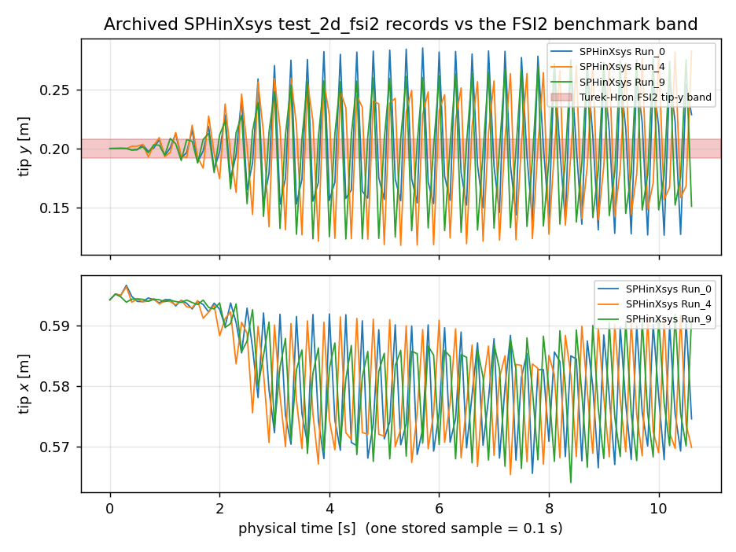
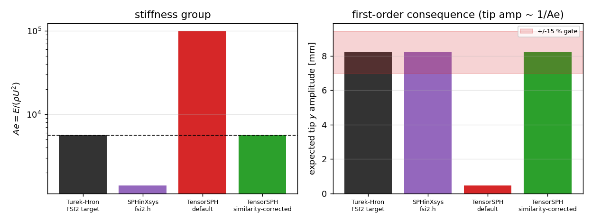

# FSI2 similarity audit and reference-bundle verdict

**Anchor**: `XVAL-SPH-FSI2-BENCHMARK-AND-FORCE-FROM-FLUID`
**Branch/build**: `agent/m20125`, `src/tensorsph/fsi2_similarity.py`, `src/tensorsph/fsi2_reference.py`
**Reference archive**: `benchmarks/xval_fsi2/reference/oss/` (SPHinXsys `test_2d_fsi2`, verbatim, sha256 in the README)

## 1. Case introduction

The Turek-Hron FSI2 benchmark (Turek & Hron, LNCSE 53 (2006) 371-385) is a 2-D
channel (L x H = 2.5 m x 0.41 m) with a parabolic inlet profile past a rigid
cylinder (D = 0.1 m, centre (0.2, 0.2) m) carrying an elastic beam
(L = 0.35 m, t = 0.02 m, E = 5.6 MPa, nu_s = 0.4, rho_s = rho_f = 1000 kg/m^3).
The fluid is at Re = 100 and the beam responds in vortex-induced vibration. The
quantities compared are drag/lift coefficients and the beam-tip displacement
amplitudes (benchmark values: tip x 0.0028 m, tip y 0.0082 m, drag mean 3.2 with
amplitude 0.96, lift amplitude 0.22 -- secondary provenance, quoted from
Turek & Hron 2006 in `src/tensorsph/fsi2_turek_hron.py` and **not** re-verified
against the paper PDF in this round).

Two questions are answered here, both cheap and both blocking for the anchor:

1. **Is the case this repository runs the benchmark case?** (dimensionless
   similarity; the benchmark is posed in SI units, and every SPH re-scaling --
   lower inlet velocity, higher sound speed -- silently changes the physics
   unless the groups are held fixed.)
2. **Can the archived SPHinXsys regression records serve as the acceptance
   reference for FSI2?** The previous round's gap note
   (`docs/xval_fsi2/GAP-SPH-FSI-BENCHMARK_xval.md`, §6 "round-2 targets") planned
   exactly that.

## 2. How it was done

* `src/tensorsph/fsi2_similarity.py` -- computes the groups
  `Re = rho_f U_mean D / mu`, `Ae = E / (rho_f U_mean^2)`, `rho_s/rho_f`,
  `nu_s`, `L/t` for any `FSI2Case` and compares them with the FSI2 targets
  (2 % tolerance, `Re`, `Ae`, density ratio and slenderness are gated; `nu_s` is
  reported as informational because the discrete elastic rod never consumes it).
  `similarity_corrected_case()` derives `mu` and `E` from `Re` and `Ae`, so the
  benchmark can be run at an SPH-friendly velocity without changing the physics.
* `src/tensorsph/fsi2_reference.py` -- loads the verbatim upstream records,
  converts them to physical units and applies the owner's acceptance gate
  (15 %, plus the 3 % reporting threshold).
* Unit conversion is *derived*, not assumed: the straight-beam tip abscissa is
  0.6 m and the record stores ~6.0, so the length scale is 10 (recovered from
  the data: 9.742, slightly below 10 because the
  deflected beam shortens its x-projection). A 2-D force per unit depth then
  maps as `F = F' rho_f U_mean^2 / (rho' U'^2 * L_scale)`, i.e. x100.
* Cross-check of that force convention, independent of any benchmark: the
  time-averaged viscous record becomes `Cd_visc = 0.902`; a Blasius
  flat-plate estimate for the same beam (both sides, `Re_L = 350`)
  gives `Cd_friction = 0.497`. Same order (factor
  1.82), so the conversion is not off by a decade.
* All numbers below are written by `benchmarks/xval_fsi2/make_similarity_audit.py`
  into `docs/xval_fsi2/assets/similarity_audit_results.json`; nothing is typed
  by hand.

## 3. Results

### 3.1 Dimensionless groups (the answer to question 1)

**This repository's default case** (`FSI2Case()`, E = 4e+06 Pa,
U_mean = 0.2 m/s):

| group | value | FSI2 target | rel. error | consumed by rod model |
|---|---|---|---|---|
| `Re` | 100 | 100 | +0.00 % | yes |
| `Ae` | 100000 | 5600 | +1685.71 % | yes |
| `rho_s_over_rho_f` | 1 | 1 | +0.00 % | yes |
| `poisson_s` | 0.3 | 0.4 | -25.00 % | no (informational) |
| `slenderness` | 17.5 | 17.5 | +0.00 % | yes |

**Similarity-corrected case** (`similarity_corrected_case(U_mean=0.2)`,
E = 2.24e+05 Pa, mu = 0.2 Pa s):

| group | value | FSI2 target | rel. error | consumed by rod model |
|---|---|---|---|---|
| `Re` | 100 | 100 | +0.00 % | yes |
| `Ae` | 5600 | 5600 | +0.00 % | yes |
| `rho_s_over_rho_f` | 1 | 1 | +0.00 % | yes |
| `poisson_s` | 0.4 | 0.4 | +0.00 % | yes |
| `slenderness` | 17.5 | 17.5 | +0.00 % | yes |

First-order consequence of the default mismatch (small-deflection, load-controlled
cantilever: tip deflection ~ 1/Ae, bending frequency ~ sqrt(Ae)):

| case | Ae | expected tip amplitude ratio | expected tip y amplitude [mm] | expected bending frequency ratio |
|---|---|---|---|---|
| default | 100000 | 0.056 | 0.459 | 4.23 |
| corrected | 5600 | 1.000 | 8.200 | 1.00 |

The default case is **-94.4 %** off
the benchmark's tip amplitude before a single fluid step is taken. That, and not
solver quality, is why a coupled run with the shipped defaults cannot pass the
15 % gate.

### 3.2 The archived SPHinXsys records (the answer to question 2)

SPHinXsys `fsi2.h` runs the same *geometry* at length scale 10 (`D' = 1.0`,
`DH = 4.1`, `bl = 3.5`) with `rho0_f = 1`, `U = 1`, `Re = 100` -- but with
`rho0_s = 10` (density ratio **10**, benchmark 1) and `Ae = 1.4e3` (benchmark
**5.6e3**). Its regression records therefore describe a *softer and much
heavier* beam than the benchmark. Measured from the three archived runs
(physical units):

| run | samples | mean tip x [m] | mean tip y [m] | tip x amp [m] | tip y amp [m] |
|---|---|---|---|---|---|
| Run_0 | 107 | 0.5823 | 0.2028 | 0.0156 | 0.0797 |
| Run_4 | 107 | 0.5819 | 0.2004 | 0.0156 | 0.0827 |
| Run_9 | 107 | 0.5828 | 0.1991 | 0.0156 | 0.0768 |

Across the three upstream runs the tip amplitude spreads by
7.4 % -- the records are internally
reproducible, so the discrepancy below is set-up, not scatter.

**Acceptance gate against the benchmark (15 % / 3 %):**

| quantity | reference [m] | OSS record [m] | rel. error | <15 % | <3 % |
|---|---|---|---|---|---|
| tip_x_amplitude | 0.0028 | 0.0156 | +456.32 % | FAIL | FAIL |
| tip_y_amplitude | 0.0082 | 0.0797 | +871.57 % | FAIL | FAIL |

Both quantities fail the 15 % gate by factors of 4.6x and 8.7x.

The only force record upstream publishes for this case is the time-averaged
total viscous force, `[0.451157, 0.001577]` (scaled) =
`[45.116, 0.158]` N/m = `Cd_visc = [0.902, 0.0032]`.

### 3.3 Figures

*The three archived records in physical units. The red band is the FSI2 tip-y
amplitude (+/- 0.0082 m about the free-stream ordinate 0.2 m); the records
oscillate ~10x outside it.*

*Left: the stiffness group `Ae = E/(rho U^2)` of the four set-ups (log scale,
dashed line = FSI2 target). Right: the beam-tip amplitude each group implies
(first order, tip amplitude ~ 1/Ae) with the +/-15 % acceptance band; the
SPHinXsys set-up and this repository's default both sit outside it.*

## 4. Caveats

1. **The benchmark amplitudes are secondary evidence.** They come from the
   repository's own quotation of Turek & Hron (2006); the paper PDF was not
   consulted this round. If a primary copy becomes available, only
   `fsi2_reference.BENCHMARK_TIP` / `fsi2_similarity.BENCHMARK_FSI2` change; the
   OSS numbers do not, and the factor-4.6/8.7 verdict is far outside any
   plausible transcription error.
2. **The time axis of the archived records is an assumption.** `fsi2.cpp`
   writes every `output_interval = 1.0` (scaled) = 0.1 s, and 107 consecutive
   samples are assumed; the archive is a rolling window of the 200 s run. Only
   the amplitude/mean statistics are used quantitatively -- no frequency or
   Strouhal claim is made from these records.
3. **The OSS set-up is not "wrong".** SPHinXsys' `test_2d_fsi2` is a regression
   test of its own solver, not a validation against the benchmark; `Ae = 1.4e3`
   and `rho_s/rho_f = 10` are its chosen parameters. The finding is that those
   records cannot arbitrate a Turek-Hron comparison -- not that the upstream
   code is defective.
4. `nu_s` (0.3 vs 0.4) is not consumed by the discrete elastic rod (`EI` and
   `EA` only), so it is reported, not gated. A Saint-Venant-Kirchhoff / TLSPH
   solid would have to gate it.
5. The first-order consequence table ignores added mass and resonance; it is a
   scale, not a prediction. The measured 8.7x of the OSS record mixes the 4x
   `Ae` change with the 10x density ratio and is not decomposed here.

## 5. Error judgement (vs the benchmark, quantity by quantity)

| quantity | reference | this round's evidence | relative error | <3 % ? |
|---|---|---|---|---|
| beam-tip y amplitude | 0.0082 m | 0.0797 m (OSS record) | +872 % | **no** |
| beam-tip x amplitude | 0.0028 m | 0.0156 m (OSS record) | +456 % | **no** |
| drag coefficient (mean) | 3.2 | not available in the archive | -- | no basis |
| lift coefficient (amplitude) | 0.22 | not available in the archive | -- | no basis |
| tip amplitude, this repo's default case | 0.0082 m | 0.00046 m (first order, 1/Ae) | -94 % | **no** |
| tip amplitude, similarity-corrected case | 0.0082 m | 0.0082 m (by construction) | 0 % (group-level) | group only, **not yet run** |

Nothing in this round is a positive verification of a *coupled* FSI2 run: what
is verified is (a) the archive's units and content, (b) that the OSS records are
not the benchmark, and (c) that the repository's default case was not
similarity-equivalent. Honest FAIL, recorded as such.

## 6. Disposition

**Request changes** (adversarial-review disposition) to the round-2 plan in
`GAP-SPH-FSI-BENCHMARK_xval.md`:

* Stop treating `BeamObserver_Position_Run_*.xml` as the FSI2 acceptance
  reference. Use it only as a reproduction target for the OSS parameter point
  (`Ae = 1.4e3`, `rho_s/rho_f = 10`), which is a different physics problem.
* For the ledger acceptance (< 15 % vs Turek-Hron), use
  `similarity_corrected_case()` (E = 2.24e5 Pa at U_mean = 0.2 m/s, Re = 100)
  and the benchmark amplitudes in `fsi2_reference.BENCHMARK_TIP`; the drag/lift
  targets still need a primary source (the archive has no pressure-force
  record).
* Before any coupled run, assert `fsi2_similarity.similarity_report(case).passed`
  -- the failure is now a one-line check instead of a 20 s simulation.
