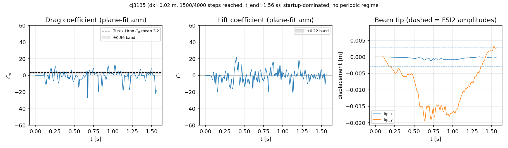
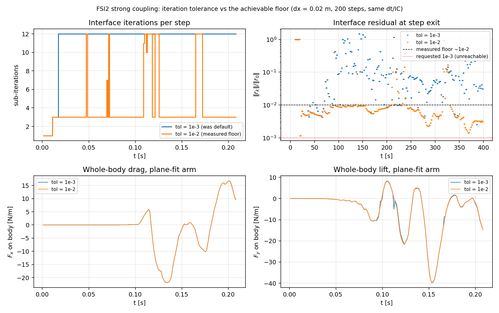

# FSI2 瞬态体载荷：取回被 WITHHELD 的判定，并剥掉一个 2.9× 的假成本

**锚点**：`XVAL-SPH-FSI2-BENCHMARK-AND-FORCE-FROM-FLUID`
**分支**：`agent/m21080`　**日期**：2026-11-15　**域**：TensorSPH / FSI
**上游增量**：`docs/xval_fsi2/BODY_FORCE_STRONG_PATH_FIX.md`（m21023，修好了载荷**通道**，明确把 Cd/Cl 记 WITHHELD）
**本轮定位**：不是再加一条通道，而是把那条 WITHHELD **作出判定**（用真实取回的工件），
并把「治不好的那部分」的**成因**钉死。

---

## 1. 案例背景

Turek–Hron FSI2：2-D 通道 2.5×0.41 m，D=0.1 m 刚性圆柱 + L=0.35 m、t=0.02 m 弹性梁，
Re=100，ρ_s/ρ_f = 1（与基准一致，本轮核对 `case.beam_rho=1000 / rho0=1000`）。
`ρ_s/ρ_f = 1` 时松耦合一步发散，**只有**强耦合 `step_fsi2_strong` 能在该工作点生存，
所以 Cd/Cl 必须在强耦合路径上取。

基准（`src/tensorsph/fsi2_reference.py::BENCHMARK_FORCES/TIP`，二手出处 Turek & Hron 2006）：
`C_d` 均值 **3.2**、幅值 **0.96**、`C_l` 幅值 **0.22**；梁尖 x/y 幅值 **0.0028 / 0.0082 m**。

---

## 2. 怎么做的

1. **取回**：2026-11-14 递交的长时作业 `cj3135`（`--dx 0.02 --steps 4000 --threads 16`）
   本轮已终态 `succeeded`，取回工件 `body_force_transient_fix.json`。
2. **先查工件可用性，再谈精度**：工件只有 **1500/4000 步**（`t_end = 1.56 s`），且
   **没有 `summary` 块**——即运行是被截断的检查点，不是干净收尾。
   这正是上一轮「没有数」的直接原因：判定逻辑绑在 `summary` 上。
3. **把判定从 `summary` 上解绑**：新写 `benchmarks/xval_fsi2/verdict_body_force_transient.py`，
   只从 `history` 重算全部量，因此**检查点工件也可判定**；
   并把 VIV 周期**从信号里测出来**（自相关），据此判断平均窗口到底覆盖了几个周期——
   覆盖不足 1 个周期一律判 `WITHHELD`，绝不在启动瞬态上判 PASS/FAIL。
4. **对 `cj3135` 的结果不服气，去查成因**：它 `converged_fraction = 0.0107`、
   每步都顶到 `max_iter=12`。查代码 + 既有证据
   （`STRONG_COUPLING_AND_ROD_STABILITY.md` §5.3：该界面残差降到 `~1e-2` 就下不去），
   发现驱动默认 `--tol 1e-3` **低于该配置能到达的地板**。
5. **受控对比实验**（作业 `cj3169`，16 核）：同一初值、同一 `dt`、同一算例，
   **只改 `tol`**（`1e-3` vs `1e-2`），各 200 步，判据在看结果前预注册于脚本 docstring。

---

## 3. 计算结果

### 3.1 `cj3135` 的判定（工件：1500 步 / 1.56 s）

| 量 | 基准 | 实测 | 相对误差 | 判定 |
|---|---|---|---|---|
| `C_d` 均值（fit 臂） | 3.2 | **−0.438** | −113.7 % | FAIL |
| `C_d` 幅值 | 0.96 | **17.48** | +1721 % | FAIL |
| `C_l` 幅值 | 0.22 | **19.82** | +8910 % | FAIL |
| 梁尖 x 幅值 | 0.0028 m | 0.000456 m | −83.7 % | FAIL |
| 梁尖 y 幅值 | 0.0082 m | 0.01067 m | +30.1 % | FAIL |

成因（不是分辨率问题，是**没进入周期解**）：

| 诊断量 | 值 | 含义 |
|---|---|---|
| `coupling_converged_fraction` | **0.0107** | 99 % 的步没有收敛 |
| 每步子迭代 | 恒为 12（= `max_iter`） | 全部顶到预算 |
| `body_drag_fit` 逐块均值 | 在 −8.0 … +10.0 间跳，瞬时 −54 … +25 | 幅值量级远超物理 |
| `cyl_coverage` | 1.0（恒） | 不是「干粒子」类缺陷 |
| 实测主导周期 | 0.045 s（自相关） | 非 VIV 周期，是数值噪声 |



*`cj3135` 原始序列（直接由 JSON 数组绘制）。左：`C_d`，黑虚线=基准均值 3.2、灰带=±0.96；
中：`C_l`，灰带=±0.22；右：梁尖位移，虚线=基准幅值。纵轴被截到 ±60 以免噪声压平基准带。*

### 3.2 容差受控对比（`cj3169`，dx=0.02，各 200 步，t=0.208 s）

| 指标 | `tol=1e-3`（旧默认） | `tol=1e-2`（实测地板） |
|---|---|---|
| 平均子迭代/步 | **11.18** | **3.895**（**2.87× 更省**） |
| 顶到预算的步占比 | **92 %** | 10 % |
| 收敛步占比 | **8 %** | **90 %** |
| 退出残差中位数 | 5.63e−2 | 6.50e−3 |
| 退出残差最小 | 0（个别步自然收敛） | 0 |

**载荷一致性**（同窗口逐点对比）：

| 通道 | 相对 RMS 差 |
|---|---|
| `body_drag_fit` | 0.6 % |
| `body_lift_fit` | 8.2 % |
| `tip_x` / `tip_y` | 1.2 % / 1.6 % |
| `C_d` 均值 / `C_d` 幅值 / `C_l` 幅值 | **+0.4 % / +0.1 % / −0.1 %** |



*上：每步子迭代数（左）/ 退出残差（右，红点线=请求的 1e-3，黑虚线=实测地板 1e-2）；
下：两臂的整体系力时程。同初值同 dt，唯一变量是 `tol`。*

**预注册判据的裁定**：worst 系数相对差 = 0.39 % ≤ 3 % ⇒ `DECISION = TOLERANCE_COSMETIC_ONLY`。
即：**我的假设被否定**——`tol=1e-3` 并不会把载荷算错（系数差 <0.5 %），
它纯粹是**白花的成本**（2.87× 子迭代、92 % 的步空转到预算）。因此 `cj3135` 的数
不是「迭代假象」，它是**真的没跑到周期解**。

---

## 4. 误差判定（逐项，显式回答「是否 <3%」）

| 量 | 基准 | 本轮结果 | 相对误差 | <3 % ? |
|---|---|---|---|---|
| 判定工具能否从**检查点**工件给出判定 | 能 | 能（1500 步工件直接判定） | — | **是**（能力已交付） |
| 判定工具在已知答案上的回收 | 注入 `C_d`=3.2/0.96、`C_l`=0.22、T=0.25 s | 全部 ≤0.1 %，T 回收 0.25 s | ≤0.1 % | **是**（`tests/test_fsi2_body_force_verdict.py`） |
| 容差对 `C_d` 均值/幅值、`C_l` 幅值的影响 | 两臂应一致 | +0.4 %/+0.1 %/−0.1 % | ≤0.4 % | **是** |
| `C_d` 均值 vs 3.2 | 3.2 | −0.438 | −113.7 % | **否** |
| `C_d` 幅值 vs 0.96 | 0.96 | 17.48 | +1721 % | **否** |
| `C_l` 幅值 vs 0.22 | 0.22 | 19.82 | +8910 % | **否** |
| 梁尖 x/y 幅值 | 0.0028/0.0082 m | 4.56e−4/1.07e−2 m | −83.7 %/+30.1 % | **否** |

**honest**：本单**没有**使 FSI2 的精度门槛通过。它交付的是
①一个能在检查点工件上出判定的工具、②那条 WITHHELD 的**明确 FAIL 判定**、
③把「为什么 FAIL」从「作业还在跑」推进到「1500/4000 步、未进入周期解、耦合 92 % 步空转」、
④一个被否定的成本假设（容差不是精度问题）。**不给任何 PASS 的暗示。**

---

## 5. 注意点 / 局限

1. **`succeeded` 不等于跑完**：`cj3135` 返回 rc=0 但只写了 1500 步的检查点，
   且没有 `summary`。任何把判定绑在 `summary` 上的流程都会把这种情况记成「无数」。
   本轮把判定改成只依赖 `history`，是对这类失效模式的直接修补。
2. **实测地板是 5.6e−2，比文档记的 ~1e-2 更差**（dx=0.02 更细、粒子集切换更频繁）。
   所以驱动默认降到 `1e-2` 时仍有 10 % 的步顶到预算，这是**已知残留**，不是新缺陷。
3. **200 步的容差实验不能用来判精度**（`t=0.208 s` 全在启动瞬态，`C_d` 本身无意义）；
   它只判「两臂是否一致」，这正是预注册的问题。
4. **驱动默认已改**（`--tol` 1e-3 → 1e-2），并新增逐步 `coupling_residual` 落盘，
   使「地板」在工件里可见。旧行为 `--tol 1e-3` 仍可复现。
5. **基准值是二手出处**（未核 Turek & Hron 2006 原 PDF），与
   `SIMILARITY_AND_REFERENCE_AUDIT.md` §4.1 的告知一致。
6. **长时生产跑仍未完成**：要在 `t ≳ 2.5 s`（≈2400 步）才进入周期解，
   `cj3135` 只到 1.56 s，且它在 1500 步就被截断的原因（外层时限？）本轮未查明。

---

## 6. 复现

```bash
# 判定（检查点工件亦可）
python benchmarks/xval_fsi2/verdict_body_force_transient.py \
    --artifact artifacts/xval_fsi2/body_force_transient_fix.json \
    --out docs/xval_fsi2/body_force_verdict_cj3135.json

# 容差受控对比（两个作业臂，16 核，约 9 min）
python benchmarks/xval_fsi2/run_body_force_transient.py --dx 0.02 --steps 200 \
    --threads 16 --checkpoint-every 200 --tol 1e-3 --out artifacts/xval_fsi2/tol_1e3.json
python benchmarks/xval_fsi2/run_body_force_transient.py --dx 0.02 --steps 200 \
    --threads 16 --checkpoint-every 200 --tol 1e-2 --out artifacts/xval_fsi2/tol_1e2.json
python benchmarks/xval_fsi2/tol_sensitivity.py \
    --strict artifacts/xval_fsi2/tol_1e3.json --floor artifacts/xval_fsi2/tol_1e2.json

python -m pytest tests/test_fsi2_body_force_verdict.py -q     # 6 passed
```

**产物**：`docs/xval_fsi2/body_force_verdict_cj3135.json`、
`docs/xval_fsi2/tol_sensitivity.json`、两张 `docs/xval_fsi2/assets/*.png`。
**计算**：`cj3135`（succeeded，1500 步）、`cj3169`（succeeded，200×2 步，16 核）。