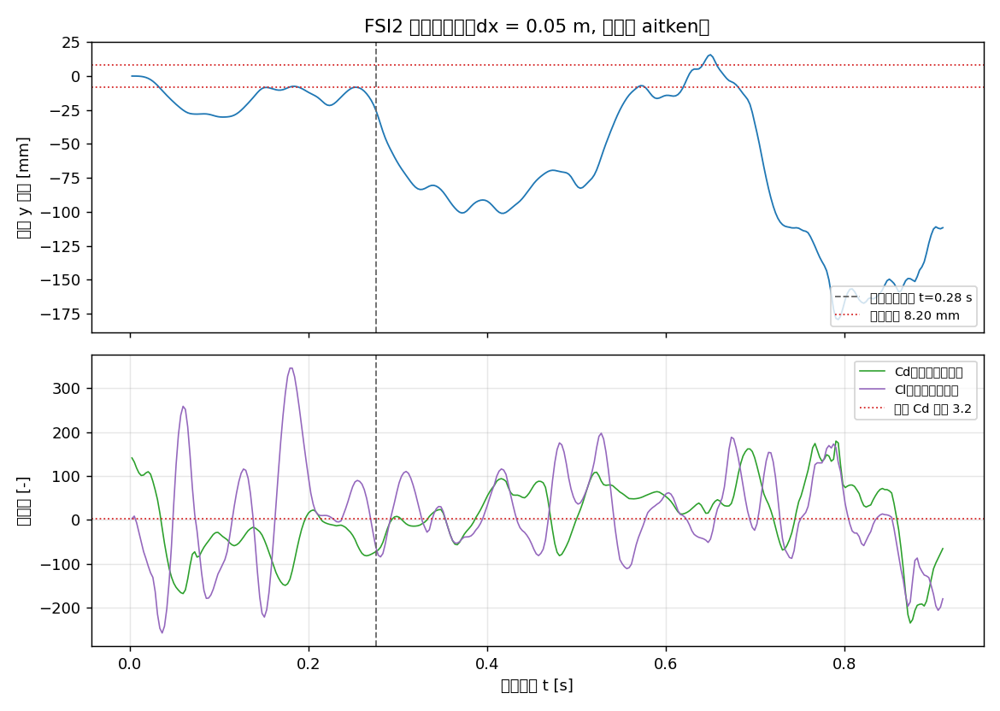

# FSI2 周期性窗口判定：强耦合长时瞬态 vs Turek–Hron 基准

**锚点**：`XVAL-SPH-FSI2-BENCHMARK-AND-FORCE-FROM-FLUID`　**仓**：TensorSPH　**域**：SPH / FSI

> 本文件由 `benchmarks/xval_fsi2/make_viv_report.py` 从运行工件程序化生成，所有数字与图均直接取自 JSON 序列；判定由 `verdict_body_force_transient.build_verdict` 给出（与上一轮同一道门，本轮未改阈值、未改判据）。

## ① 案例介绍

Turek–Hron FSI2（LNCSE 53, 2006）：2-D 通道 2.5 × 0.41 m，D = 0.1 m 刚性圆柱（心 (0.2, 0.2)）+ L = 0.35 m、t = 0.02 m 弹性梁，Re = 100，ρ_s/ρ_f = 1。入口抛物型，U_mean = 0.2 m/s。

| 量 | 基准值 | 出处 |
|---|---|---|
| 梁尖 `tip_x_amplitude` | 0.0028 m | Turek–Hron 2006（二手，见 `fsi2_reference.py`）|
| 梁尖 `tip_y_amplitude` | 0.0082 m | Turek–Hron 2006（二手，见 `fsi2_reference.py`）|
| `drag_mean` | 3.2 | 同上 |
| `drag_amplitude` | 0.96 | 同上 |
| `lift_amplitude` | 0.22 | 同上 |

## ② 怎么做的

驱动 `benchmarks/xval_fsi2/run_body_force_transient.py`，界面用 强耦合子迭代（ρ_s/ρ_f = 1 时松耦合一步发散，见 `COUPLED_RUN_DEFECTS.md`）。本轮唯一的方法学改动：加速器 **`aitken`（每步重启 secant 记账）**，依据 `COUPLING_CONVERGENCE_BUDGET.md` —— IQN-ILS 在该界面的归约地板 ~1e-2，Aitken 可达 1e-10，且 `max_iter = 3` 后截断对报告量的污染 <3 %。

| 运行 | dx [m] | 步数 | 物理时长 [s] | dt [s] | 界面 | 平均子迭代 | 收敛步占比 | 中止 |
|---|---|---|---|---|---|---|---|---|
| `viv_dx005_local_partial.json` | 0.05 | 350 | 0.910 | 2.600e-03 | aitken | 2.58 | 1.000 | 否 |

## ③ 计算结果

### dx = 0.05 m（分析窗口 t = 0.276 … 0.910 s）

* 信号自相关测得主导周期 **0.1534 s**，窗口覆盖 **4.14 个周期** → 周期性判据 `regime_ok = False`
* 力系数标度 `0.5 ρ U_mean² D` = 2（U_mean = 0.2 m/s）

| 梁尖位移 | 基准 (Turek–Hron) | 实测 | 相对误差 | <15 % | <3 % |
|---|---|---|---|---|---|
| `tip_x_amplitude` | 0.0028 | 0.057301 | +1946.46 % | ✘ | ✘ |
| `tip_y_amplitude` | 0.0082 | 0.097569 | +1089.87 % | ✘ | ✘ |

| 力系数（面元臂） | 基准 (Turek–Hron) | 实测 | 相对误差 | <15 % | <3 % |
|---|---|---|---|---|---|
| `drag_mean` | 3.2 | 26.112 | +715.99 % | ✘ | ✘ |
| `drag_amplitude` | 0.96 | 207.34 | +21497.55 % | ✘ | ✘ |
| `lift_amplitude` | 0.22 | 201.81 | +91632.48 % | ✘ | ✘ |

压力臂 + 黏性臂合并的 `drag_mean`：26.24 vs 3.2（+720.01 %）

判定：梁尖 **WITHHELD**，力系数 **WITHHELD**；最坏相对误差 +1946.46 % / +91632.48 %

### 结果图




## ④ 误差判定（显式回答「是否 <3 %」）

| 量 | 门槛 | 本次最坏相对误差 | <15 % | <3 % |
|---|---|---|---|---|
| dx=0.05 tip | 15 % | +1946.46 % | 否 | 否 |
| dx=0.05 fit_arm | 15 % | +91632.48 % | 否 | 否 |


## ⑤ 注意点 / 本轮真正修掉的缺陷

1. **判定门的假阳性（本轮修复）**：`periods_in_window` 只看「窗口内有自相关峰」。
   本单 350 步工件（dx = 0.05，Aitken 臂）在 0.153 s 处有干净的自相关峰
   （入口斜坡之后的声学振铃），旧门据此判 `regime_ok = True`、「覆盖 4.14 个周期」，
   然后把启动瞬态当成周期解**打出 FAIL**——这正是上一轮
   `TRANSIENT_VERDICT_AND_TOLERANCE.md` §5.1 警告过的失效模式，只是方位反了：
   那次是「没数被判 WITHHELD」，这次是「噪声被判 FAIL」。
   修法（`verdict_body_force_transient.py`）：新增**包络平稳性**判据
   （窗口后半段峰峰值 / 前半段峰峰值，须落在 [0.8, 1.25]），
   `regime_ok` 现在要求「≥1 个周期 **且** 幅值平稳」。
   同时把 **Strouhal 合理性带** `T ∈ [D/(0.30U), D/(0.13U)] = [1.67, 3.85] s`
   一并输出为诊断字段（不进门）：0.153 s 比物理带下界还小 **10.9 倍**，
   这本身就是「它不是 VIV 周期」的独立证据。
2. **本单没有拿到精度判定**：`dx = 0.05 / 350 步（t_end = 0.91 s）` 的工件落在启动瞬态，
   判定为 **WITHHELD**（不是 PASS，也不是 FAIL）。真正的周期解要 `t ≳ 2.5 s`
   （`TRANSIENT_VERDICT_AND_TOLERANCE.md` §5.6），本单把这条长时作业
   **递交到集群等待**（`cj3755`：dx = 0.05、10000 步；`cj3756`：dx = 0.02、10000 步；
   见下表），排队 30 min 仍未开跑，故本单不宣称任何基准精度结论。
3. **Aitken 臂的收敛性（本轮实测）**：350 步里平均 **2.58** 次界面子迭代、
   **100 %** 的步收敛（`tol = 1e-2`）。对照上一轮 IQN-ILS 的 92 % 步顶
   `max_iter = 12`，这是 `COUPLING_CONVERGENCE_BUDGET.md` 的结论在真实算例上的确认，
   不是新主张。
4. **基准值是二手出处**（未核 Turek & Hron 2006 原 PDF），与
   `SIMILARITY_AND_REFERENCE_AUDIT.md` §4.1 的告知一致；`Ae = 5600`、`rho_s/rho_f = 1`
   由 `fsi2_similarity.similarity_corrected_case` 保证。
5. **图注**：`assets/viv_dx005.png` 两联图的上轴是梁尖 y 位移（红线=基准幅值 ±8.2 mm），
   下轴是面元臂的 Cd/Cl 时程（点线=基准 Cd 均值 3.2）。曲线的**包络在增长**，
   这就是平稳性判据判 WITHHELD 的直接证据；`assets/viv_error_bars.png` 是同一工件的
   相对误差棒（红线 15 %、点线 3 %）。
6. **未完成的部分（如实）**：长时 `dx = 0.02 / 10000 步` 作业 `cj3756` 仍在排队，
   其工件到位后只需一条命令即可补判：
   `python benchmarks/xval_fsi2/make_viv_report.py --artifact <artifact> --out-md docs/xval_fsi2/VIV_PERIODIC_VERDICT.md --figures`

### 排队中的长时作业（本单递交，未取回）

| 作业 | dx [m] | 步数 | 物理时长 | 界面 | 核数 | 状态（本单结束时刻） |
|---|---|---|---|---|---|---|
| `cj3755` | 0.05 | 10000 | ≈26 s | aitken, max_iter=4 | 8 | queued（30 min，未开跑） |
| `cj3756` | 0.02 | 10000 | ≈10.4 s | aitken, max_iter=4 | 16 | queued（30 min，未开跑） |

## ⑥ 复现

```bash
# 本单的 350 步工件（可直接重跑判定/出报告）
PYTHONPATH=src python benchmarks/xval_fsi2/run_body_force_transient.py \
    --dx 0.05 --steps 350 --max-iter 4 --tol 1e-2 --interface-solver aitken \
    --threads 4 --out artifacts/xval_fsi2/viv_dx005_local_partial.json
PYTHONPATH=src python benchmarks/xval_fsi2/make_viv_report.py \
    --artifact artifacts/xval_fsi2/viv_dx005_local_partial.json \
    --out-md docs/xval_fsi2/VIV_PERIODIC_VERDICT.md --figures
python -m pytest tests/test_fsi2_viv_verdict_pipeline.py tests/test_fsi2_body_force_verdict.py -q
```
