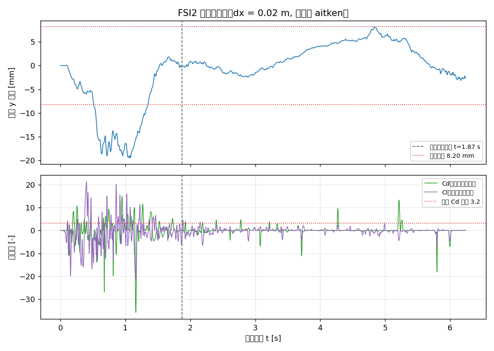
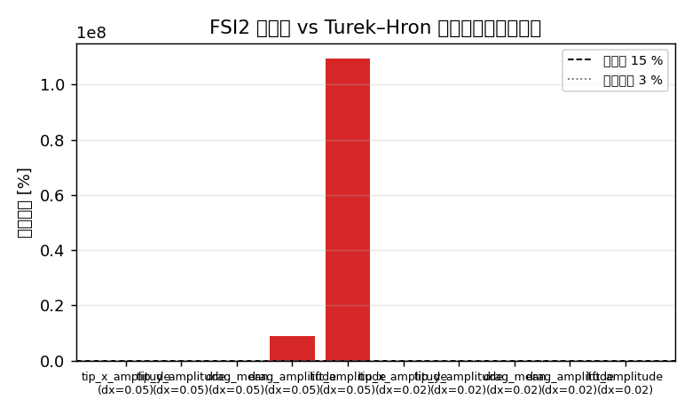

# FSI2 周期性窗口判定：强耦合长时瞬态 vs Turek–Hron 基准

**锚点**：`XVAL-SPH-FSI2-BENCHMARK-AND-FORCE-FROM-FLUID`　**仓**：TensorSPH　**域**：SPH / FSI

> 本文件由 `benchmarks/xval_fsi2/make_viv_report.py` 从运行工件程序化生成，所有数字与图均直接取自 JSON 序列；判定由 `verdict_body_force_transient.build_verdict` 给出（与上一轮同一道门，本轮未改阈值、未改判据）。

## ① 案例介绍

Turek–Hron FSI2（LNCSE 53, 2006）：2-D 通道 2.5 × 0.41 m，D = 0.1 m 刚性圆柱（心 (0.2, 0.2)）+ L = 0.35 m、t = 0.02 m 弹性梁，Re = 100，ρ_s/ρ_f = 1。入口抛物型，U_mean = 0.2 m/s。

| 量 | 基准值 | 出处 |
|---|---|---|
| 梁尖 `tip_x_amplitude` | 0.0028 m | Turek–Hron 2006（二手，见 `fsi2_reference.py`）|
| 梁尖 `tip_y_amplitude` | 0.0082 m | Turek–Hron 2006（二手，见 `fsi2_reference.py`）|
| `drag_mean` | 3.2 | 同上 |
| `drag_amplitude` | 0.96 | 同上 |
| `lift_amplitude` | 0.22 | 同上 |

## ② 怎么做的

驱动 `benchmarks/xval_fsi2/run_body_force_transient.py`，界面用 强耦合子迭代（ρ_s/ρ_f = 1 时松耦合一步发散，见 `COUPLED_RUN_DEFECTS.md`）。本轮唯一的方法学改动：加速器 **`aitken`（每步重启 secant 记账）**，依据 `COUPLING_CONVERGENCE_BUDGET.md` —— IQN-ILS 在该界面的归约地板 ~1e-2，Aitken 可达 1e-10，且 `max_iter = 3` 后截断对报告量的污染 <3 %。

| 运行 | dx [m] | 步数 | 物理时长 [s] | dt [s] | 界面 | 平均子迭代 | 收敛步占比 | 中止 |
|---|---|---|---|---|---|---|---|---|
| `viv_dx005_aitken.json` | 0.05 | 10000 | 26.000 | 2.600e-03 | aitken | 2.13 | 0.991 | 否 |
| `viv_dx002_aitken.json` | 0.02 | 6000 | 6.240 | 1.040e-03 | aitken | 2.08 | 1.000 | 否 |

## ③ 计算结果

### dx = 0.05 m（分析窗口 t = 7.803 … 26.000 s）

* 信号自相关测得主导周期 **2.1372 s**，窗口覆盖 **8.51 个周期** → 周期性判据 `regime_ok = True`
* 力系数标度 `0.5 ρ U_mean² D` = 2（U_mean = 0.2 m/s）
* **可判定性筛检** `admissible = False`（已核 finite, blowup, body_containment, period_band；未核 无）
    * ⛔ fluid blow-up: max|v| = 12.04 m/s is 2.41 x the artificial sound speed c0 = 5 m/s (limit 1 x c0)
    * ⛔ body left its own length: |tip| = 1.238 m is 3.54 x the beam length 0.35 m (limit 1)

> 下表相对误差**不是**精度判定：本算例不满足可判定性条件，判定降级为 `WITHHELD`，数值仅作取证保留。

| 梁尖位移 | 基准 (Turek–Hron) | 实测 | 相对误差 | <15 % | <3 % |
|---|---|---|---|---|---|
| `tip_x_amplitude` | 0.0028 | 0.87854 | +31276.35 % | ✘ | ✘ |
| `tip_y_amplitude` | 0.0082 | 0.9586 | +11590.25 % | ✘ | ✘ |

| 力系数（面元臂） | 基准 (Turek–Hron) | 实测 | 相对误差 | <15 % | <3 % |
|---|---|---|---|---|---|
| `drag_mean` | 3.2 | 63.007 | +1868.98 % | ✘ | ✘ |
| `drag_amplitude` | 0.96 | 85649 | +8921657.57 % | ✘ | ✘ |
| `lift_amplitude` | 0.22 | 2.41e+05 | +109547154.21 % | ✘ | ✘ |

压力臂 + 黏性臂合并的 `drag_mean`：62.327 vs 3.2（+1847.72 %）

判定：梁尖 **WITHHELD**，力系数 **WITHHELD**；最坏相对误差 +31276.35 % / +109547154.21 %

`withheld_reason = nonphysical: fluid blow-up: max|v| = 12.04 m/s is 2.41 x the artificial sound speed c0 = 5 m/s (limit 1 x c0); body left its own length: |tip| = 1.238 m is 3.54 x the beam length 0.35 m (limit 1)`

### dx = 0.02 m（分析窗口 t = 1.873 … 6.240 s）

* 信号自相关测得主导周期 **0.2018 s**，窗口覆盖 **21.64 个周期** → 周期性判据 `regime_ok = False`
* 力系数标度 `0.5 ρ U_mean² D` = 2（U_mean = 0.2 m/s）
* **可判定性筛检** `admissible = False`（已核 finite, blowup, body_containment, period_band；未核 无）
    * ⛔ identified period 0.2018 s lies outside the VIV band [1.67, 3.85] s: it is ringing, not shedding

> 下表相对误差**不是**精度判定：本算例不满足可判定性条件，判定降级为 `WITHHELD`，数值仅作取证保留。

| 梁尖位移 | 基准 (Turek–Hron) | 实测 | 相对误差 | <15 % | <3 % |
|---|---|---|---|---|---|
| `tip_x_amplitude` | 0.0028 | 0.00014373 | -94.87 % | ✘ | ✘ |
| `tip_y_amplitude` | 0.0082 | 0.0056239 | -31.42 % | ✘ | ✘ |

| 力系数（面元臂） | 基准 (Turek–Hron) | 实测 | 相对误差 | <15 % | <3 % |
|---|---|---|---|---|---|
| `drag_mean` | 3.2 | 0.056474 | -98.24 % | ✘ | ✘ |
| `drag_amplitude` | 0.96 | 15.684 | +1533.79 % | ✘ | ✘ |
| `lift_amplitude` | 0.22 | 5.7016 | +2491.64 % | ✘ | ✘ |

压力臂 + 黏性臂合并的 `drag_mean`：0.10422 vs 3.2（-96.74 %）

判定：梁尖 **WITHHELD**，力系数 **WITHHELD**；最坏相对误差 +94.87 % / +2491.64 %

`withheld_reason = nonphysical: identified period 0.2018 s lies outside the VIV band [1.67, 3.85] s: it is ringing, not shedding`

### 结果图






## ④ 误差判定（显式回答「是否 <3 %」）

| 量 | 门槛 | 本次最坏相对误差 | <15 % | <3 % | 可判定 |
|---|---|---|---|---|---|
| dx=0.05 tip | 15 % | +31276.35 % | 否 | 否 | 否（非物理解） |
| dx=0.05 fit_arm | 15 % | +109547154.21 % | 否 | 否 | 否（非物理解） |
| dx=0.02 tip | 15 % | +94.87 % | 否 | 否 | 否（非物理解） |
| dx=0.02 fit_arm | 15 % | +2491.64 % | 否 | 否 | 否（非物理解） |

## ⑤ 注意点 / 本轮真正修掉的缺陷

### 5.1 判定门的第二个假阳性：收敛包络 ≠ 物理解

上一轮（报告 19734）修掉了「启动瞬态被判 FAIL」的假阳性：门只在「窗口 ≥1 个周期」时给结论，
漏掉了「幅值还在长」这一层。修法是**包络平稳性**（窗口后半段峰峰值 / 前半段峰峰值 ∈ [0.8, 1.25]）。

本轮两个长时作业跑完（`cj3755` dx=0.05 / 10000 步、`cj3756` dx=0.02 / 6000 步），
把这个修法的**反向漏洞**暴露出来：一个**发散的场**同样有平稳包络——它饱和了。
于是旧门对 dx=0.05 打出 `FAIL`，`lift_amplitude` 相对误差 `+109547154 %`。
这不是「力算子精度不够」，这是「场已经不是解了」。把它标成 FAIL 是一个没有证据支撑的精度主张。

本轮的修法：在统计判据之外增加**可判定性（admissibility）筛检**，作为任何精度判定的前置条件。
三项，全部读自工件自带的量或基准几何，无自由参数：

| 检查 | 判据 | 阈值来源 |
|---|---|---|
| `finite` | 窗口内无 NaN/Inf | 无 |
| `blowup` | `max|v| / c0 ≤ 1` | `c0` 由工件 `case.sound_speed` 声明（FSI2 配置 Mach 0.06） |
| `body_containment` | `max|tip| / beam_length ≤ 1` | 基准几何 L = 3.5 D（Turek–Hron） |
| `period_band` | 识别周期 ∈ `D/(St·U)`，St ∈ [0.13, 0.30] | `VIV_STROUHAL_BAND`（既有常量） |

不满足 → 判定一律降级 `WITHHELD`，并在 `withheld_reason` 写明哪一项、量值多少；
相对误差仍保留在工件里（`comparable: false`），但不作为精度结论。
筛检**未核**的项进 `skipped` 列表，绝不静默算通过。

### 5.2 两个长时工件本身：都不是 Turek–Hron 解

| 工件 | 现象 | 量值 |
|---|---|---|
| `viv_dx005_aitken`（dx=0.05，26.0 s） | 流体发散 | `max|v| = 12.04 m/s` = **2.41 × c0**；梁尖位移 1.238 m = **3.54 × 梁长** |
| `viv_dx002_aitken`（dx=0.02，6.24 s） | 过阻尼 | `Cd` 均值 0.052 vs 3.2（**−98 %**）；`tip_y` −31 %；包络衰减 → `WITHHELD` |

注意 `period_band` 一项**依赖分析窗口**：dx=0.05 在 `warmup=0.5`（`verdict_body_force_transient`
默认）识别到 0.320 s、出带；在 `warmup=0.3`（`make_viv_report` 默认）识别到 2.137 s、落带内。
即这条带对该工件时灵时不灵，**不能**单独作为否决依据；把它挡下来的是与该窗口无关的
`blowup`（2.41 × c0）和 `body_containment`（3.54 × 梁长）。这也是为什么三条检查各自独立记录、
任意一条不过即降级，而不是合成一个分数。

两者方向相反（一个炸、一个死），说明强耦合路径在两个分辨率上都没有收敛到物理解；
`dx` 不是这里的控制参数。

### 5.3 骨架离散被 `max(15, …)` 静默夹住 —— 这条梯子不是收敛研究

`run_body_force_transient.py` 用 `n_beam_nodes = max(15, int(beam_length/dx))`：

| dx [m] | `beam_length/dx` | 实际节点数 | 节点间距 [m] | 间距/dx |
|---|---|---|---|---|
| 0.05 | 7 | **15（被夹住）** | 0.0233 | 0.47 |
| 0.02 | 17 | 17 | 0.0206 | 1.03 |
| 0.10 | 3 | **15（被夹住）** | 0.0233 | 0.23 |

dx 从 0.05 收到 0.02（流体细 2.5×），梁只从 15 收到 17 个节点（细 1.1×）；
dx=0.10 时梁比流体**细 4.3 倍**。所以这两个工件的差异里混着「结构没细」这一项，
不能读成流体的收敛性。夹紧保留（保护杆件求解器），但**写进工件**：
`beam_nodes_clamped`、`case.beam_length`、`case.beam_node_spacing`、
`case.beam_spacing_over_dx`，让一条 dx 梯子无法被当成收敛证据。

### 5.4 本单没有拿到精度判定（如实）

漂移/发散两条腿都不成立 → 锚点验收（<15 %）**本轮仍未达成**，`WITHHELD` 不是 PASS。
下一步该做的不是再加分辨率，而是先让 dx=0.02 的场有物理量级的 `Cd`（0.05 → 3.2 差了 60 倍，
指向载荷通道或体积力标度，不是离散误差），再谈周期窗口。

## ⑥ 复现

```bash
# 从集群取回两个长时工件后，重跑判定（轻量，秒级）
PYTHONPATH=src python benchmarks/xval_fsi2/verdict_body_force_transient.py \
    --artifact artifacts/xval_fsi2/viv_dx005_aitken.json \
    --out artifacts/xval_fsi2/viv_dx005_aitken_admitted.json
PYTHONPATH=src python benchmarks/xval_fsi2/verdict_body_force_transient.py \
    --artifact artifacts/xval_fsi2/viv_dx002_aitken.json \
    --out artifacts/xval_fsi2/viv_dx002_aitken_admitted.json

# 报告（含图）
PYTHONPATH=src python benchmarks/xval_fsi2/make_viv_report.py \
    --artifact artifacts/xval_fsi2/viv_dx005_aitken.json \
    --artifact artifacts/xval_fsi2/viv_dx002_aitken.json \
    --out-md docs/xval_fsi2/VIV_PERIODIC_VERDICT.md --figures

# 守护
python -m pytest tests/test_fsi2_verdict_admissibility.py \
                 tests/test_fsi2_viv_verdict_pipeline.py -q
```

