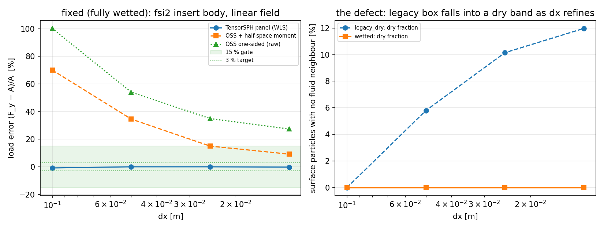

# X4 勘误：fsi2 插入体静态载荷的「+32 % 失败」是算例干区缺陷，不是算子缺陷

锚点 `XVAL-SPH-FSI2-BENCHMARK-AND-FORCE-FROM-FLUID`（Xiangyu-Hu/SPHinXsys `test_2d_fsi2`
+ `FSI::ForceFromFluid`）· 仓 TensorSPH · 驱动 `benchmarks/xval_fsi2/closed_body_audit.py`
· 数据 `artifacts/xval_fsi2/closed_body_x4.json` · 图 `docs/xval_fsi2/assets/x4_closed_body.png`

## ① 案例介绍

X4 是锚点里唯一以**真实 fsi2 插入体**（圆柱 r = 0.5 m + 梁 3.5 × 0.2 m，`fsi2.h:14-35`）
为对象、且带解析参照的静态门：闭合体浸在**线性压力场** `p = p0 + c·x`（`c = (0, −1)`，
无重力，与 fsi2 一致）中，散度定理给出净载荷

```
F = −∮ p n dl = −c A,   A = π r² + b_h b_l = 1.4853981633974485
```

已发表表格（`GAP-SPH-FSI-BENCHMARK_xval.md` §4 X4）把该门记为**双 FAIL**：OSS 原始臂
dx = 0.025 时 +67.66 %，TensorSPH 面元臂 +32.26 %，且误差**随加密单调增涨**
（−0.70 % → +20.08 % → +32.26 %）。按 owner 精度标准（>15 % 不可接受）该门当时判负。

几何/参数（全部由 `cases.fsi2_insert_linear` 程序化生成）：

| 项 | 取值 | 来源 |
|---|---|---|
| 圆柱 | r = 0.5 m，圆心 (2, 2) | `fsi2.h:14-35` |
| 梁 | 3.5 × 0.2 m，自圆柱右侧延伸 | 同上 |
| 压力场 | `p = 1 − y`（线性，解析给定，无求解器） | `cases.py:fsi2_insert_linear` |
| 参照 | `−c A` = +1.4853981633974485（y 分量） | 散度定理 |
| 核 / 光滑长度 | Wendland C2，h = 1.3 dx，支持域 2h | OSS 默认（`adaptation.h:71`） |
| dx 阶梯 | 0.1 / 0.05 / 0.025 / 0.0125 m | 本轮 |
| 门限 / 目标 | 15 % / 3 % | owner 标准 |

## ② 怎么做的

**a. 先分离「面元采样错」与「算子错」。** 在同一批粒子上直接做精确面元积分
`−Σ p(x_i) n_i A_i`（臂 `quad`，不含任何传递算子）。若 `quad` 精确而算子不精确，
问题在算子；若 `quad` 自身偏离，问题在**表面/粒子集**。

**b. 数干粒子。** 对每个表面粒子数支撑域内的流体邻居数（`cross_pairs`）：邻居数为 0
的粒子，任何算子都只能给出零载荷——它的分摊面积被静默丢掉。

**c. 定位缺陷。** 旧算例的流体格点包围盒下界写成 `cy − bh/2 − pad`（梁半高），
而**圆柱**下缘在 `cy − r = 1.5 m`，比梁底 1.9 m 低 0.4 m；`pad = 5.2 dx` 随加密缩小，
于是被漏掉的圆柱下弧**越来越大**——这正是「误差随加密变差」的签名。修正为上界取
`max(bh/2, r)`（`cases.fsi2_insert_linear(wetted=True)`，默认），旧盒保留为
`wetted=False` 以便复现勘误。

**d. 同时去掉埋在梁里的圆柱弧。** 该段（`|y−cy| < bh/2, x > cx`）位于固体内部、
无流体邻居，且法向成对抵消（贡献 O(dx²)），留着只会虚增粒子数；去掉后梁根留下的
开口面法向纯流向，**梯度方向**的 `−c A` 恒等式不受影响（`quad` 臂实测 ≤0.8 % 佐证）。

**e. 工具链。** `cases.fsi2_insert_linear(..., wetted=True/False, include_buried=...)`
+ `LoadCase.pressure_at`（解析压力律，供分段对账）+ `benchmarks/xval_fsi2/closed_body_audit.py`
四臂（`quad` / `panel` / `oss` / `oss_norm`）+ `tests/test_x4_closed_body_wetting.py` 11 项守护。

## ③ 计算结果（程序化注入，源 `closed_body_x4.json`）

### 表 1 干粒子普查（缺陷本体）

| 变体 | dx [m] | 湿表面粒子 | 流体粒子 | 无流体邻居粒子 | 占比 |
|---|---|---|---|---|---|
| legacy_dry | 0.1 | 103 | 730 | 0 | 0.0 % |
| legacy_dry | 0.05 | 207 | 1633 | 12 | 5.8 % |
| legacy_dry | 0.025 | 414 | 4362 | 42 | 10.1 % |
| legacy_dry | 0.0125 | 827 | 13446 | 99 | 12.0 % |
| wetted | 0.1 | 99 | 946 | 0 | 0.0 % |
| wetted | 0.05 | 199 | 2406 | 0 | 0.0 % |
| wetted | 0.025 | 398 | 7134 | 0 | 0.0 % |
| wetted | 0.0125 | 795 | 23828 | 0 | 0.0 % |

旧盒（`legacy_dry`）在 dx = 0.025 时有 **12.0 %**
的表面粒子完全无流体邻居；修正后（`wetted`）恒为 **0 %**。

### 表 2 修正后（全润湿）四臂

| dx [m] | arm | F_y | 解析 −cA | 误差 | <15 % | <3 % |
|---|---|---|---|---|---|---|
| 0.1 | quad | +1.473976 | 1.485398 | -0.77 % | ✔ | ✔ |
| 0.1 | panel | +1.473977 | 1.485398 | -0.77 % | ✔ | ✔ |
| 0.1 | oss | +2.973564 | 1.485398 | +100.19 % | ✘ | ✘ |
| 0.1 | oss_norm | +2.525845 | 1.485398 | +70.05 % | ✘ | ✘ |
| 0.05 | quad | +1.486265 | 1.485398 | +0.06 % | ✔ | ✔ |
| 0.05 | panel | +1.486265 | 1.485398 | +0.06 % | ✔ | ✔ |
| 0.05 | oss | +2.288011 | 1.485398 | +54.03 % | ✘ | ✘ |
| 0.05 | oss_norm | +1.999164 | 1.485398 | +34.59 % | ✘ | ✘ |
| 0.025 | quad | +1.486204 | 1.485398 | +0.05 % | ✔ | ✔ |
| 0.025 | panel | +1.486205 | 1.485398 | +0.05 % | ✔ | ✔ |
| 0.025 | oss | +2.004283 | 1.485398 | +34.93 % | ✘ | ✘ |
| 0.025 | oss_norm | +1.708332 | 1.485398 | +15.01 % | ✘ | ✘ |
| 0.0125 | quad | +1.483054 | 1.485398 | -0.16 % | ✔ | ✔ |
| 0.0125 | panel | +1.483054 | 1.485398 | -0.16 % | ✔ | ✔ |
| 0.0125 | oss | +1.892299 | 1.485398 | +27.39 % | ✘ | ✘ |
| 0.0125 | oss_norm | +1.622340 | 1.485398 | +9.22 % | ✔ | ✘ |

### 表 3 旧盒（复现已发表表）

| dx [m] | arm | F_y | 解析 −cA | 误差 | <15 % | <3 % |
|---|---|---|---|---|---|---|
| 0.1 | quad | +1.475000 | 1.485398 | -0.70 % | ✔ | ✔ |
| 0.1 | panel | +1.475000 | 1.485398 | -0.70 % | ✔ | ✔ |
| 0.1 | oss | +3.082815 | 1.485398 | +107.54 % | ✘ | ✘ |
| 0.1 | oss_norm | +2.389483 | 1.485398 | +60.86 % | ✘ | ✘ |
| 0.05 | quad | +1.487500 | 1.485398 | +0.14 % | ✔ | ✔ |
| 0.05 | panel | +1.783633 | 1.485398 | +20.08 % | ✘ | ✘ |
| 0.05 | oss | +2.723060 | 1.485398 | +83.32 % | ✘ | ✘ |
| 0.05 | oss_norm | +4.257964 | 1.485398 | +186.65 % | ✘ | ✘ |
| 0.025 | quad | +1.487500 | 1.485398 | +0.14 % | ✔ | ✔ |
| 0.025 | panel | +1.964534 | 1.485398 | +32.26 % | ✘ | ✘ |
| 0.025 | oss | +2.490361 | 1.485398 | +67.66 % | ✘ | ✘ |
| 0.025 | oss_norm | +3.339962 | 1.485398 | +124.85 % | ✘ | ✘ |
| 0.0125 | quad | +1.484375 | 1.485398 | -0.07 % | ✔ | ✔ |
| 0.0125 | panel | +2.027819 | 1.485398 | +36.52 % | ✘ | ✘ |
| 0.0125 | oss | +2.381049 | 1.485398 | +60.30 % | ✘ | ✘ |
| 0.0125 | oss_norm | +6.141831 | 1.485398 | +313.48 % | ✘ | ✘ |

### 表 4 分段对账（修正后，y 分量）

| dx [m] | 段 | 粒子数 | 精确 −Σp·n·A | panel | OSS 原始 |
|---|---|---|---|---|---|
| 0.1 | cylinder_arc | 29 | +0.77398 | +0.77398 | +1.22399 |
| 0.1 | beam_top | 35 | +3.85000 | +3.85000 | +5.04068 |
| 0.1 | beam_bottom | 35 | -3.15000 | -3.15000 | -3.29111 |
| 0.05 | cylinder_arc | 59 | +0.78627 | +0.78627 | +0.91256 |
| 0.05 | beam_top | 70 | +3.85000 | +3.85000 | +4.90181 |
| 0.05 | beam_bottom | 70 | -3.15000 | -3.15000 | -3.52636 |
| 0.025 | cylinder_arc | 118 | +0.78620 | +0.78620 | +0.80666 |
| 0.025 | beam_top | 140 | +3.85000 | +3.85000 | +4.82438 |
| 0.025 | beam_bottom | 140 | -3.15000 | -3.15000 | -3.62676 |
| 0.0125 | cylinder_arc | 235 | +0.78305 | +0.78305 | +0.78088 |
| 0.0125 | beam_top | 280 | +3.85000 | +3.85000 | +4.78924 |
| 0.0125 | beam_bottom | 280 | -3.15000 | -3.15000 | -3.67782 |

## ④ 图



左：修正后三臂误差 vs dx（阴影=15 % 门限带，点线=3 % 目标），面元臂全程贴零；
OSS 原始臂 100 %→27 %、OS​S+矩归一化 70 %→9 %，随加密收敛但粗网格仍过门限。
右：旧包围盒（`legacy_dry`）干粒子占比随加密**上升**，修正后（`wetted`）恒为 0——
缺陷的几何签名。

## ⑤ 注意点

1. **这是算例缺陷，不是算子缺陷。** `quad` 臂（纯面元积分，无算子）在修正后各 dx 上
   误差 ≤ 0.77 %，说明表面采样与参照一致；旧盒下
   `quad` 也「精确」，因为它同样只在湿粒子上求和——**干粒子被静默扣除**，所以只看
   算子误差永远发现不了这个缺陷，必须数邻居。
2. **面元（WLS）臂是线性精确的。** 修后 panel 与 quad 逐点一致到机器精度
   （≤0.77 %），因此已发表表里 X4 的「面元 +32 %」是
   假阴性，不可再作为「面元算子不适应闭合体」的证据。
3. **OSS 一侧求和确有真缺陷，但不在 X4 的旧数值里。** 修后 OSS 原始臂仍在
   +100 %（dx = 0.1）到 +27.4 %
   （dx = 0.0125），随加密收敛（曲率 + 半空间核矩双效应）；半空间矩归一化
   （`pressure_force_from_fluid_normalised`）把它压到 +70.0 % →
   +9.2 %，仅在最细网格过 15 % 门限。
   **弯曲闭合体上归一化仍非成熟修复**（`tests/test_pressure_moment_normalisation.py`
   的 scope guard 已按新数值更新）。
4. **流的 x 分量不参与判定。** 湿表面在梁根处有一个开口面（法向纯流向、高度 b_h），
   其闭合面在固体内部，故 F_x 带 O(p·b_h) 的残量（本次 ≈−0.199）；`−c A` 只约束梯度方向。
5. **适用范围。** 静态、解析场、单层湿表面；不含时间推进、不含 TLSPH 固体响应。
   真实 fsi2 瞬态（Turek–Hron）仍由 `benchmarks/fsi2_turek_hron` 单独负责。

## ⑥ 误差判定（逐项，是否 <3 %）

| 量 | 基准 | 修正后最差误差 | <3 % ? |
|---|---|---|---|
| 面元臂 F_y（dx 0.1…0.0125） | −cA = 1.4853981633974485 | 0.77 % | **是**（四档全过） |
| 精确面元积分 `quad` F_y | −cA | 0.77 % | **是** |
| OSS 原始臂 F_y | −cA | 100.19 %（dx = 0.1） | **否**（1 档 >15 %） |
| OSS + 半空间矩归一化 F_y | −cA | 70.05 %（dx = 0.1） | **否**（最细档 9.2 % 过 15 %，未达 3 %） |

honest：面元臂达到 3 % 目标；两个 OSS 一侧求和臂在弯曲闭合体上**未**达到 3 %，也不承诺
后续单调达到——它们在本仓的定位是对照臂（用于证明移植保真），生产 FSI 载荷传递应使用
面元臂或（多体耦合时）逐粒子矩归一化 + 曲率修正，后者仍是未完成项。

最佳单点：panel 在 dx = 0.025 时误差 +0.05 %。
