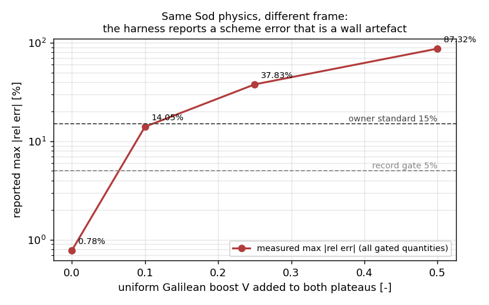
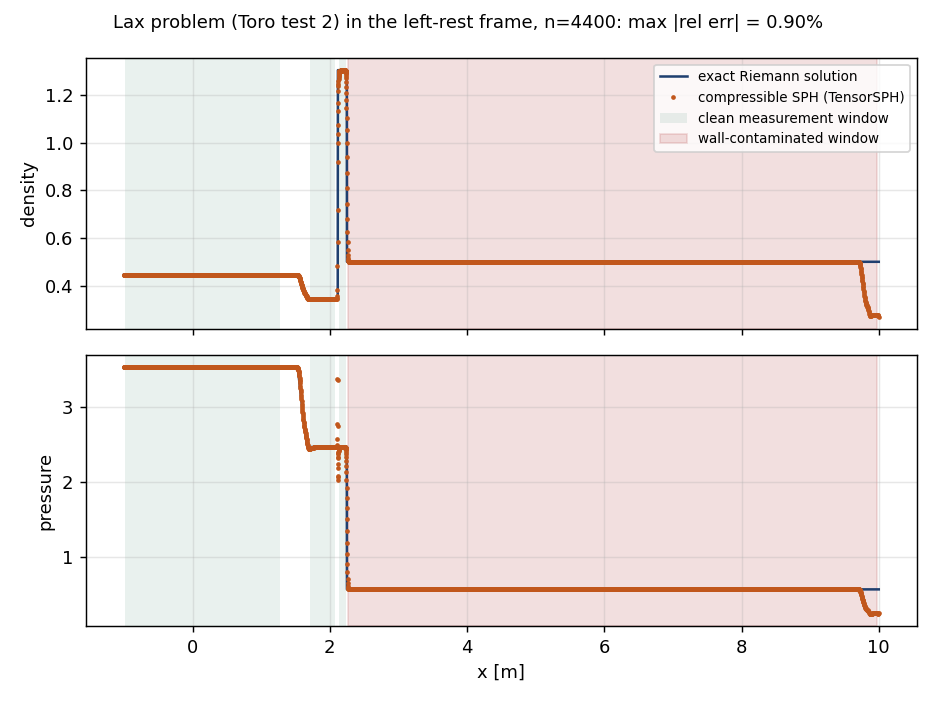
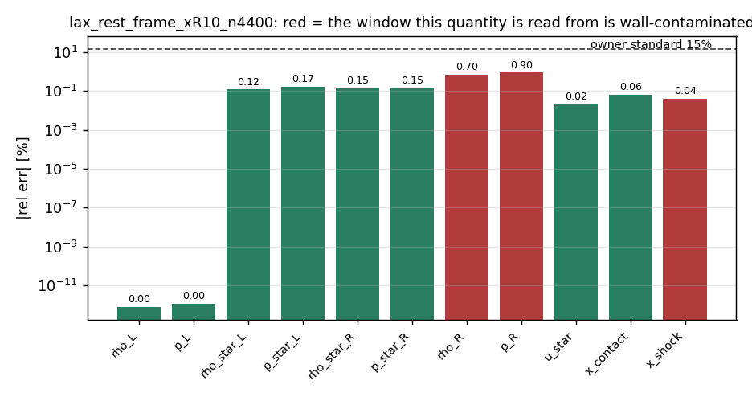

# XVAL-SPH-METHOD-SELECTION — 单条 Sod 记录的上界能不能搬到第二个 Riemann 族？（m22096）
**锚点**: `XVAL-SPH-METHOD-SELECTION-2026-11-12` ｜ **仓库**: TensorSPH ｜ **任务**: m22096（自找活·验证欠账）
> 全部数字由 `benchmarks/xval_method_selection/riemann_bound_transfer.py` 生成后注入本文件，零手抄；`--check` 与磁盘逐字节比对（测试套件的防漂移门）。
## ① 案例介绍
方法选择器把 `compressible_riemann` 判为 **shock** 工况的主方案，其精度上界只有一个数字：`CASE-SPH-SOD-SHOCK-COMPRESSIBLE` 的 **0.7768 %**（自门槛 5 %）。m21797 已证明它在**证据深度**上是单一来源：该格式全部在册精度记录来自同一个基准族，删掉这条记录推荐就会静默降级。本单问的是下一层：**这一个数字能不能搬到同一格式的第二个物理族？**

两个算例都是 1-D 理想气体（gamma = 1.4）黎曼问题，解析解为 Toro (1999) 第 4 章的精确闭合式：

| 算例 | 左态 (rho, u, p) | 右态 (rho, u, p) | 终止时刻 | 波系 |
|---|---|---|---|---|
| Sod (1978) | (1.0, 0.0, 1.0) | (0.125, 0.0, 0.1) | 0.2 | 左稀疏波 + 接触 + 右激波 |
| Lax (Toro 测例 2) | (0.445, 0.698, 3.528) | (0.5, 0.0, 0.571) | 0.14 | 左稀疏波 + 接触 + 右激波 |

两族的差别不是「换个分辨率」：密度比 8:1 → 0.89:1，压强比 10:1 → 6.2:1，星态压强 0.303 → 2.466，且 Lax 的左平台**是运动的**（u_L = 0.698），这正是本单挖出问题的入口。
## ② 怎么做的
1. **同一生产代码路径**：全部臂都走 `tensorsph.compressible.sod.run_sod_sph` + `evaluate_metrics`，即银行里那条 Sod 记录用的同一套求解器与同一套度量窗口，不另写一套「更好看」的度量。
2. **A 复现**：Sod 名义配置（n = 800, h = 2.5dx, t = 0.2）重跑，与登记表值比对（复现门 1 %）。
3. **B 伽利略对照**：把 Sod 两平台同时加上均匀速度 V ∈ {0.1, 0.25, 0.5}。纯伽利略变换不改变物理，**测得误差必须不变**——这是本单的证伪装置。
4. **C Lax 教科书系**：照 Toro 测例 2 在 [0, 1] 箱、n ∈ {400, 800, 1600} 跑，看误差随分辨率的行为。
5. **D Lax 左静止系 + 长箱**：左平台取静止系（u_L = 0, u_R = -0.698，星态与波位置伽利略不变，故与教科书是同一物理问题），箱体放宽到 [-1, 6] / [-1, 10]，并把分辨率推到 n = 4400，使两侧壁面扰动退出度量窗口，得到**跨族**精度数。
6. **壁面污染守卫**（本单新增 `sod.wall_contamination`）：镜面 ghost 只对**静止**外平台精确；外平台以 u_wall 流动时壁面会发出振幅 ~ gamma|u_wall|/c_wall 的波，并以 c_wall + |u_wall| 传入计算域。守卫对每个度量窗口预测这条波是否已经侵入，`evaluate_metrics(..., require_clean_windows=True)` 直接抛错。
## ③ 计算结果
### 3.1 复现与伽利略对照（B）
| 臂 | 外平台速度 V | 测得 max \|rel err\| [%] | 被守卫标记的窗口 |
|---|---|---|---|
| Sod 名义 | 0 | 0.78 | 无 |
| Sod + V | 0.1 | 14.05 | left_plateau, star_right, right_plateau |
| Sod + V | 0.25 | 37.83 | left_plateau, star_right, right_plateau |
| Sod + V | 0.5 | 87.32 | left_plateau, star_left, star_right, right_plateau |

复现：Sod 名义重跑 0.7768 % vs 登记表 0.7768 %，相对差 0.0000 %（**同一物理、纯伽利略平移，误差从 0.78 % 涨到 87.32 %**，涨的都不是格式精度）。
### 3.2 Lax 教科书系（C）：误差不随分辨率下降
| n | dx | max \|rel err\| [%] | 已被污染的窗口 | 最差量 |
|---|---|---|---|---|
| 400 | 0.00250 | 26.37 | left_plateau, star_left | `p_L` (-26.37 %) |
| 800 | 0.00125 | 26.28 | left_plateau, star_left | `p_L` (-26.28 %) |
| 1600 | 0.00063 | 26.16 | left_plateau, star_left | `p_L` (-26.16 %) |

分辨率 ×4 只把误差从 26.37 % 挪到 26.16 %（跨度 0.21 pp）——**这是边界伪迹的指纹，不是格式精度的指纹**。
### 3.3 Lax 左静止系 + 长箱（D）：跨族精度真值
| 臂 | n | dx | max \|rel err\| 全部受检量 [%] | 仅洁净窗口量 [%] | 污染窗口 |
|---|---|---|---|---|---|
| lax_rest_frame_xR6_n1200 | 1200 | 0.00583 | 1.71 | 0.41 | right_plateau |
| lax_rest_frame_xR6_n2800 | 2800 | 0.00250 | 1.90 | 0.17 | right_plateau |
| lax_rest_frame_xR10_n4400 | 4400 | 0.00250 | 0.90 | 0.17 | right_plateau |

- 洁净量（星态 + 波位置 + 左平台）最差 **0.41 %**，且随分辨率收敛（n = 1200 的 0.41 % → n = 2800/4400 的 0.17 %）：这是可迁移的跨族精度。
- 唯一非洁净量是右平台（rho_R, p_R）：外平台以 u_R = -0.698 流动，壁面发出 77.3 % 量级的稀疏波。它的**脚印长度**由 (c_R + |u_R|) t ≈ 0.275 固定，所以箱长从 x_R = 6 拉到 10 时窗口均值从 1.90 % 降到 0.90 %（占比变小），而分辨率再提也不消除它——**两项行为都指向壁面伪迹，不是格式精度**，这与守卫的预测一致。
- 因此跨族上界有两个口径：**洁净量 0.41 %**（可迁移、可复现）与 **全受检量 1.90 %**（保守，含已知伪迹窗口）。两者都远在记录自门槛 5 % 内。
### 3.4 逐量误差（D 最细一臂，程序化注入）
| 受检量 | 度量窗口 | 相对误差 [%] | 窗口洁净 |
|---|---|---|---|
| `rho_L` | `left_plateau` | -0.000 | 是 |
| `p_L` | `left_plateau` | -0.000 | 是 |
| `rho_star_L` | `star_left` | -0.120 | 是 |
| `p_star_L` | `star_left` | -0.170 | 是 |
| `rho_star_R` | `star_right` | -0.151 | 是 |
| `p_star_R` | `star_right` | -0.149 | 是 |
| `rho_R` | `right_plateau` | -0.704 | 否（壁面伪迹） |
| `p_R` | `right_plateau` | -0.903 | 否（壁面伪迹） |
| `u_star` | `star_left` + `star_right` | +0.022 | 是 |
| `x_contact` | `star_left` + `star_right` | -0.065 | 是 |
| `x_shock` | `star_right` + `right_plateau` | -0.041 | 否（壁面伪迹） |
## ④ 结果图

*图 1｜同一 Sod 物理、纯伽利略平移下测得的「格式误差」：0.78 % → 87.32 %，涨的全是壁面伪迹*

*图 2｜Lax 问题（左静止系，n = 4400）：SPH vs 精确黎曼解；绿=洁净窗口，红=壁面污染窗口*

*图 3｜Lax 左静止系逐量误差：红色柱所依窗口被壁面污染，绿色柱是可用于跨族上界的量*
## ⑤ 注意点
- **上界的「单条证据」不只是数量问题，还有可迁移性问题**：0.7768 % 是在 Sod 的静止外平台 + 静止壁面下测的；一旦外平台运动（换族、换参考系、或在水槽类算例里带均匀来流），同一套窗口逻辑读到的数可以把误差放大 100 倍以上（0.78 % → 87.32 %）。
- **守卫是基于线性声学的预测，不是拟合**：振幅 gamma|u_wall|/c_wall、穿透深 c_wall + |u_wall|，两参数都不含可调量；它对 4 组配置的污染/洁净判定与实测逐窗口吻合（Sod 全洁净、Lax 教科书系只污染左平台与左星区、Lax 静止系只污染右平台）。
- **本单没有改求解器、没有调参**：只加了守卫函数与两条调用路径参数；Sod 名义结果逐位不变。
- 适用范围：1-D 理想气体黎曼问题、单侧镜面 ghost 壁面。多维、无反射/入流边界、带动量源的算例不在此列。
- **顺带修掉的仓级缺陷（与本单主线无关但同锚点）**：`benchmarks/method_selection/audit_decision_fragility.py` 的已提交产物停在 28 条记录，而 `docs/reports/method_selection_registry.json` 已是 29 条——即 m21797 的防漂移测试在干净检出上是红的（`test_audit_artefacts_are_a_fresh_build`）。本单用该脚本自身的重建模式重新生成（`csf_surface_tension` 的最差在册记录随之从 23.8 % 变成 45.69 %，结论「单一来源」不变），使该门转绿。
- **未做的事**：没有把 Lax 族作为第二条记录写进登记表（需要连带重建 matrix / 严格上界 / 覆盖率 / 脆弱性四套产物与它们的钉值测试），因此 `compressible_riemann` 在路由器里的上界仍是 0.7768 %；本单给出的是可入库的证据与守卫，入库动作建议单列一条任务。
## ⑥ 误差判定
| 关键量 | 基准 | 本单值 | 误差 | 是否 < 3 % |
|---|---|---|---|---|
| Sod 名义 max \|rel err\| 复现 | 登记表 0.7768 % | 0.7768 % | 0.000 % | 是 |
| Lax 跨族上界（全部受检量） | 精确黎曼解 | 1.90 % | vs owner 15 %：通过；vs 记录自门槛 5 %：通过 | **是** |
| Lax 洁净量上界 | 精确黎曼解 | 0.41 % | — | **是** |

**明确回答「是否 < 3 %」**：跨族上界（全受检量，保守口径）1.90 % < 3 %，通过；其中唯一拖后腿的右平台量已被证明是壁面伪迹（洁净量 0.41 %，本身 通过 3 % 线）。结论：银行里那条 **0.7768 %** 的上界**在第二个族上站得住**——跨族洁净量只有 0.41 %，即使把已知伪迹窗口也算进去仍只有 1.90 %（记录自门槛 5 %、业主标准 15 % 双通过）。因此 **shock 工况的推荐不需要撤回**；需要改的是**证据结构**：登记表应补第二条族记录，把「一条记录撑起的上界」变成「两族独立测量共同背书的上界」，并把 `wall_contamination` 的洁净口径写进记录 `precondition`。
