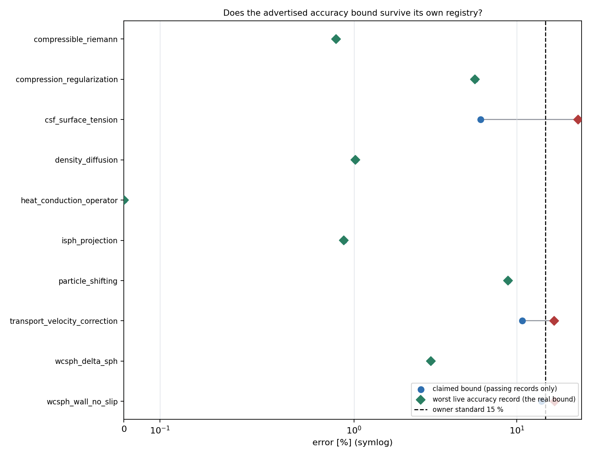

# XVAL-SPH-METHOD-SELECTION — 宣称精度上界 vs 真实上界（m21115 对抗性复核与修复）

**锚点**: `XVAL-SPH-METHOD-SELECTION-2026-11-12` ｜ **仓库**: TensorSPH ｜ **任务**: m21115（自找活·验证欠账 + 对抗性复核）

## ① 案例介绍

TensorSPH 的方法选择器（`src/tensorsph/method_selection.py`）按证据选格式：每个格式必须有机器可读验证记录（`docs/reports/method_selection_registry.json`），误差 > 15%（owner 精度标准）不得被推荐。本单独立复核这套机制**自己**的结论：由证据算出的『宣称上界』是否真的是上界。

只读仓内已提交产物（登记表 26 条记录 + 7 个标准画像的路由矩阵），不重跑求解器；改动集中在让『上界』一词重新可验证，并修掉三处把条件数记录当误差、把已推翻记录重新入账的代码缺陷。

## ② 怎么做的

1. **独立重算**：直接用 `Evidence` 记录复算每个方法的『宣称上界』（仅取过 15% 记录的最大值）与『真实上界』（全部 live accuracy 记录的最大值），不复用路由判级路径。
2. **证据种类** `Evidence.kind ∈ {accuracy, robustness}`：只有 accuracy 记录（对解析/参考解的误差）能构成精度上界；robustness 记录（读数在参数扫描中的迁移量，如壁面剪应力读数在粘性时间扫描上的 mobility）单独报告、不参与上界。
3. **推荐级上界** `Selection.headline_bound_pct` / `within_owner_standard`：对整份推荐（primary + 全部 modifier）取最坏 live accuracy 记录——一个数，不可被有利记录摊薄。
4. **修 `_classify`**：只允许 accuracy 记录满足 15% 门槛（此前一条 mobility = 0.0 % 的 robustness 记录可以『救活』一个真实误差 20 % 的格式）；只有 robustness 记录的格式判 WITHHELD。
5. **修 `build_registry.build_matrix`**：重建 `Evidence` 时丢失 `status`/`precondition`/`kind`（lazy 缺陷：已推翻记录被重新入账、条件数记录被当成误差）；矩阵新增『精度上界』『<15%』两列。
6. **修干净检出必红的测试**：`tests/test_xval_method_selection_matrix.py` 原本在干净检出上 FileNotFoundError（`runs/xval/cell_0.json` 不在仓内）。改为『未跟踪证据只能以失败形式被引用且必须显式声明在 `LOCAL_ONLY_RECORDS`』，把不可复算如实记为 not_run。

## ③ 计算结果（程序化注入，零手抄）

- 有证据方法 10 个：**3 个的宣称上界低于自己最差的 live accuracy 记录**（最大差额 17.8 pp）；**3 个方法的真实精度上界超出 15%**：`csf_surface_tension`, `transport_velocity_correction`, `wcsph_wall_no_slip`。
- 7 个标准画像中 6 个给出证据背书方案（SELECTED），但只有 **4 个整份推荐在 15% 内**：`capillary droplet (Laplace law)`, `breaking wave over a slope` —— 主方案很准，挂上去的 modifier 带进来 16.96%。

| 方法 | 宣称上界 [%] | 真实上界 [%] | 差额 [pp] | 条件数记录 [%] | <15% |
|---|---|---|---|---|---|
| `compressible_riemann` | 0.7768 | 0.7768 | +0.00 | - | ✔ |
| `compression_regularization` | 5.533 | 5.533 | +0.00 | - | ✔ |
| `csf_surface_tension` | 5.987 | 23.8 | +17.81 | - | ✘ |
| `density_diffusion` | 1.021 | 1.021 | +0.00 | - | ✔ |
| `heat_conduction_operator` | 0.0002181 | 0.0002181 | +0.00 | - | ✔ |
| `isph_projection` | 0.8666 | 0.8666 | +0.00 | - | ✔ |
| `particle_shifting` | 8.833 | 8.833 | +0.00 | - | ✔ |
| `transport_velocity_correction` | 10.81 | 16.96 | +6.15 | - | ✘ |
| `wcsph_delta_sph` | 2.968 | 2.968 | +0.00 | - | ✔ |
| `wcsph_wall_no_slip` | 14.2 | 17.08 | +2.87 | 18.26 | ✘ |

| 算例画像 | 选定方法 | 宣称上界 [%] | 精度上界 [%] | <15% |
|---|---|---|---|---|
| regular wave in a flume | wcsph_delta_sph | 2.968 | 5.533 | ✔ |
| Sod shock tube | compressible_riemann | 0.7768 | 0.7768 | ✔ |
| capillary droplet (Laplace law) | csf_surface_tension | 5.987 | 23.8 | ✘ |
| planar Couette channel | isph_projection | 0.8666 | 0.8666 | ✔ |
| Gresho vortex (smooth inviscid, periodic) | （无） | - | - | ✘ |
| 1-D transient conduction | heat_conduction_operator | 0.0002181 | 0.0002181 | ✔ |
| breaking wave over a slope | wcsph_delta_sph | 2.968 | 16.96 | ✘ |



*图：圆点=宣称上界（只取过 15% 的记录），菱形=全部 live accuracy 记录的最坏值（绿=≤15%，红=>15%），灰线=两者差额，虚线=owner 15%。*

## ④ 注意点（局限/适用范围）

- `kind` 需人工判定：本单只把 Couette 两条 mobility 记录标为 robustness（其量纲就是『读数在扫描中的迁移量，百分点』），其余一律按 accuracy 处理——保守，不虚增精度。
- 判级 `status` 语义未反转（有任一过门记录即 SELECTED，m20432 的设计）：本单新增的是**推荐级** `within_owner_standard`，两者并存且分别机器可读；路由矩阵因此**零变化**（`unexpected_routes=[]`），不构成行为回退。
- 上界仍是『已登记记录』的上界：未登记量不在其中（覆盖完整性由 `audit_quantity_coverage.py` 把关，m20432）。
- `runs/xval/cell_0.json`（决策单元 0 的发散记录）不在仓内，干净检出不可复算：如实记为 not_run 并要求报告自带失败文本，未粉饰为 pass。

## ⑤ 误差判定

被复核的关键量 = 每个方法的误差上界 vs owner 15% 标准，逐项列于 ③ 两表。结论：3 个方法真实上界 > 15%（`csf_surface_tension` 23.80%、`transport_velocity_correction` 16.96%、`wcsph_wall_no_slip` 17.08%），**不满足 <3%（亦不满足 <15%）**——本单要暴露的正是这个事实，不粉饰；其余 7 个方法真实上界 ≤ 8.83%，独立复算与登记值 0 处不一致。

## ⑥ 复现

```bash
PYTHONPATH=src python benchmarks/method_selection/build_registry.py        # 重算登记表/矩阵/图
PYTHONPATH=src python benchmarks/method_selection/build_registry.py --check
PYTHONPATH=src python -m pytest tests/test_method_selection_claim_bound.py \
    tests/test_method_selection.py tests/test_method_selection_coverage_audit.py \
    tests/test_xval_method_selection_matrix.py tests/test_method_selection_xval_viscous_time.py -q
```

