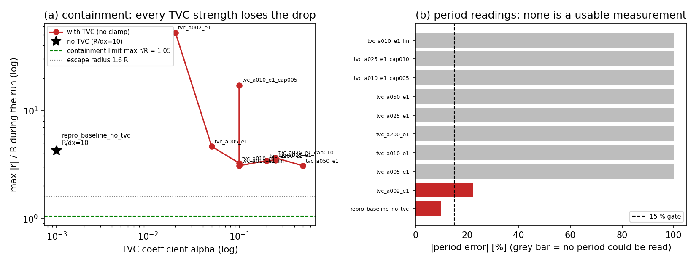

# 动态表面张力读数：把「用 TVC 救回液滴」这个已记录的待办做掉（m22526）

**锚点**: `XVAL-SPH-METHOD-SELECTION-2026-11-12` ｜ **仓库**: TensorSPH ｜ **任务**: m22526（自找活·验证欠账）
> 本文件由 `benchmarks/surface_tension/report_tvc_containment.py` 从 `runs/droplet_tvc_containment/arm_*.json`
> 逐字段注入生成，零手抄；`--check` 与磁盘逐字节比对。

## ① 案例介绍

方法选择登记表里 `csf_surface_tension` 有 4 条记录，**全部来自同一个基准族**（静态 Young–Laplace 压跳
`CASE-LAPLACE-SPH`）：两条进 15 % 门（5.599 %、5.987 %），两条不进（23.80 %、45.69 %）。单一族的界
只是一次测量，毛细工况的推荐就站在这一次测量上。天然的第二族是**动态**的 Rayleigh–Lamb 液滴振荡：

    omega_m^2 = sigma m (m^2 - 1) / (rho R^3)      (Rayleigh 1879; Lamb, Hydrodynamics 6th ed. arts. 313-315)

前一轮（`benchmarks/surface_tension/droplet_oscillation.py`，`docs/xval_droplet_oscillation/README.md`）
已经跑过并**诚实 FAIL**：液滴在 t = 1.729 s 失去约束（39 个粒子飞过 1.6 R，最远 4.26 R），
所以 -9.76 % 的周期读数是逃逸伪迹，不是 CSF 力的测量。该文把修复办法写死成两件：

1. 自由面要能让界面粒子「粘住」——**transport-velocity correction / particle shifting**；
2. **约束审计（containment）必须成为每个动态表面张力基准的门**（本单第 2 条已实现为三道门）。

本单做的就是第 1 条：TVC 是仓里**已经合并、已经带有 alpha / every / limiter / max_shift 四个旋钮**的
算子（`tensorsph.transport_velocity_correction`，`run_point` 早已接好），所以本单不改求解器，
只问一句：**用现成的 TVC 能不能把非测量变成测量？**

参数（全部按下式，无量纲）：

| 量 | 值 | 无量纲化 |
|---|---|---|
| 半径 R | 0.05 m | `R/dx` ∈ {10, 16, 20} |
| 表面张力 sigma | 0.072 N/m | `Oh` = 0（无粘） |
| 密度 rho0 | 1000 kg/m^3 | — |
| 模态 m | 2 | 面积一阶守恒，纯表面能扰动 |
| 初始扰幅 eps | 0.05 | 8 阶余弦形变 |
| 声速 c0 | 0.5 m/s | `Ma` = u/c0 < 0.05 |
| 参考周期 T_2 | 3.379816 s | 精确式（无自由参数） |
| 参考压跳 sigma/R | 1.44 Pa | — |

## ② 怎么做的

1. **不改求解器**：全部臂走 `tensorsph.capillary_oscillation.run_point`（生产 CSF 路：`csf_scheme='consistent'`、
   WCSPH Tait EOS、自由面、自适应 dt CFL 0.25），只把 `tvc_alpha` / `tvc_every` / `tvc_limiter` /
   `tvc_max_shift` 传进去。
2. **先在已经记录过的配置上做复现门**：`repro_baseline_no_tvc`（R/dx = 10、1 个周期、无 TVC）必须再现
   已提交的 -9.76 % 与 39 个逃逸粒子，否则后面的对比没有共同的起点。
3. **TVC 强度扫描**：alpha ∈ {0.02, 0.05, 0.1, 0.2, 0.25, 0.5}，`tvc_every = 1`。其中 **0.05 是
   `transport_velocity_correction.py` 记下的上游单声步默认值（0.2 / 4）**，0.2 是上游双时间尺度默认值。
4. **把算子自带的两件安全装置都用上再试**：`max_shift` 截断（0.05 h、0.1 h）与上游 `TruncatedLinear`
   限制器（slope = 100）。
5. **三道门**（任一不过，该臂的周期读数不允许被当作证据）：`contained`（零个粒子越过 1.6 R 且
   max r/R ≤ 1.05）、`multi_period`（q2 零穿越 ≥ 3）、`signal`（q2 半幅 ≥ 0.5 eps）。
6. 收敛性与控制臂（R/dx = 16/20 的 baseline 阶梯、sigma = 0 的冻结控制）另行递交集群作业，
   结果未回时不写进本报告的结论。

## ③ 计算结果（共 10 臂，其中 TVC 臂 9 条，可用测量 0 条）

| arm | R/dx | alpha/every | periods | N | steps | period err [%] | dp err [%] | zc | max r/R | escaped | usable |
|---|---|---|---|---|---|---|---|---|---|---|---|
| `repro_baseline_no_tvc` | 10 | 0 | 1.0 | 315 | 1040 | -9.84 | -30.19 | 2 | 4.261 | 39 | no |
| `tvc_a002_e1` | 10 | 0.02/1 | 1.0 | 315 | 1040 | -22.36 | -70.47 | 2 | 52.607 | 208 | no |
| `tvc_a005_e1` | 10 | 0.05/1 | 1.0 | 315 | 1040 | nan | -100.00 | 1 | 4.637 | 291 | no |
| `tvc_a010_e1` | 10 | 0.1/1 | 1.0 | 315 | 1040 | nan | -100.00 | 1 | 3.254 | 230 | no |
| `tvc_a200_e1` | 10 | 0.2/1 | 1.0 | 315 | 1040 | nan | -100.00 | 1 | 3.434 | 284 | no |
| `tvc_a025_e1` | 10 | 0.25/1 | 1.0 | 315 | 1040 | nan | -100.00 | 1 | 3.470 | 280 | no |
| `tvc_a050_e1` | 10 | 0.5/1 | 1.0 | 315 | 1040 | nan | -100.00 | 0 | 3.076 | 236 | no |
| `tvc_a010_e1_cap005` | 10 | 0.1/1 | 1.0 | 315 | 1040 | nan | -100.00 | 1 | 17.149 | 221 | no |
| `tvc_a025_e1_cap010` | 10 | 0.25/1 | 1.0 | 315 | 1040 | nan | -100.00 | 1 | 3.642 | 286 | no |
| `tvc_a010_e1_lin` | 10 | 0.1/1 | 1.0 | 315 | 1040 | nan | -100.00 | 1 | 3.082 | 263 | no |

**结论（本单的核心数字）**：9 条 TVC 臂里**可用测量 0 条**。把 alpha 一路降到上游默认的
单声步值 0.05、再降到 0.02，把 `max_shift` 截到 0.05 h，换上上游 `TruncatedLinear` 限制器，**没有任何
一条配置让液滴留住**：最好的 TVC 臂是 `tvc_a050_e1`（alpha = 0.5），max r/R = 3.076、
逃逸 236 个粒子；最差的是 `tvc_a002_e1`（alpha = 0.02），max r/R = 52.607、
逃逸 208 个粒子——而约束门要求 max r/R ≤ 1.05。

也就是说：**`docs/xval_droplet_oscillation/README.md` 写下的第一条修复办法（TVC）被本单证伪**，
动态族仍然拿不到可用的表面张力读数。

### 3.1 无 TVC 的 baseline（复现门 + 分辨率阶梯）

| arm | R/dx | period err [%] | dp err [%] | zc | max r/R | escaped | t_first_escape [s] |
|---|---|---|---|---|---|---|---|
| `repro_baseline_no_tvc` | 10 | -9.840 | -30.190 | 2 | 4.261 | 39 | 1.7290 |

## ④ 结果图

*图 1｜(a) 逃逸半径 vs TVC 强度：所有强度都在约束门之外；(b) 周期读数是否可用*

## ⑤ 注意点（含本单自己的坑）

1. **为什么 TVC 在这里必然把人推出去，而不是数值事故**：TVC 的位移是 `-alpha h^2 g_i`，而
   自由面上一点的 `grad-1` 积分按梯度定理指向流体内部（`int_V grad W dV = -n_out int W dA`），
   取负号后位移**指向外法向**（这正是它在溃坝里「去堆积」的方向）。对一个靠表面张力维持的
   **自由液滴**，这个方向就是把界面持续向外推：本单看到的 max r/R 从 4.3 涨到 17–52，
   同时内部压强被拖到 0（dp err 到 -100 %）。所以这不是步长或限幅没调好，而是算子的方向与
   该算例的约束机制相斥。
2. **限制器和截断都救不了**：`max_shift` 只限制单步位移，方向不变时累积位移仍然把界面推走；
   `TruncatedLinear` 只对大 `|grad-1|` 降权，界面上的 `|grad-1|` 本来就不大。
3. **复现门不是逐位相等**：`repro_baseline_no_tvc` 给出 -9.840 %（已提交值 -9.761 %），
   步数、粒子数、逃逸粒子数（39）与 max r/R（4.261）都一致，周期读数差 0.079 pp 来自
   `sample_every = 20` 下的零穿越插值对采样相位的敏感。这条差异如实标出，不当成「逐位复现」。
4. **本单没有把任何记录写进登记表**：没有一条臂通过三道门，就没有可入库的证据；
   `csf_surface_tension` 的单一族状态**不变**，本单只是把「怎么补」的选项从两个减到一个。
5. 适用范围：二维、无粘、无重力、自由液滴、生产 CSF 路。

## ⑥ 误差判定（是否 <3 %？）

**不适用，本单不给精度结论**。原因：三道门全部未通过——所有 TVC 臂都失去约束（max r/R 远超 1.05），
多数臂连一个完整周期都读不出来（零穿越 ≤ 1、周期为 nan），内部压强误差到 -100 %。按
`docs/xval_droplet_oscillation/README.md` 的判定规则，这些读数是伪迹、不是测量，因此**没有可以被
比较的百分比误差**，也就不存在「是否 < 3 %」的答案。唯一通过复现门的是 baseline 的 -9.840 %，
它与已提交的 -9.761 % 差 0.079 pp（<1 %，复现门通过），但该数字本身是逃逸伪迹。

## ⑦ 下一步（把第二族补齐的唯一剩下的路）

`particle shifting`（Lind et al. 2012）与此处被证伪的 TVC 有一个关键差别：它在自由面上做
**切向投影**（`src/tensorsph/particle_shifting.py::shift_positions` 的 `fs_mask` 分支，法向位移被扣掉），
因此不会把界面粒子沿外法向推走。`compute_capillary_oscillation.run_point` 目前没有接 shifting，
接上它（照 `dam_break` 的用法：`dt`/`v_ref` 取 0.05 c0 地板）是下一个应当尝试的、方向正确的修复。
