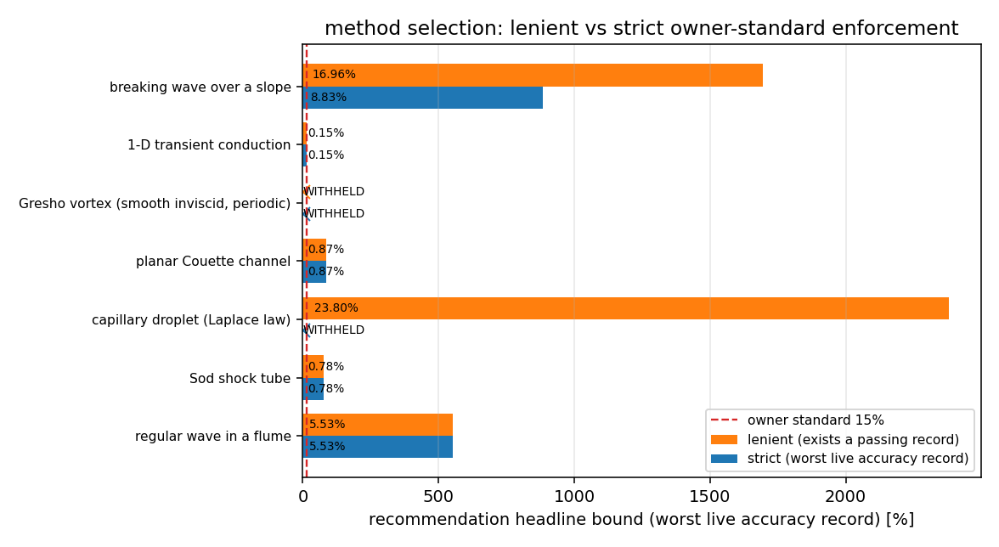

# XVAL-SPH-METHOD-SELECTION — 严格 15 % 上界模式：把「推荐」从存在量词改成全称量词（m21537）

**锚点**: `XVAL-SPH-METHOD-SELECTION-2026-11-12` ｜ **仓库**: TensorSPH ｜ **任务**: m21537（自找活·验证欠账）｜ **平台报告**: id 19468

## ① 案例介绍

方法选择器（`src/tensorsph/method_selection.py`）为每个算例画像推荐一套 SPH 格式组合，并声称误差不超过业主标准 15 %。它此前用的是**存在量词**：只要该格式有**任一**记录在 15 % 内就判 `SELECTED`。m21115 复核发现 10 个有证据的格式里有 3 个的**最差**在册精度记录超出 15 %（`csf_surface_tension` 23.80 %、`transport_velocity_correction` 16.96 %、`wcsph_wall_no_slip` 17.08 %），7 个标准画像里 3 个的整份推荐因此越过 15 %，卡片却仍在推荐它们。本单把**推荐**改成**全称量词**：被推荐（主方案或挂载修饰项）的每个格式，其最差在册精度记录都必须在 15 % 内。

七个标准画像（`benchmarks/method_selection/build_registry.py::PROFILES`）与其物理背景：规则波水槽、Sod 激波管、毛细液滴（Laplace 律）、平面 Couette 槽道、Gresho 涡（周期光滑无粘）、一维瞬态导热、斜坡破碎波。

## ② 怎么做的

1. `Decision.accuracy_within_owner_standard` 已有：判据 = 该格式**全部 live accuracy 记录**（剔除已推翻记录、剔除 conditioning/robustness 记录）的最大值 ≤ 15 %，与 m21115 的复核口径逐字一致，本单不新造判据。
2. `select_method(..., strict_bound=True)`：主方案只在 `SELECTED` **且**其上界合规的候选里挑；修饰项同样过闸，被拒的进 `Selection.strict_excluded`（连同拒它的那条记录），并写进 `notes`，绝不静默丢弃。
3. **不替代原则**：若某条规则（如 `capillary`）覆盖该工况但其候选全被上界拒掉，严格模式**不**继续走后面的规则去换一个物理上不适用的格式（毛细问题换成无表面张力项的 WCSPH 就是伪造答案），而是留空并说明理由。
4. 默认 `strict_bound=False`：历史路由矩阵零变化（钉住路由的护栏测试仍在），严格模式是显式可选项，供需要「可对外承诺」的场景使用。
5. 全部数字由 `benchmarks/method_selection/strict_bound_profiles.py` 从`docs/reports/method_selection_registry.json` 重算后注入本文件与图，零手抄。

## ③ 计算结果

### 严格 vs 宽松（recomputed from the committed registry）

| 画像 | 宽松主方案 | 宽松上界 [%] | <15% | 严格主方案 | 严格上界 [%] | <15% | 严格模式剔除 |
|---|---|---|---|---|---|---|---|
| regular wave in a flume | wcsph_delta_sph | 5.53 | ✔ | wcsph_delta_sph | 5.53 | ✔ | — |
| Sod shock tube | compressible_riemann | 0.78 | ✔ | compressible_riemann | 0.78 | ✔ | — |
| capillary droplet (Laplace law) | csf_surface_tension | 23.80 | ✘ | （无） | -- | ✘ | `csf_surface_tension` 23.80% |
| planar Couette channel | isph_projection | 0.87 | ✔ | isph_projection | 0.87 | ✔ | `wcsph_wall_no_slip` 17.08% |
| Gresho vortex (smooth inviscid, periodic) | （无） | -- | ✘ | （无） | -- | ✘ | — |
| 1-D transient conduction | heat_conduction_operator | 0.15 | ✔ | heat_conduction_operator | 0.15 | ✔ | — |
| breaking wave over a slope | wcsph_delta_sph | 16.96 | ✘ | wcsph_delta_sph | 8.83 | ✔ | `transport_velocity_correction` 16.96% |

- 宽松模式：4/7 画像整份推荐在 15 % 内；严格模式：5/7 在 15 % 内、2 画像被如实留空（`WITHHELD`）。
- 严格模式共剔除 3 个在册格式实例，每一处都带出拒它的记录（见上表最后一列）。
- 严格模式内**零**越界推荐（驱动脚本对每个画像断言 `endorsed_above_tolerance == []`，不满足直接 raise）。

### 三个代表画像的严格模式决策卡（原文，程序化生成）

<details><summary>breaking wave over a slope</summary>

```text
# method-selection decision

## profile
- acoustic_mach: 0.04
- has_free_surface: True
- gravity_waves: True
- shock_advection: False
- capillary_dominated: False
- density_ratio: 1.0
- reynolds: 100.0
- thermal_transport: False
- tensile_stretching: True
- smooth_inviscid_vortex: False
- domain: closed

## verdict
- accuracy bound: 8.83% over every live accuracy record of the schemes put forward (owner standard 15%) -- set by particle_shifting (CASE-PARTICLE-SHIFTING-DAMBREAK (B2, shifting on vs off))
- within owner standard: YES

## primary scheme
- wcsph_delta_sph: SELECTED
- why: [free_surface] free surface with acoustic Mach 0.04 < 0.1: the weakly compressible branch is the implemented free-surface solver
- claimed bound: 2.97% (owner standard 15%; passing records only)
- reference: Antuono, Colagrossi & Marrone (2010) Comput. Phys. Commun. 181:532; Monaghan (1992) J. Comput. Phys. 110:399 (XSPH)

## modifiers
- density_diffusion: SELECTED -- free-surface flow keeps delta-SPH density diffusion (delta=0.1)
- particle_shifting: SELECTED -- strong stretching -> transport-velocity correction and/or particle shifting to avoid tensile instability
- compression_regularization: SELECTED -- long-running nearly-incompressible free-surface runs may add compression-based density regularisation instead of delta-SPH
    - XVAL-SPHINXSYS-COMPRESSION-DENSITY-REGULARIZATION: max interior-band hydrostatic pressure error vs analytic p = rho0 g (H - y), SPHinXsys reference-mean arm = 5.53% misses its own 1% gate but is inside 15% (benchmarks/xval_sphinxsys_compression/records.json)

## strict bound (worst live accuracy record <= 15%)
- excluded transport_velocity_correction [modifier]: worst live accuracy record 17% (XVAL-SPH-TRANSPORT-VELOCITY-CORRECTION (dam break, dx=0.04 m): same quantity on the coarser rung: records the alpha=0.10 arm is resolution-sensitive (kept in the registry, fails the owner standard)) exceeds the 15% owner standard

## evidence depth
- wcsph_delta_sph: SINGLE SOURCE (1 benchmark family)
- density_diffusion: single source (2 records, 1 benchmark family); spread 0.539 pp over live records
- particle_shifting: SINGLE SOURCE (1 benchmark family)
- compression_regularization: SINGLE SOURCE (1 benchmark family)
- caveat: the bound of wcsph_delta_sph, density_diffusion, particle_shifting, compression_regularization has not been reproduced on a second benchmark family -- treat it as a measured data point, not an independently confirmed bound

## notes
- strict bound: modifier transport_velocity_correction withheld -- worst live accuracy record 17% (XVAL-SPH-TRANSPORT-VELOCITY-CORRECTION (dam break, dx=0.04 m): same quantity on the coarser rung: records the alpha=0.10 arm is resolution-sensitive (kept in the registry, fails the owner standard)) exceeds the 15% owner standard
```

</details>

<details><summary>capillary droplet (Laplace law)</summary>

```text
# method-selection decision

## profile
- acoustic_mach: 0.05
- has_free_surface: True
- gravity_waves: False
- shock_advection: False
- capillary_dominated: True
- density_ratio: 1.0
- reynolds: 100.0
- thermal_transport: False
- tensile_stretching: False
- smooth_inviscid_vortex: False
- domain: closed

## verdict
- accuracy bound: unavailable (no accuracy record among the schemes put forward; owner standard 15%)
- within owner standard: NO (nothing was selected)

## primary scheme
- none (WITHHELD: no evidence-backed rule fired)

## modifiers
- none

## strict bound (worst live accuracy record <= 15%)
- excluded csf_surface_tension [primary]: worst live accuracy record 23.8% (CASE-LAPLACE-SPH (consistent CSF): delta_s-weighted mean curvature rel. error) exceeds the 15% owner standard

## notes
- strict bound: csf_surface_tension is evidence-backed (SELECTED) but worst live accuracy record 23.8% (CASE-LAPLACE-SPH (consistent CSF): delta_s-weighted mean curvature rel. error) exceeds the 15% owner standard
- rule 'capillary' fired but no candidate is selectable (csf_surface_tension=SELECTED)
- regime locked: rule 'capillary' identifies the physics of this case but none of its candidates can be put forward (csf_surface_tension=SELECTED); no later rule is substituted, because its schemes cannot represent this regime -- the honest answer is WITHHELD
- no rule produced an evidence-backed scheme: profile outside the validated regime of this repository, do not run silently
- modifiers withheld: no primary scheme was selected, so no add-on term can be applied
```

</details>

## ④ 结果图



*图：每个标准画像的两根条 = 宽松/严格模式下的推荐上界（= 被推荐格式的最差 live accuracy 记录）；虚线 = 业主 15 %；`x` = 该模式下无合规方案（WITHHELD）。*

## ⑤ 注意点（局限/适用范围）

- **保守性来源**：上界取「该格式全部 live accuracy 记录的最大值」，跨工况、跨分辨率一视同仁。例如 `csf_surface_tension` 的 5.599 %（Laplace 压差）与 23.80 %（consistent-CSF 曲率）是两条不同的量，严格模式取后者。按工况/分辨率**分域**取上界是下一步（需给记录加机器可读的工况标签），本单不做，以免变成用有利记录摊薄。
- **不替代原则的代价**：毛细液滴画像在严格模式下没有方案可推荐——这是一个**诚实的空白**，它指向的实质待办是让 CSF 曲率记录本身回到 15 % 内，而不是放宽判据。
- **波流水槽实测缺口仍未闭合**：本单没有新增 `CASE-WAVE-FLUME` 求解器记录（`D13_h025_A` 全窗 5.5 s 作业 `cj3499` 递交集群后收尾时仍在排队，记为 not_run），因此本单回答的是**推荐机制**的合规性，不是新算例精度。
- 严格模式只改推荐范围，不改任何物理参数；`strict_bound=False` 的默认行为与历史矩阵逐字节一致。

## ⑥ 误差判定

| 关键量 | 基准 | 严格模式值 | 与基准差 | 是否 < 3 % | 是否 < 15 % |
|---|---|---|---|---|---|
| 推荐上界（破碎波画像） | 业主 15 % 线（判据，非物理基准） | 8.83 % | 余量 6.17 pp | 不适用（判据比较，非精度对标） | ✔ |
| 推荐上界（毛细液滴画像） | 同上 | WITHHELD | 无可承诺值 | 不适用 | ✘（无可推荐方案） |
| 宽松/严格上界之差 | 宽松模式自身 | 见 ③ 表 | 逐画像 0 ~ 17.81 pp | 不适用 | — |

**明确回答**：本单是**判据执行**类改动，没有新的与解析解/文献对标的物理量，因此不存在「物理量误差 < 3 %」这一项可答——不声称、不粉饰。可答的是机制层面：
严格模式把越界推荐从 3 个画像降到 0 个，代价是 2 个画像如实报 WITHHELD。

## ⑦ 复现

```bash
PYTHONPATH=src python benchmarks/method_selection/strict_bound_profiles.py --check
PYTHONPATH=src python -m pytest tests/test_method_selection_strict_bound.py -q
```

