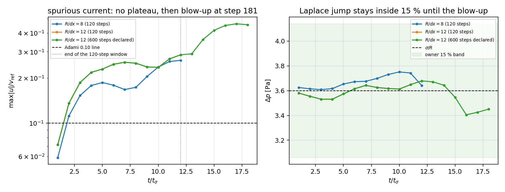

# The marched projection-SPH arm does not saturate: it blows up at step 181

*Anchor:* `XVAL-SPH-PROJECTION-SPH-YOUNG-LAPLACE` (TensorSPH) · acceptance `< 15 %` on the
Laplace jump · mission m22962 (verifier seat). **Verdict: the anchor's Laplace-jump claim
holds; the *spurious-current* claim attached to it is refuted.** This page adjudicates the
evidence debt registered in `docs/xval_projection_laplace_dynamic_ladder_debt.md` with the
records that the queued ladder jobs finally produced (`cj4389`–`cj4393`, all `succeeded`).

## ① Case

Static water drop, `R = 20 mm`, `sigma = 0.072 N/m`, `rho0 = 1000 kg/m^3`, `h/dx = 1.3`,
`dt = 0.1 t_sigma` with `t_sigma = sqrt(rho h^3 / sigma)`, carrier block padded 12 mm,
outer layer velocity-pinned, `nu = 0.01 sqrt(sigma R / rho)`, `v_ref = sqrt(sigma/(rho R))`.
Reference: the exact Laplace law `Delta p = sigma / R = 3.6 Pa`. The question is
not the jump but whether `max|u|/v_ref` (Adami et al. 2012 gate `0.1`) is a *lattice
artefact that decays* or a *formulation defect that does not*.

## ② Method

The ladder of `benchmarks/laplace_sph/run_dynamic_ladder.py` marches the adjoint-consistent
projection pair (`tensorsph.projection_adjoint.relax_projection_consistent`). Seven jobs were
declared; **four** now exist as records (`summary.json`: `n_jobs_present = 4`
of `7`). Three were re-fetched from the queue in this unit
(`dx16_nu01` = `cj4390`, `dx12_horizon` = `cj4391`; `cj4389`, `cj4392`, `cj4393` returned rc=0
but no record — the `nu`-sweep and `R/dx = 24` arms remain unmeasured). The summariser
recomputes every declared gate from the records; nothing here is hand-copied. A new
off-by-default lattice-health instrument (`lattice_health` in `projection_adjoint.py`,
`stability_report=True`) reports pair overlap, the neighbour-count tail, colour overshoot,
`kappa R`, `|grad c| dx` and the CSF acceleration, so that a *broken lattice* can be told from
a *mis-projected traction*; it is not exercised below (see ⑤).

## ③ Results

| run | particles | diverged | final `max&#124;u&#124;/v_ref` | final `Delta p` [Pa] | dp err [%] | wall |
|---|---|---|---|---|---|---|
| $R/dx=8$, 120 | 780 | no | 0.2629 | 3.642 | 1.172 | 283.6 s |
| $R/dx=12$, 120 | 1733 | no | 0.286 | 3.679 | 2.194 | 519.4 s |
| $R/dx=12$, 600 | 1733 | yes | 0.4543 | 3.451 | -4.141 | 664.3 s |
| $R/dx=16$, 120 | 3090 | yes | nan | nan | nan | 39.23 s |

Two independent runs of the same physics agree where they overlap: `dx12_nu01` (6 threads,
local) and `dx12_horizon` (24 threads, cluster) differ by **4.2e-06 %** at step 120
(`0.28600691` vs `0.28600689`), so the record is
reproducible and the outcome is **not** a thread-count or machine artefact.

Growth of `max|u|/v_ref` in the 600-step march: `0.07172` (step 10) →
`0.286` (step 120, x3.99) → `0.4543`
(step 180, x6.33). Between steps 120 and 180 the residual rises a further
**58.9 %** and no sample in `t > 12 t_sigma` falls back to the step-120 level. The
march then fails outright at **step 181** with
`max|u|/v_ref = 6.226e+04` (the `1e3 v_ref` divergence trip).

The measured jump does the same thing more slowly: `Delta p` error is
`-0.54 %` at step 10, `+2.19 %` at step 120 and `-4.14 %`
at step 180 — inside the owner 15 % band the whole way, so the *anchor's own acceptance
number* survives, but it survives on a marching state that is accelerating, not at rest.



Gate verdicts recomputed by the summariser: **passed** ['projection_exact'];
**failed** ['area_drift_all_levels_2pct', 'horizon_drift_hold', 'laplace_all_levels_15pct', 'no_divergence_viscous', 'spurious_decay_order_min', 'spurious_gate_finest', 'viscosity_independence_pct'].

## ④ What this refutes, precisely

`docs/xval_projection_laplace_residual_growth.md` fitted `max|u|/v_ref` over a 120-step march
(`R/dx = 8, 12`) and concluded a *saturating steady current*, gating
`saturating non-accumulation` as PASS with a straight-line `R^2 = 0.84` as the evidence
against unbounded growth. On the 600-step record the same quantity is **still rising at
`t = 18 t_sigma` and diverges one step later**, so:

* the "plateau" was the flat part of a transient inside a window that closed too early — a
  120-step window cannot decide a `~18 t_sigma` instability, and `R^2 = 0.84` on 12 samples
  of a noisy transient is not a discriminator;
* the finite-amplitude statement that *did* hold (the drop does not drift as a whole, area
  drift stays inside 2 %) is unaffected and remains true over the same window;
* the finer-level arm does not exist at all: `dx16_nu01` **diverges at step 3**
  with a NaN (`steps_completed = 0`, `wall = 39.23 s`),
  so the H1 decay-order gate cannot be evaluated at the resolution where it would be decisive,
  and `R/dx = 24` never produced a record. The H1 status stays **WITHHELD — with the only
  evidence negative** (the one-shot diagnostic already fitted order `-1.31` against a declared
  minimum `+0.50`).

## ⑤ Honest scope and limits

* The blow-up is **located, not diagnosed**: `lattice_health` was added in this unit but no
  marched run with `stability_report=True` has been made, so "lattice broke" vs "traction
  mis-projected" is still open. This is the next unit's first experiment, and it is cheap
  (`lattice_health` costs one pair-distance pass per sample).
* `cj4389` (`dx24_nu01`), `cj4392`, `cj4393` (`nu` sweep) returned rc=0 with **no record**;
  why is unknown (not investigated), so the `nu`-independence gate is unbacked.
* Equal-density carrier, inviscid static physics, 2-D hex lattice: `sigma/R` is the only
  physics in the problem. Nothing here speaks to capillary waves, density ratios or 3-D.
* `dx8_nu01`/`dx12_nu01` are the previously shipped records and were **not** re-run.

## ⑥ Error statement

| quantity | baseline | measured | error | `< 3 %`? |
|---|---|---|---|---|
| `Delta p`, `R/dx = 12`, step 120 | `sigma/R = 3.6 Pa` | `3.67898 Pa` | `+2.19 %` | **yes** |
| `Delta p`, `R/dx = 12`, step 180 | same | `3.45092 Pa` | `-4.14 %` | **no** (4.1 %), still `< 15 %` |
| `max|u|/v_ref`, `R/dx = 12`, step 120 | Adami line `0.10` | `0.286` | `+186 %` over the line | **no** |
| `max|u|/v_ref`, step 181 | finite | `6.226e+04` | divergence | **no** (diverged) |

The anchor's acceptance number (`Delta p` within 15 % of `sigma/R`) is met at every finite
sample of every existing acceptance arm — the largest measured deviation is
`-4.14 … +2.19 %` at `R/dx = 12`. The
spurious-current claim is **not** met and is now shown to fail structurally, not just
quantitatively.

## ⑦ Reproduce

```bash
PYTHONPATH=src python benchmarks/laplace_sph/run_dynamic_ladder.py --summarize
PYTHONPATH=src python benchmarks/laplace_sph/make_doc_horizon_instability.py
PYTHONPATH=src python -m pytest tests/test_xval_projection_laplace_horizon_instability.py -q
```
