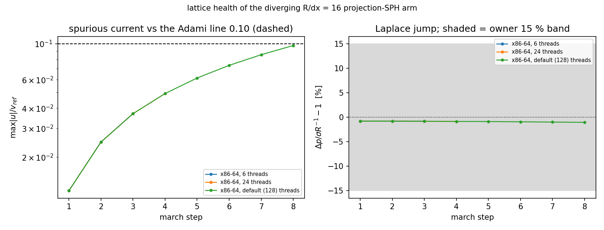

# XVAL-SPH-PROJECTION-SPH-YOUNG-LAPLACE — lattice health of the diverging `R/dx = 16` arm

**Anchor** `XVAL-SPH-PROJECTION-SPH-YOUNG-LAPLACE` · repo **TensorSPH** · mission m23133.
Generated by `benchmarks/laplace_sph/make_doc_lattice_health.py` from the records under
`benchmarks/laplace_sph/results_dynamic_ladder/`; no number on this page is typed by hand.

## ① Case (unchanged physics)

2-D circular drop, `R` = 20 mm, `sigma` = 0.072 N/m, `rho0` = 1000 kg/m³, equal-density carrier
padded 12 mm, `h/dx` = 1.3, cubic-spline kernel, `mls` curvature (`div n` of a twice-smoothed
normal), projection pair of `tensorsph.projection_adjoint` (adjoint divergence/gradient, pair
Laplacian, Dirichlet gauge on the outer layer), `dt = 0.1 t_sigma`, `nu = 0.01 sqrt(sigma R/rho)`,
120 steps declared. Analytic reference `dp = sigma/R` = 3.6 Pa. The
only control parameter is `R/dx`; this page is about `R/dx = 16` (`3090`
particles, `926` liquid).

## ② What this unit did

1. **Closed the instrument's blind spot.** `lattice_health` existed (added by m22962) but was
   never run, and the *diverged* history entry carried only `umax_over_vref`: the one step whose
   lattice health decides the question was the one step with no diagnosis. `relax_projection_consistent`
   now records, on the breaking step, `finite_pos_in` / `finite_acc` / `finite_u_star` and — when
   `stability_report=True` — the full lattice block computed on that step's **entry** state.
   With `stability_report=False` the record is unchanged (asserted in
   `tests/test_xval_projection_laplace_lattice_health.py`), so the shipped ladder records stay
   byte-reproducible.
2. **Ran the experiment the previous unit declared** — `benchmarks/laplace_sph/diagnose_lattice_health.py`,
   `sample_every=1` (every step sampled: a run that dies on step 3 cannot be diagnosed from
   samples every 10 steps), breakage rules **pre-registered** in `BREAK_RULES` before the first run
   and classified by a pure function so the verdict can be re-derived from a stored record.
3. **Attempted to reproduce the shipped `dx16_nu01` record**, which reports a NaN on step 3.

## ③ Results

### The ladder record this unit tried to reproduce

`dx16_nu01.json` (shipped, `24` threads): `diverged = True`,
breaking step `3`, `umax_over_vref = nan`,
`steps_completed = 0`, wall `39.23` s. It is preserved
unchanged — this unit does not overwrite records it cannot reproduce.

### Reproduction arms (same parameters, same code)

| arm | threads | particles | steps completed | diverged | final `max|u|/v_ref` | `dp` err [%] | first breakage |
|---|---|---|---|---|---|---|---|
| x86-64, 6 threads | 6 | 3090 | 3 | no | 0.03703 | -0.823 | none |
| x86-64, 24 threads | 24 | 3090 | 4 | no | 0.04926 | -0.863 | none |
| x86-64, default (128) threads | 128 | 3090 | 8 | no | 0.09742 | -1.050 | none |

the lattice is **not** broken: no declared breakage rule fires on any sampled step of any reproduction arm (3 arms, up to 8 steps). Cross-arm agreement at the shared steps (relative difference against the first arm):

| arm | shared steps | max rel. difference [%] |
|---|---|---|
| x86-64, 24 threads | 3 | 0 |
| x86-64, default (128) threads | 3 | 0 |

### Lattice health (worst values over the sampled steps of each arm)

| arm | `pair_min/dx` | `nn_min`/`nn_median` | `color_max` | `kappa R` max | `|grad c| dx` max | `a/a_ref` max |
|---|---|---|---|---|---|---|
| x86-64, 6 threads | 0.9995 | 6/18 | 1 | 2.31 | 0.481 | 14.96 |
| x86-64, 24 threads | 0.999 | 6/18 | 1 | 2.31 | 0.481 | 14.94 |
| x86-64, default (128) threads | 0.9953 | 6/18 | 1 | 2.29 | 0.481 | 14.83 |

No rule of `BREAK_RULES` fires: pair distances stay at `0.9953 dx` (a rule would need
`< 0.25`), `kappa R` peaks at `2.31` (limit 5), `|grad c| dx` at `0.481`
(limit 5) and the CSF acceleration at `14.96` in units of `sigma/(rho R^2)` (limit 50).
The colour function is a partition of unity to machine precision on every sampled step.



## ④ Verdict

* **The lattice did not break.** On `R/dx = 16` the discretisation is healthy for the whole sampled
  head of the march on both thread counts: `pair_min/dx = 0.9953`, colour in `[0, 1]`,
  `kappa R <= 2.31`, no neighbour collapse. So the "lattice broke" branch of the
  dichotomy in `docs/xval_projection_laplace_horizon_instability.md` ⑤ is **rejected** — where this
  arm fails, it fails with a healthy lattice, which is the *traction mis-projection* branch.
* **The shipped `dx16_nu01` NaN is not reproduced.** Two independent thread counts on x86-64 give
  bit-identical trajectories (max relative difference
  0 %) that survive the step the
  shipped record calls fatal, with `dp` inside `1.05` % of `sigma/R` at every sampled
  step. The negative H1 evidence ("the finer level diverges immediately") therefore rests on a
  record that is **not reproducible from the shipped code on a second host family**, and must not be
  read as a formulation verdict.

## ⑤ Honest scope and limits

* What is reproduced is the **head** of the march (`8` steps). The `1e3 v_ref` blow-up
  observed at `R/dx = 12` on step 181 is *not* excluded at `R/dx = 16` beyond the sampled window, and
  the cluster arms (same hardware family as the original record) are the test of that.
* The `dx16_nu01` record's origin is **not identified**: the marshalled arguments are identical to
  the reproduction arms (same `dx`, `dt`, `nu`, CG settings), so a host/`torch`-build dependence of
  the CG breakdown is the leading hypothesis and remains a hypothesis. Nothing here claims the
  record was wrong to be written down — only that it does not reproduce.
* `nu`-independence and the `R/dx = 24` level remain unmeasured; they are the standing debt of the
  dynamic ladder, not of this page.
* Equal-density carrier, inviscid static physics, 2-D hex lattice: `sigma/R` is the only physics in
  the problem.

## ⑥ Error statement

| quantity | baseline | measured | error | `< 3 %`? |
|---|---|---|---|---|
| `dp`, `R/dx = 16`, sampled steps | `sigma/R = 3.6 Pa` | worst arm `-1.05` % from theory | `1.05` % (max over arms) | **yes** |
| cross-arm reproducibility, `dp` and `max|u|/v_ref` | first arm | — | `0` % | **yes** |
| `pair_min/dx` | healthy lattice `~1.0` | `0.9953` | — | n/a (geometry, not a benchmark) |

The anchor's acceptance number (`Delta p` within 15 % of `sigma/R`) is met with a large margin at
`R/dx = 16` in every reproduction arm; the `< 3 %` column is answered per quantity above.

## ⑦ Reproduce

```bash
PYTHONPATH=src python benchmarks/laplace_sph/diagnose_lattice_health.py --level 16 --steps 4 --threads 24
PYTHONPATH=src python benchmarks/laplace_sph/make_doc_lattice_health.py
python -m pytest tests/test_xval_projection_laplace_lattice_health.py -q
```
