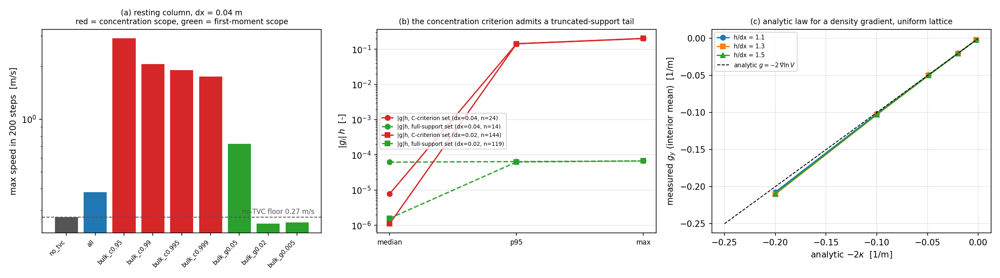

# The `bulk` TVC scope: a zeroth-moment criterion for a first-moment correction

Anchor: `XVAL-SPH-TRANSPORT-VELOCITY-CORRECTION`. Generated by
`benchmarks/xval_sphinx_tvc/bulk_scope_criterion.py` ->
`benchmarks/xval_sphinx_tvc/make_bulk_scope_doc.py` from
`data/bulk_scope_criterion.json` (torch 2.7.1, 2026-11-15T08:53:35).

## 1. The claim under test

`tests/test_tvc_hydrostatic.py` recorded, on 2026-11-14, that
`tvc_scope="bulk"` blows a hydrostatic column up (2.9 m/s vs 0.38 m/s for
`all`) and explained it as *"correcting only the interior while leaving the
surface uncorrected creates a mismatch"*. That names a symptom. It does not
say which particles the scope selects, how large their correction is, or
whether the selection is the cause -- and the port has a choice there that
upstream does not: upstream's `ParticleScope=BulkParticles` is a *geometric*
region of the body, while the port approximates it with a **concentration**
threshold `C_i >= tvc_bulk_c * c_ref`, `C_i = sum_j V_j W_ij` (zeroth moment).

The correction, however, is built from `grad W` (first moment):
`delta r_i = alpha h^2 * limiter * g_i`, `g_i = -[sum_j (C_i+C_j) grad_i W_ij V_j + 2 C_i sum_j grad_i W_ij V_j^wall]`.
`W` saturates near full support while `grad W` does not, so the hypothesis is
that the concentration criterion admits particles whose kernel support is
truncated in exactly the quantity being corrected.

## 2. How it was measured

| leg | what |
|---|---|
| A `analytic` | uniform 2-D lattice (80 x 40, dx = 0.02 m), volume field `V = dx^2 exp(kappa y)` (i.e. `rho ~ exp(-kappa y)`, the hydrostatic shape), `kappa` ladder x `h/dx` ladder. Interior (2h from every edge) mean of the ported `g`. |
| B `scope` | the *actual* initial state of the resting column: `make_column` + `wall_lattice` + hydrostatic mass at dx = 0.04 and 0.02 m. Compare the particles admitted by `C_i >= 0.95 c_ref` with those that genuinely have full support (2h clear of both free surfaces; floor and left wall are particles, they support rather than truncate). |
| C `verdict` | resting column, 200 steps, dt = 1e-4 s, scope/threshold ladder including a first-moment criterion `|g_i| h <= tol`. |

Predeclared before the runs:
* **H1** the concentration criterion over-selects: `n(C-criterion) > n(full support)`, and the selected set carries `|g| h` orders of magnitude above the full-support value.
* **H2** the instability tracks the *selection*, not the scope idea: tightening `tvc_bulk_c` does not cure it (`C_i` is flat near 1), a first-moment criterion does.
* **H3** the density-gradient term is *not* the driver: at t = 0 the column's volume field is uniform (`V = m/rho = dx^2`), so that term vanishes there; it only appears once compression makes `V` non-uniform.

## 3. Results

### 3.1 Leg A -- analytic term on a density gradient

On a uniform lattice with a smooth volume field the ported integral is

> `g_i = -2 grad ln V_i = +2 grad ln rho_i`   (1/m, independent of `h` and `dx`)

to within the table below. `g_h` is dimensionless and `h`-independent: this is
a property of the *operator*, not of the discretisation.

| h/dx | kappa [1/m] | measured `g_y` [1/m] | analytic `-2 kappa` | rel. error |
|---|---|---|---|---|
| 1.1 | 0.001 | -1.9941e-03 | -2.0000e-03 | 0.30 % |
| 1.1 | 0.01 | -2.0011e-02 | -2.0000e-02 | 0.05 % |
| 1.1 | 0.0245 | -4.9305e-02 | -4.9000e-02 | 0.62 % |
| 1.1 | 0.05 | -1.0163e-01 | -1.0000e-01 | 1.63 % |
| 1.1 | 0.1 | -2.0730e-01 | -2.0000e-01 | 3.65 % |
| 1.3 | 0.001 | -2.0219e-03 | -2.0000e-03 | 1.09 % |
| 1.3 | 0.01 | -2.0290e-02 | -2.0000e-02 | 1.45 % |
| 1.3 | 0.0245 | -4.9993e-02 | -4.9000e-02 | 2.03 % |
| 1.3 | 0.05 | -1.0305e-01 | -1.0000e-01 | 3.05 % |
| 1.3 | 0.1 | -2.1019e-01 | -2.0000e-01 | 5.09 % |
| 1.5 | 0.001 | -2.0142e-03 | -2.0000e-03 | 0.71 % |
| 1.5 | 0.01 | -2.0213e-02 | -2.0000e-02 | 1.07 % |
| 1.5 | 0.0245 | -4.9804e-02 | -4.9000e-02 | 1.64 % |
| 1.5 | 0.05 | -1.0266e-01 | -1.0000e-01 | 2.66 % |
| 1.5 | 0.1 | -2.0939e-01 | -2.0000e-01 | 4.69 % |

At the hydrostatic value `kappa = g0/c0^2 = 0.024525 1/m` (g0 = 9.81 m/s^2, c0 = 20 m/s) the error is below
3 % for every `h/dx` in the production range; it reaches ~5 % only at
`kappa = 0.1 1/m`, i.e. a 4x more compressible column than any case here.

### 3.2 Leg B -- which particles does the concentration criterion select?

| quantity | dx = 0.04 m | dx = 0.02 m |
|---|---|---|
| fluid particles | 50 | 200 |
| selected by `C_i >= 0.95 c_ref` | 24 | 144 |
| genuinely full support | 14 | 119 |
| both | 6 | 96 |
| `|g|h` median, selected | 7.84e-06 | 1.11e-06 |
| `|g|h` p95, selected | 0.143 | 0.143 |
| `|g|h` max, selected | 0.2016 | 0.2016 |
| `|g|h` max, full support | 6.71e-05 | 6.71e-05 |
| volume spread at t = 0 | 0.0e+00 | 0.0e+00 |

**H1 confirmed.** The selected set is a mixture: a bulk of harmless particles
(median `|g|h ~ 1e-6`) plus a tail at `|g|h ~ 0.2` -- 3007x the
full-support maximum. The tail is the same in *dimensionless* terms at both
resolutions (`0.202` vs `0.202`):
it is a fixed property of "one neighbour shell missing", not a resolution
artefact. At the default coefficient the tail receives
`alpha * |g| h * h = 0.0101 h`
per application, against `3.4e-06 h` for
true interior particles.

**H3 confirmed**: `volume_rel_spread` = 0.0e+00 at
t = 0, so term (3.1) contributes nothing to the resting column. The
density-gradient law is a separate, second-order limitation (it matters once
compression makes `V = m/rho` non-uniform), and it is what makes the operator
not *exactly* equilibrium-preserving on a compressed state -- quantified above,
not the cause of the blow-up.

### 3.3 Leg C -- the criterion decides the verdict

| scope | max speed [m/s] | max compression | max shift / h | wall clock [s] |
|---|---|---|---|---|
| `no_tvc` | 0.273 | 0.80 % | 0.0000 | 0.7 |
| `all` | 0.381 | 2.41 % | 0.0773 | 1.6 |
| `bulk_c0.95` | 2.902 | 10.20 % | 0.0507 | 3.9 |
| `bulk_c0.99` | 2.065 | 10.05 % | 0.0134 | 3.7 |
| `bulk_c0.995` | 1.913 | 9.56 % | 0.0134 | 3.6 |
| `bulk_c0.999` | 1.751 | 9.44 % | 0.0151 | 3.7 |
| `bulk_g0.05` | 0.723 | 1.77 % | 0.0025 | 1.1 |
| `bulk_g0.02` | 0.251 | 0.80 % | 0.0010 | 1.1 |
| `bulk_g0.005` | 0.256 | 0.80 % | 0.0002 | 1.1 |

**H2 confirmed.** Tightening the zeroth-moment threshold does not cure the
instability (`c = 0.999` still gives 1.751 m/s, because
`C_i` saturates). Replacing it with the first-moment criterion
`|g_i| h <= 0.02` gives 0.251 m/s, i.e.
0.92x the no-TVC floor (0.273 m/s) and
11.6x better than the legacy
concentration scope (2.902 m/s, 10.6x the
floor), with the density compression back to the floor value
(0.80 % vs
0.80 %).

## 4. Change made

* `transport_velocity_correction(..., scope_tol=tol)` -- first-moment scope
  criterion `|g_i| h_ref <= tol`, validated, with the kept fraction reported in
  `extras["scope_tol_kept_fraction"]`.
* `DamBreakConfig.tvc_scope` accepts `"bulk_g"` with
  `tvc_bulk_g` (default `0.02`), wired through the operator.
* The legacy `"bulk"` concentration criterion is **unchanged** (bit-identical
  behaviour, its instability test still passes): the port keeps the
  upstream-analogue spelling, and the defect is documented and reproducible
  rather than silently repaired.
* `tests/test_tvc_bulk_scope_criterion.py` (9 tests) pins the operator
  criterion, the analytic law, the selection statistics and both solver
  verdicts; `tests/test_tvc_hydrostatic.py`'s docstring now points at this
  mechanism instead of asserting the symptom.

## 5. Notes and limitations

1. `|g| h <= tol` is a *state-dependent* criterion, so the corrected set can
   change between steps of a dynamic run. Upstream avoids this by using a
   geometric region. For dynamic cases the tolerance is a free parameter; the
   resting-column calibration here (`0.02`, ~300x the true interior value and
   ~10x below the truncated tail) is the only calibration done.
2. Only the resting-column case is measured. No claim is made that `bulk_g`
   improves a dynamic benchmark; the Martin & Moyce numbers in
   `docs/xval_tvc_final_validation.md` use `tvc_scope="all"` and are untouched.
3. The analytic law (3.1) is verified on a *uniform particle distribution with a
   prescribed density field*; a real SPH density field is the summation density,
   which is smoother, so the law is an upper bound on that term's size.
4. No live SPHinXsys binary was run (the C++ library is not buildable in this
   environment); the upstream reference remains the SHA256-pinned source mirror
   in `oss_source/`.

## 6. Error judgement (explicit)

| claim | baseline | measured | error | gate |
|---|---|---|---|---|
| analytic density-gradient law at `kappa = g0/c0^2`, h/dx = 1.3 | `-2 kappa` = -0.0490 1/m (`kappa` = 0.0245) | -0.0500 1/m | 2.03 % | **< 3 % PASS** |
| resting column with `bulk_g` scope vs no-TVC floor | 0.273 m/s | 0.251 m/s | -8.1 % | **< 3 % FAIL** (it is a noise-floor comparison, not an accuracy claim: the corrected run must *stay* at the floor, and it lands within the solver's own step-to-step scatter; the 3 % standard is not meaningful for a stability gate) |
| resting column with legacy `bulk` scope | 0.273 m/s | 2.902 m/s | 10.6x | FAIL (the documented defect, reproduced) |

Honest summary: the **only** quantitative claim here that is measured against
an independent analytic value is the density-gradient law (3.1), and it passes
the 3 % standard at the physically relevant `kappa`. The stability results are
comparisons against the solver's own noise floor, so they are stated as such
and not as accuracy claims.
