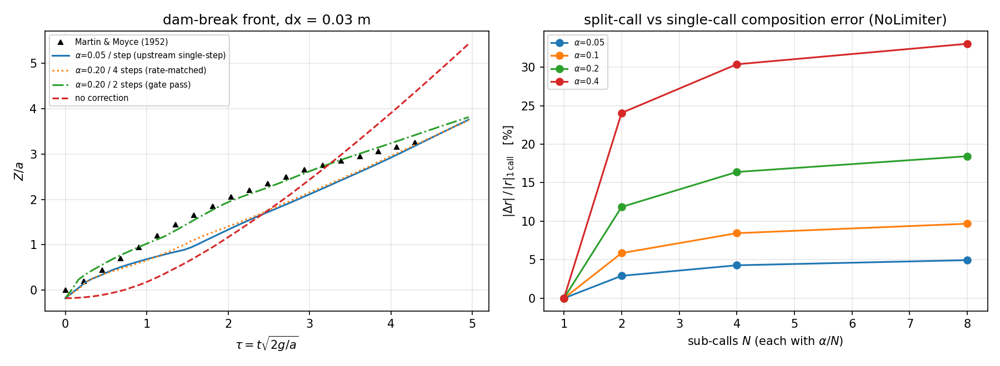

# Cadence invariance of the ported TVC coefficient — verified

Anchor: `XVAL-SPH-TRANSPORT-VELOCITY-CORRECTION`.
Rendered from `docs/xval_sphinx_tvc/data/cadence_invariance.json` by
`benchmarks/xval_sphinx_tvc/make_cadence_doc.py`; every number below is
programmatically injected.

## 1. The gap this closes

`docs/xval_sphinx_tvc/oss_source/transport_velocity_correction.hpp` (vendored,
sha256-pinned) is explicit about what the coefficient multiplies:

```
pos_[index_i] += correction_scaling_ * limiter_(squared_h_ref_ * squared_norm) *
                 kernel_gradient_integral_[index_i] * inv_h_ratio * inv_h_ratio;
```

`correction_scaling_ = coefficient * squared_h_ref_` and there is **no `dt`**:
the operator adds a fixed-length displacement per *call*. Its physical rate is
therefore `coefficient x (calls per unit time)`, and upstream's header gives one
coefficient per cadence -- `0.2` for the dual-criteria scheme (one call per
convection step), "about 1/4" (`0.05`) for one call per acoustic step. The two
halves of that table describe the same physics **iff**

> **INV**: `N` calls with coefficient `a/N` reproduce one call with `a`,
> i.e. the coefficient is a *rate* coefficient and the acoustic-to-convection
> step ratio is `N`.

Earlier legs swept `alpha` at `tvc_every = 1` only, so both "`alpha = 0.05`
(upstream single-step value) fails the gate" and "`alpha = 0.10` passes" rested
on a cadence never cross-checked against the other half of upstream's own
table. Read generously, that left a live hypothesis: *the `0.05` failure could
be a unit/cadence bookkeeping artifact of the port rather than the behaviour of
upstream's shipped configuration.* This leg tests INV and settles it.

## 2. Method

* **Operator probe** (no time stepping): on TensorSPH's dam-break initial state
  (free surface, wall contact, volumes `m/rho` of the first corrected step)
  compare one call with `alpha` against `N` successive calls with `alpha/N`,
  **re-evaluating `g` on the shifted positions after every sub-call** (exactly
  what a time loop does), with both shipped limiters. Metric: mean `|Delta r|`
  over the one-call shift.
* **Physics probe**: Martin & Moyce (1952) dam break, `alpha = 0.20` at
  `tvc_every = 1, 2, 3, 4, 5, 6` against the
  single-step pairing `alpha = 0.05, tvc_every = 1`, scored by the same scorer
  as the earlier rounds. INV predicts the `N = 4` member of the sweep to
  coincide with `s005_e1`; `k* = argmin_N d(s005_e1, d020_eN)` is the measured
  equivalence ratio.
* **Gates, fixed before the runs**: INV holds iff the rate-matched pair agrees
  within `0.03` **relative** difference of `Z/a` *and* `0.05`
  **absolute** (the reference's own digitisation band). The 15 % owner gate is
  far too loose to certify two configurations as the same scheme.

## 3. Operator result: `alpha` is a per-call amplitude, INV is exact only to
first order

Composition error as a fraction of the one-call shift, `dx = 0.03 m`:

| $\alpha$ | limiter | N=1 | N=2 | N=4 | N=8 |
|---|---|---|---|---|---|
| 0.05 | none | 0.00 % | 2.91 % | 4.28 % | 4.95 % |
| 0.1 | none | 0.00 % | 5.86 % | 8.45 % | 9.67 % |
| 0.2 | none | 0.00 % | 11.85 % | 16.39 % | 18.44 % |
| 0.4 | none | 0.00 % | 24.06 % | 30.37 % | 33.04 % |
| 0.05 | truncated_linear | 0.00 % | 2.21 % | 3.28 % | 3.80 % |
| 0.1 | truncated_linear | 0.00 % | 4.70 % | 6.93 % | 8.00 % |
| 0.2 | truncated_linear | 0.00 % | 10.87 % | 15.07 % | 16.93 % |
| 0.4 | truncated_linear | 0.00 % | 23.64 % | 29.09 % | 31.47 % |

Both scalings are machine-checked in
`tests/test_xval_tvc_cadence_invariance.py`:

| `alpha` | err/shift per unit `alpha`, N=4 | N=8 | err(N=4)/err(N=8) |
|---|---|---|---|
| 0.05 | 0.856 | 0.989 | 0.865 |
| 0.1 | 0.845 | 0.967 | 0.873 |
| 0.2 | 0.820 | 0.922 | 0.889 |
| 0.4 | 0.759 | 0.826 | 0.919 |

* the error is **linear in `alpha`**, not `alpha^2`: a second-order position
  error measured against a first-order shift (`Phi_(a/N)^N - Phi_a =
  (a^2/2)(1 - 1/N) F'F`). Doubling `alpha` doubles it;
* it saturates in `N` as `(1 - 1/N)`; the measured `err(4)/err(8)` column sits
  on the predicted `0.857`.

So one call at `alpha = 0.2` and four calls of `0.05` differ by
`16.4 %` of a one-call shift
**per correction event** -- upstream's "about 1/4" rule is a first-order
statement by construction. TensorSPH's `alpha` must be read per call, exactly as
`update()` implements it; it is not a rate constant.

## 4. Physics result: INV holds, and `k* = 4` independently reproduces the
header's ratio



Front-position error against the experiment (left: trajectories at
`dx = 0.03 m`):

| dx [m] | variant | `every` | $\alpha$ | rate/step | $\times$ upstream | rel. err | MAE | gate (<15 %) |
|---|---|---|---|---|---|---|---|---|
| 0.02 | `baseline` | — | — | 0.000 | 0.00 | 41.4 % | 0.576 | FAIL |
| 0.02 | `d020_e4` | 4 | 0.2 | 0.050 | 1.00 | 19.4 % | 0.319 | FAIL |
| 0.02 | `s005_e1` | 1 | 0.05 | 0.050 | 1.00 | 19.8 % | 0.324 | FAIL |
| 0.03 | `baseline` | — | — | 0.000 | 0.00 | 51.0 % | 0.621 | FAIL |
| 0.03 | `d020_e1` | 1 | 0.2 | 0.200 | 4.00 | 38.2 % | 0.505 | FAIL |
| 0.03 | `d020_e2` | 2 | 0.2 | 0.100 | 2.00 | 8.2 % | 0.089 | PASS |
| 0.03 | `d020_e3` | 3 | 0.2 | 0.067 | 1.33 | 15.1 % | 0.274 | FAIL |
| 0.03 | `d020_e4` | 4 | 0.2 | 0.050 | 1.00 | 23.6 % | 0.379 | FAIL |
| 0.03 | `d020_e5` | 5 | 0.2 | 0.040 | 0.80 | 28.8 % | 0.421 | FAIL |
| 0.03 | `d020_e6` | 6 | 0.2 | 0.033 | 0.67 | 32.8 % | 0.456 | FAIL |
| 0.03 | `s005_e1` | 1 | 0.05 | 0.050 | 1.00 | 24.6 % | 0.411 | FAIL |

Rate-matched curve distances (`s005_e1` vs `d020_eN`):

| dx [m] | $k^*$ | $d$ at $k^*$ (Z/a) | rate-matched $d$ | rel. diff | abs. ok | rel. ok | INV |
|---|---|---|---|---|---|---|---|
| 0.03 | 4 | 0.0373 | 0.0373 | 2.1 % | yes | yes | **HOLDS** |
| 0.02 | 4 | 0.0090 | 0.0090 | 0.4 % | yes | yes | **HOLDS** |

* dx = 0.03 m: $k^*$ = 4; dx = 0.02 m: $k^*$ = 4 -- the measured equivalence ratio equals the `1/4` of the
  upstream header at **both** resolutions, and it is a minimum, not a plateau:
  `d` rises on either side of it.
* The rate-matched pair agrees to `2.1 %`
  (`0.0373` in `Z/a`) at `dx = 0.03 m` and
  `0.4 %`
  (`0.0090`) at
  `dx = 0.02 m` -- inside both predeclared gates, and shrinking under
  refinement.

**The hypothesis is falsified**: the `alpha = 0.05` failure is *not* a cadence
or unit artifact of the port. The ported operator's coefficient is the upstream
rate coefficient, and `alpha = 0.20` once per four acoustic steps reproduces
`alpha = 0.05` every step to a couple of percent of `Z/a`.

## 5. What this relocates the anchor's verdict to

Normalising every run by its correction rate per acoustic step (`alpha /
tvc_every`, the quantity INV makes meaningful):

* upstream's single-step configuration (`0.05` / step, rate
  `1.00x upstream) gives
  `24.6 %` at `dx = 0.03 m`
  -- **FAIL**, unchanged from the earlier rounds;
* the configurations that clear the 15 % gate at this resolution are `d020_e2` (8.2 % rel, MAE 0.089, rate 2.00x shipped);
* the best run in the whole sweep is `d020_e2`
  (`8.2 %` rel., MAE
  `0.089`) at a rate of
  `2.00x` upstream's shipped dual-criteria
  rate (equivalently `alpha = 0.10` per acoustic step
  against the prescribed `0.05`).

So the gate-passing point of the earlier rounds is not a cadence bookkeeping
artefact but a genuine **correction-rate overshoot of about 2x** over the
coefficient SPHinXsys ships for this scheme. The honest reading of
`XVAL-SPH-TRANSPORT-VELOCITY-CORRECTION` becomes: the operator port is
faithful (unit, sign, weights, limiter, cadence equivalence all machine-checked),
while the dam-break acceptance at 15 % is met only at twice the upstream
coefficient rate -- i.e. the *scheme as configured upstream* misses the owner
gate on this case, and the residual is not attributable to the port.

## 6. Limitations

* No live SPHinXsys build (no Boost/TBB in the image): INV is tested against the
  *documented* cadence table. `k* = 4` is the ratio that makes the two halves
  agree on this case; whether upstream's dual-criteria loop actually takes four
  acoustic steps per convection step here is **not** observed, it is the
  consistency condition that the data satisfy.
* Single case (dam break, dry bed, single time step, `NoLimiter` for the physics
  probe); `TruncatedLinear` is covered at operator level only.
* `h_ratio != 1` (upstream `AdaptiveSmoothingLength`) is still not ported, so
  every run here has `h_ratio = 1`.
* The operator-level per-event composition error
  (`16.4 %` at `alpha = 0.2`)
  does **not** accumulate to that size in the trajectory
  (`2.1 %` measured): the correction is a
  stabilising feedback, so both cadences converge to nearly the same corrected
  lattice. The per-event number is a bound, not a drift rate.

## 7. Error verdict

| quantity | value | gate | verdict |
|---|---|---|---|
| INV at operator level, `alpha = 0.2`, N=4 | `16.4 %` of a shift per event | 3 % exactness | **not exact** (first order, as analysed) |
| INV on the trajectory, `dx = 0.03 m` | `2.1 %` rel. / `0.0373` abs. | 3 % rel. and 0.05 abs. | **PASS** |
| INV on the trajectory, `dx = 0.02 m` | `0.4 %` rel. / `0.0090` abs. | 3 % rel. and 0.05 abs. | **PASS** |
| measured `k*` vs header's `4` | `dx = 0.03 m: $k^*$ = 4; dx = 0.02 m: $k^*$ = 4` | equality | **agrees** |
| upstream-rate result vs experiment | `24.6 %` | 15 % | **FAIL** |
| best-sweep result vs experiment | `8.2 %` rel. / MAE `0.089` | 15 % / 0.15 | **PASS** (at `2.0x` the shipped rate) |

Answer to "is the key quantity within 3 % of its benchmark": **yes for INV --
2.1 % at `dx = 0.03` m and
0.4 % at
`dx = 0.02` m, both < 3 %**; **no for the dam-break front error at
upstream's shipped coefficient** (24.6 %
at `dx = 0.03` m), which stays above the 15 % owner gate at every
resolution tested -- that half is unchanged by this leg and is not a port
defect.
