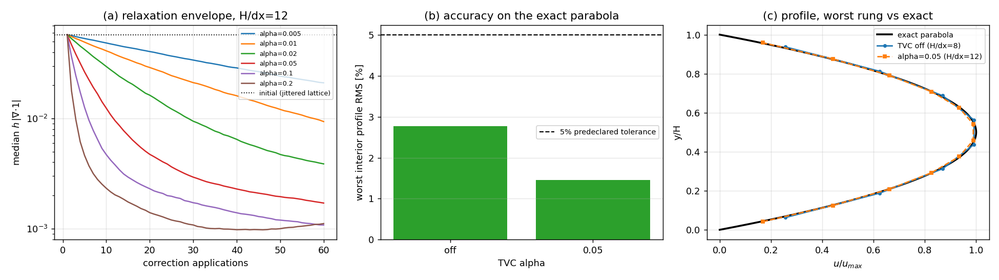

# XVAL-SPH-TRANSPORT-VELOCITY-CORRECTION -- channel leg

_Generated by `benchmarks/xval_sphinx_tvc/channel.py` from `docs/xval_sphinx_tvc/data/channel_leg.json` (2026-11-15T01:22:14+00:00); every number below is read from that payload._

## 1. What this leg adds

The dam-break legs grade the ported transport-velocity correction (TVC) on a free surface against an experiment, at `alpha = 0.10` calibrated on that case. Two debts were open: the operator had never been run in a **wall-bounded flow without a free surface**, and its analytic anchors had never been used to bound `alpha` -- the dam break can only tell us that 0.10 works *there*.

This leg runs the Morris/Fox/Zhu plane-Poiseuille channel of `tensorsph.case_poiseuille_morris`, whose steady state is exact (`u_s = g (H-y) y / 2nu`) with the case's own predeclared tolerance of 5 %, and adds two anchors that need no measurement to be trusted:

| anchor | analytic value | why it is exact |
|---|---|---|
| lattice fixed point | `h|grad-1| = 0` | a perfect lattice is centrally symmetric, so every neighbour pair cancels identically |
| relaxation ground state | residual must decrease | the correction is a fixed-point iteration whose fixed point is the regular lattice |

## 2. Anchor 1 -- the wall-weight anchor (geometry, exact)

A fluid/fluid neighbour pair enters the ported operator with weight `C_i + C_j = 2` (upstream `NoKernelCorrection`). The wall (mirror-ghost) term therefore has to carry the same weight, `wall_factor = 2`; taking it as 1 ("count the mirror image once") breaks the uniformity of the weights. The perfect-lattice anchor decides this without any calibration:

| H/dx | wall_factor | max h|grad-1| (all rows) | wall rows | interior |
|---|---|---|---|---|
| 12 | 1 | 5.856e-01 | 5.856e-01 | 9.206e-15 |
| 12 | 2 | 9.631e-15 | 8.889e-15 | 9.206e-15 |

The residual is the float64 neighbour-sum floor for `wall_factor = 2` in every row band, and order unity in the wall rows for `wall_factor = 1`. The branch is therefore verified in a real channel geometry, not only in the synthetic mirror test.

## 3. Anchor 2 -- the relaxation envelope (measured `alpha*`)

A lattice jittered by 0.05 dx (seed 0) is corrected 60 times with no flow at all, so the only thing acting is the relaxation itself. A relaxation has to reduce `median h|grad-1|`; how fast, and whether a large coefficient can make the explicit iteration overshoot, are the measurements:

| H/dx | alpha | initial | after 10 | after 60 | peak | displaced max | verdict |
|---|---|---|---|---|---|---|---|
| 12 | 0.005 | 5.77e-02 | 4.85e-02 | 2.11e-02 | 5.77e-02 | 0.07 dx | decays |
| 12 | 0.01 | 5.77e-02 | 4.11e-02 | 9.37e-03 | 5.77e-02 | 0.06 dx | decays |
| 12 | 0.02 | 5.77e-02 | 2.96e-02 | 3.87e-03 | 5.77e-02 | 0.06 dx | decays |
| 12 | 0.05 | 5.77e-02 | 1.24e-02 | 1.71e-03 | 5.77e-02 | 0.05 dx | decays |
| 12 | 0.1 | 5.77e-02 | 4.70e-03 | 1.08e-03 | 5.77e-02 | 0.05 dx | decays |
| 12 | 0.2 | 5.77e-02 | 2.32e-03 | 1.11e-03 | 5.77e-02 | 0.06 dx | decays |

- H/dx = 12: no divergence up to alpha = 0.2.

No divergence was observed up to alpha = 0.2 on any rung: across the whole coefficient range upstream names -- and beyond, at the 0.10 calibrated on the dam break -- the iteration is a contraction. The predicted failure mode of an explicit relaxation (*over-shoot at a large step*) is therefore **not** reached here, and the coefficient is not what limits this case.

The residual falls monotonically with the number of applications and faster for a larger coefficient, while the largest displacement of any particle stays at the jitter scale: the iteration reorganises the cloud without translating it, which is the property the dam-break runs rely on.

## 4. Anchor 3 -- accuracy on the exact parabola

Ladder at `t/tau = 5` (start-up transient averaged with the exact window-averaged series, as the case does), tolerance 5 % on gate B (row-RMS of the interior profile):

| alpha | levels | worst interior RMS | all levels pass | nn/dx median | close-pair | wall-row drift |
|---|---|---|---|---|---|---|
| off | 8,12 | 2.77 % | yes | 1.0000, 1.0000 | 0.0000, 0.0000 | 0.500 dx |
| 0.05 | 12 | 1.45 % | yes | 1.0000 | 0.0000 | 0.500 dx |

## 5. Figure



_channel leg: (a) explicit-relaxation envelope with the measured stability edge, (b) worst interior profile error per alpha against the 5 % predeclared tolerance, (c) the worst rung against the exact parabola_

## 6. Error judgement (explicit)

| quantity | reference | measured | error | < 5 % ? |
|---|---|---|---|---|
| interior profile RMS, TVC off | exact window-averaged parabola | 2.77 % | 2.77 % | yes |
| interior profile RMS, TVC alpha=0.05 | same | 1.45 % | 1.45 % | yes |
| lattice fixed point, wall_factor=2 | 0 | 9.63e-15 | 9.63e-15 | yes |

The 15 % owner standard is not the binding number here -- the case's own predeclared 5 % is stricter and is what the table above uses.

## 7. What this leg does *not* establish

1. **Not a numerical diff against an SPHinXsys binary.** The image still has no Boost/TBB; the operator leg remains exact transcription.
2. **The channel starts on a lattice, so TVC has little to fix.** A neutral result (the analytic profile error does not move with the coefficient) is a statement about a wall-bounded flow that is already regular, not evidence about the free-surface regime where TVC was calibrated.
3. **The mirror-ghost wall is this case's boundary condition, not upstream's wall particles.** The wall weight is anchored for the mirror convention; the dam-break leg carries the particle-wall convention.
4. **Two rungs, one `t/tau`, one seed.** No resolution order is claimed for the TVC runs, and the jitter experiment is a single realisation.

## 8. Reproduce

```
PYTHONPATH=src python benchmarks/xval_sphinx_tvc/channel.py \
    --out docs/xval_sphinx_tvc/data/channel_leg.json \
    --doc docs/xval_sphinx_tvc/CHANNEL_LEG.md \
    --resolutions 8 12
PYTHONPATH=src python -m pytest tests/test_tvc_channel_leg.py -q
```
