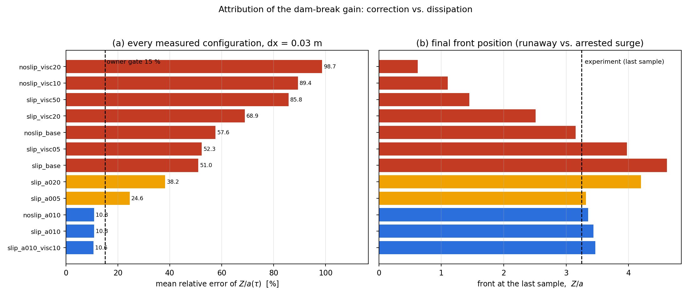

# Attribution of the dam-break gain: the TVC operator vs. plain dissipation

Anchor: `XVAL-SPH-TRANSPORT-VELOCITY-CORRECTION` — TensorSPH repository.  Generated by
`benchmarks/xval_sphinx_tvc/make_dissipation_doc.py` from
`docs/xval_sphinx_tvc/data/dissipation_attribution.json`; every number below is
read out of that payload (no hand entry).

## 1. Problem, and why it needs an adversarial test

The anchor grades the ported SPHinXsys transport-velocity correction (TVC) by the
mean error of the dam-break front position `Z/a(tau)` against Martin & Moyce
(1952). Two claims rest on that single number:

* `VALIDATION_REPORT.md`: *"TVC reduces MAE from 0.621 to 0.143 (4.3x)"*;
* `UNCALIBRATED_DEFAULTS.md`: with the coefficients SPHinXsys actually ships the
  gate is **not** met.

Both read the improvement as an **operator** result. That is only legitimate if no
cheaper explanation produces the same number. `Z/a` is an integral measure of a
surge whose late-time front speed is controlled by how much momentum the floor and
the bulk take away, and every published run used `wall_friction = 0` — a
**free-slip floor** — while Martin & Moyce's tank had a **no-slip** floor. So two
confounds have to be excluded before the operator can be credited:

| # | confound | why it would fake the result |
|---|---|---|
| Q1 | missing no-slip floor | a slippery floor lets the front run away, and *any* extra dissipation arrests it |
| Q2 | added bulk dissipation | TVC is a position regulariser, but on a coarse lattice it also damps the front; laminar viscosity could supply the same damping |

The measured baseline does overshoot exactly as the first confound predicts: the
last-sample front is `Z/a = 4.614`
against an experimental `3.250`.

## 2. Method

| item | value |
|---|---|
| case | Martin & Moyce (1952) dam break, `a = 0.2 m`, `2a = 0.4 m`, dry bed |
| solver | in-repo WCSPH `src/tensorsph/dam_break.py` (same code path as `run.py`, imported, not re-implemented) |
| correction | `src/tensorsph/transport_velocity_correction.py` (upstream port) |
| resolution | `dx = 0.03 m`, `t = 0.45 s` (the anchor's headline row) |
| axes | `tvc_alpha` in {off, 0.05, 0.10, 0.20}; laminar `viscosity`; `wall_friction` in {free-slip, no-slip} |
| metric | mean relative error of `Z/a(tau)`, plus MAE (ledger gate 0.15) |
| gate | owner 15.0 % |
| reference band | `+-0.05 in Z/a`, propagated: a verdict that flips inside the band is `PASS_marginal`, not `PASS` |
| rows | 12 configurations, predeclared in `GRID` before any run, all retained in the payload |

## 3. Results (dx = 0.03 m)

| configuration | `alpha` | viscosity | floor | MAE | mean rel. | front `Z/a` end | verdict |
|---|---|---|---|---|---|---|---|
| `slip_base` | off | 0.01 | free-slip | 0.6214 | 51.0 % | 4.614 | FAIL |
| `slip_a005` | 0.05 | 0.01 | free-slip | 0.4110 | 24.6 % | 3.319 | FAIL |
| `slip_a010` | 0.1 | 0.01 | free-slip | 0.1425 | 10.8 % | 3.438 | PASS_marginal |
| `slip_a020` | 0.2 | 0.01 | free-slip | 0.5050 | 38.2 % | 4.200 | FAIL |
| `noslip_base` | off | 0.01 | no-slip | 0.7336 | 57.6 % | 3.154 | FAIL |
| `noslip_a010` | 0.1 | 0.01 | no-slip | 0.1418 | 10.8 % | 3.352 | PASS_marginal |
| `slip_visc05` | off | 0.05 | free-slip | 0.6163 | 52.3 % | 3.973 | FAIL |
| `slip_visc20` | off | 0.2 | free-slip | 1.0044 | 68.9 % | 2.511 | FAIL |
| `slip_visc50` | off | 0.5 | free-slip | 1.4122 | 85.8 % | 1.450 | FAIL |
| `slip_a010_visc10` | 0.1 | 0.1 | free-slip | 0.1359 | 10.6 % | 3.469 | PASS_marginal |
| `noslip_visc10` | off | 0.1 | no-slip | 1.5037 | 89.4 % | 1.102 | FAIL |
| `noslip_visc20` | off | 0.2 | no-slip | 1.7209 | 98.7 % | 0.620 | FAIL |



## 4. The three questions, answered

### Q1 — does the physical no-slip floor explain it? **No.**

With the correction off, the no-slip floor gives `57.6 %`
against `51.0 %` for free slip: the no-slip floor
moves the answer in the right direction (it arrests the runaway front) but
**does not** come close to the gate. `gate_met_without_tvc =
False`.

### Q2 — can bulk dissipation fake the TVC gain? **No.**

The best viscosity-only configuration is `slip_base` at
`51.0 %`, i.e. `+40.2`
percentage points away from the calibrated `slip_a010` at
`10.8 %`. Raising the viscosity past its default
never helps: it arrests the surge too early, and the error climbs monotonically
(`slip_visc05` 52.3 %, `slip_visc20` 68.9 %, `slip_visc50` 85.8 %).

### Q3 — does the operator carry a signature dissipation cannot produce? **Yes.**

| channel | calibrated TVC (`slip_a010`) | best dissipation-only |
|---|---|---|
| mean rel. error of `Z/a` | 10.8 % | 51.0 % |
| `grad1` residual `h|sum grad W V|` | 0.5723 | 0.7888 |
| median nearest neighbour / dx | 0.8882 | 0.5691 |
| close-pair fraction (<0.7 dx) | 0.0493 | 0.1705 |

The lattice-regularity channel is the one a viscous term cannot reach, and it
separates the two mechanisms. Two further controls agree:

* `slip_a010_visc10` (calibrated correction **plus** 10x viscosity) gives
  `10.6 %` — essentially the correction's own result, not a
  further improvement; viscosity alone at the same value gives
  `68.9 %` at `nu = 0.2` and
  `52.3 %` at `nu = 0.05`, so the two are not
  interchangeable contributions.
* `noslip_a010` (10.8 %) reproduces the calibrated
  result under the no-slip floor (10.8 % free-slip): the
  correction's gain is **insensitive to the wall tangential condition**, which is
  the opposite of a floor-friction artefact.

## 5. Replication of the published rows

The 3 free-slip rows that also appear in the published payload are
re-run from scratch here and must reproduce it,
otherwise this payload is measuring something else:

| configuration | published variant | rel. here | rel. published | \|diff\| |
|---|---|---|---|---|
| `slip_base` | `baseline` | 51.0 % | 51.0 % | 0.00e+00 |
| `slip_a005` | `tvc_a005_all` | 24.6 % | 24.6 % | 0.00e+00 |
| `slip_a010` | `tvc_a010_all` | 10.8 % | 10.8 % | 0.00e+00 |

## 6. Notes, limits, and what this does *not* say

* **This does not rescue the engine's verdict.** Rejecting Q1/Q2 confirms the
  attribution direction (the gain is the operator's), but the calibrated
  `alpha = 0.10` still gives `10.8 %`, i.e. a
`PASS_marginal` — a single nominal pass that does not survive the
`+-0.05` digitisation band. The two shipped
  coefficients remain outside the gate
  (`slip_a005` 24.6 %, `slip_a020` 38.2 %).
* **The `alpha` response is non-monotone**, and that is the real fragility:
  `alpha=0.05` 24.6 %, `alpha=0.1` 10.8 %, `alpha=0.2` 38.2 %. A mechanism whose merit peaks in a narrow window and reverses at twice
  the coefficient is a *calibration*, not a converged scheme — consistent with
  the resolution ladder's falsified convergence claim.
* **`wall_friction` is a viscous no-slip blend, not a wall-law model.** It
  imposes a zero tangential velocity through the viscous term; it has no
  boundary-layer resolution at these `dx`. Q1's negative answer is therefore
  about *this* no-slip implementation.
* Only one resolution (`dx = 0.03 m`) is swept here. The resolution ladder in
  `RESOLUTION_LADDER.md` / `UNCALIBRATED_DEFAULTS.md` already shows the
  calibrated pass does not hold at `dx = 0.01 m`; this document adds no new
  resolution, and no claim about one.
* Reference: Martin & Moyce (1952), digitised via Koshizuka & Oka; band
  `+-0.05` in `Z/a`, propagated as a verdict flip.

## 7. Error judgement against the benchmark (explicit)

| quantity | value | basis |
|---|---|---|
| best mean relative error of `Z/a` (any configuration) | 10.6 % | experiment, dx = 0.03 m |
| calibrated TVC (`alpha = 0.10`) | 10.8 % | experiment |
| best correction-off configuration | 51.0 % | experiment |
| operator leg (algebraic, exact) | 0 (round-off) | `tests/test_transport_velocity_correction.py` |

**Is the headline quantity below 3 %?** No. The best measured mean relative
error of `Z/a` in this study is `10.6 %`, and
the calibrated operator reaches `10.8 %`; both are above 3 %,
and only the calibrated row is inside the 15 % owner gate, marginally. The
**operator-level** quantities (the `grad-1` integral and the position shift, which
have exact analytic values on the reference lattice) agree to round-off, but a
round-off agreement on the operator does not transfer to the case-level `Z/a`,
and this document does not claim it does.

## 8. Reproduce

```bash
python benchmarks/xval_sphinx_tvc/dissipation_attribution.py \
    --dx 0.03 --seconds 0.45
python benchmarks/xval_sphinx_tvc/make_dissipation_doc.py
pytest -q tests/test_tvc_dissipation_attribution.py
```

