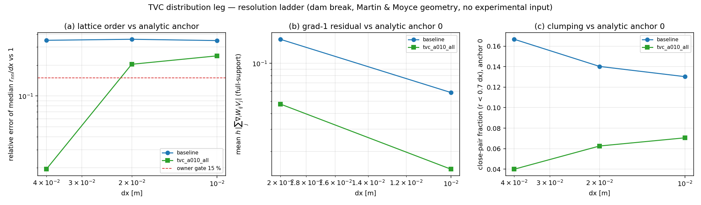

# XVAL-SPH-TRANSPORT-VELOCITY-CORRECTION - distribution leg

_Generated by `benchmarks/xval_sphinx_tvc/make_distribution_doc.py` from `docs/xval_sphinx_tvc/data/distribution_ladder.json`; every number below is read from that payload._

## 1. What this leg is

Rounds 1-3 graded the ported transport-velocity correction (TVC) on the Martin & Moyce dam-break **front position** and left two debts: the bulk metrics were never made into a ladder, and the verdict rested on one case and one metric (`RESOLUTION_LADDER.md` 7.2). This leg removes the experiment from the loop and scores the particle set against the exact analytic anchor of a perfect square lattice (`benchmarks/xval_sphinx_tvc/distribution.py`).

| metric | analytic anchor | why the anchor is exact |
|---|---|---|
| `nn_median_over_dx` | 1 | a lattice puts every neighbour at exactly dx |
| `nn_cv` | 0 | all nearest-neighbour distances are equal |
| `close_pair_fraction` | 0 | no lattice pair lies below 0.7 dx |
| `bulk_grad1_mean_h` | 0 | neighbour pairs are symmetric, the sum cancels |
| `bulk_concentration_error` | 0 | same lattice sum (kernel normalisation) |

The owner 15 % standard applies to the only metric with a non-zero anchor (`nn_median_over_dx`); the anchor-zero metrics are reported as absolutes, because a relative error against 0 is undefined.

## 2. Setup

* Case: Martin & Moyce dam-break geometry (water column 0.2 x 0.4 m, tank 2.0 x 0.75 m, dry bed), `h = 1.3 dx`, `t = 0.45 s`, same solver, time step law and initial placement as the front leg.
* Operator: `tensorsph.transport_velocity_correction` (SPHinXsys `TransportVelocityCorrection`; verbatim upstream files, sha256-pinned, under `docs/xval_sphinx_tvc/oss_source/`).
* Full-support subset: selected **geometrically** (neighbour count >= the perfect-lattice count), never by a concentration threshold, so the subset cannot be biased by the quantity under test.
* Every level starts on a lattice, so the metrics must reproduce the anchors there. Measured worst deviation: 9.54e-07 (float32 placement floor), asserted at 1.00e-05.
* Run note: levels executed as two local short runs (dx=0.04,0.02 and dx=0.01; the dx=0.03/0.005 levels are queued on the compute scheduler as cj2396 — this payload is the completed subset).

## 3. Results

### 3.1 Per level (final state)

| dx [m] | variant | median r_nn/dx | err vs 1 | gate 15 % | nn_cv | close-pair | bulk h|grad-1| | bulk C err | bulk n/N | front rel. err | steps | wall [s] |
|---|---|---|---|---|---|---|---|---|---|---|---|---|
| 0.04 | baseline (no correction) | 0.6508 | 34.92 % | FAIL | 0.3933 | 0.1667 | n/a | n/a | 0/50 | 46.75 % | 577 | 2.8 |
| 0.04 | TVC alpha=0.10 (all particles) | 0.9807 | 1.93 % | PASS | 0.2919 | 0.04 | n/a | n/a | 0/50 | 17.06 % | 577 | 3.7 |
| 0.02 | baseline (no correction) | 0.6426 | 35.74 % | FAIL | 0.328 | 0.1402 | 0.1555 | 0.005595 | 5/200 | 41.38 % | 1154 | 6.9 |
| 0.02 | TVC alpha=0.10 (all particles) | 0.7961 | 20.39 % | FAIL | 0.3486 | 0.06263 | 0.04752 | 0.004747 | 3/200 | 12.48 % | 1154 | 9.8 |
| 0.01 | baseline (no correction) | 0.6529 | 34.71 % | FAIL | 0.2717 | 0.1302 | 0.05862 | 0.003446 | 182/800 | 38.73 % | 2308 | 24.1 |
| 0.01 | TVC alpha=0.10 (all particles) | 0.7537 | 24.63 % | FAIL | 0.3656 | 0.07059 | 0.01441 | 0.002746 | 144/800 | 16.39 % | 2308 | 30.2 |

### 3.2 Decay with resolution

| variant | worst relative error per level | log-log slope vs dx | levels passing 15 % |
|---|---|---|---|
| baseline (no correction) | 34.71 % / 35.74 % / 34.92 % | 0.0044 | none |
| TVC alpha=0.10 (all particles) | 24.63 % / 20.39 % / 1.93 % | -1.84 | 0.04 |

### 3.3 Grad-1 residual of the full-support subset

| variant | 0.04 m | 0.02 m | 0.01 m |
|---|---|---|---|
| baseline (no correction) | n/a | 0.1555 | 0.05862 |
| TVC alpha=0.10 (all particles) | n/a | 0.04752 | 0.01441 |

## 4. Figure

(a) relative error of `median r_nn/dx` against the analytic 1 with the 15 % gate; (b) grad-1 residual of the full-support subset against its analytic 0; (c) close-pair fraction against its analytic 0.

## 5. Error judgement (explicit)

| variant | finest dx | median r_nn/dx | err vs analytic 1 | below 15 % ? | below 3 % ? |
|---|---|---|---|---|---|
| baseline (no correction) | 0.04 | 0.6508 | 34.92 % | NO | NO |
| TVC alpha=0.10 (all particles) | 0.04 | 0.9807 | 1.93 % | YES | YES |

## 6. Notes and limits

* The metrics are geometry-only (`V = dx^D` for every particle); the solver's own `m/rho` volumes are deliberately not used, so a density error cannot leak into the distribution metric.
* `bulk n/N` is reported per level because the full-support subset must shrink where a region is diluted or voided: the metric then reports no sample instead of a bogus zero. Coarse, thin clouds can leave the grad-1 column at n/a.
* This leg says nothing about momentum or pressure accuracy; it is a statement about the particle distribution only and must be read next to the front leg (`RESOLUTION_LADDER.md`).
* The environment and git head of the run are recorded in the payload.
