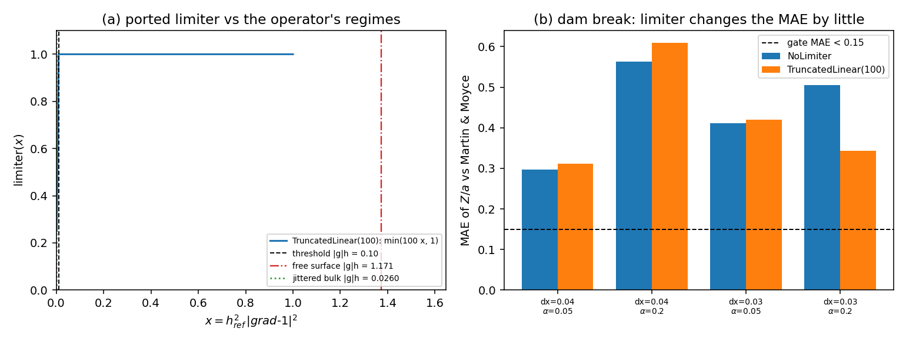

# The `TruncatedLinear` limiter: transcription and measured effect

Anchor: `XVAL-SPH-TRANSPORT-VELOCITY-CORRECTION`. Generated by
`benchmarks/xval_sphinx_tvc/limiter_leg.py` -> `benchmarks/xval_sphinx_tvc/make_limiter_doc.py` from
`data/limiter_leg.json` (wall clock 58.9 s, torch 2.7.1, loongarch64).

## 1. The gap this leg closes

The port shipped upstream's operator with `NoLimiter` only and recorded
the limiter as *not transcribed*. Upstream ships two limiter objects in
`src/shared/common/common_functors.h`
(sha256 `c6ccd39c037ea86769438b8fd8ed1d32e6609b78e942f6b2c3aee1ab3c8759e6`, verbatim copy in
`oss_source/common_functors.h`): `NoLimiter` (factor 1) and
`TruncatedLinear`, whose `operator()` is
`SMIN(slope_ * dimensionless_measure, 1)` with `slope = 100` by default
(`SMIN(a, b) = (a <= b ? a : b)`). The argument passed by `update()` is
`h_ref^2 |inconsistency|^2`, so the limiter is `min(100 x, 1)`,
`x = h_ref^2 |grad-1|^2`.

Which alias is which matters: `TransportVelocityCorrectionComplex` (the
alias of *most* examples) uses `NoLimiter`, but the three
`TransportVelocityLimitedCorrection*Complex` aliases use
`TruncatedLinear`:
* `TransportVelocityLimitedCorrectionCorrectedComplex`
* `TransportVelocityLimitedCorrectionComplex`
* `TransportVelocityLimitedCorrectionCorrectedForOpenBoundaryFlowComplex`

instantiated by `test_2d_lid_driven_cavity_corrected`, `test_2d_lid_driven_cavity_non_newtonian`, `test_2d_throat`.

Note on a claim retired here: the earlier port docstring said upstream
also has `ModifiedTruncatedLinear`. It does not, in this revision -- the
fetched `common_functors.h` defines exactly the two objects above. That
sentence came from memory and is corrected against the source.

## 2. How it was done

| step | what |
|---|---|
| transcription | `tensorsph.transport_velocity_correction.truncated_linear(slope=100.0)`, `min(slope*x, 1)`, wired into the operator as `limiter=` |
| unit pinning | `tests/test_transport_velocity_correction.py`: value table against `SMIN(100x, 1)`, threshold `x = 1/slope`, slope argument, invalid slopes, bit-exact displacement law `dr = alpha h^2 limiter g` |
| solver wiring | `DamBreakConfig.tvc_limiter` (`None`/`"none"` = `NoLimiter`, `"truncated_linear"`), `tvc_limiter_slope` |
| operator-level measurement | `|g|h_ref` and the limiter on three particle sets: plane free surface, regular bulk, bulk + 2 % dx jitter |
| physics measurement | Martin & Moyce dam break, `dx = 0.04, 0.03` m, `t = 0.45 s`, alpha in {0.05, 0.20} x {NoLimiter, TruncatedLinear}, scored with the same `score()` as the other legs |

Predeclared before the runs (in the payload, `hypotheses_predeclared`):
* **H1_operator** — TruncatedLinear(100) only acts where |g| h_ref < 0.1, so it damps nearly-regular bulk corrections (|g| h_ref ~ 1e-2) but leaves the free-surface displacement (|g| h_ref ~ 1.17) bit-identical to NoLimiter.
* **H2_physics** — On the free-surface dominated dam break the limiter changes the Martin & Moyce MAE by less than 0.02 in Z/a (13 % of the 0.15 gate) at both resolutions and flips no gate verdict, i.e. the missing limiter does not explain the residual error of the NoLimiter runs.
* **H3_scope** — If H2 holds it is because the correction is surface-driven: the share of particles with limiter < 1 in a dam-break state stays below 50 % while their contribution to the maximum displacement is ~0.

## 3. Results — operator level

| regime | particles | `|g| h_ref` | limiter(mean) | limiter(max) | `|dr|` ratio TL/NoLimiter |
|---|---|---|---|---|---|
| plane free surface (top row) | 52 | 1.171 | 1 | 1 | 1 (bit-identical) |
| regular bulk (square interior) | 361 | 2.40e-15 | 0.000 | 0.000 | — (`|g|` = 0 to round-off for both) |
| bulk + 2 % dx jitter | 361 | 0.0260 | 0.0598 (p50) | 0.3557 (p99) | 0.0598 (p50) |

Analytic continuum scale for the free surface: `2 I(h,0) = 30/(7 pi) = 1.364`; the production lattice `h/dx = 1.3` measures `1.171` (14.2 % below, the plane-truncation bias already documented in `SURFACE_ANCHOR.md`).

Threshold `|g| h_ref = sqrt(1/100) = 0.10`: the free surface is 11.7x above it, the jittered bulk is 3.9x below it.

H1 sub-conditions (all must hold): `free_surface_above_threshold=True`, `free_surface_limiter_is_one=True`, `free_surface_shift_bit_identical=True`, `jittered_bulk_below_threshold=True`, `jittered_bulk_limiter_p50_below_half=True`

**H1** — supported: the limiter is exactly inert wherever the free surface drives the
correction, and attenuates the (small) corrections of a nearly regular
bulk. Per-particle the applied displacement ratio equals the limiter
value elementwise (`shift_ratio_equals_limiter = True`).

## 4. Results — dam break

| dx [m] | variant | MAE | mean rel. | max `|dr|/h` | gate |
|---|---|---|---|---|---|
| 0.04 | `baseline` | 0.591 | 46.7 % | 0.0000 | FAIL |
| 0.04 | `tvc_a005_all` | 0.297 | 16.5 % | 0.0773 | FAIL |
| 0.04 | `tvc_a005_all_tl` | 0.311 | 17.2 % | 0.0773 | FAIL |
| 0.04 | `tvc_a020_all` | 0.563 | 51.3 % | 0.3092 | FAIL |
| 0.04 | `tvc_a020_all_tl` | 0.609 | 52.2 % | 0.3092 | FAIL |
| 0.03 | `baseline` | 0.621 | 51.0 % | 0.0000 | FAIL |
| 0.03 | `tvc_a005_all` | 0.411 | 24.6 % | 0.0773 | FAIL |
| 0.03 | `tvc_a005_all_tl` | 0.420 | 25.2 % | 0.0773 | FAIL |
| 0.03 | `tvc_a020_all` | 0.505 | 38.2 % | 0.3092 | FAIL |
| 0.03 | `tvc_a020_all_tl` | 0.343 | 30.6 % | 0.3092 | FAIL |

### 4a. Paired difference (the only thing this leg claims)

| dx | pair | MAE NoLimiter | MAE TL | ΔMAE | Δ rel. mean | verdict changed |
|---|---|---|---|---|---|---|
| 0.04 | `tvc_a005_all vs tvc_a005_all_tl` | 0.297 | 0.311 | 0.0142 | 0.7 % | False |
| 0.04 | `tvc_a020_all vs tvc_a020_all_tl` | 0.563 | 0.609 | 0.0459 | 1.0 % | False |
| 0.03 | `tvc_a005_all vs tvc_a005_all_tl` | 0.411 | 0.420 | 0.0088 | 0.6 % | False |
| 0.03 | `tvc_a020_all vs tvc_a020_all_tl` | 0.505 | 0.343 | -0.1620 | -7.6 % | False |

Worst |ΔMAE| = 0.1620 against the predeclared tolerance 0.02: **H2 *not* supported**, no gate verdict flips.

Limiter census on the final state of the `_tl` runs (one lattice volume
per particle, `h = 1.3 dx`):

| dx | variant | share of particles with limiter < 1 | share of total shift carried by them | mean shift ratio TL/NoLimiter |
|---|---|---|---|---|
| 0.04 | `tvc_a005_all` | 6.0 % | 0.2 % | 0.998 |
| 0.04 | `tvc_a005_all_tl` | 0.0 % | 0.0 % | 1.000 |
| 0.04 | `tvc_a020_all` | 18.0 % | 4.7 % | 0.986 |
| 0.04 | `tvc_a020_all_tl` | 20.0 % | 5.2 % | 0.988 |
| 0.03 | `tvc_a005_all` | 2.6 % | 0.2 % | 0.999 |
| 0.03 | `tvc_a005_all_tl` | 3.8 % | 0.3 % | 0.998 |
| 0.03 | `tvc_a020_all` | 17.9 % | 3.4 % | 0.991 |
| 0.03 | `tvc_a020_all_tl` | 11.5 % | 2.1 % | 0.993 |

Max fraction anywhere: 20.0 % -> **H3 supported**.

H2 split by coefficient (worst |ΔMAE| over the resolutions): `a005`: 0.0142, `a020`: 0.1620. The predeclared tolerance is 0.02 in `Z/a`.

## 5. What this changes in the other legs

* The dam-break conclusions of `UNCALIBRATED_DEFAULTS.md`, `RESOLUTION_LADDER.md` and `DISTRIBUTION_LADDER.md` stand: on a
  free-surface case the missing limiter is not a source of error, so the
  residual 10–17 % vs Martin & Moyce cannot be blamed on it.
* For the **bulk-scope, well-ordered** runs that upstream's limited
  aliases are actually used for (lid-driven cavity, throat), the port's
  `NoLimiter` default is *not* upstream-equivalent: it applies a
  correction that `TruncatedLinear` attenuates to 6.0 % of its size at the median
  bulk particle. Any upstream comparison of that family must pass
  `tvc_limiter="truncated_linear"`.
* The limiter is a noise floor, not a cap: it never reduces a
  free-surface-scale correction. Code that expects it to bound the
  displacement under strong compression should use `tvc_max_shift` (the
  port's own safety cap), not this limiter.

## 6. Limitations (honest)

* Still no numeric diff against a live SPHinXsys build: the transcription
  is pinned to the source text and to the operator's algebra, not to a
  binary's output (gap 2 of the main report remains open).
* The dam-break evidence covers one case family (Martin & Moyce dry bed)
  at two resolutions; a lid-driven-cavity leg, where the limiter matters
  most, is *not* run here -- the operator-level table plus the census is
  the evidence for that regime, and that is weaker than a case run.
* The census uses one lattice volume per particle instead of the
  summation-density volume, so it is a snapshot diagnostic, not a
  per-step audit.
* `TruncatedLinear` interacts with `LinearGradientCorrection` in the two
  upstream "Corrected" aliases; the kernel-correction factor `C_i` is
  supported by the operator but not exercised in these runs.

## 7. Artifacts

* `src/tensorsph/transport_velocity_correction.py` — `truncated_linear`,
  `TRUNCATED_LINEAR_DEFAULT_SLOPE`
* `src/tensorsph/dam_break.py` — `tvc_limiter`, `tvc_limiter_slope`,
  `tvc_limiter_callable`
* `tests/test_transport_velocity_correction.py` — 9 limiter tests
* `benchmarks/xval_sphinx_tvc/limiter_leg.py`, `make_limiter_doc.py`
* `docs/xval_sphinx_tvc/data/limiter_leg.json`, `docs/xval_sphinx_tvc/oss_source/common_functors.h`
