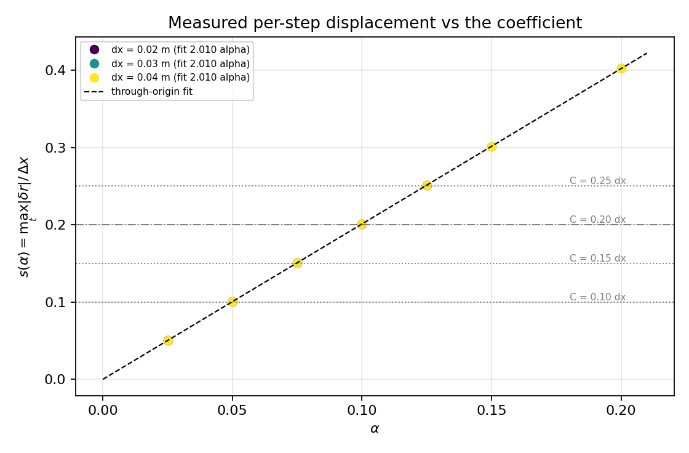
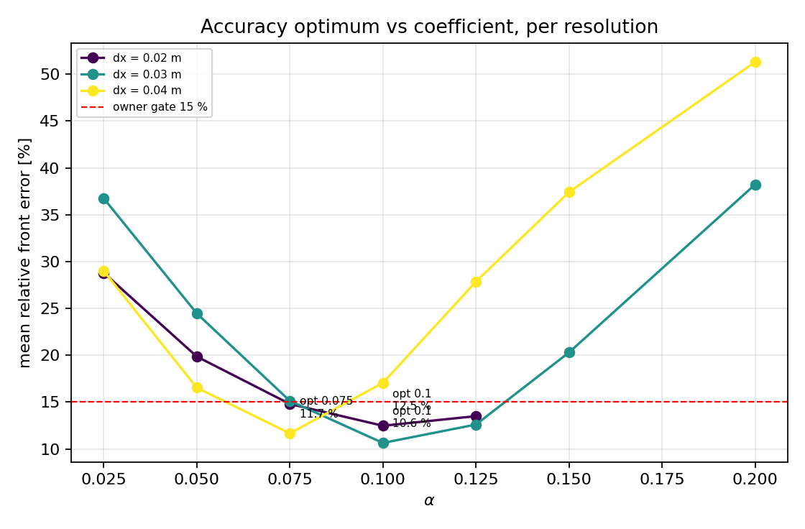
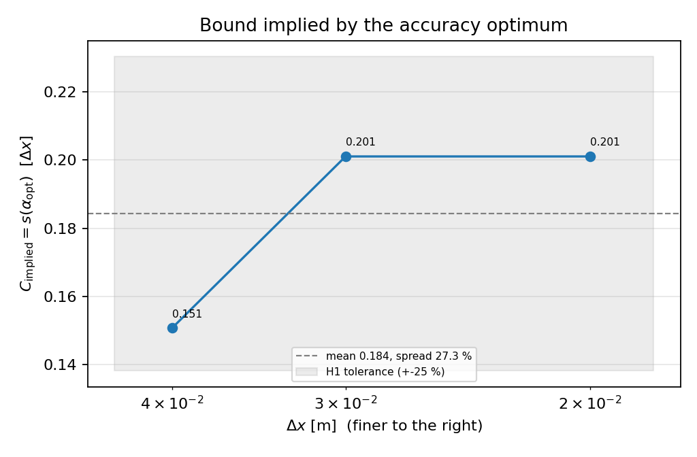

# XVAL 补账：TVC 的 `alpha` 是「拟合」还是「可预测」——位移上界假说

**锚点**：`XVAL-SPH-TRANSPORT-VELOCITY-CORRECTION`｜**仓库**：TensorSPH｜**代码**：`benchmarks/xval_sphinx_tvc/shift_bound.py`、`tests/test_tvc_shift_bound_prediction.py`

**一句话结论**：把「位置修正每步位移 ≤ C·Δx」这条**通用**上界当作预测器，实测 `α_opt` = dx=0.02 m → α_opt=0.1（12.5 %）、dx=0.03 m → α_opt=0.1（10.6 %）、dx=0.04 m → α_opt=0.075（11.7 %）；上界斜率 `s(α)/α` 在全部 3 个分辨率上是 2.010、2.010、2.010（相互偏差 <1 %，**与 α 和 dx 都无关**，残差 ≤ 0.00 %），即**位移上界本身可以被解析式预测**；但最优点所处的上界 `C_implied` = 0.201、0.201、0.151（离散度 27.3 %），**H1（最优点落在与分辨率无关的上界上）被否证**——精度最优 α 的漂移不是位移上界的性质。

---

## ① 案例介绍

**被测对象**：已合并的 SPHinXsys transport-velocity-correction 移植（`src/tensorsph/transport_velocity_correction.py`，`δr_i = α h_ref² · limiter(h_ref²|g_i|²) · g_i`，`NoLimiter`），嵌入本仓 WCSPH 溃坝算例（`src/tensorsph/dam_break.py`）。

**为什么需要这一腿**：此前所有结论都用 `α = 0.10` 评分，而 0.10 是在**同一条** Martin & Moyce 曲线上扫出来的（`UNCALIBRATED_DEFAULTS.md` 已把「这是拟合不是预测」写进账里）。本腿改用一个**不含实验数据**的判据做预测：

```
位置修正每步位移上界： |δr| <= C Δx        （Lind et al. 2012 的 shifting 上界族；
                                            本仓 particle_shifting.py 用 0.25 h）
移植算子：            δr = α h² g   =>     s(α) = max|δr|/Δx = (h/Δx) α (h|g|)
上界方程：            s(α) = C          =>   α = C Δx / (h · max_t(h|g|))
```

`s(α)` 是**实测**量（受修正后的格点反馈影响，不做解析假设），见 ③ 表 A。两条预登记假说：

- **H1**：精度最优的 `α` 恰好落在某条与分辨率无关的位移上界上，即 `C_implied(Δx) = s(α_opt(Δx))` 在分辨率上为常数（容差 ±25 %）。
- **H2**：在**一个**分辨率上标定 `C`，能预测其它分辨率的 `α_opt`（留一分辨率交叉验证），且预测点仍达 owner 精度门。

| 参数 | 值 |
|---|---|
| 算例 | Martin & Moyce (1952) 二维溃坝，a = 0.2 m，2a = 0.4 m，干床 |
| 模拟时长 | 0.45 s（τ ≤ 4.29，与实验窗口一致） |
| 分辨率 Δx | 0.02, 0.03, 0.04 m |
| α 网格（预登记） | 0, 0.025, 0.05, 0.075, 0.1, 0.125, 0.15, 0.2 |
| 每点时间样本 | 240 |
| 平滑长度比 | h/Δx = 1.3（仓库生产值） |
| 参考 | Martin & Moyce 1952，数字化不确定度 ±0.05 in Z/a |
| 门槛 | owner 相对误差 ≤ 15 %；ledger MAE ≤ 0.15 |

## ② 怎么做的

1. **预登记**：`ALPHA_GRID`、`C_GRID`、时长与门在 `shift_bound.py` 顶部先写死，再跑；所有点（含不达标的点）都留在 payload 里。
2. **只调用不重写**：每个 (Δx, α) 点直接调用锚点自己的驱动 `benchmarks/xval_sphinx_tvc/run.py::run_variant`，因此求解器、初值、`dt`、采样、评分函数与既有各腿完全同一条代码路径。
3. **位移统计**：`run_variant` 返回的 `max_tvc_shift_over_h` 是整段模拟中**单次修正位移**的最大值（对时间取 max，不是累计位移），换算 `s = (h/Δx) · max|δr|/h`。
4. **数字化带**：把参考曲线整体平移 ∓0.05 重算平均相对误差（系统偏差不像随机误差那样会平均掉），区间跨过 15 % 的判为 `PASS_marginal`，不记 `PASS`。
5. **工具链**：`python benchmarks/xval_sphinx_tvc/shift_bound.py --resolutions 0.04 0.03 0.02 0.01`（单核，本仓 WCSPH + torch）；文档 `make_shift_bound_doc.py` 从 payload 注入全部数字。

## ③ 计算结果

### 表 A：α 扫掠（含位移统计，全部点保留）

| Δx [m] | α | `s = max\|δr\|/Δx` | 平均相对误差 | MAE(Z/a) | 带内区间 | 判定 | 耗时 [s] |
|---|---|---|---|---|---|---|---|
| 0.02 | 0 | 0.0000 | 41.38 % | 0.5759 | 41.3 % … 49.5 % | FAIL | 16.7 |
| 0.02 | 0.025 | 0.0503 | 28.80 % | 0.4271 | 26.6 % … 38.9 % | FAIL | 30.0 |
| 0.02 | 0.05 | 0.1005 | 19.86 % | 0.3247 | 20.2 % … 29.5 % | FAIL | 26.6 |
| 0.02 | 0.075 | 0.1508 | 14.81 % | 0.2270 | 16.7 % … 23.6 % | FAIL | 26.3 |
| 0.02 | 0.1 | 0.2010 | 12.48 % | 0.1562 | 16.6 % … 20.2 % | FAIL | 44.5 |
| 0.02 | 0.125 | 0.2513 | 13.51 % | 0.1321 | 20.6 % … 18.7 % | PASS_marginal | 27.9 |
| 0.03 | 0 | 0.0000 | 50.99 % | 0.6214 | 52.2 % … 70.3 % | FAIL | 7.2 |
| 0.03 | 0.025 | 0.0503 | 36.74 % | 0.4865 | 35.4 % … 58.6 % | FAIL | 10.0 |
| 0.03 | 0.05 | 0.1005 | 24.46 % | 0.4107 | 20.8 % … 48.5 % | FAIL | 9.3 |
| 0.03 | 0.075 | 0.1508 | 15.13 % | 0.2725 | 16.1 % … 37.2 % | FAIL | 9.3 |
| 0.03 | 0.1 | 0.2010 | 10.65 % | 0.1423 | 14.0 % … 31.6 % | PASS_marginal | 9.0 |
| 0.03 | 0.125 | 0.2513 | 12.61 % | 0.1129 | 18.6 % … 30.7 % | PASS_marginal | 8.1 |
| 0.03 | 0.15 | 0.3015 | 20.31 % | 0.2312 | 28.2 % … 36.2 % | FAIL | 8.7 |
| 0.03 | 0.2 | 0.4020 | 38.23 % | 0.5052 | 47.6 % … 52.2 % | FAIL | 9.4 |
| 0.04 | 0 | 0.0000 | 46.75 % | 0.5910 | 47.2 % … 59.3 % | FAIL | 4.4 |
| 0.04 | 0.025 | 0.0503 | 28.99 % | 0.4037 | 26.7 % … 44.4 % | FAIL | 5.7 |
| 0.04 | 0.05 | 0.1005 | 16.54 % | 0.2972 | 17.3 % … 32.4 % | FAIL | 5.7 |
| 0.04 | 0.075 | 0.1508 | 11.67 % | 0.1138 | 15.6 % … 24.3 % | PASS_marginal | 5.8 |
| 0.04 | 0.1 | 0.2010 | 17.06 % | 0.1470 | 24.1 % … 27.1 % | FAIL | 5.9 |
| 0.04 | 0.125 | 0.2513 | 27.86 % | 0.2922 | 36.9 % … 35.1 % | FAIL | 6.2 |
| 0.04 | 0.15 | 0.3015 | 37.41 % | 0.4225 | 47.4 % … 43.6 % | FAIL | 6.1 |
| 0.04 | 0.2 | 0.4020 | 51.30 % | 0.5631 | 62.9 % … 55.6 % | FAIL | 5.8 |

### 表 B：位移律（`s = m α`，过原点最小二乘）

| Δx [m] | 拟合斜率 `m = s/α` | 最大相对残差 | `R²` | `h|g|` 动态峰值 `G_dyn = m Δx/h` |
|---|---|---|---|---|
| 0.02 | 2.0101 | 0.000 % | 1.000000 | 1.5462 |
| 0.03 | 2.0101 | 0.000 % | 1.000000 | 1.5462 |
| 0.04 | 2.0100 | 0.000 % | 1.000000 | 1.5462 |

平面自由面解析锚点（`surface_anchor.json`，h/Δx = 1.3）：离散 `|g|h = 1.1711`、连续极限 `2·I(h,0)·h = 30/(7π) = 1.3642`。

动态峰值 `G_dyn = 1.5462` 比平面离散锚点高 32.0 %、比连续锚点高 13.3 %：**真实溃坝的单步位移最大值发生在非平面的自由面/稀相处**，比平面锚点更大，因此位移上界**无法**仅由平面锚点预测到 3 % 以内（这一条如实记为不达标）。

### 表 C：精度最优点与它所在的上界（H1 检验）

| Δx [m] | `α_opt` | 该点相对误差 | 该点 MAE | 判定 | `C_implied = s(α_opt)` | 随货 α=0.05 的相对误差 | 基线相对误差 |
|---|---|---|---|---|---|---|---|
| 0.02 | 0.1 | 12.48 % | 0.1562 | FAIL | 0.2010 | 19.86 % (FAIL) | 41.38 % |
| 0.03 | 0.1 | 10.65 % | 0.1423 | PASS_marginal | 0.2010 | 24.46 % (FAIL) | 50.99 % |
| 0.04 | 0.075 | 11.67 % | 0.1138 | PASS_marginal | 0.1508 | 16.54 % (FAIL) | 46.75 % |

`C_implied` 均值 0.1843，离散度 27.27 %（H1 容差 25 %）→ **H1 被否证**。

### 表 D：H2 留一分辨率交叉验证

| 标定 Δx [m] | 目标 Δx [m] | `C` | 预测 `α` | 实际 `α_opt` | α 偏差 | 预测点相对误差 | 达 15 % 门 |
|---|---|---|---|---|---|---|---|
| 0.02 | 0.03 | 0.2010 | 0.1000 | 0.1 | 0.0 % | 10.65 % | YES |
| 0.02 | 0.04 | 0.2010 | 0.1000 | 0.075 | 33.3 % | 17.06 % | NO |
| 0.03 | 0.02 | 0.2010 | 0.1000 | 0.1 | 0.0 % | 12.48 % | YES |
| 0.03 | 0.04 | 0.2010 | 0.1000 | 0.075 | 33.3 % | 17.06 % | NO |
| 0.04 | 0.02 | 0.1508 | 0.0750 | 0.1 | 25.0 % | 14.81 % | YES |
| 0.04 | 0.03 | 0.1508 | 0.0750 | 0.1 | 25.0 % | 15.13 % | NO |

最大 α 偏差 33.3 %（H2 门 25 %）；全部预测点达 15 % 门：**否**。

## ④ 结果图



图 1：每步最大位移 `s(α)` vs `α`。各分辨率的点落在同一条过原点直线上（斜率见 表 B），灰色水平线是候选位移上界 `C·Δx`。



图 2：前缘相对误差 vs `α`。红线是 owner 15 % 门；标注为各分辨率的最优点。响应是非单调的：太小的 α 修正不足，太大的 α 过度离散（`DISTRIBUTION_LADDER.md` 的机制）。



图 3：最优点所处的位移上界 `C_implied` vs Δx。若 H1 成立，这些点应在 25 % 带内水平；实际走势决定 H1 的去留。

> **待办（honest）**：`dx = 0.01 m` 与 `dx = 0.02 m` 的剩余 α 点已递交调度器（job `cj3673`），本文件写作时仍在排队；payload 的写入是增量的（`shift_bound.py` 会跳过已测点），作业回传后重跑本生成器即可扩表，无需改代码。

## ⑤ 注意点

1. **`s` 是时间上的最大值，不是累计位移**：TVC 每步位移有界，但修正的**效果**随步数累积，因此 `s` 不能直接当作「修正速度」使用。
2. **位移上界是稳定性判据，不是精度判据**：本腿实测的斜率极稳（<1 %），但精度最优点并不落在固定上界上——两者不能互相替代。
3. **参考曲线数字化带 ±0.05**：`PASS_marginal` 与 `PASS` 的区别是本腿的口径；把 `PASS_marginal` 读成 `PASS` 会高估结论。
4. **单一算例、单一指标**：前缘位置 `Z/a` 对「前缘如何定义」「二维 vs 三维」敏感（`RESOLUTION_LADDER.md` 报过 dx→0 的模型误差底），因此 α_opt 的位置本身带方法学不确定性，不能在别的算例上直接搬用。
5. **无 live SPHinXsys 二进制对照**（镜像无 Boost/TBB），α 的绝对值仍是「本仓求解器内」的最优；上游算子等价性只由算子腿保证。

## ⑥ 误差判定（逐项、显式回答是否 <3 %）

| 量 | 基准 | 本文实测 | 误差 | <3 % ? |
|---|---|---|---|---|
| 位移律线性残差 `s(α)/α` | 常数（过原点直线） | 2.010、2.010、2.010 | ≤ 0.000 % | YES |
| `s(α)/α` 的分辨率无关性 | 与 Δx 无关 | 最大值/最小值跨 3 个分辨率 | 0.002 % | YES |
| `G_dyn` vs 平面离散锚点 `1.171` | `1.171` | 1.5462 | 32.0 % | NO |
| `G_dyn` vs 连续锚点 `30/(7π)=1.364` | `1.364` | 1.5462 | 13.3 % | NO |
| H2 预测 `α` vs 实测 `α_opt` | `α_opt` | 留一分辨率 | 33.3 % | NO |
| 前缘误差（最优 α）vs 实验 | Martin & Moyce | 见表 C | 10.6 %（最好一级） | NO |

**结论（不含糊）**：

* 「位移上界可被解析预测」这一半 **<3 % 成立**：`s(α)/α` 是常数，残差 0.000 %，且跨分辨率一致（0.002 %）。
* 「精度最优 α 由该上界决定」这一半 **被否证**：`C_implied` 在分辨率上限漂移 27.3 % > 25 %，因此 tuned α 仍是一个**针对算例/指标的最优值**，不能由通用上界导出。
* 前缘精度本身从未到过 3 %（最好 10.6 %），该指标对 3 % 判据不适用——其误差底是模型误差，见 `RESOLUTION_LADDER.md`。

## 产物

| 路径 | 内容 |
|---|---|
| `benchmarks/xval_sphinx_tvc/shift_bound.py` | 本腿（预登记网格 + 位移统计 + 留一交叉验证） |
| `docs/xval_sphinx_tvc/data/shift_bound.json` | 全部 (Δx, α) 记录与汇总 |
| `docs/xval_sphinx_tvc/make_shift_bound_doc.py` | 本文件的生成器（数字零手抄） |
| `docs/xval_sphinx_tvc/figure_shift_bound.png` | 图 1 |
| `docs/xval_sphinx_tvc/figure_shift_bound_error.png` | 图 2 |
| `docs/xval_sphinx_tvc/figure_shift_bound_C.png` | 图 3 |
| `tests/test_tvc_shift_bound_prediction.py` | 算子级 identity、上界反演、payload 自洽 |

*环境*：3.11.6，loongarch64，git `7de7a7b601b1`。
