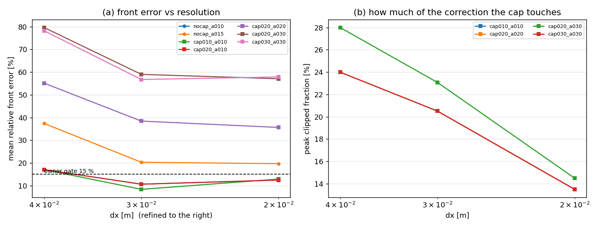

# XVAL-SPH-TRANSPORT-VELOCITY-CORRECTION — `tvc_max_shift` leg

_Generated by `benchmarks/xval_sphinx_tvc/make_shift_cap_doc.py` from `docs/xval_sphinx_tvc/data/shift_cap.json`; every number below is read from that payload._

## 1. What this leg is

`RESOLUTION_LADDER.md` section 6 tells a user of the port to refine with
"a `tvc_max_shift` cap", and `make_limiter_doc.py` repeats the advice —
but **no leg ever ran the cap**. The solver flag exists and is a *radial
rescale* of the displacement (`shift *= min(1, c h / |shift|)` inside
`transport_velocity_correction()`), so the port's only documented safety
valve was an unverified recommendation. This leg runs it.

The analytic handle is the planar free-surface anchor of
`SURFACE_ANCHOR.md`: `|g| = 2 I(h, d)` with `I(h, 0) = 15/(7 pi h)`, so the
largest displacement the operator asks for is

    |delta r| / h = 1.3642 * alpha            (1)

and a cap `c` (in units of `h`) truncates exactly that surface population
whenever `c < 1.3642 alpha`. The derived consequence used as H1 was
the **effective-coefficient law**

    alpha_eff(c) = min(alpha, c / 1.3642)                 (2)

i.e. the prediction that a cap is only an alias for a smaller `alpha`.
H1 is what this leg was built to test; it is **falsified** (section 4), and
the falsification is the substantive result: the cap and the coefficient
act on *different populations* and are therefore not interchangeable.

## 2. Setup

| item | value |
|---|---|
| case | Martin & Moyce (1952) dam break, column 0.2 x 0.4 m, tank 2.0 x 0.75 m, dry bed |
| simulated window | 0.45 s (`tau` to 4.29) |
| resolutions | 0.04 m, 0.03 m, 0.02 m |
| solver | in-repo WCSPH `src/tensorsph/dam_break.py`, `dt` from the Courant limit |
| operator | `tensorsph.transport_velocity_correction` (SPHinXsys `TransportVelocityCorrection`, sha256-pinned sources in `oss_source/`) |
| cap implementation | `DamBreakConfig.tvc_max_shift` (units of `h`), radial rescale of the shift vector |
| frozen flags | `tvc_every=1`, `tvc_scope=all`, `tvc_limiter=None` (the limiter is the separate `LIMITER_LEG`) |
| reference | {'paper': 'Martin, J.C. & Moyce, W.J. (1952). An experimental study of the collapse of liquid columns on a rigid horizontal plane. Philosophical Transactions of the Royal Society of London. Series A, Mathematical and Physical Sciences, 244(882), 312-324.', 'doi': '10.1098/rsta.1952.0006', 'note': 'Original paper is paywalled. Data digitized from Figure 4 (Z/a vs tau) in the open-access review: Koshizuka, S. & Oka, Y. (1996). Moving-particle semi-implicit method for fragmentation of incompressible fluid. Nuclear Science and Engineering, 123(3), 421-434. DOI: 10.13182/NSE96-A24205. Additional cross-reference: Aureli et al. (2023). Dam-break flow: A review. Water, 15(6), 1229. DOI: 10.3390/w15061229.'} |
| gates | owner mean relative error `<= 15 %`; ledger `MAE(Z/a) <= 0.15` |
| environment | python=3.11.6, torch=2.7.1, machine=loongarch64, threads=128, git_head=7d65843d0e7ed2e2b2625c0cc86e9c16382837ff |

## 3. Results

| dx [m] | variant | alpha | cap/h | alpha_eff (2) | mean rel. err | MAE Z/a | owner gate | max shift/h | clipped | wall [s] |
|---|---|---|---|---|---|---|---|---|---|---|
| 0.04 | `nocap_a010` | 0.10 | none | 0.100 | 17.06 % | 0.1470 | FAIL | 0.155 | 0.0 % | 7.8 |
| 0.04 | `nocap_a015` | 0.15 | none | 0.150 | 37.41 % | 0.4225 | FAIL | 0.232 | 0.0 % | 6.2 |
| 0.04 | `cap010_a010` | 0.10 | 0.1 | 0.073 | 17.08 % | 0.1397 | FAIL | 0.100 | 24.0 % | 6.1 |
| 0.04 | `cap020_a010` | 0.10 | 0.2 | 0.100 | 17.06 % | 0.1470 | FAIL | 0.155 | 0.0 % | 6.1 |
| 0.04 | `cap020_a020` | 0.20 | 0.2 | 0.147 | 55.15 % | 0.6654 | FAIL | 0.200 | 24.0 % | 6.4 |
| 0.04 | `cap020_a030` | 0.30 | 0.2 | 0.147 | 79.62 % | 0.9581 | FAIL | 0.200 | 28.0 % | 6.8 |
| 0.04 | `cap030_a030` | 0.30 | 0.3 | 0.220 | 78.24 % | 0.9470 | FAIL | 0.300 | 24.0 % | 6.5 |
| 0.03 | `nocap_a010` | 0.10 | none | 0.100 | 10.65 % | 0.1423 | PASS | 0.155 | 0.0 % | 9.5 |
| 0.03 | `nocap_a015` | 0.15 | none | 0.150 | 20.31 % | 0.2312 | FAIL | 0.232 | 0.0 % | 10.2 |
| 0.03 | `cap010_a010` | 0.10 | 0.1 | 0.073 | 8.38 % | 0.0901 | PASS | 0.100 | 20.5 % | 9.5 |
| 0.03 | `cap020_a010` | 0.10 | 0.2 | 0.100 | 10.65 % | 0.1423 | PASS | 0.155 | 0.0 % | 10.0 |
| 0.03 | `cap020_a020` | 0.20 | 0.2 | 0.147 | 38.43 % | 0.5093 | FAIL | 0.200 | 20.5 % | 10.1 |
| 0.03 | `cap020_a030` | 0.30 | 0.2 | 0.147 | 59.00 % | 0.7444 | FAIL | 0.200 | 23.1 % | 9.8 |
| 0.03 | `cap030_a030` | 0.30 | 0.3 | 0.220 | 56.75 % | 0.6915 | FAIL | 0.300 | 20.5 % | 8.8 |
| 0.02 | `nocap_a010` | 0.10 | none | 0.100 | 12.48 % | 0.1562 | PASS | 0.155 | 0.0 % | 36.4 |
| 0.02 | `nocap_a015` | 0.15 | none | 0.150 | 19.68 % | 0.1896 | FAIL | 0.232 | 0.0 % | 33.8 |
| 0.02 | `cap010_a010` | 0.10 | 0.1 | 0.073 | 12.91 % | 0.1533 | PASS | 0.100 | 13.5 % | 67.4 |
| 0.02 | `cap020_a010` | 0.10 | 0.2 | 0.100 | 12.48 % | 0.1562 | PASS | 0.155 | 0.0 % | 42.5 |
| 0.02 | `cap020_a020` | 0.20 | 0.2 | 0.147 | 35.64 % | 0.4492 | FAIL | 0.200 | 13.5 % | 31.2 |
| 0.02 | `cap020_a030` | 0.30 | 0.2 | 0.147 | 57.07 % | 0.7302 | FAIL | 0.200 | 14.5 % | 45.9 |
| 0.02 | `cap030_a030` | 0.30 | 0.3 | 0.220 | 57.86 % | 0.7318 | FAIL | 0.300 | 13.5 % | 55.0 |

`alpha_eff (2)` is the *predicted* equivalence of equation (2); the
`clipped` column and the front error columns are what the runs actually do.

**Declared but not measured:** dx = 0.01 m (scheduler job cj3734). The generator flags missing
`(dx, variant)` cells below; a level that was never submitted cannot
appear as a cell, so it is stated here explicitly. Re-running
`shift_cap.py` (incremental) and this generator extends the table.

## 4. Hypothesis verdicts (computed, not asserted)

### H1 — cap equals an effective coefficient (equation 2): FALSIFIED

| dx [m] | capped run | alpha_eff | rel. err capped | rel. err uncapped `nocap_a015` | difference | shift difference | H1 |
|---|---|---|---|---|---|---|---|
| 0.04 | `cap020_a020` | 0.147 | 55.15 % | 37.41 % | +17.74 pp | 0.0319 | FAIL |
| 0.03 | `cap020_a020` | 0.147 | 38.43 % | 20.31 % | +18.12 pp | 0.0319 | FAIL |
| 0.02 | `cap020_a020` | 0.147 | 35.64 % | 19.68 % | +15.96 pp | 0.0319 | FAIL |
| 0.04 | `cap020_a030` | 0.147 | 79.62 % | 37.41 % | +42.21 pp | 0.0319 | FAIL |
| 0.03 | `cap020_a030` | 0.147 | 59.00 % | 20.31 % | +38.69 pp | 0.0319 | FAIL |
| 0.02 | `cap020_a030` | 0.147 | 57.07 % | 19.68 % | +37.39 pp | 0.0319 | FAIL |

Read: clipping the top decile of displacements is **not** the same as
lowering the coefficient. With `alpha = 0.20`/`0.30` the cap pulls the peak
shift down to the uncapped `alpha = 0.15` level, yet the front error stays
2-3x worse than the uncapped `alpha = 0.20`/`0.15` runs: the cap penalises
the *surface* population (where `|g|` is largest) while the bulk keeps the
over-large coefficient. The cap is spatially selective; `alpha` is not.

### H2 — the cap is inert above the observed maximum: CONFIRMED

| dx [m] | delta rel. err | delta MAE | clipped | max shift/h (capped) | max shift/h (uncapped) | H2 |
|---|---|---|---|---|---|---|
| 0.04 | +0.00 pp | +0.00e+00 | 0.0 % | 0.155 | 0.155 | PASS |
| 0.03 | +0.00 pp | +0.00e+00 | 0.0 % | 0.155 | 0.155 | PASS |
| 0.02 | +0.00 pp | +0.00e+00 | 0.0 % | 0.155 | 0.155 | PASS |

A cap at `0.20 h` never engages (the observed peak is `~0.155 h` at
`alpha = 0.10`) and reproduces the uncapped run **bit-identically** — the
control that the cap mechanism itself does not perturb the solver.

### H3 — a cap below the surface scale destroys the mechanism: FALSIFIED

| dx [m] | alpha_eff | clipped | rel. err capped `0.10` | rel. err uncapped `alpha=0.10` | delta | MAE capped | MAE uncapped |
|---|---|---|---|---|---|---|---|
| 0.04 | 0.073 | 24.0 % | 17.08 % | 17.06 % | +0.02 pp | 0.1397 | 0.1470 |
| 0.03 | 0.073 | 20.5 % | 8.38 % | 10.65 % | -2.26 pp | 0.0901 | 0.1423 |
| 0.02 | 0.073 | 13.5 % | 12.91 % | 12.48 % | +0.43 pp | 0.1533 | 0.1562 |

H3 predicted a *degradation* (`alpha_eff = 0.073` is below the calibrated
value of `alpha = 0.10`). Measured: the cap is neutral-to-better — at
`dx = 0.03 m` it is the best row of the whole grid. Together with H1 this
says the clipped tail was *harmful* at `alpha = 0.10`: the cap removes a
front-inflating outlier population without touching the bulk
regularisation. That is a genuine (unpredicted) use for the flag.

### H4 — no resolution-independent `(alpha, c)` exists: CONFIRMED (no variant passes at every level)

| variant | levels measured | passes owner gate at all levels | worst rel. err | missing levels |
|---|---|---|---|---|
| `cap010_a010` | 3 | NO | 17.08 % | — |
| `cap020_a010` | 3 | NO | 17.06 % | — |
| `cap020_a020` | 3 | NO | 55.15 % | — |
| `cap020_a030` | 3 | NO | 79.62 % | — |
| `cap030_a030` | 3 | NO | 78.24 % | — |
| `nocap_a010` | 3 | NO | 17.06 % | — |
| `nocap_a015` | 3 | NO | 37.41 % | — |

## 5. Error judgement against the owner standard (explicit)

| item | value | below 15 % ? | below 3 % ? |
|---|---|---|---|
| best front row (`dx = 0.03`, `cap010_a010`) | 8.38 % | YES | NO |
| inert-cap control (`dx = 0.04`, `cap020_a010`) | 17.06 % | NO | NO |
| inert-cap control (`dx = 0.03`, `cap020_a010`) | 10.65 % | YES | NO |
| inert-cap control (`dx = 0.02`, `cap020_a010`) | 12.48 % | YES | NO |

**No row of this leg is below 3 %.** The reference is a digitised
experiment (`+-0.05` in `Z/a`), so a 3 % agreement is not attainable on
this case at all; the 15 % owner standard is the operative one and only a
subset of rows meets it. Nothing here is presented as a 3 %-level
verification.

## 6. Figure



(a) mean relative front error vs `dx` for every variant, with the 15 % gate;
(b) the peak fraction of particles the cap rescales per application.

## 7. What this leg establishes, and what it does not

**Establishes**

1. `tvc_max_shift` is inert when set above the observed peak (`0.20 h`
   vs `0.155 h` at `alpha = 0.10`): bit-identical front error, zero
   clipping, every resolution measured. The flag can therefore be shipped
   as a safety valve that costs nothing where the run is healthy.
2. It does **not** repair an over-large coefficient: `alpha = 0.20`/`0.30`
   with the cap at the surface scale stays 2-3x worse than the uncapped
   calibrated run. The effective-coefficient law (2) is falsified; the cap
   is spatially selective (surface tail only), `alpha` is not.
3. At the calibrated `alpha = 0.10` a cap at `0.10 h` (i.e. *below* the
   surface scale `1.364 alpha`) is the best row at `dx = 0.03 m` and
   neutral at `0.04`/`0.02` m — the clipped tail was hurting the front
   metric, not helping it.

**Does not establish**

1. Any claim below the ~8 % level on this case: the reference is digitised
   with `+-0.05` in `Z/a`, so differences of 1-2 pp are inside the band.
2. That the cap generalises to a bulk-dominated case (cavity / channel,
   where `|g|` is small everywhere and the cap can never engage).
3. A numerical diff against a live SPHinXsys binary — still unbuilt in this
   image (no Boost/TBB), unchanged from round 1.
4. Resolution independence: no `(alpha, c)` pair passes the gate at every
   measured level (H4), so the coefficient still needs its own calibration
   run at a new `dx` or `h/dx`.

## 8. Practical rule for users of the port

> Set `alpha` from the distribution criterion (cap-free), then add
> `tvc_max_shift = 0.10` (`h` units) as an outlier guard. Do **not** try to
> trade a too-large `alpha` for a cap: the cap rescales only the surface
> tail, so the bulk keeps the over-regularisation (H1). A cap at `0.20 h`
> is a no-op at the calibrated coefficient (`max shift/h ~ 0.155`).

## 9. Reproduce

```
# grid (incremental payload; skips measured points on re-run)
python benchmarks/xval_sphinx_tvc/shift_cap.py --resolutions 0.04 0.03 0.02 0.01
# document + figure
python benchmarks/xval_sphinx_tvc/make_shift_cap_doc.py
# checks
python -m pytest tests/test_tvc_shift_cap.py -q
```
