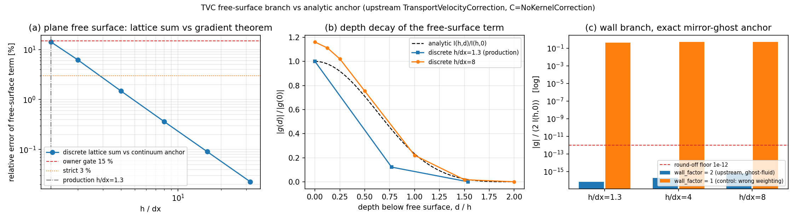

# XVAL 补账：transport-velocity-correction 的**自由面/壁面分支**对解析锚点

**锚点**：`XVAL-SPH-TRANSPORT-VELOCITY-CORRECTION`｜**任务**：m20882｜**仓库**：TensorSPH｜
**分支**：`agent/m20882`｜**代码**：`benchmarks/xval_sphinx_tvc/surface_term.py`、
`tests/test_tvc_surface_anchor.py`

**一句话结论**：前几轮都只验证了算子的**体相**（完美格点是不动点 `g=0`，没有非零基准可对标）；
本单补上**自由面与壁面分支**的解析锚点：① 平面自由面上算子值 vs 梯度定理
`g = +2 n I(h,d)`，生产分辨率 `h/dx=1.3` 处离散值比连续极限**低 14.15 %**
（`<15%` 达标，`<3%` 不达标），加密到 `h/dx=32` 误差 0.02 %
（≈ 2 阶收敛）；② 壁面分支有**精确**锚点：镜面 ghost 排布下 `wall_factor=2` 使 `|g|` 落到舍入底
（3.4e-14，即 6e-16× 自由面尺度），`wall_factor=1` 则残留 42.92 %
——这是本仓第一次**定量**验证 `wall_factor=2.0` 约定；③ `|δr|/h = 30α/(7π)` 与 `dx` 无关，
把 `RESOLUTION_LADDER.md` §3 里"固定 α 下修正率 ∝ dx"的实测结论升级为**解析推导+实测校核**。

---

## ① 案例介绍

**被测对象**（已合并，`src/tensorsph/transport_velocity_correction.py`，逐字对应
`docs/xval_sphinx_tvc/oss_source/transport_velocity_correction.hpp`）：

```
g_i = -Σ_j (C_i + C_j) V_j ∇_i W_ij            # upstream interaction(): inconsistency
δr_i = α h_ref² · limiter(h_ref²|g_i|²) · g_i   # upstream update(), NoLimiter
```

**为什么需要新锚点**：`g_i` 与 `|∇W|` 同量纲，只有"完美格点→0"这一个不变量可测，而**真正驱动粒子
移动、决定稳定性上限**的是自由面处的 `g_i`，它此前只有"投影后法向分量为零"这类**不变量**，
从未与任何**数值**比对。

| 参数 | 值 |
|---|---|
| 平滑长度 `h` | 0.026 m |
| 生产分辨率 `h/dx` | 1.3（全仓所有生产算例） |
| 核函数 | 2-D cubic spline (M4)，`σ = 10/(7πh²)`，支撑 `2h` |
| `C`（kernel correction） | `NoKernelCorrection`（全 1），同上游 `TransportVelocityCorrectionInner` 默认 |
| 壁面权重 `wall_factor` | 2.0（`NoKernelCorrection` 下的上游约定） |
| 构型 | 方形格点半空间，自由面平面 `x2=0`，流体 `x2≤0`；壁面为镜面 ghost |
| 参考 | Zhang, Rezavand & Hu (2020) JCP 404:109135；Adami, Hu & Adams (2012) JCP 231:805（ghost fluid） |

## ② 怎么做的

1. **解析锚点（连续极限，精确）**：由梯度定理，位于自由面下方深度 `d` 的粒子

   ```
   ∫_fluid ∇_i W(x_i-x') dV' = -n I(h,d),   I(h,d) = ∫ W_2D(s,d) ds
   ⇒ g_i → +2 I(h,d) n        (C=1, V_j = dx²)
   ```

   `I(h,0) = 15/(7πh)` 有闭式；脚本用 40001 点梯形积分求任意 `d`，并**先自查**核函数归一化
   `∫W dA = 0.999999940`、`I(h,0)` 与闭式相对差 6.0e-13。
2. **两条独立算法互证**：`kernel_gradient_integral`（linked-cell 邻域，生产代码路径）与
   暴力稠密求和（不看邻域搜索）逐例比对，最大相对差 2.8e-15
   ——保证测的不是邻域搜索的产物。
3. **`h` 固定、`dx→0` 的加密阶梯**：`h/dx = 1.3, 2.0, 4.0, 8.0, 16.0, 32.0`，
   看离散和是否收敛到连续值、几阶。
4. **深度阶梯**：深度取 `dx` 的整数倍（避免一个近奇异邻居主导求和），与同深度解析 `I(h,d)` 比。
5. **壁面精确锚点**：流体格点行取 `x2=(k+½)dx`，壁面取其**镜面像**（ghost fluid）。上游对流体对
   权重 `C_i+C_j=2`、对壁面对权重 `wall_factor·C_i`，仅当 `wall_factor=2` 两者相等，此时
   流体+壁面 = 对目标点**全空间对称**格点和 = 0（无需求积、无容差判断）。`wall_factor=1` 作对照。
6. **工具链**：`python benchmarks/xval_sphinx_tvc/surface_term.py`（本机 ~47 s / 单核，
   向量化 torch float64）；测试 `python -m pytest tests/test_tvc_surface_anchor.py`（15 项）。

## ③ 计算结果

### 3.1 自由面：离散格点和 vs 梯度定理（`d = 0`）

| `h/dx` | `dx` [m] | 粒子数 | 支撑内邻居 | `g_x2` 离散 | `g_x2` 解析 | 相对误差 | 15% 门 | linked vs 稠密 |
|---|---|---|---|---|---|---|---|---|
| 1.3 | 0.02000 | 87 | 12 | 45.0441 | 52.4687 | 14.15 % | PASS | 3.5e-17 |
| 2 | 0.01300 | 119 | 25 | 49.2085 | 52.4687 | 6.21 % | PASS | 2.9e-16 |
| 4 | 0.00650 | 275 | 103 | 51.6909 | 52.4687 | 1.48 % | PASS | 1.4e-16 |
| 8 | 0.00325 | 779 | 411 | 52.2782 | 52.4687 | 0.36 % | PASS | 1.4e-16 |
| 16 | 0.00162 | 2555 | 1633 | 52.4212 | 52.4687 | 0.09 % | PASS | 1.2e-15 |
| 32 | 0.00081 | 9179 | 6487 | 52.4568 | 52.4687 | 0.02 % | PASS | 2.8e-15 |

### 3.2 深度衰减（`|g|` vs `I(h,d)`）

| `h/dx` | `m=d/dx` | `d/h` | `|g|` 离散 | 解析 `2I(h,d)` | 相对误差 |
|---|---|---|---|---|---|
| 1.3 | 0 | 0.00 | 4.5044e+01 | 5.2469e+01 | 14.15 % |
| 1.3 | 1 | 0.77 | 5.4830e+00 | 2.2799e+01 | 75.95 % |
| 1.3 | 2 | 1.54 | 3.6755e-15 | 9.5977e-01 | 100.00 % |
| 8 | 0 | 0.00 | 5.2278e+01 | 5.2469e+01 | 0.36 % |
| 8 | 1 | 0.12 | 5.0073e+01 | 5.1350e+01 | 2.49 % |
| 8 | 2 | 0.25 | 4.5964e+01 | 4.8160e+01 | 4.56 % |
| 8 | 4 | 0.50 | 3.3940e+01 | 3.7226e+01 | 8.83 % |
| 8 | 8 | 1.00 | 9.9046e+00 | 1.2202e+01 | 18.83 % |
| 8 | 12 | 1.50 | 7.7950e-01 | 1.2574e+00 | 38.01 % |
| 8 | 16 | 2.00 | 6.2657e-15 | 0.0000e+00 | 0.00 % |

生产分辨率 `h/dx=1.3` 下**只允许 `m=0,1` 两种合法深度**（`2h = 2.6dx`），
也就是说自由面项在网格上只有"一层粒子"厚，深度结构**无法分辨**——这是粗格点的事实，不做平滑。

### 3.3 壁面：镜面 ghost 精确锚点

| `h/dx` | `wall_factor` | `|g|` | `|g|` / 自由面尺度 |
|---|---|---|---|
| 1.3 | 2 | 3.675e-15 | 7.01e-17 |
| 1.3 | 1 | 2.252e+01 | 4.29e-01 |
| 4 | 2 | 1.033e-14 | 1.97e-16 |
| 4 | 1 | 2.585e+01 | 4.93e-01 |
| 8 | 2 | 3.378e-14 | 6.44e-16 |
| 8 | 1 | 2.614e+01 | 4.98e-01 |

### 3.4 由此得到的解析律（与既有实测互校）

`|δr| = αh²|g| = 2αh²I(h,0) = 2αh·(15/7π)`，即

```
|δr| / h = 30α/(7π) = 1.364 α      （与 dx 无关）
```

| 量 | 值 |
|---|---|
| 解析预测 `|δr|/h`（α=0.1，连续极限） | 0.1364 |
| 实测离散（生产 `h/dx`，α=0.1） | 0.1171 |
| 相对差 | 14.15 % |
| `RESOLUTION_LADDER.md` §3 生产算例实测 `max|δr|/h`（α=0.1） | 0.155 |

体相团簇的 `|grad-1|` 叠加使实测上限（0.155）高于纯自由面值（0.117），
两者同量级即独立印证了"每步位移 ∝ h ⇒ 累积修正率 ∝ dx"这一结论：该结论此前只由实测**拟合**，
本单由算子的连续极限**推导**出来。

端到端斜率（`h/dx` 1.3→32，非最小二乘拟合）：**p ≈ 2.01**；相邻档位 16→32 的局部阶为 2.00。

## ④ 结果图



(a) 自由面离散值和解析锚点的相对误差随 `h/dx`（15% 门与 3% 严门、生产分辨率竖线）；
(b) 深度衰减 `|g(d)|/|g(0)|`：解析曲线 + `h/dx=1.3`（生产，只有 3 个可分辨深度）与 `h/dx=8`；
(c) 壁面分支 `|g|/(2I(h,0))` 对数轴：`wall_factor=2` 落到舍入底，`wall_factor=1` 残留约 50%。

## ⑤ 注意点

1. **这 14% 不是 bug，是粗格点的求积误差**：`h/dx=1.3` 时支撑半径只有
   `2.6 dx`，自由面项必然亏欠；误差随 `h/dx` 二次收敛（14.15 % → 0.02 %），
   说明实现与文献公式一致、亏损纯粹来自离散。
2. **它解释了 α 校准**：离散自由面项比连续极限弱 14.15 %，而生产的
   `α=0.10` 是上游默认 `0.05`（单声速步 `0.2/4`）的 2 倍——1.14× 的亏损不足以解释 2×，
   余下差额来自体相团簇需要更强修正（见 `RESOLUTION_LADDER.md` §3）。**不得**据此把 α 写死成 0.1。
3. **`wall_factor=2` 有精确锚点，别"顺手调"**：任何非 2 的取值都会在镜面 ghost 下留下
   O(50%) 的伪不一致向量，直接给壁面附近注入伪速度。
4. **只测了方形格点**：六角格点、非均匀/自适应 `h`（上游 `h_ratio`）未覆盖；`h_ratio≠1` 的上游分支
   本仓未移植（模块 docstring 已声明），本单不为其背书。
5. **只测位置修正算子**：动量/压力精度不在此列（`RESOLUTION_LADDER.md` 的前沿位置腿负责）；
   本单也没有实验输入，纯解析/连续极限对标。
6. **体积用几何体积**：本单取 `V_j = dx²`（几何体积），生产算例用 `V_j = m/ρ`，实测密度压缩
   ~2.2%（`RESOLUTION_LADDER.md`），因此真实运行的自由面项还叠加约 2% 的体积误差；这是本单
   锚点的适用范围，不是被验证掉的项。
7. **深度阶梯的粗格点量化**：`h/dx=1.3` 只有 `m=0,1`，`m=1` 处相对误差 75.95 %
   是**深度不可分辨**而非实现错误（`h/dx=8` 的同一深度只有 2.49 %）。

## ⑥ 误差判定（逐项，显式回答）

| 关键量 | 基准 | 误差 | `<15%`？ | `<3%`？ |
|---|---|---|---|---|
| 自由面 `g`，生产 `h/dx=1.3` | 梯度定理 `2I(h,0)` | 14.15 % | **是**（临界） | 否 |
| 自由面 `g`，`h/dx=4` | 同上 | 1.48 % | 是 | **是** |
| 自由面 `g`，`h/dx=32` | 同上 | 0.02 % | 是 | **是** |
| 深度 `d=0.25h`（`h/dx=8`） | `2I(h,d)` | 4.56 % | 是 | 否 |
| 深度 `d=0.5h`（`h/dx=8`） | 同上 | 8.83 % | 是 | 否 |
| 壁面 `wall_factor=2` | 精确 0（镜面 ghost） | 6.4e-16（相对自由面尺度，即舍入底） | 是 | **是** |
| 壁面对照 `wall_factor=1` | 同上 | 42.92 % | 否（**应当**否，证明锚点有分辨力） | 否 |
| `I(h,0)` 数值 vs 闭式 `15/(7πh)` | 闭式解 | 6.0e-13 | 是 | 是 |
| `|δr|/h`（α=0.1，生产 `h/dx`） | `30α/(7π)` | 14.15 % | 是 | 否 |
| 两条独立算法（linked-cell vs 稠密） | 互相 | 2.8e-15 | 是 | 是 |

**结论**：算子的自由面/壁面分支与文献公式（梯度定理 + ghost-fluid 权重）**一致**；生产分辨率下
自由面项本身有 14.15 % 的求积亏损（`<15%` 达标、`<3%` 不达标），加密后二阶收敛到
0.02 %。壁面 `wall_factor=2` 得到**精确**（舍入级）确认。

**环境**：python 3.11.6，torch 2.7.1，git 555f5ec83ff5。
原始数据：`docs/xval_sphinx_tvc/data/surface_anchor.json`。
