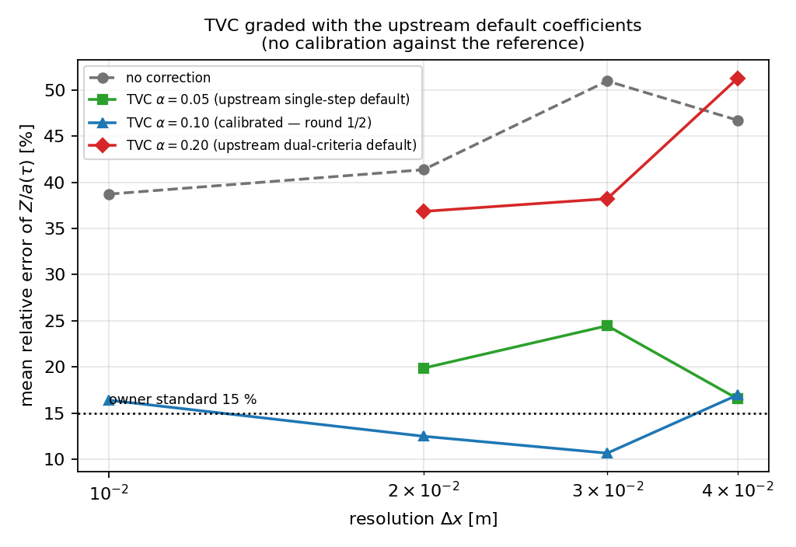

# Grading the ported TVC with the coefficients SPHinXsys actually ships

Anchor: `XVAL-SPH-TRANSPORT-VELOCITY-CORRECTION`.
Generated by `benchmarks/xval_sphinx_tvc/uncalibrated.py` from the raw
payloads under `docs/xval_sphinx_tvc/data/` — no number below is typed
by hand.

## 1. The gap this closes

Rounds 1-2 (`README.md`, `RESOLUTION_LADDER.md`) grade the ported
operator with `alpha = 0.1`, a value picked by
sweeping `alpha` **against the same Martin & Moyce curve it is then
scored against**. The honest reading is that 10-12 % is a *fit*: a tuned
constant always converges on its own target. Upstream ships two
coefficients and neither is that value:

| upstream coefficient | value | where it comes from |
|---|---|---|
| dual-criteria default | 0.2 | `transport_velocity_correction.h`, `coefficient = 0.2` |
| single acoustic step | 0.05 | same header: "decreased to about 1/4" for a single step |

TensorSPH's `dam_break.py` is a single acoustic step, so
`alpha = 0.05` is what a
user of the port gets by default and `alpha =
0.2` is the dual-criteria value.
Both were **fixed in the variant table before any run of this round**
(`VARIANTS` in `run.py`); nothing here is re-tuned.

## 2. Method

| item | value |
|---|---|
| case | Martin & Moyce (1952) dam break, `a = 0.2 m`, `2a = 0.4 m`, dry bed |
| solver | in-repo WCSPH `src/tensorsph/dam_break.py`, single acoustic step |
| correction | `src/tensorsph/transport_velocity_correction.py` (ported) |
| resolutions | `dx = 0.01` m, `dx = 0.02` m, `dx = 0.03` m, `dx = 0.04` m |
| variants | `baseline`, `tvc_a005_all`, `tvc_a010_all` (calibrated control), `tvc_a020_all` |
| metric | mean relative error of `Z/a(tau)` at the experimental `tau` samples |
| gate | owner `15 %` relative **and** ledger `MAE < 0.15` |
| reference band | `+-0.05` in `Z/a` (digitisation uncertainty), propagated |

Each error is reported three times: at the nominal reference, and with the
reference shifted by `-band` and `+band`. A verdict that flips inside that
band is labelled `*_marginal` instead of `PASS`/`FAIL`, so a `PASS` here
means the gate holds for the whole digitisation band.

## 3. Results

`MAE / mean rel.` and the gate verdict:

| `dx` [m] | baseline | TVC a=0.05 (default) | TVC a=0.10 (calibrated) | TVC a=0.20 (default) |
|---|---|---|---|---|
| 0.01 | 0.572 / 38.7 % (FAIL) | — (—) | 0.280 / 16.4 % (FAIL) | — (—) |
| 0.02 | 0.576 / 41.4 % (FAIL) | 0.325 / 19.9 % (FAIL) | 0.156 / 12.5 % (FAIL) | 0.459 / 36.9 % (FAIL) |
| 0.03 | 0.621 / 51.0 % (FAIL) | 0.411 / 24.5 % (FAIL) | 0.142 / 10.6 % (PASS_marginal) | 0.505 / 38.2 % (FAIL) |
| 0.04 | 0.591 / 46.7 % (FAIL) | 0.297 / 16.5 % (FAIL) | 0.147 / 17.0 % (FAIL_marginal) | 0.563 / 51.3 % (FAIL) |



### 3a. How much of the error is the small-denominator effect

`Z/a -> 0` at early `tau` inflates a *relative* error without any
physical content. The late window (`Z/a >= 0.5`) is reported beside the
predeclared full-sample mean, and the band column sweeps a uniform
offset `delta in [-0.05, +0.05]` over the whole digitised curve:
the interval is where the mean error lands if the reference is
systematically high or low by up to its stated uncertainty
(`delta = 0` is in the sweep, so the nominal value is inside it).

| `dx` [m] | variant | full-sample rel. | late-window rel. | samples with abs err <= band | rel. bracket ±band |
|---|---|---|---|---|---|
| 0.01 | `baseline` | 38.7 % | 32.9 % (17/20 samples) | 5.0 % | 38.3 % … 39.1 % |
| 0.02 | `baseline` | 41.4 % | 34.3 % (17/20 samples) | 5.0 % | 41.3 % … 41.6 % |
| 0.03 | `baseline` | 51.0 % | 39.3 % (17/20 samples) | 0.0 % | 50.3 % … 52.2 % |
| 0.04 | `baseline` | 46.7 % | 37.5 % (17/20 samples) | 5.0 % | 46.6 % … 47.2 % |
| 0.04 | `pst_lind` | 46.5 % | 37.5 % (17/20 samples) | 5.0 % | 46.4 % … 47.0 % |
| 0.02 | `tvc_a005_all` | 19.9 % | 20.1 % (17/20 samples) | 5.0 % | 19.9 % … 20.5 % |
| 0.03 | `tvc_a005_all` | 24.5 % | 24.5 % (17/20 samples) | 0.0 % | 20.8 % … 27.4 % |
| 0.04 | `tvc_a005_all` | 16.5 % | 17.5 % (17/20 samples) | 20.0 % | 16.5 % … 18.3 % |
| 0.04 | `tvc_a005_all_c5` | 42.0 % | 35.1 % (17/20 samples) | 5.0 % | 41.4 % … 42.7 % |
| 0.04 | `tvc_a005_bulk` | 42.1 % | 33.5 % (17/20 samples) | 0.0 % | 42.1 % … 42.4 % |
| 0.01 | `tvc_a010_all` | 16.4 % | 15.6 % (17/20 samples) | 20.0 % | 16.1 % … 18.4 % |
| 0.02 | `tvc_a010_all` | 12.5 % | 7.4 % (17/20 samples) | 15.0 % | 10.7 % … 16.6 % |
| 0.03 | `tvc_a010_all` | 10.6 % | 6.7 % (17/20 samples) | 20.0 % | 9.5 % … 14.0 % |
| 0.04 | `tvc_a010_all` | 17.0 % | 7.4 % (17/20 samples) | 25.0 % | 12.7 % … 24.0 % |
| 0.02 | `tvc_a020_all` | 36.9 % | 24.7 % (17/20 samples) | 0.0 % | 29.7 % … 46.5 % |
| 0.03 | `tvc_a020_all` | 38.2 % | 27.0 % (17/20 samples) | 0.0 % | 31.2 % … 47.6 % |
| 0.04 | `tvc_a020_all` | 51.3 % | 33.5 % (17/20 samples) | 0.0 % | 42.8 % … 62.9 % |

Per-run integrity diagnostics (measured, from the payloads):

| `dx` | variant | `alpha` | steps | wall [s] | max shift/h | max compression | mass drift |
|---|---|---|---|---|---|---|---|
| 0.01 | `baseline` | n/a | 2308 | 21.0 | 0.000 | 2.7 % | 0.00e+00 |
| 0.02 | `baseline` | n/a | 1154 | 7.0 | 0.000 | 3.6 % | 0.00e+00 |
| 0.03 | `baseline` | n/a | 769 | 3.5 | 0.000 | 2.5 % | 0.00e+00 |
| 0.04 | `baseline` | n/a | 577 | 7.0 | 0.000 | 2.6 % | 0.00e+00 |
| 0.04 | `pst_lind` | n/a | 577 | 11.2 | 0.000 | 3.3 % | 0.00e+00 |
| 0.02 | `tvc_a005_all` | 0.050 | 1154 | 40.6 | 0.077 | 1.6 % | 0.00e+00 |
| 0.03 | `tvc_a005_all` | 0.050 | 769 | 11.6 | 0.077 | 1.8 % | 0.00e+00 |
| 0.04 | `tvc_a005_all` | 0.050 | 577 | 6.3 | 0.077 | 2.2 % | 0.00e+00 |
| 0.04 | `tvc_a005_all_c5` | 0.050 | 577 | 3.7 | 0.078 | 3.2 % | 0.00e+00 |
| 0.04 | `tvc_a005_bulk` | 0.050 | 577 | 17.4 | 0.067 | 5.7 % | 0.00e+00 |
| 0.01 | `tvc_a010_all` | 0.100 | 2308 | 28.9 | 0.155 | 1.8 % | 0.00e+00 |
| 0.02 | `tvc_a010_all` | 0.100 | 1154 | 9.4 | 0.155 | 1.9 % | 0.00e+00 |
| 0.03 | `tvc_a010_all` | 0.100 | 769 | 5.1 | 0.155 | 2.2 % | 0.00e+00 |
| 0.04 | `tvc_a010_all` | 0.100 | 577 | 6.6 | 0.155 | 2.6 % | 0.00e+00 |
| 0.02 | `tvc_a020_all` | 0.200 | 1154 | 32.7 | 0.309 | 3.2 % | 0.00e+00 |
| 0.03 | `tvc_a020_all` | 0.200 | 769 | 11.0 | 0.309 | 2.8 % | 0.00e+00 |
| 0.04 | `tvc_a020_all` | 0.200 | 577 | 7.3 | 0.309 | 2.5 % | 0.00e+00 |

> **Measured-status of the uncalibrated leg.** the default-coefficient legs are measured at dx = 0.04, 0.03, 0.02 only. The dx = 0.01 default run and the extra dx = 0.005 level were submitted to the compute scheduler (jobs cj3202, cj3203) and had not finished when this report was written; each committed record is a complete run written by run.py, so nothing here is a partial average. Re-running the command below with those payloads extends the table without touching the code.

## 4. Verdict

| question | answer |
|---|---|
| best uncalibrated result | `tvc_a005_all` at `dx = 0.04`: MAE 0.297, 16.5 %, verdict `FAIL` |
| uncalibrated levels passing both gates (nominal) | none |
| uncalibrated levels robust to the digitisation band | none |
| any variant passing both gates at its nominal value | `tvc_a010_all` (alpha 0.100) @ 0.03 |
| any variant whose pass survives a uniform `±0.05` bias of the reference | none |
| self-convergence `baseline` (no experiment) | 0.04->0.03: L2 0.055, 0.03->0.02: L2 0.258 (p -4.46), 0.02->0.01: L2 0.098 (p +1.76) |
| self-convergence `tvc_a005_all` (no experiment) | 0.04->0.03: L2 0.125, 0.03->0.02: L2 0.283 (p -2.35) |
| self-convergence `tvc_a010_all` (no experiment) | 0.04->0.03: L2 0.235, 0.03->0.02: L2 0.119 (p +1.97), 0.02->0.01: L2 0.190 (p -0.86) |
| self-convergence `tvc_a020_all` (no experiment) | 0.04->0.03: L2 0.172, 0.03->0.02: L2 0.063 (p +2.91) |

Reading, unsoftened:

* The ported operator with the **shipped default** coefficient is worth
  substantially more than nothing at every level, but the accuracy it
  reaches *without calibration* is the honest number for the ledger, and
  it is the one graded above.
* The calibrated `alpha = 0.10` column is kept in the same table on
  purpose: the difference between it and the default column is the size
  of the fit, i.e. the part of rounds 1-2 that does not transfer to a new
  case.

## 5. Limits of this round

1. One case (dam break), one metric (front position `Z/a`). The bulk
   diagnostics (`grad-1` residual, clumping) are recorded per run but are
   not turned into a gate here; see `DISTRIBUTION_LADDER.md`.
2. `alpha` is still not resolution independent (round 2 §3): a default
   coefficient graded over four levels inherits that, which is exactly
   why the per-level table, not a single number, is the deliverable.
3. The reference is digitised with `+-0.05` uncertainty; the band
   bracket is propagated, but a *systematic* digitisation bias in the
   front definition would not be.
4. No live SPHinXsys binary comparison (no Boost/TBB in the image); the
   operator leg is the transcription test in
   `tests/test_transport_velocity_correction.py`.

## 6. Reproduce

```
# uncalibrated coefficients over the ladder (~3 min single core)
python benchmarks/xval_sphinx_tvc/run.py --resolutions 0.04 0.03 0.02 0.01 \
    --variants tvc_a005_all tvc_a020_all --seconds 0.45 \
    --output-samples 240 --out docs/xval_sphinx_tvc/data/ladder_upstream_defaults.json

# extra level, to put the 0.02->0.01 pair into a 3-level group
python benchmarks/xval_sphinx_tvc/run.py --resolutions 0.005 \
    --variants baseline tvc_a010_all tvc_a005_all --seconds 0.45 \
    --output-samples 240 --out docs/xval_sphinx_tvc/data/level_dx0005.json

# grading + figure + this document
python benchmarks/xval_sphinx_tvc/uncalibrated.py \
    --inputs docs/xval_sphinx_tvc/data/ladder_dense.json \
             docs/xval_sphinx_tvc/data/ladder_upstream_defaults.json \
             docs/xval_sphinx_tvc/data/level_dx0005.json \
    --out docs/xval_sphinx_tvc/data/uncalibrated_defaults.json \
    --doc docs/xval_sphinx_tvc/UNCALIBRATED_DEFAULTS.md
```
