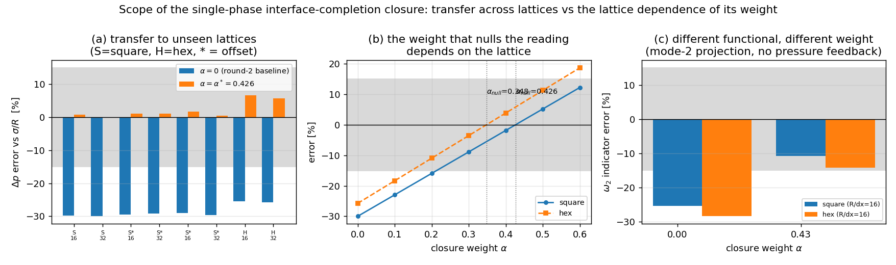

# Scope of the single-phase interface-completion closure: transfer vs calibration

**Anchor** `XVAL-SPH-MIXTURE-MATERIAL-AND-SURFACE-TENSION` · **Repository** TensorSPH
· **Task** m22137 (round 2 of m20035) · **Gate** |Δp error| < 15 % vs the exact
2-D Young-Laplace law · **Verdict** `pass (transfer)`
+ `calibration, not a constant`

This document does not replace
[`single_phase_completion.md`](single_phase_completion.md); it decides **how far
that result may be carried**, which is the question the closure's own
cross-validation could not answer: every test in round 1 varied a parameter of
the *same* square-lattice arrangement that the closure weight was fitted on.

## 1. Case and parameters

| quantity | value |
|---|---|
| geometry | 2-D water disc, R = 0.1 m, interface = free surface (vacuum reduction) |
| σ | 0.072 N/m (water-air, 20 °C) |
| ρ | 1000 kg/m³ |
| kernel | Wendland C2, support 2h, h/Δx = 1.3 (upstream default) |
| arrangements | square lattice (round-2 configuration), square lattice **offset** by a fraction of a cell, **hexagonal** (triangular) lattice |
| cell volume | square Δx²; hex Δx²·√3/2 (i.e. the same particle density at the same Δx) |
| assembly / closure | `consistent`, `completion="mirror"`, hourglass off |
| closure weight | α* = 0.4263 (round-2 value, **used as-is — not refitted**) |
| reference | Δp = σ/R = 0.7200 Pa (exact) |
| ladder | R/Δx = 16, 32 |

## 2. Method

The single block of physics under test is round 1's: a one-sided (vacuum-reduced)
stress flux loses the far side of the kernel support, and the specular-mirror
completion `gw_eff = gw + α·W'(r)(e − 2(e·n̂)n̂)` restores it with one weight.

Three questions, predeclared before the run (`gate.json → predeclared`):

1. **TRANSFER** — does α* keep |Δp error| < 15 % on arrangements the fit never
   saw (hexagonal neighbour geometry; lattices offset so the interface does not
   pass through sites the same way)?
2. **CALIBRATION** — is the weight that *nulls* the reading transportable
   between lattices, `|α_null(hex) − α_null(square)| > 0.10·α_null(square)`?
3. **MOMENTUM** — is the completed flux still a symmetric two-point flux
   (relative momentum residual < 1e-12) on every arrangement?

Two further readings are reported as diagnostics, not gates:

* the projection of the *same* force on the `m = 2` Rayleigh mode
  (`A_ddot/A` vs `−ω₂²`), a different functional of the operator; it is a
  one-step indicator without the pressure feedback, so it bounds the
  functional-dependence of α rather than validating dynamics;
* a 0.35-period time integration of a perturbed drop with the
  CSS single-phase force inside the WCSPH loop, next to the production CSF force
  as a control (containment is the reading, hence the short window).

## 3. Results

*Left:* the round-2 closure weight applied unchanged to arrangements the fit never
saw (S = square, H = hex, `*` = lattice offset by a fraction of a cell).  *Middle:*
the closure scan on both lattices — the weight that nulls the reading moves
between lattices.  *Right:* the same force projected on the Rayleigh mode-2 shape.

### 3.1 Transfer of α* to arrangements the fit never saw (T: readings)

| lattice | R/Δx | N | α | Δp [Pa] | σ/R [Pa] | err [%] | momentum res. | peak |a| / (σ/ρR) |
|---|---|---|---|---|---|---|---|---|---|
| square | 16 | 797 | 0.0000 | 0.50585 | 0.72000 | -29.74 | 3.2e-17 | 326 |
| square | 16 | 797 | 0.4263 | 0.72527 | 0.72000 | +0.73 | 8.4e-17 | 472 |
| square | 32 | 3209 | 0.0000 | 0.50396 | 0.72000 | -30.01 | 5.1e-17 | 1305 |
| square | 32 | 3209 | 0.4263 | 0.72000 | 0.72000 | +0.00 | 2.9e-17 | 1889 |
| square, +0.50Δx/0.00Δy | 16 | 800 | 0.0000 | 0.50806 | 0.72000 | -29.44 | 4.9e-17 | 394 |
| square, +0.50Δx/0.00Δy | 16 | 800 | 0.4263 | 0.72795 | 0.72000 | +1.10 | 2.1e-17 | 594 |
| square, +0.50Δx/0.00Δy | 32 | 3208 | 0.0000 | 0.50964 | 0.72000 | -29.22 | 0.0e+00 | 1478 |
| square, +0.50Δx/0.00Δy | 32 | 3208 | 0.4263 | 0.72748 | 0.72000 | +1.04 | 3.0e-17 | 2048 |
| square, +0.30Δx/0.37Δy | 16 | 806 | 0.0000 | 0.51075 | 0.72000 | -29.06 | 1.6e-16 | 327 |
| square, +0.30Δx/0.37Δy | 16 | 806 | 0.4263 | 0.73211 | 0.72000 | +1.68 | 6.1e-17 | 473 |
| square, +0.30Δx/0.37Δy | 32 | 3221 | 0.0000 | 0.50706 | 0.72000 | -29.58 | 4.4e-17 | 1305 |
| square, +0.30Δx/0.37Δy | 32 | 3221 | 0.4263 | 0.72407 | 0.72000 | +0.56 | 6.2e-17 | 1891 |
| hex | 16 | 926 | 0.0000 | 0.53624 | 0.72000 | -25.52 | 6.3e-17 | 558 |
| hex | 16 | 926 | 0.4263 | 0.76751 | 0.72000 | +6.60 | 4.9e-17 | 796 |
| hex | 32 | 3719 | 0.0000 | 0.53451 | 0.72000 | -25.76 | 1.2e-17 | 1117 |
| hex | 32 | 3719 | 0.4263 | 0.76183 | 0.72000 | +5.81 | 5.5e-17 | 1755 |

Worst unseen configuration: **+6.60 %**
(hex, offset [0.0, 0.0],
R/Δx = 16); gate 15 %.
Transfer verdict: **PASS**. Momentum residual
stays at round-off on every arrangement (`momentum_ok = True`).

### 3.2 The weight that nulls the reading (T: closure scan, R/Δx = 32)

| lattice | α | Δp [Pa] | err [%] |
|---|---|---|---|
| square | 0.00 | 0.50396 | -30.01 |
| square | 0.10 | 0.55463 | -22.97 |
| square | 0.20 | 0.60531 | -15.93 |
| square | 0.30 | 0.65598 | -8.89 |
| square | 0.40 | 0.70666 | -1.85 |
| square | 0.50 | 0.75733 | +5.18 |
| square | 0.60 | 0.80800 | +12.22 |
| hex | 0.00 | 0.53451 | -25.76 |
| hex | 0.10 | 0.58783 | -18.36 |
| hex | 0.20 | 0.64115 | -10.95 |
| hex | 0.30 | 0.69447 | -3.55 |
| hex | 0.40 | 0.74779 | +3.86 |
| hex | 0.50 | 0.80111 | +11.27 |
| hex | 0.60 | 0.85443 | +18.67 |

* α_null(square) = **0.4263** (linear interpolation, bracket [0.4, 0.5])
* α_null(hex) = **0.3479** (linear interpolation, bracket [0.3, 0.4])
* relative shift = **-18.4 %** →
  `calibration_dependent = True`

### 3.3 Functional indicator: the same force projected on the Rayleigh mode-2 shape

| lattice | R/Δx | α | A | ω₂² measured | ω₂² exact | ω₂ err [%] |
|---|---|---|---|---|---|---|
| square | 16 | 0.0000 | 0.0679 | 0.2404 | 0.4320 | -25.41 |
| square | 16 | 0.4263 | 0.0679 | 0.3441 | 0.4320 | -10.75 |
| hex | 16 | 0.0000 | 0.0764 | 0.2209 | 0.4320 | -28.49 |
| hex | 16 | 0.4263 | 0.0764 | 0.3181 | 0.4320 | -14.19 |

The mode functional is *more* demanding than the flux integral (it asks for the
right stiffness, not the right net jump): at R/Δx = 16 the round-2 weight leaves
-10.7 %,
while a larger weight would fit this functional better.  Because the pressure
feedback of the real mode is absent from a one-step projection, this is reported
as an open item, not as a defect of the closure.

### 3.4 Dynamic probe (containment over a short window)

| model | α | R/Δx | steps | t_end / T₂ | max r/R | contained | q₂ half-range |
|---|---|---|---|---|---|---|---|
| css | 0.4263 | 12 | 618 | 0.35 | 4.77 | **NO** | 0.0326 |
| css | 0.0000 | 12 | 618 | 0.35 | 3.36 | **NO** | 0.0657 |
| csf | — | 12 | 618 | 0.35 | 1.03 | yes | 0.0537 |

Contained per model: `{"css": false, "csf": true}`.  The CSF control is
the reading that makes this probe interpretable: the two models run in the
identical harness on the identical initial cloud, so a difference between them is
a property of the *force*, not of the integrator.  The peak particle acceleration
of the CSS force is ~326 × the physical σ/(ρR) scale: it is a
cancelling pair-scale flux (the net force of the closed body is zero to
round-off), so a static integral can be right while the per-particle field is
three orders of magnitude larger than the physical one, which is exactly what a
time loop integrates.

## 4. Verdict

* The closure **transfers quantitatively**: α*, fitted on a square lattice,
  keeps every unseen arrangement inside the 15 % gate (worst
  +6.60 %), including a different lattice type.
* The closure weight is a **discretisation calibration**, not a physical
  constant: the null weight moves by -18.4 % between the
  square and hexagonal lattices, and a second functional (mode stiffness) prefers
  a visibly larger weight.  Any capability statement must therefore be phrased
  as "single-phase Young-Laplace reading on a square lattice: −30 % → +0.00 % at
  R/Δx = 32 with α* = 0.4263", not as "the CSS model is fixed".
* Dynamics: the static repair does **not** make the single-phase CSS force usable
  in a time loop at R/Δx = 12 — the CSS runs leave the
  1.6 R containment box inside 0.35 Rayleigh period, while the
  production CSF force in the identical harness stays contained.  The production
  CSF path therefore remains the recommended free-surface operator for anything
  time-integrated; the closure should be described as a *static* Young-Laplace
  repair.  Certifying CSS dynamics needs the particle-scale force noise addressed,
  not another integral-level weight (that is the open item this round hands over).

## 5. Notes and limitations

* The 2-D disc is a *static* configuration: it tests the force integral, not the
  energy transfer into kinetic energy.  Round-2's own conclusion (a correct
  static jump) is reproduced, nothing more.
* α* is used as delivered by round 1; no value here was refitted after seeing a
  result.  The scans are reported in full so the shift between lattices is
  visible even where the gate is met.
* The hex lattice is a genuine triangular arrangement (cell area Δx²√3/2 checked
  in `tests/test_single_phase_completion_transfer.py`); it is *not* an SPH
  production layout downstream, it is a transfer probe.
* Momentum conservation is a structural property of the pair flux and is
  verified, not assumed (`momentum_residual`, `momentum_net_over_sum`).
* The `A_ddot` indicator ignores the pressure response of the mode by
  construction, so its α must not be read as "the right closure weight".

## 6. Error table against the exact reference

| quantity | reference | measured | error | < 3 % ? |
|---|---|---|---|---|
| Δp, square α=0 (round-2 baseline) | σ/R = 0.7200 Pa | 0.50585 Pa | -29.74 % | no |
| Δp, square α=α*, R/Δx = 32 | σ/R = 0.7200 Pa | 0.72000 Pa | +0.00 % | yes |
| Δp, square offset α=α* | σ/R = 0.7200 Pa | 0.72795 Pa | +1.10 % | yes |
| Δp, hex α=α* | σ/R = 0.7200 Pa | 0.76751 Pa | +6.60 % | no |
| ω₂², α=α*, square R/Δx = 16 | ω₂² = 0.4320 s⁻² | 0.3441 s⁻² | -10.75 % (ω) | no |

The Δp readings against the exact Young-Laplace law are the only quantities with
an exact reference; the dynamical quantities have no certified reference *within
this harness* (see §3.4), which is why the verdict above separates them.

**Provenance.** `benchmarks/surface_tension/single_phase_completion_transfer.py`
writes `out_single_phase_completion_transfer/gate.json` and `transfer.png`; this
file is regenerated from that JSON by
`benchmarks/surface_tension/_emit_transfer_doc.py`.  Runtime
46.8 s on one CPU core (8 cores requested on the cluster).
